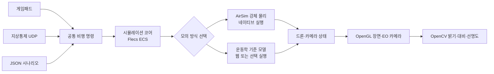

# AeroSimLab

AeroSimLab은 C++20으로 만든 드론 모델링·시뮬레이션 프로그램입니다. 가상 드론의 비행, 탑재 카메라 화면, 지상통제 명령과 여러 드론의 임무를 시험합니다. 실제 드론을 조종하거나 실제 비행 성능을 예측하지는 않습니다.

장기 목표는 여러 드론의 임무·센서·통신 상황을 반복해서 시험하고 결과를 비교하는 M&S 환경입니다. 현재는 가상 X500, 카메라 화면, 지상통제, 게임패드, 고장 시나리오와 화면 없는 공동 임무 실행을 제공합니다. 실기체의 비행 기록과 대조하지 않았으므로 디지털 트윈이나 실비행 훈련 인증 도구로 볼 수 없습니다.

처음 사용하는 분은 [처음 실행하고 조작하기](docs/public/시작하기.md)부터 읽어 주세요.

## 문서

- [사용 안내](docs/public/시작하기.md): 빌드, 실행, 조작, 시나리오 사용법
- [엔진 문제 해결 기록](docs/public/문제해결.md): 실제로 추적한 그래픽·물리·통신 문제와 확인 결과
- [개발 원리와 확인 결과](docs/public/기술검토.md): C++20과 기술 스택을 선택한 이유, 입력부터 화면까지의 흐름, 물리·기체·지형을 확인한 결과
- [프로젝트 목표](GOAL.md)와 [MVP 명세](SPEC.md): 방향, 요구사항, 구현 상태

## 현재 가능한 일

- 가상 드론을 이륙시키고 이동·회전·착륙시킵니다.
- 주변을 보는 화면과 드론에 달린 카메라 화면을 함께 띄웁니다.
- 시뮬레이터 화면에서 비행 상태와 위치, 게임패드·지상통제 연결 여부를 확인합니다.
- 지상통제 프로그램에서 명령을 보내고 응답을 확인하며, 드론을 추가해 편대 상태를 볼 수 있습니다.
- 통신 지연·손실과 카메라 고장 상황을 시나리오로 재현합니다.
- 화면 없는 시나리오에서 여러 드론에 따로 명령하고 마지막 상태와 최소 중심 간 거리를 확인합니다.
- 한 드론이 다른 드론을 따라가고, 위치 공유 연결이 끊겼다가 복구되는 상황도 시험합니다.
- 드론별 역할과 목표 지점을 정해 공동 임무의 완료 여부와 기한을 자동 판정합니다.
- 카메라 화면의 밝기·대비·선명도를 간단히 계산합니다.
- 약 18.8 × 23.7km 북한산 지형을 화면과 강체 충돌에 사용합니다. 건물·시설물은 중심 구역에만 있습니다.
- PX4 공개 X500 형상을 불러오고 화면용 셰이더와 탄소 섬유 무늬 텍스처를 적용합니다. 실제 프레임·모터 CAD는 참고 자료로 포함합니다.

지상통제 창은 0.25초 간격으로 상태를 갱신합니다. 드론 추가 버튼은 최대 8대까지 지원하며, 새 드론은 주 드론 주변 지면에 5m 간격으로 놓입니다. 현재 화면에서는 편대 상태를 확인할 수 있지만, 새로 추가한 드론을 따로 조종하거나 임무를 지정할 수는 없습니다. 자세한 사용법은 [처음 실행하고 조작하기](docs/public/시작하기.md)를 참고하세요.

네이티브 실행의 기본 물리 계산은 AirSim 하나로 처리합니다. AirSim이 로터 힘과 모터 지연, 이동·회전 적분, 충돌 뒤 반응을 계산합니다. 현재 장면은 지형 높이와 회전 상자 사이의 접촉을 계산해 AirSim에 전달합니다. 정밀 메시 충돌은 지원하지 않습니다. `kinematic`을 지정하면 기존 운동학 기준선을 사용할 수 있습니다. WebAssembly에서는 AirSim 대신 이 기준선을 사용합니다. 물리 계수는 공개 자료를 참고했으며 실제 비행으로 검증하지 않았습니다. 게임패드 입력 경로는 있지만 실제 기기별 동작은 확인하지 않았습니다. 카메라 화면은 시뮬레이터 장면에서 만들며, AI 영상 분석은 아직 없습니다.

## 계산과 화면은 이렇게 연결됩니다

화면이 있는 시뮬레이터와 화면 없는 시나리오는 같은 비행 계산을 사용합니다. 입력은 공통 명령으로 바뀐 뒤 60Hz 고정 Tick에 적용됩니다.

| 기술 | 이 프로젝트에서 맡는 일 |
| --- | --- |
| C++20 | 비행·통신·그래픽 기능을 구현하는 언어입니다. 취소 처리, 데이터를 복사 없이 빌려 보는 기능, 안전한 값 변환 등 필요한 표준 기능을 사용합니다. |
| Flecs | 드론 상태 데이터와 Tick마다 실행할 계산을 관리합니다. |
| AirSim | 네이티브 실행에서 로터·모터·강체 이동과 충돌 뒤 반응을 계산합니다. 직접 적분기를 유지하지 않기 위해 사용합니다. |
| GLFW·OpenGL·GLM | 창과 입력을 받고 3D 장면·카메라 화면을 그리며, 위치·방향·행렬 계산에 같은 수학 타입을 씁니다. |
| Dear ImGui | 한 창 안에서 장면·카메라 패널과 비행 상태를 보여 줍니다. |
| OpenCV | EO 화면의 밝기·대비·선명도를 계산합니다. 물체 인식 기능은 아닙니다. |
| CMake·GoogleTest | Windows·Linux·웹 빌드 구성을 관리하고 핵심 동작을 자동 시험합니다. |

자세한 선택 이유와 현재 한계는 [기술 스택 및 구현 원리](docs/public/기술검토.md)에서 확인할 수 있습니다. Visual Studio에서 준비하고 실행하는 순서는 [처음 실행하고 조작하기](docs/public/시작하기.md)에 있습니다.

## 모델과 지도 자료

- 화면의 X500은 PX4 공개 형상을 바탕으로 하며 BSD 3-Clause 조건을 따릅니다. Holybro CAD는 참고 자료로 보관하고, 재배포 조건이 확인되지 않아 실행 파일에는 포함하지 않습니다. [X500 형상과 제조사 CAD 출처](assets/models/source/x500-v2/README.md)
- 북한산 지형에는 NASA SRTM 높이, 중심 구역의 OpenStreetMap 건물, 국립공원 시설물, Copernicus 위성 영상을 사용합니다. 각 자료의 좌표·높이 기준과 이용 조건은 [지도 자료 안내](assets/maps/bukhansan-demo/README.md)에 있습니다.
- 자료마다 출처와 이용 조건이 다릅니다. 프로젝트 전체를 다른 사람에게 배포할 때는 [CAD 안내](assets/cad/x500/README.md)와 지도 자료 안내를 함께 확인하세요.

## 다음 개발 방향

- 실제 비행 기록과 공개 제원을 더 확보해 물리 모델을 대조합니다.
- 지형 자료의 해상도와 건물 높이를 보강해 경사·장애물 판정을 개선합니다.
- 외부 자율비행 알고리즘을 연결하고, 통신 장애와 임무 결과를 반복 측정합니다.

실제 자료와 비교하기 전에는 물리 정확도나 디지털 트윈 수준을 주장하지 않습니다. 구현 상태와 수용 기준은 [MVP 명세](SPEC.md)에서 확인할 수 있습니다.

## 시험과 성능 확인

Windows Release 빌드에서 자동 시험 20개가 통과했습니다. 2026년 10월 23일 측정은 다음과 같습니다. 모든 숫자는 아래에 적은 시험 조건에 한정됩니다.

| 확인 항목 | 조건과 결과 | 해석 범위 |
| --- | --- | --- |
| 화면 프레임 | `aac03875` Release, RTX 3060 Ti, 1280×720 보이는 창에서 5초씩 3회 측정. 중앙값은 414.21FPS, 앱 프레임 p95 3.704ms·p99 3.985ms. 실행별 최댓값 8.584~11.813ms, 16.67ms 초과 없음 | 과거 96~101ms 지연은 이번 시험에서 재현되지 않음. 짧은 측정으로 원인 해결을 입증하지 못했으며, 화면 교체 대기와 입력 지연도 확인하지 않음 |
| EO 픽셀 읽기 추적 | 이전 진단 실행에서 상태 조회 전후 요청 p50은 2.283ms, 0.064ms, 2.282ms였습니다. 각 실행의 앱 프레임 최댓값은 90ms 이상이었습니다. | 과거 진단값이며 현재 Release 기준선과 직접 비교하지 않습니다. 요청 지연과 긴 프레임이 함께 기록됐다는 사실만으로 원인을 확정할 수 없습니다. |
| 운동학 확장 | [현재 전체 측정](benchmarks/results/aerosimlab-full-benchmark-release-2026-10-23-4cb66d99.json), 분리 배치 1,024대에서 Tick p95 중앙값 9.2µs, 30,000 Tick씩 3회 완료 | 처리량 시험 결과이며 GUI 실시간 조종 성능이나 물리 정확도를 뜻하지 않음 |
| AirSim 강체 확장 | 분리 배치 512대에서 Tick p95 중앙값 896.7µs, 30,000 Tick씩 3회 완료. 1,024대는 한 번 실행해 18,000 Tick에서 30초 제한 도달 | 512대 반복 중 90,000 Tick 가운데 16.67ms 초과 프레임 1회. 1,024대 부분 실행은 완료된 반복으로 보지 않음 |
| 0.55m 간격 강체 배치 | 256대에서 Tick p95 중앙값 948.3µs, 30,000 Tick씩 3회 완료 | 배치 간격을 줄인 화면 없는 처리량 측정. 실제 충돌 상황 전체를 대표하지 않음 |
| 강체 충돌 후보 정렬 전후 | 같은 PC에서 3회씩 측정. 분리 512대 물리 단계 p95 중앙값 745.3→677.7µs, 밀집 128대 474.0→411.9µs | 정렬 재사용 변경의 화면 없는 시험 결과입니다. 지형·건물 장애물이 빠진 측정이므로 실제 장면의 충돌 성능을 대표하지 않습니다. [조건과 한계](docs/public/기술검토.md) |
| 메모리 표본 | 한 모의에 드론을 1대씩 추가해 1,024대까지 측정. Private Bytes 증가량의 단순 평균은 운동학 약 388B, AirSim 강체 약 8.2KiB/추가 드론 | 모의별 1회 측정이며 프로세스 전체 메모리 차이로 계산한 추정치. 드론 객체 하나의 정확한 메모리 크기는 아님 |
| 밀집 충돌 처리 | 과거 256대 비교에서 밀집 배치는 접촉 생성 p95 3.6%, Tick p95 3.2% 감소했고 분리 배치는 Tick p95가 5.1% 증가했습니다. [당시 조건과 한계](docs/public/문제해결/다중드론-충돌-성능.md) | 해당 비교는 현재 기준선과 다른 실행이므로 장면별 관찰로만 봐야 합니다. 전반적인 성능 개선을 뜻하지 않습니다. |
| 협동 임무 | 운동학 1,024대·480 Tick 시나리오 중앙 실행 시간 16.96ms, 강체 128대 94.04ms. 각 시나리오를 3회 실행해 지정 임무를 모두 완료했습니다. [측정 조건과 해석](docs/public/기술검토.md#현재-release-확장-측정-4cb66d99) | 시뮬레이터 내부 임무 결과입니다. 실제 통신 장애·편대 충돌 회피·실비행 정확도 검증은 아닙니다. |

측정 조건과 해석은 [기술 검토](docs/public/기술검토.md)에서 확인할 수 있습니다. 대표 측정과 과거 원자료는 [측정 결과 찾아보기](benchmarks/results/README.md)에서 볼 수 있습니다. 화면 지연 원인은 [문제 해결 기록](docs/public/문제해결/화면-프레임-지연.md), 다른 주요 문제는 [문제 해결 목록](docs/public/문제해결.md)에서 확인할 수 있습니다.
