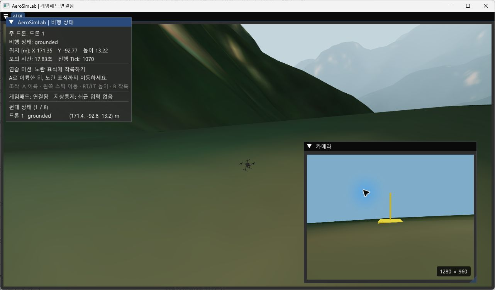

# AeroSimLab

AeroSimLab은 C++20으로 만든 가상 드론의 비행·카메라 화면·지상통제 명령 시험 프로그램입니다. 실제 드론을 조종하거나 실제 비행 성능을 예측하지는 않습니다.

장기 목표는 여러 드론의 임무·센서·통신 상황을 반복해서 시험하고 결과를 비교하는 M&S 환경입니다. 현재는 가상 X500, 카메라 화면, 지상통제, 게임패드, 고장 시나리오와 화면 없는 공동 임무 실행을 제공합니다. 실기체의 비행 기록과 대조하지 않았으므로 디지털 트윈이나 실비행 훈련 인증 도구로 볼 수 없습니다.

처음 사용하는 분은 [처음 실행하고 조작하기](docs/public/시작하기.md)부터 읽어 주세요.

## 문서

- [사용 안내](docs/public/시작하기.md): 빌드, 실행, 조작, 시나리오 사용법
- [엔진 문제 해결 기록](docs/public/문제해결.md): 실제로 추적한 그래픽·물리·통신 문제와 확인 결과
- [개발 원리와 확인 결과](docs/public/기술검토.md): C++20과 기술 스택을 선택한 이유, 입력부터 화면까지의 흐름, 물리·기체·지형을 확인한 결과
- [프로젝트 목표](GOAL.md)와 [MVP 명세](SPEC.md): 방향, 요구사항, 구현 상태

## 현재 가능한 일

- 가상 드론을 이륙시키고 이동·회전·착륙시킵니다.
- 주변을 보는 화면과 드론에 달린 카메라 화면을 함께 띄웁니다.
- 시뮬레이터 화면에서 비행 상태와 위치, 게임패드·지상통제 연결 여부를 확인합니다.
- 지상통제 프로그램에서 명령을 보내고 응답을 확인하며, 드론을 추가해 편대 상태를 볼 수 있습니다.
- 통신 지연·손실과 카메라 고장 상황을 시나리오로 재현합니다.
- 화면 없는 시나리오에서 여러 드론에 따로 명령하고 마지막 상태와 최소 중심 간 거리를 확인합니다.
- 한 드론이 다른 드론을 따라가고, 위치 공유 연결이 끊겼다가 복구되는 상황도 시험합니다.
- 드론별 역할과 목표 지점을 정해 공동 임무의 완료 여부와 기한을 자동 판정합니다.
- 카메라 화면의 밝기·대비·선명도를 간단히 계산합니다.
- 약 18.8 × 23.7km 북한산 지형을 화면과 강체 충돌에 사용합니다. 건물·시설물은 중심 구역에만 있습니다.
- PX4 공개 X500 형상을 불러오고 화면용 셰이더와 탄소 섬유 무늬 텍스처를 적용합니다. 실제 프레임·모터 CAD는 참고 자료로 포함합니다.

지상통제 창은 0.25초 간격으로 상태를 갱신합니다. 드론 추가 버튼은 최대 8대까지 지원하며, 새 드론은 주 드론 주변 지면에 5m 간격으로 놓입니다. 현재 화면에서는 편대 상태를 확인할 수 있지만, 새로 추가한 드론을 따로 조종하거나 임무를 지정할 수는 없습니다. 자세한 사용법은 [처음 실행하고 조작하기](docs/public/시작하기.md)를 참고하세요.

네이티브 실행의 기본 물리 계산은 AirSim 하나로 처리합니다. AirSim이 로터 힘과 모터 지연, 이동·회전 적분, 충돌 뒤 반응을 계산합니다. 현재 장면은 지형 높이와 회전 상자 사이의 접촉을 계산해 AirSim에 전달합니다. 정밀 메시 충돌은 지원하지 않습니다. `kinematic`을 지정하면 기존 운동학 기준선을 사용할 수 있습니다. WebAssembly에서는 AirSim 대신 이 기준선을 사용합니다. 물리 계수는 공개 자료를 참고했으며 실제 비행으로 검증하지 않았습니다. 게임패드 입력 경로는 있지만 실제 기기별 동작은 확인하지 않았습니다. 카메라 화면은 시뮬레이터 장면에서 만들며, AI 영상 분석은 아직 없습니다.

## 다음 개발 방향

- 실제 비행 기록과 공개 제원을 더 확보해 물리 모델을 대조합니다.
- 지형 자료의 해상도와 건물 높이를 보강해 경사·장애물 판정을 개선합니다.
- 외부 자율비행 알고리즘을 연결하고, 통신 장애와 임무 결과를 반복 측정합니다.

실제 자료와 비교하기 전에는 물리 정확도나 디지털 트윈 수준을 주장하지 않습니다. 구현 상태와 수용 기준은 [MVP 명세](SPEC.md)에서 확인할 수 있습니다.

## 시험과 성능 확인

Windows Release 빌드에서 자동 시험 20개가 통과했습니다. 2026년 10월 23일 측정은 다음과 같습니다. 모든 숫자는 아래에 적은 시험 조건에 한정됩니다.

| 확인 항목 | 조건과 결과 | 해석 범위 |
| --- | --- | --- |
| 화면 프레임 | RTX 3060 Ti, 1280×720 보이는 창에서 5초씩 3회 측정. EO PBO 지속 매핑 뒤 앱 프레임 p95 3.663~3.889ms·최댓값 96~101ms. ImGui 백엔드 CPU 호출은 최대 약 91ms, 같은 구간 GPU 시간은 약 0.04ms | 반복 매핑 대기는 줄었지만 긴 CPU 지연은 남음. 원인은 미확정이며 모니터 표시·입력 지연은 확인하지 않음 |
| EO 픽셀 읽기 추적 | 이전 숨김 창 측정에서 상태 조회 제거 전 요청 p50 2.283ms, 제거 후 두 실행은 0.064ms와 2.282ms. 앱 프레임 최댓값은 세 실행 모두 90ms 이상 | 결과 확인과 요청 제출 중 긴 시간이 기록된 위치가 실행마다 달라졌고, 전체 프레임 멈춤은 남음. 해당 측정만으로 GPU 원인이나 실제 표시 지연은 확정하지 못함 |
| 운동학 확장 | 화면 없는 분리 배치 1,024대, Tick p95 중앙값 7.1µs, 30,000 Tick씩 3회 완료 | 처리량 시험 결과이며 GUI 실시간 조종 성능이나 물리 정확도를 뜻하지 않음 |
| AirSim 강체 확장 | 분리 배치 512대에서 Tick p95 중앙값 622.2µs, 30,000 Tick씩 3회 완료 | 같은 PC의 화면 없는 시험. 1,024대 강체는 1회 실행 중 30초 제한에 걸려 완료 결과가 아님 |
| 메모리 표본 | 기존 반복 시험과 별도로 드론을 1대에서 1,024대까지 한 모의에 차례로 추가. Private Bytes 증가량을 추가 드론 수로 나눈 값은 운동학 약 384B, AirSim 강체 약 8.16KiB | 종류별 한 번의 실행에서 얻은 프로세스 전체 메모리의 단순 평균. 실제 드론 메모리 비용으로 단정할 수 없음 |
| 밀집 충돌 처리 | 0.55m 간격 256대에서 접촉 생성 p95 중앙값 607.6µs → 496.3µs, 전체 Tick p95 801.6µs → 648.2µs. 변경 전후 각각 30,000 Tick씩 3회 완료 | 같은 PC와 입력 조건에서 측정했지만 코드 리비전은 다름. 이 장면의 결과이며 다른 배치의 성능을 보장하지 않음 |
| 협동 임무 | 운동학 1,024대와 AirSim 강체 128대까지 모든 기록된 반복에서 목표 완료 | 로컬 시나리오 결과이며 실제 통신 장애·충돌 회피·실비행 정확도 검증은 아님 |

상세 조건과 실행 환경은 [기술 검토](docs/public/기술검토.md)에서 확인할 수 있습니다. [확장 시험과 메모리 표본 원본](benchmarks/results/aerosimlab-full-benchmark-release-2026-10-23-e2510815.json), [이전 반복 시험 원본](benchmarks/results/aerosimlab-full-benchmark-release-2026-10-23-cd8344bc.json), 보이는 창의 [화면 측정 원본](benchmarks/results/aerosimlab-visible-gui-release-2026-10-23.json), [PBO 매핑 변경 전후 기록](benchmarks/results/aerosimlab-visible-pbo-persistent-map-2026-10-23.json), [ImGui CPU·GPU 시간 기록](benchmarks/results/aerosimlab-visible-imgui-gpu-timing-2026-10-23.json)을 보관합니다. 화면 지연 분석은 [EO 픽셀 읽기 기록](docs/public/문제해결/화면-프레임-지연.md), 주요 문제의 목록은 [문제 해결 기록](docs/public/문제해결.md)에서 확인할 수 있습니다.

다중 드론과 공동 임무의 실행 범위, 실패한 규모 시험은 [개발 원리와 확인 결과](docs/public/기술검토.md)에 정리했습니다.
