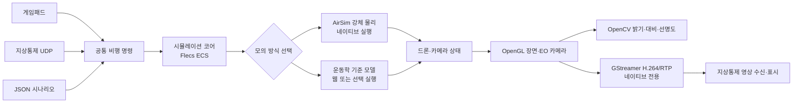

# DroneSim

DroneSim은 사람이 정한 정찰 지점으로 드론을 보내 영상 자료를 확보하고 전달하는 과정을 모의하는 프로젝트입니다. 드론은 사람이 접근하기 어려운 곳을 비행해 EO 영상을 수집합니다. 어디를 살펴볼지와 파손 여부는 사람이 정하고 판단합니다. 영상은 시각·위치·자세 정보와 함께 저장해 지상통제 화면으로 보냅니다. 사진 파일 저장은 아직 구현하지 않았습니다.

현재 시뮬레이터는 탄천교 주변의 30m 지형 격자와 높이 정보가 있는 OSM 건물, 도로·교량 선형을 화면에 표시합니다. 네이티브 강체 물리는 지형을 지면으로, 건물을 외곽 사각형 충돌체로 사용합니다. 카메라 가림은 건물 외곽선 다각형과 높이 범위로 검사합니다. 기본 시험 목표는 시작 위치에 가까운 OSM 건물 외벽입니다. 층수만 있는 건물 높이는 층당 3m로 추정합니다. 이 형상은 실제 시설물이나 사람이 지정한 정찰 지점이 아닙니다. 일부 도로 폭도 추정치이며, 교량 선형은 지면 높이의 위치 표시입니다. 웹 물리에는 지형·건물 충돌이 없습니다.

웹 지상통제에서 OSM 외벽 시험 위치 하나 또는 전체를 골라 정찰 임무를 시작할 수 있습니다. 이 위치는 시험용이며 실제 점검 대상이 아닙니다. 메타데이터에는 선택한 건물·구역 ID와 촬영 시점·카메라 화면 정보를 기록합니다. 이 정보는 시험 목표가 영상에 담겼는지 확인하는 데 쓰며, 시설물 상태나 추가 점검 필요성을 판단하지 않습니다. 네이티브는 EO 영상을 H.264 MP4와 JSONL로 저장합니다. 웹은 임무 전체 영상과 위치별 영상을 WebM으로 저장하고 파일 크기·SHA-256을 기록합니다. Chromium 검사에서 영상과 촬영 기록의 크기·체크섬을 대조했습니다. 같은 검사에서 EO 화면을 페이지 안의 WebRTC로 보내고 받았지만, 다른 기기나 원격 지상통제소로 전달한 것은 아닙니다. 자동 경로는 건물 외곽을 평면에서 피해가도록 만들지만, 지형 높이·교량 구조물까지 고려한 안전 경로는 아닙니다. 사용자가 임의 위치를 입력하는 기능은 아직 구현하지 않았습니다.

처음 사용하는 분은 [처음 실행하고 조작하기](docs/public/시작하기.md)부터 읽어 주세요.

## 문서

- [사용 안내](docs/public/시작하기.md): 빌드, 실행, 조작, 시나리오 사용법
- [엔진 문제 해결 기록](docs/public/문제해결.md): 실제로 추적한 그래픽·물리·통신 문제와 확인 결과
- [개발 원리와 확인 결과](docs/public/기술검토.md): C++20과 기술 스택을 선택한 이유, 입력부터 화면까지의 흐름
- [성능 검증과 측정 결과](docs/public/성능검증.md): 각 성능 측정의 목적, 조건, 결과와 해석 범위
- [프로젝트 목표](GOAL.md)와 [기능 명세](SPEC.md): 방향, 요구사항, 구현 상태

## 현재 시제품에서 확인할 수 있는 기능

- 가상 드론을 이륙시키고 이동·회전·착륙시킵니다.
- 주변을 보는 화면과 드론에 달린 카메라 화면을 함께 띄웁니다.
- 시뮬레이터 화면에서 비행 상태와 위치, 게임패드·지상통제 연결 여부를 확인합니다.
- 웹 화면에서 이륙·정지·착륙을 누르고, 방향 버튼을 누르는 동안 드론을 조종합니다. 웹 지상통제에는 비행 상태·위치·속도·EO 카메라 상태가 표시됩니다.
- 사람이 고른 시험 위치를 차례로 방문해 EO 영상을 확보하는 정찰 임무를 실행할 수 있습니다. 이동과 카메라 방향을 맞추는 동안 멈췄다가 다시 진행할 수 있고, 중단하면 착륙을 요청합니다. 현재 시연은 영상 수집 흐름을 확인하기 위해 목표가 화면에 들어오는 구도를 잠시 유지한 뒤 착륙합니다. 이 동작은 시설물 상태나 점검 필요성을 판단하지 않습니다. 네이티브는 EO 영상을 MP4로, 웹은 임무 전체와 위치별 영상을 WebM으로 저장합니다. 웹 검사에서 파일 내려받기·체크섬 대조와 페이지 안의 WebRTC 영상 수신을 확인했습니다.
- 지상통제 프로그램에서 명령을 보내고 응답을 확인하며, 드론을 추가해 편대 상태를 볼 수 있습니다.
- 네이티브 지상통제 창에서 영상 수집 임무를 시작·일시 정지·재개·중단하고 목표 방문 상태를 확인합니다. 현재 임무 대상은 OSM에서 만든 외벽 시험 위치입니다.
- 통신 지연·손실과 카메라 고장 상황을 시나리오로 재현합니다.
- 화면 없는 시나리오에서 여러 드론에 따로 명령하고 마지막 상태와 최소 중심 간 거리를 확인합니다.
- 한 드론이 다른 드론을 따라가고, 위치 공유 연결이 끊겼다가 복구되는 상황도 시험합니다.
- 직사각형 조사 구역을 드론별로 나눠 왕복 경로를 만들고, 임무 완료 여부와 기한을 판정합니다.
- 통신 단절 뒤 마지막 명령 유지·현재 위치 유지, 낮은 배터리, 예상 충돌을 시나리오에 넣어 임무 재배정과 회피 동작을 시험합니다.
- 결과에서 목표 방문 상태, 경유점 진행률, 완료 시간, 안전거리와 배터리 사용량을 확인합니다. 임무는 비행과 영상 수집을 기록하며, 파손 여부나 추가로 살펴볼 곳은 판단하지 않습니다.
- 카메라 화면의 밝기·대비·선명도를 간단히 계산합니다.
- 네이티브 지상통제 창에서 EO 영상 녹화를 시작·종료합니다. 프레임은 최대 8장까지 대기열에 복사한 뒤 별도 작업자에서 H.264로 인코딩하고 JSONL 정보를 기록합니다. 대기열이 가득 차면 녹화와 영상 수집 임무를 실패 처리하고, 저장 목록에 실패 사유를 남깁니다. 녹화가 끝나면 MP4·JSONL 파일 크기와 프레임 수·CRC-32를 저장 목록에 기록합니다. 저장된 영상·촬영 정보·목록은 시뮬레이터가 지상통제소에 자동 전달하고, GCS는 CRC-32를 대조해 결과를 표시합니다. 연결이 끊기면 자료는 시뮬레이터에 남아 다음 연결 확인 때 다시 전송합니다. GCS는 받은 자료를 `%LOCALAPPDATA%\DroneSim\received`에 저장합니다. 전송에는 TCP 5603 포트를 사용합니다. 자동 시험에서는 송수신과 파일별 CRC 대조를 확인했으며, 두 프로그램 창을 실제로 연결하는 수동 시험은 아직 하지 않았습니다.
- 네이티브 시뮬레이터와 지상통제 프로그램 사이에 EO 영상을 H.264/RTP로 전송하고, 지상통제 창에서 디코딩된 영상을 표시합니다. 송신은 별도 작업자와 두 프레임 대기열을 쓰며, 수신 화면에는 가장 최근 프레임 하나를 보관합니다. Windows Release 환경의 로컬 왕복 시험에서 인코딩·전송·디코딩과 영상 위아래 방향을 확인했습니다. 다른 PC 사이의 전송, 방화벽 설정, 장시간 손실 복구는 아직 확인하지 않았습니다. 이 실시간 전송은 MP4 녹화와 별도 경로입니다.
- 웹 영상 수집 임무는 임무 전체 EO 영상과 위치별 영상을 WebM으로 만듭니다. 임무 전체 영상은 OPFS를 쓸 수 있으면 녹화 조각을 파일 쓰기에 차례로 넘기고, 녹화를 마쳐 파일을 닫은 뒤 크기와 SHA-256을 확인합니다. 구역별 영상과 촬영 기록도 OPFS에 저장하며 지상통제 화면에서 내려받을 수 있습니다. JSON 기록에는 시설물·구역 ID, 촬영 Tick, 드론·카메라 위치와 자세, 시야 시험 결과, 파일 크기와 SHA-256, 예정·촬영·미기록 수를 담습니다. 시야 시험은 촬영 목표가 카메라 프레임에 들어왔는지 확인하는 모의 정보이며 파손 여부를 판정하지 않습니다. OPFS를 쓸 수 없으면 긴 녹화에서 메모리 사용량이 커질 수 있습니다. 실시간 미리보기는 같은 페이지 안의 WebRTC 연결이며, 다른 기기·탭이나 원격 지상통제소 전송은 확인하지 않았습니다.
- 탄천교 주변 지형을 30m 격자로 표시하고, 높이 정보가 있는 OSM 건물을 돌출해 그립니다. 네이티브 충돌은 건물 외곽 사각형으로 단순화합니다.
- PX4 공개 X500 형상을 불러오고 화면용 셰이더와 탄소 섬유 무늬 텍스처를 적용합니다. 실제 프레임·모터 CAD는 참고 자료로 포함합니다.

지상통제 창은 0.25초 간격으로 상태를 갱신합니다. 드론 추가 버튼은 최대 8대까지 지원하며, 새 드론은 주 드론 주변 지면에 5m 간격으로 놓입니다. 편대 목록에서 드론을 고른 뒤 이륙·정지·착륙·경유점 명령을 보낼 수 있습니다. 자동 영상 수집 임무와 카메라·녹화 명령은 아직 주 드론을 대상으로 합니다. 입력 기록 중에는 주 드론만 조종할 수 있습니다. EO 영상 저장은 카메라가 켜져 있을 때 시작할 수 있으며, 녹화 파일은 `%LOCALAPPDATA%\DroneSim\recordings`에 저장됩니다. 자세한 사용법은 [처음 실행하고 조작하기](docs/public/시작하기.md)를 참고하세요.

네이티브 실행에서는 AirSim이 로터 힘, 모터 지연, 기체의 이동·회전과 충돌 뒤 반응을 계산합니다. 현재 지면 충돌에는 탄천 SRTM 격자를, 건물 충돌에는 OSM 건물의 외곽 사각형을 씁니다. 이 사각형은 실제 외곽보다 넓을 수 있고, 층수에서 바꾼 높이는 추정치입니다. 교량 충돌은 아직 연결하지 않았습니다. `kinematic`을 지정하거나 WebAssembly로 실행하면 운동학 기준 모델을 사용합니다. 웹 화면에는 지형과 건물을 그리지만 물리 충돌은 계산하지 않습니다. 물리 계수는 공개 자료를 참고했지만 실비행 기록과 대조하지 않았습니다. Xbox 패드별 조작과 AI 영상 분석은 확인하지 않았습니다.

## 계산과 화면은 이렇게 연결됩니다

화면이 있는 시뮬레이터와 화면 없는 시나리오는 같은 비행 계산을 사용합니다. 입력은 공통 명령으로 바뀐 뒤 60Hz 고정 Tick에 적용됩니다.

| 기술 | 이 프로젝트에서 맡는 일 |
| --- | --- |
| C++20 | 비행·통신·그래픽 기능을 구현합니다. 취소 처리, 메모리를 복사하지 않고 읽기, 안전한 값 변환 등 필요한 표준 기능을 씁니다. |
| Flecs | 드론 상태 데이터와 Tick마다 실행할 계산을 관리합니다. |
| AirSim | 네이티브 실행에서 로터·모터·강체 이동과 충돌 뒤 반응을 계산합니다. 직접 적분기를 유지하지 않기 위해 사용합니다. |
| GLFW·OpenGL·GLM | 창과 입력을 받고 3D 장면·카메라 화면을 그리며, 위치·방향·행렬 계산에 같은 수학 타입을 씁니다. |
| Dear ImGui | 한 창 안에서 장면·카메라 패널과 비행 상태를 보여 줍니다. |
| OpenCV | EO 화면의 밝기·대비·선명도를 계산하고, 네이티브 영상 녹화에서 H.264 MP4를 만듭니다. |
| GStreamer | 네이티브 시뮬레이터와 지상통제 프로그램 사이에서 H.264 영상을 RTP/RTCP로 인코딩·전송·디코딩합니다. |
| CMake·GoogleTest | Windows·Linux·웹 빌드 구성을 관리하고 핵심 동작을 자동 시험합니다. |

자세한 선택 이유와 현재 한계는 [기술 스택 및 구현 원리](docs/public/기술검토.md)에서 확인할 수 있습니다. Visual Studio에서 준비하고 실행하는 순서는 [처음 실행하고 조작하기](docs/public/시작하기.md)에 있습니다.

## 모델과 시험 자료

- 화면의 X500은 PX4 공개 형상을 바탕으로 하며 BSD 3-Clause 조건을 따릅니다. Holybro CAD는 참고 자료로 보관하고, 재배포 조건이 확인되지 않아 실행 파일에는 포함하지 않습니다. [X500 형상과 제조사 CAD 출처](assets/models/source/x500-v2/README.md)
- 화면용 X500과 별도 CAD의 출처·이용 조건은 [X500 안내](assets/models/source/x500-v2/README.md)에서 확인할 수 있습니다.

## 개발 순서

1. 기존 코드·시험·자산의 기준선을 확인하고 새 시설물 점검 목표에 맞춰 정리합니다.
2. 탄천 지형·건물·교량 자료를 확보해 좌표와 높이 기준을 맞춥니다.
3. 사람이 정한 위치까지 비행해 영상 자료를 얻고 저장하는 흐름을 연결합니다.
4. 영상 전송·녹화·저장과 지상통제 화면을 연결합니다.
5. 여러 드론의 구역 분담과 장애 대응을 반복 시험합니다.
6. 네이티브와 웹에서 주요 임무 흐름을 확인하고 차이를 설명합니다.

현재 구현과 목표 기능의 차이는 [기능 명세](SPEC.md), 프로젝트의 전체 방향은 [프로젝트 목표](GOAL.md)에서 확인할 수 있습니다.

## 시험과 성능 확인

Windows Release 빌드에서 자동 시험 22개가 통과했습니다. 별도 성능 측정은 다음 질문에 답하려고 진행했습니다.

| 측정한 이유 | 시험으로 확인한 내용 | 이 시험만으로 판단할 수 없는 내용 |
| --- | --- | --- |
| 장면과 EO 카메라를 켰을 때 화면이 간헐적으로 멈추는지 확인 | 보이는 창에서 앱이 프레임을 처리하는 시간과 긴 프레임의 빈도 | 모니터에 실제로 표시된 시각이나 조종 입력부터 화면까지의 지연 |
| 드론 수가 늘면 비행 계산이 얼마나 무거워지는지 확인 | 화면을 끈 상태에서 운동학·AirSim 강체 계산과 배치별 처리 비용 | 그래픽을 포함한 전체 화면 성능이나 실제 지도에서의 충돌 비용 |
| 충돌 코드 변경이 계산량에 영향을 주는지 확인 | 같은 조건으로 측정한 변경 전후의 물리·충돌 계산 시간 | 모든 장면과 PC에서 같은 폭으로 빨라진다는 보장 |
| 여러 드론의 임무와 메모리 증가가 감당되는지 확인 | 정해진 가상 시나리오의 완료 여부와 프로세스 메모리 변화 | 실제 비행 성공률이나 드론 객체 하나의 정확한 메모리 크기 |
| 긴 프레임이 생기는 경로를 좁히기 | EO 픽셀 읽기와 화면 처리 호출에서 지연이 나타난 위치 | 원인을 확정하거나 대표 화면 성능을 정하는 결과 |

시험 조건과 수치, 결과를 어디까지 해석할 수 있는지는 [성능 검증](docs/public/성능검증.md)에 적었습니다. 실행별 원자료는 [측정 결과 찾아보기](benchmarks/results/README.md)에서 찾을 수 있습니다. 화면 지연의 조사 과정은 [문제 해결 기록](docs/public/문제해결/화면-프레임-지연.md)에 있습니다.
