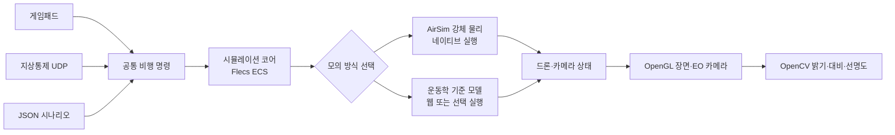

# AeroSimLab

AeroSimLab은 여러 드론이 건물 안을 수색하는 임무와 비행 물리를 시험하는 프로그램입니다. 목표는 카메라로 사람·잔해를 찾아 위치와 종류를 기록하고, 통신이 끊겨도 남은 구역을 이어서 수색하는 상황을 반복 검증하는 것입니다.

현재 화면에는 방과 통로, 잔해 모형, 사람 표식, 카메라가 달린 드론이 나옵니다. 화면에서 실제 영상 인식이나 대상 기록은 아직 하지 않습니다. 여러 드론의 임무·통신 장애 시험은 화면 없는 시나리오에서 할 수 있습니다. 실기체 비행 기록과 대조하지 않았으며, 비행 정확도와 훈련 적합도도 검증하지 않았습니다.

처음 사용하는 분은 [처음 실행하고 조작하기](docs/public/시작하기.md)부터 읽어 주세요.

## 문서

- [사용 안내](docs/public/시작하기.md): 빌드, 실행, 조작, 시나리오 사용법
- [엔진 문제 해결 기록](docs/public/문제해결.md): 실제로 추적한 그래픽·물리·통신 문제와 확인 결과
- [개발 원리와 확인 결과](docs/public/기술검토.md): C++20과 기술 스택을 선택한 이유, 입력부터 화면까지의 흐름
- [성능 검증과 측정 결과](docs/public/성능검증.md): 각 성능 측정의 목적, 조건, 결과와 해석 범위
- [프로젝트 목표](GOAL.md)와 [MVP 명세](SPEC.md): 방향, 요구사항, 구현 상태

## 현재 가능한 일

- 가상 드론을 이륙시키고 이동·회전·착륙시킵니다.
- 주변을 보는 화면과 드론에 달린 카메라 화면을 함께 띄웁니다.
- 시뮬레이터 화면에서 비행 상태와 위치, 게임패드·지상통제 연결 여부를 확인합니다.
- 지상통제 프로그램에서 명령을 보내고 응답을 확인하며, 드론을 추가해 편대 상태를 볼 수 있습니다.
- 통신 지연·손실과 카메라 고장 상황을 시나리오로 재현합니다.
- 화면 없는 시나리오에서 여러 드론에 따로 명령하고 마지막 상태와 최소 중심 간 거리를 확인합니다.
- 한 드론이 다른 드론을 따라가고, 위치 공유 연결이 끊겼다가 복구되는 상황도 시험합니다.
- 직사각형 조사 구역을 드론별로 나눠 왕복 경로를 만들고, 임무 완료 여부와 기한을 판정합니다.
- 통신 단절 뒤 마지막 명령 유지·현재 위치 유지, 낮은 배터리, 예상 충돌을 시나리오에 넣어 임무 재배정과 회피 동작을 시험합니다.
- 결과에서 임무 완료율, 경유점 기준 진행률, 완료 시간, 안전거리와 배터리 사용량을 확인합니다.
- 카메라 화면의 밝기·대비·선명도를 간단히 계산합니다.
- 작은 실내 수색 장면을 화면에 띄우고 방과 통로, 잔해, 사람 표식 사이를 비행합니다. 표식은 화면 확인용이며 카메라 인식 결과가 아닙니다.
- PX4 공개 X500 형상을 불러오고 화면용 셰이더와 탄소 섬유 무늬 텍스처를 적용합니다. 실제 프레임·모터 CAD는 참고 자료로 포함합니다.

지상통제 창은 0.25초 간격으로 상태를 갱신합니다. 드론 추가 버튼은 최대 8대까지 지원하며, 새 드론은 주 드론 주변 지면에 5m 간격으로 놓입니다. 현재 화면에서는 편대 상태를 확인할 수 있지만, 새로 추가한 드론을 따로 조종하거나 임무를 지정할 수는 없습니다. 자세한 사용법은 [처음 실행하고 조작하기](docs/public/시작하기.md)를 참고하세요.

네이티브 실행에서는 AirSim이 로터 힘, 모터 지연, 기체의 이동·회전과 충돌 뒤 반응을 계산합니다. 장면은 지형 높이와 회전 상자 사이의 접촉을 찾아 AirSim에 전달합니다. 충돌에는 정밀 메시를 쓰지 않습니다. `kinematic`을 지정하거나 WebAssembly로 실행하면 운동학 기준 모델을 사용합니다. 물리 계수는 공개 자료를 참고했지만 실비행 기록과 대조하지 않았습니다. Xbox 패드별 조작과 AI 영상 분석은 확인하지 않았습니다.

## 계산과 화면은 이렇게 연결됩니다

화면이 있는 시뮬레이터와 화면 없는 시나리오는 같은 비행 계산을 사용합니다. 입력은 공통 명령으로 바뀐 뒤 60Hz 고정 Tick에 적용됩니다.

| 기술 | 이 프로젝트에서 맡는 일 |
| --- | --- |
| C++20 | 비행·통신·그래픽 기능을 구현합니다. 취소 처리, 메모리를 복사하지 않고 읽기, 안전한 값 변환 등 필요한 표준 기능을 씁니다. |
| Flecs | 드론 상태 데이터와 Tick마다 실행할 계산을 관리합니다. |
| AirSim | 네이티브 실행에서 로터·모터·강체 이동과 충돌 뒤 반응을 계산합니다. 직접 적분기를 유지하지 않기 위해 사용합니다. |
| GLFW·OpenGL·GLM | 창과 입력을 받고 3D 장면·카메라 화면을 그리며, 위치·방향·행렬 계산에 같은 수학 타입을 씁니다. |
| Dear ImGui | 한 창 안에서 장면·카메라 패널과 비행 상태를 보여 줍니다. |
| OpenCV | EO 화면의 밝기·대비·선명도를 계산합니다. |
| CMake·GoogleTest | Windows·Linux·웹 빌드 구성을 관리하고 핵심 동작을 자동 시험합니다. |

자세한 선택 이유와 현재 한계는 [기술 스택 및 구현 원리](docs/public/기술검토.md)에서 확인할 수 있습니다. Visual Studio에서 준비하고 실행하는 순서는 [처음 실행하고 조작하기](docs/public/시작하기.md)에 있습니다.

## 모델과 시험 자료

- 화면의 X500은 PX4 공개 형상을 바탕으로 하며 BSD 3-Clause 조건을 따릅니다. Holybro CAD는 참고 자료로 보관하고, 재배포 조건이 확인되지 않아 실행 파일에는 포함하지 않습니다. [X500 형상과 제조사 CAD 출처](assets/models/source/x500-v2/README.md)
- 화면용 X500과 별도 CAD의 출처·이용 조건은 [X500 안내](assets/models/source/x500-v2/README.md)에서 확인할 수 있습니다.

## 다음 개발 방향

- 실제 비행 기록과 공개 제원을 더 확보해 물리 모델을 대조합니다.
- 실내 구조와 잔해를 모델 자료로 바꾸고, 대상 종류·위치·확인 시각을 결과로 남깁니다.
- 카메라에서 사람과 잔해를 구분하는 영상 인식 기능을 추가하고 시험 자료와 비교합니다.
- 외부 자율비행 알고리즘을 연결하고, 통신 장애와 임무 결과를 반복 측정합니다.

구현 상태와 수용 기준은 [MVP 명세](SPEC.md)에서 확인할 수 있습니다.

## 시험과 성능 확인

Windows Release 빌드에서 자동 시험 20개가 통과했습니다. 별도 성능 측정은 다음 질문에 답하려고 진행했습니다.

| 측정한 이유 | 시험으로 확인한 내용 | 이 시험만으로 판단할 수 없는 내용 |
| --- | --- | --- |
| 장면과 EO 카메라를 켰을 때 화면이 간헐적으로 멈추는지 확인 | 보이는 창에서 앱이 프레임을 처리하는 시간과 긴 프레임의 빈도 | 모니터에 실제로 표시된 시각이나 조종 입력부터 화면까지의 지연 |
| 드론 수가 늘면 비행 계산이 얼마나 무거워지는지 확인 | 화면을 끈 상태에서 운동학·AirSim 강체 계산과 배치별 처리 비용 | 그래픽을 포함한 전체 화면 성능이나 실제 지도에서의 충돌 비용 |
| 충돌 코드 변경이 계산량에 영향을 주는지 확인 | 같은 조건으로 측정한 변경 전후의 물리·충돌 계산 시간 | 모든 장면과 PC에서 같은 폭으로 빨라진다는 보장 |
| 여러 드론의 임무와 메모리 증가가 감당되는지 확인 | 정해진 가상 시나리오의 완료 여부와 프로세스 메모리 변화 | 실제 비행 성공률이나 드론 객체 하나의 정확한 메모리 크기 |
| 긴 프레임이 생기는 경로를 좁히기 | EO 픽셀 읽기와 화면 처리 호출에서 지연이 나타난 위치 | 원인을 확정하거나 대표 화면 성능을 정하는 결과 |

시험 조건과 수치, 결과를 어디까지 해석할 수 있는지는 [성능 검증](docs/public/성능검증.md)에 적었습니다. 실행별 원자료는 [측정 결과 찾아보기](benchmarks/results/README.md)에서 찾을 수 있습니다. 화면 지연의 조사 과정은 [문제 해결 기록](docs/public/문제해결/화면-프레임-지연.md)에 있습니다.
