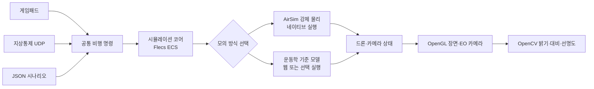

# AeroSimLab

AeroSimLab은 C++20으로 만든 드론 모델링·시뮬레이션 프로그램입니다. 가상 드론의 비행, 탑재 카메라 화면, 지상통제 명령과 여러 드론의 임무를 시험합니다. 실제 드론을 조종하거나 실제 비행 성능을 예측하지는 않습니다.

장기 목표는 여러 드론의 임무·센서·통신 상황을 반복해서 시험하고 결과를 비교하는 M&S 환경입니다. 현재는 가상 X500, 카메라 화면, 지상통제, 게임패드, 고장 시나리오와 화면 없는 공동 임무 실행을 제공합니다. 실기체의 비행 기록과 대조하지 않았으므로 디지털 트윈이나 실비행 훈련 인증 도구로 볼 수 없습니다.

처음 사용하는 분은 [처음 실행하고 조작하기](docs/public/시작하기.md)부터 읽어 주세요.

## 문서

- [사용 안내](docs/public/시작하기.md): 빌드, 실행, 조작, 시나리오 사용법
- [엔진 문제 해결 기록](docs/public/문제해결.md): 실제로 추적한 그래픽·물리·통신 문제와 확인 결과
- [개발 원리와 확인 결과](docs/public/기술검토.md): C++20과 기술 스택을 선택한 이유, 입력부터 화면까지의 흐름
- [성능 검증과 측정 결과](docs/public/성능검증.md): 각 성능 측정의 목적, 조건, 결과와 해석 범위
- [프로젝트 목표](GOAL.md)와 [MVP 명세](SPEC.md): 방향, 요구사항, 구현 상태

## 현재 가능한 일

- 가상 드론을 이륙시키고 이동·회전·착륙시킵니다.
- 주변을 보는 화면과 드론에 달린 카메라 화면을 함께 띄웁니다.
- 시뮬레이터 화면에서 비행 상태와 위치, 게임패드·지상통제 연결 여부를 확인합니다.
- 지상통제 프로그램에서 명령을 보내고 응답을 확인하며, 드론을 추가해 편대 상태를 볼 수 있습니다.
- 통신 지연·손실과 카메라 고장 상황을 시나리오로 재현합니다.
- 화면 없는 시나리오에서 여러 드론에 따로 명령하고 마지막 상태와 최소 중심 간 거리를 확인합니다.
- 한 드론이 다른 드론을 따라가고, 위치 공유 연결이 끊겼다가 복구되는 상황도 시험합니다.
- 드론별 역할과 목표 지점을 정해 공동 임무의 완료 여부와 기한을 자동 판정합니다.
- 카메라 화면의 밝기·대비·선명도를 간단히 계산합니다.
- 약 18.8 × 23.7km 북한산 지형을 화면과 강체 충돌에 사용합니다. 건물·시설물은 중심 구역에만 있습니다.
- PX4 공개 X500 형상을 불러오고 화면용 셰이더와 탄소 섬유 무늬 텍스처를 적용합니다. 실제 프레임·모터 CAD는 참고 자료로 포함합니다.

지상통제 창은 0.25초 간격으로 상태를 갱신합니다. 드론 추가 버튼은 최대 8대까지 지원하며, 새 드론은 주 드론 주변 지면에 5m 간격으로 놓입니다. 현재 화면에서는 편대 상태를 확인할 수 있지만, 새로 추가한 드론을 따로 조종하거나 임무를 지정할 수는 없습니다. 자세한 사용법은 [처음 실행하고 조작하기](docs/public/시작하기.md)를 참고하세요.

네이티브 실행의 기본 물리 계산은 AirSim 하나로 처리합니다. AirSim이 로터 힘과 모터 지연, 이동·회전 적분, 충돌 뒤 반응을 계산합니다. 현재 장면은 지형 높이와 회전 상자 사이의 접촉을 계산해 AirSim에 전달합니다. 정밀 메시 충돌은 지원하지 않습니다. `kinematic`을 지정하면 기존 운동학 기준선을 사용할 수 있습니다. WebAssembly에서는 AirSim 대신 이 기준선을 사용합니다. 물리 계수는 공개 자료를 참고했으며 실제 비행으로 검증하지 않았습니다. 게임패드 입력 경로는 있지만 실제 기기별 동작은 확인하지 않았습니다. 카메라 화면은 시뮬레이터 장면에서 만들며, AI 영상 분석은 아직 없습니다.

## 계산과 화면은 이렇게 연결됩니다

화면이 있는 시뮬레이터와 화면 없는 시나리오는 같은 비행 계산을 사용합니다. 입력은 공통 명령으로 바뀐 뒤 60Hz 고정 Tick에 적용됩니다.

| 기술 | 이 프로젝트에서 맡는 일 |
| --- | --- |
| C++20 | 비행·통신·그래픽 기능을 구현하는 언어입니다. 취소 처리, 데이터를 복사 없이 빌려 보는 기능, 안전한 값 변환 등 필요한 표준 기능을 사용합니다. |
| Flecs | 드론 상태 데이터와 Tick마다 실행할 계산을 관리합니다. |
| AirSim | 네이티브 실행에서 로터·모터·강체 이동과 충돌 뒤 반응을 계산합니다. 직접 적분기를 유지하지 않기 위해 사용합니다. |
| GLFW·OpenGL·GLM | 창과 입력을 받고 3D 장면·카메라 화면을 그리며, 위치·방향·행렬 계산에 같은 수학 타입을 씁니다. |
| Dear ImGui | 한 창 안에서 장면·카메라 패널과 비행 상태를 보여 줍니다. |
| OpenCV | EO 화면의 밝기·대비·선명도를 계산합니다. 물체 인식 기능은 아닙니다. |
| CMake·GoogleTest | Windows·Linux·웹 빌드 구성을 관리하고 핵심 동작을 자동 시험합니다. |

자세한 선택 이유와 현재 한계는 [기술 스택 및 구현 원리](docs/public/기술검토.md)에서 확인할 수 있습니다. Visual Studio에서 준비하고 실행하는 순서는 [처음 실행하고 조작하기](docs/public/시작하기.md)에 있습니다.

## 모델과 지도 자료

- 화면의 X500은 PX4 공개 형상을 바탕으로 하며 BSD 3-Clause 조건을 따릅니다. Holybro CAD는 참고 자료로 보관하고, 재배포 조건이 확인되지 않아 실행 파일에는 포함하지 않습니다. [X500 형상과 제조사 CAD 출처](assets/models/source/x500-v2/README.md)
- 북한산 지형에는 NASA SRTM 높이, 중심 구역의 OpenStreetMap 건물, 국립공원 시설물, Copernicus 위성 영상을 사용합니다. 각 자료의 좌표·높이 기준과 이용 조건은 [지도 자료 안내](assets/maps/bukhansan-demo/README.md)에 있습니다.
- 자료마다 출처와 이용 조건이 다릅니다. 프로젝트 전체를 다른 사람에게 배포할 때는 [CAD 안내](assets/cad/x500/README.md)와 지도 자료 안내를 함께 확인하세요.

## 다음 개발 방향

- 실제 비행 기록과 공개 제원을 더 확보해 물리 모델을 대조합니다.
- 지형 자료의 해상도와 건물 높이를 보강해 경사·장애물 판정을 개선합니다.
- 외부 자율비행 알고리즘을 연결하고, 통신 장애와 임무 결과를 반복 측정합니다.

실제 자료와 비교하기 전에는 물리 정확도나 디지털 트윈 수준을 주장하지 않습니다. 구현 상태와 수용 기준은 [MVP 명세](SPEC.md)에서 확인할 수 있습니다.

## 시험과 성능 확인

Windows Release 빌드에서 자동 시험 20개가 통과했습니다. 아래 측정은 화면 지연, 화면 없는 확장, 충돌 비용, 메모리와 임무 완료 여부를 확인하려고 진행했습니다. 각 시험의 목적과 해석 범위는 [성능 검증](docs/public/성능검증.md), 실행별 원자료는 [측정 결과 찾아보기](benchmarks/results/README.md)에 있습니다.

| 무엇을 확인했나 | 조건과 결과 | 이 결과로 알 수 있는 점 |
| --- | --- | --- |
| 보이는 창 프레임 지연 | `69ecab93` Release, RTX 3060 Ti, 1280×720 보이는 창에서 5초씩 3회 측정. FPS 중앙값 353.28, 앱 프레임 p95 5.041ms·p99 5.513ms. 최댓값 12.254~17.353ms이며 세 실행 중 한 번 16.67ms 초과 | 앱 프레임의 짧은 기준선입니다. 모니터 표시 완료나 입력 지연은 확인하지 않았습니다. |
| EO 픽셀 읽기 지연 원인 조사 | 과거 진단 실행에서 각 실행의 앱 프레임 최댓값이 90ms 이상이었고, 픽셀 요청 경로를 여러 OpenGL 호출로 나눠 기록했습니다. | 원인 후보를 좁힌 자료입니다. 긴 프레임과 픽셀 읽기의 동시 기록만으로 원인을 확정하지 않았습니다. |
| 화면 없는 운동학 처리량 | 분리 배치 1,024대에서 Tick p95 중앙값 10.1µs, 30,000 Tick씩 3회 완료 | 그래픽 비용을 뺀 운동학 처리량입니다. 강체 물리나 GUI 성능을 뜻하지 않습니다. |
| 화면 없는 AirSim 강체 처리량 | 분리 배치 512대에서 Tick p95 중앙값 894.5µs, 30,000 Tick씩 3회 완료. 1,024대는 한 번 실행해 20,000 Tick에서 제한 도달 | 반복을 마친 최대 규모는 512대입니다. 1,024대는 부분 실행입니다. |
| 밀집 배치 충돌 비용 | 0.55m 간격 256대에서 Tick p95 중앙값 904.2µs, RTF 중앙값 24.11배, 30,000 Tick씩 3회 완료 | 드론끼리 가까운 배치의 비용입니다. 실제 지도 장애물은 포함하지 않았습니다. |
| 충돌 후보 정렬 변경 효과 | 같은 PC에서 3회씩 측정. 분리 512대 물리 단계 p95 중앙값 745.3→677.7µs, 밀집 128대 474.0→411.9µs | 충돌 후보 정렬 재사용의 전후 결과입니다. 실제 지도 장애물 비용과는 다릅니다. |
| 드론 수에 따른 메모리 변화 | 한 번의 실행에서 1대→1,024대. 프로세스 Private Bytes는 운동학 +393,216B, AirSim 강체 +8,331,264B | 추가 1,023대로 나눈 값입니다. 메모리 할당기·컨테이너·물리 엔진 메모리도 포함해 객체 하나의 크기로 볼 수 없습니다. |
| 이전 밀집 충돌 변경 관찰 | 과거 256대 비교에서 밀집 배치 접촉 생성 p95 3.6%, Tick p95 3.2% 감소. 분리 배치 Tick p95는 5.1% 증가 | 현재 기준선과 다른 실행이므로 변경 효과를 대표하지 않습니다. [당시 조건과 한계](docs/public/문제해결/다중드론-충돌-성능.md) |
| 다중 드론 임무 완료 | 운동학 1,024대·300 Tick 중앙 실행 시간 14.75ms, 강체 128대·480 Tick 79.43ms. 두 규모 모두 세 번 실행해 임무 완료 | 시뮬레이터 내부의 임무 판정입니다. 실제 통신 장애·편대 충돌 회피·실비행 정확도 검증은 아닙니다. |

측정 목적과 해석은 [성능 검증](docs/public/성능검증.md)에서, 실행별 원자료는 [측정 결과 찾아보기](benchmarks/results/README.md)에서 확인할 수 있습니다. 화면 지연 원인은 [문제 해결 기록](docs/public/문제해결/화면-프레임-지연.md), 다른 주요 문제는 [문제 해결 목록](docs/public/문제해결.md)에서 확인할 수 있습니다.
