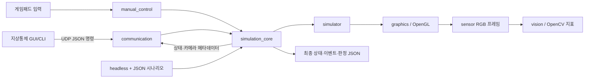

# AeroSimLab 기술 설계

이 문서는 현재 소스 코드에서 확인되는 구조와 데이터 흐름을 설명합니다. 실제 기체에 대한 물리 검증, 건물·시설 지도, 복잡한 다중 드론 협동은 아직 구현되지 않았습니다. 모의 코어의 개별 드론 생성·명령·삭제, 시나리오의 최소 중심 간격·한 방향 위치 공유 장애·역할별 목표 임무까지 지원합니다.

## 구성

## 실행 프로그램

| 대상 | 책임 |
| --- | --- |
| `apps/simulator/` | 고정 Tick 모의와 그래픽 화면을 연결하고 게임 입력·UDP 수신을 통합합니다. 실행 파일은 `aerosimlab_simulator`입니다. |
| `apps/headless/` | 그래픽 없이 JSON 시나리오를 실행하고 판정 결과를 stdout에 출력합니다. |
| `apps/ground_control/` | UDP 명령 클라이언트, CLI 및 Windows GUI 지상통제 앱을 제공합니다. |

## 모의 코어

`modules/simulation_core/`는 `DroneModel`, `EoCameraModel`, `SimulationCore`, `ScenarioRunner`로 나뉩니다.

- Tick 간격은 `1/60`초입니다. 화면 프레임 시간이 여러 Tick에 대응할 수 있고, 프레임 누적기는 한 화면 프레임에서 따라잡을 시간을 최대 100ms로 제한합니다.
- 좌표는 월드 기준 미터 단위 `(x, y, z)`이며 z가 고도입니다. Yaw는 z축 주위 라디안입니다. 운동학 기준선은 `(0,0,0)`에서 시작하고, 강체 X500은 기체 기준점이 지면에서 0.24m인 상태로 시작합니다.
- 화면 앱은 Jolt 강체, 모터 응답, 로터 추력·항력, 바람과 지형 충돌을 사용합니다. X500 강체는 프레임·착륙 다리·스키드·프로펠러 면을 나타내는 아홉 개의 기체 기준 상자를 하나로 묶습니다. 헤드리스 시나리오는 기본적으로 운동학 기준선을 사용하며 `rigid_body`를 선택할 수 있습니다.
- 모의 코어는 ID와 Flecs Entity를 연결해 여러 드론의 상태·명령을 분리합니다. 강체 경로에서는 모든 Entity가 힘을 적용한 다음 공유 Jolt 세계를 한 번 진행하고, 각 상태를 다시 읽습니다. 제거할 때 Body와 Entity를 함께 지웁니다. 화면·지상통제·JSON 시나리오와 성능 측정은 아직 단일 드론 경로입니다.
- 운동학 모델의 최대 속력은 5m/s, 최대 Yaw 속력은 1.5rad/s, 이륙·착륙 높이는 1.5m, 상승·하강 속력은 1m/s입니다. 경유점 허용 거리는 0.05m입니다. 강체 물리 계수는 PX4 X500 Gazebo 설정을 바탕으로 하며 실기체 적합성은 확인하지 않았습니다.
- 활성 EO 카메라는 각 Tick에서 프레임 번호와 마지막 Tick 메타데이터를 갱신합니다. 별도 10Hz 센서 주기는 없습니다.
- `modules/terrain/`이 SRTM 격자를 읽고 지역 좌표 변환을 제공합니다. 지형 격자는 화면 메시와 Jolt 충돌 형상에 함께 사용됩니다.

충돌 상자는 PX4 공개 Gazebo 모델의 크기와 위치를 옮긴 단순 근사입니다. 상세한 프로펠러 표면이나 메시 충돌은 만들지 않습니다. 강체 질량·관성에는 중심 기체 링크뿐 아니라 네 로터 링크의 값도 포함합니다. 로터마다 16.0769g인 질량과 링크 위치를 한 강체 기준으로 합산하지만, 모터와 프로펠러가 실제로 회전하면서 만드는 추가 효과는 계산하지 않습니다.

## 화면과 픽셀 경로

`modules/graphics/`가 OpenGL 창·메시·셰이더와 장면 그리기를 담당합니다. 시뮬레이터는 단일 메시 GLB에 담긴 X500 본체·모터·프로펠러 형상을 읽고, 물리 상태의 위치·자세를 적용해 그립니다. GLB 읽기는 위치·법선·삼각형 번호를 GPU에 올리는 데 필요한 구조만 지원합니다. 모델 재질과 표면 무늬는 읽지 않고 단일 색을 사용합니다. 시뮬레이터 화면에는 주변 장면과 드론 시점 화면이 표시됩니다. 북한산 높이 격자를 화면에 그리며, 네이티브 강체 물리는 같은 격자로 지면 충돌을 계산합니다. 도로·건물·작은 장애물은 표현하지 않습니다.

화면 RGB 픽셀은 센서 프레임 자료구조로 전달되고 `modules/vision/`에서 OpenCV 기반 밝기·대비·선명도 요약을 계산합니다. 이 결과는 실제 광학 카메라 품질 측정이나 AI 객체 인식 결과가 아닙니다. 별도 GCS 영상 스트리밍은 구현되지 않았습니다.

## 시나리오

시나리오 버전 1은 `ticks`, Tick 순서의 `commands`, 필수 `expected`를 사용합니다. 선택적으로 카메라 이벤트와 카메라 기대값을 지정합니다. 초기 위치와 Yaw, 중간 상태 assertion, 난수 시드는 지원하지 않습니다.

지원하는 명령 유형은 `takeoff`, `land`, `stop`, `set_velocity`, `set_waypoint`, `set_yaw_rate`입니다. 명령은 해당 Tick에 적용된 뒤 그 Tick의 모의 진행이 이뤄집니다. 장애 시나리오는 지연·손실·중복을 주입할 수 있습니다. 출력 결과는 통과 여부, 최종 드론/카메라 상태, 이벤트, 실패 사유를 포함합니다.

현재 예제는 [정상 비행](../../scenarios/flight/normal-flight.json)과 [장애 주입](../../scenarios/fault-injection/fault-injection.json)입니다. 파일 이동 시 `CMakeLists.txt`의 CTest 경로도 함께 바꿔야 합니다.

## UDP 인터페이스

- 기본 포트: `27015`; 최대 데이터그램 크기: 1200바이트.
- 프로토콜은 JSON 명령·응답을 사용합니다. 요청에는 명령 ID와 연결 시퀀스가 있고, 응답에는 수락 여부, 적용 Tick, 모의 시각, 드론/카메라 telemetry가 포함됩니다.
- 반복·역순 명령을 시퀀스로 걸러냅니다. UDP 전달 자체를 보장하거나 암호화·인증하지 않습니다.
- CLI 클라이언트는 기본 4초 동안 응답을 기다리며, 대기 중 400ms 간격으로 재전송합니다. 만료된 비행 명령을 자동 정지시키는 서버 측 정책은 아직 없습니다.
- UDP 지상통제 인터페이스는 한 대의 드론을 전제로 합니다. 드론 식별자, 여러 개체 telemetry, 협동 임무 프로토콜은 없습니다. 시나리오의 위치 공유 링크는 이 UDP 경로와 별개이며 실제 네트워크를 통과하지 않습니다.

## 빌드 구성

CMake 최소 버전은 3.20, C++ 표준은 C++20입니다. vcpkg manifest가 OpenCV 4.14 이상을 지정하며 CMake 종속성 파일에서 GLM, nlohmann-json, GLFW를 연결합니다. 그래픽 빌드는 `AEROSIMLAB_BUILD_GRAPHICS` 옵션으로 켜고 끌 수 있습니다. 기본 프리셋은 `ninja-release`이며 출력 폴더는 `build-ninja-release/`입니다.

저장소 설정이 바뀔 수 있으므로 실제 실행 명령과 설치 조건은 [사용 안내](../public/시작하기.md)와 `CMakePresets.json`, `vcpkg.json`을 함께 확인하세요.

## 주요 책임 위치

| 영역 | 경로 |
| --- | --- |
| 요구 방향 및 현재 기준 | `GOAL.md`, `SPEC.md` |
| 비행·카메라·시나리오 | `modules/simulation_core/` |
| UDP 프로토콜·소켓 | `modules/communication/` |
| 게임패드 매핑 | `modules/manual_control/` |
| RGB 프레임 및 지표 | `modules/sensor/`, `modules/vision/` |
| 그래픽 기반 | `modules/graphics/`, `assets/shaders/` |
| 지형·드론 자산·다중 드론 | `modules/terrain/`, `assets/maps/`, `assets/models/drones/`, `scenarios/multi-drone/` — 지형, 개별 명령, 최소 중심 간격 검사, 위치 공유 장애, 역할별 목표·기한 판정은 구현됨. 임무 간 선후 관계와 실제 네트워크 통신은 미구현 |
