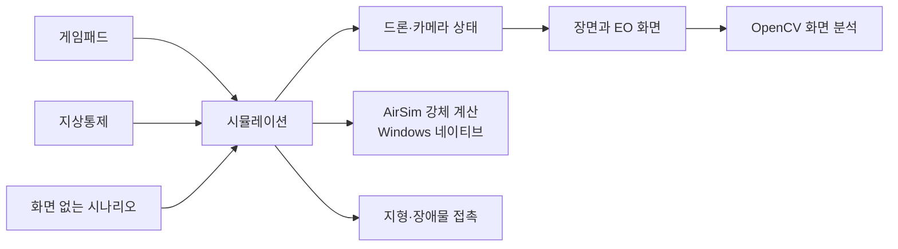
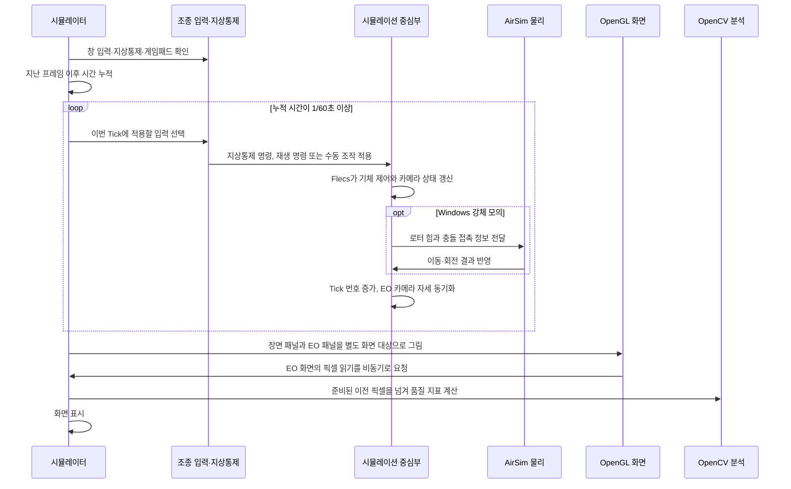
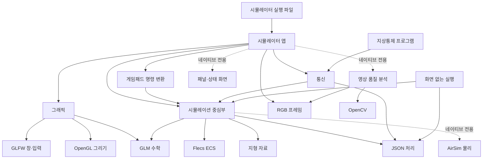

# AeroSimLab 개발 원리와 확인 결과

이 문서는 프로그램이 비행을 계산하고 화면을 만드는 흐름, 현재 모델의 한계, 실제로 측정한 결과를 설명합니다. 수치는 현재 구현을 이해하기 위한 기준입니다. 실제 드론의 성능이나 안전을 보증하지 않습니다.

## 프로그램은 어떻게 움직이나요?

시뮬레이터 화면과 화면 없는 시나리오 실행은 같은 시뮬레이션 중심 기능을 사용합니다. 지상통제 명령과 게임패드 입력도 공통 명령으로 바뀐 뒤 같은 비행 상태에 적용됩니다.



한 Tick은 1/60초입니다. 입력을 적용하고 선택한 모의 방식으로 상태를 한 번 갱신한 다음 카메라 자세를 맞춥니다. 화면이 몇 FPS로 그려지는지와 모의 시간이 얼마나 흐르는지는 별개입니다.

화면 없는 시험도 같은 시뮬레이션을 실행합니다. 따라서 버튼·통신·화면이 없어도 비행 명령과 시나리오 결과를 확인할 수 있습니다. 웹 빌드는 AirSim 없이 운동학 기준 계산을 사용합니다.

### 한 화면 프레임은 어떤 순서로 진행되나요?

화면 프레임은 모니터에 한 번 그리는 과정이고, Tick은 비행 상태를 1/60초만큼 계산하는 과정입니다. 한 화면 프레임 사이에 시간이 많이 흘렀다면 여러 Tick을 먼저 처리한 뒤 화면을 그릴 수 있습니다.



지상통제 명령이 그 Tick에 적용되면 게임패드와 재생 입력은 같은 Tick에 추가 적용하지 않습니다. 지상통제 명령이 없을 때는 재생 중인 기록을 먼저 적용하고, 재생 중이 아니면 게임패드 입력을 반영합니다. Demo 명령은 외부 조종이 꺼진 경우 이 선택 과정 앞에서 만들어집니다.

| 구성 | 맡은 일 | 다른 구성과 만나는 지점 |
| --- | --- | --- |
| 시뮬레이터 화면 | 입력을 모으고 고정 Tick을 진행하며 장면·카메라 패널과 상태 표시를 갱신합니다. | 공통 시뮬레이션 명령과 상태를 사용합니다. |
| 시뮬레이션 중심부 | 드론·카메라 상태와 명령을 관리하고 매 Tick의 ECS 시스템을 실행합니다. | 선택한 운동학 또는 강체 계산을 호출합니다. |
| AirSim 물리 연결 | 로터 입력, 강체 이동·회전, 충돌 후 반응을 계산합니다. | 장면의 충돌 접촉 정보를 받아 시뮬레이션 상태를 돌려줍니다. |
| 통신·수동 조종 | UDP 지상통제 메시지와 게임패드 값을 공통 명령으로 바꿉니다. | 명령을 시뮬레이션 중심부에 전달하고 상태 응답을 만듭니다. |
| 그래픽 | 창, 카메라, 메시, 재질, 화면 대상과 셰이더로 장면을 그립니다. | 시뮬레이션 상태를 읽어 두 패널을 각각 렌더링합니다. |
| 센서·영상 분석 | RGB 프레임 정보를 다루고 화면의 밝기·대비·선명도를 계산합니다. | EO 렌더링 결과의 픽셀을 읽어 분석기에 전달합니다. |

EO 화면은 패널에 보이는 크기로 다시 축소해 그리지 않고, 드론에 설정된 카메라 해상도로 별도 렌더링합니다. GPU에 픽셀 읽기를 요청하고 완료된 프레임을 다음 처리 시점에 가져오므로, 화면 표시와 영상 분석은 서로 다른 프레임을 볼 수 있습니다. 이 때문에 프레임 번호를 함께 기록합니다.

### 실행 프로그램은 어떤 구성에 의존하나요?

아래 그림은 현재 CMake 빌드에 등록된 주요 의존 관계입니다. 화살표는 앞에 있는 실행 파일이나 모듈이 뒤의 기능을 사용한다는 뜻입니다. `네이티브 전용`은 Windows 같은 일반 운영체제 빌드에만 포함되고, WebAssembly 빌드에는 들어가지 않는 경로입니다.



화면 없는 실행은 그래픽 모듈을 거치지 않고 같은 시뮬레이션 중심부를 호출합니다. 따라서 화면 표시 없이도 비행 명령, 공동 임무, 통신 장애와 결과 판정을 실행할 수 있습니다. 지상통제 명령은 통신 형식을 거쳐 공통 비행 명령으로 바뀌며, 게임패드 입력도 별도 변환 단계를 거쳐 같은 명령 체계에 들어옵니다.

시나리오는 JSON을 읽고 검증한 뒤 실행용 드론과 물리 방식을 준비합니다. 매 Tick마다 예약 명령, 임무 목표, 편대 위치 공유, 카메라 이벤트를 반영하고 시뮬레이션을 진행합니다. Tick 뒤에는 최소 드론 간 거리와 임무 진행을 기록하며, 마지막 상태를 만든 다음 기대 위치·상태·카메라 결과와 비교합니다. 이 과정은 실제 UDP 패킷을 전송하지 않고 시나리오 안에서 지연·손실·연결 중단을 재현합니다.

### Flecs에는 어떤 데이터를 두나요?

Flecs는 드론별 상태와 제어 목표를 컴포넌트로 저장하고, 선택한 모의 방식에 맞는 시스템을 Tick마다 실행합니다. 컴포넌트는 데이터 묶음이고, 시스템은 그 데이터를 읽거나 갱신하는 작업입니다.

| 컴포넌트 | 보관하는 내용 | 사용처 |
| --- | --- | --- |
| `DroneState` | 위치·속도·자세·각속도·비행 상태·로터 속도 | 시뮬레이터, 지상통제 응답, 시나리오 판정 |
| `DroneControlState` | 경유점·목표 속도·목표 방향·지면 높이 | 비행 규칙과 강체 제어기 |
| `InitialPose` | 처음 위치·방향·지면 높이 | 초기화 및 재시작 |
| `PhysicsBody` | AirSim 강체를 찾는 핸들 | 네이티브 강체 모드에만 사용 |
| `DroneActuation` | 기체별 질량·관성·로터 제원 | 네이티브 강체 제어와 모터 목표 계산 |
| `CameraState` | 카메라 상태·해상도·프레임 번호·드론 기준 자세 | 카메라 시스템, EO 렌더링, 결과 판정 |

시스템은 모의 방식에 따라 달라집니다. 운동학 모드의 `AdvanceKinematicDrone`은 간단한 비행 규칙으로 위치와 방향을 갱신합니다. 강체 모드의 `ApplyRigidBodyForces`는 현재 상태와 목표에서 로터 회전 목표를 계산합니다. 두 모드 모두 `AdvanceCamera`가 카메라 켜짐·고장 상태와 프레임 번호를 갱신합니다. Flecs 진행이 끝난 뒤 강체 모드에서는 AirSim이 물리를 한 번 계산하고, 반환된 강체 상태로 드론 상태를 맞춘 다음 카메라 위치와 방향을 동기화합니다.

### 객체와 자원은 누가 정리하나요?

| 자원 | 소유자와 정리 시점 | 수명상 주의점 |
| --- | --- | --- |
| 창·렌더러·메시·텍스처·셰이더·화면 대상 | 시뮬레이터 앱이 소유하고 앱 종료 때 정리합니다. | OpenGL 자원은 유효한 그래픽 문맥에서 해제돼야 하므로 창과 그래픽 객체의 생성·정리 순서를 지켜야 합니다. |
| Flecs 실행 공간과 드론 엔티티 | 시뮬레이션 중심부의 내부 저장소가 소유합니다. | 엔티티의 물리 정보는 AirSim 강체 자체가 아니라 그 강체를 찾는 식별 핸들입니다. |
| AirSim 물리 월드와 강체 | 시뮬레이션 내부 물리 월드가 소유합니다. 드론을 지우면 연결된 강체도 함께 등록 해제하고 정리합니다. | Flecs 시스템 콜백이 물리 월드를 참조하므로, 콜백을 가진 Flecs 실행 공간을 먼저 닫고 물리 월드를 나중에 정리합니다. |
| UDP 소켓과 영상 분석기 | 시뮬레이터 앱이 소유하고 종료 때 정리합니다. | 통신·분석 자원은 시뮬레이터 앱의 실행 기간 안에서만 사용합니다. |
| EO RGB 픽셀 버퍼 | 앱이 소유합니다. 영상 분석기는 처리 중 이 버퍼를 복사하지 않고 빌려 봅니다. | 분석이 끝나기 전에 GPU 읽기 결과로 버퍼를 덮어쓰지 않습니다. |

모듈 내부의 대부분 자원은 소유 객체가 직접 정리하지만, OpenGL 문맥이나 Flecs 콜백처럼 생성 순서에 영향을 받는 자원은 단순히 포인터가 사라지는 것만으로 수명이 안전해지지 않습니다. 그래서 창·그래픽 자원과 Flecs·물리 월드의 생성 및 해제 순서도 구조의 일부로 다룹니다.

## 비행 계산은 누가 하나요?

Windows 네이티브 실행은 AirSim의 멀티로터 물리 계산을 사용합니다. 로터 힘, 모터 응답, 공기 저항, 강체의 이동·회전과 충돌 뒤 반응을 계산합니다. 별도의 Gazebo 서버가 필요하지 않습니다. 공개 X500 설정과 제조사 시험표를 참고해 질량·관성·로터 계수를 정했지만, 실제 비행 기록과 대조하지 않았습니다.

AirSim은 충돌 뒤의 반응을 계산하지만 이 프로그램의 지형이나 건물에서 접촉 위치를 찾아주지는 않습니다. 현재 장면이 드론의 충돌 상자와 지형·장애물의 겹침을 검사해 접촉 정보를 만들고 AirSim에 전달합니다. 두 엔진이 같은 운동을 따로 적분하는 구조는 아닙니다.

| 입력 또는 물리값 | 현재 기준 | 확인할 점 |
| --- | --- | --- |
| 시뮬레이션 간격 | 1/60초 | 화면 프레임 수와 무관하게 고정됩니다. |
| 기본 기체 | PX4 공개 X500 형상과 설정을 참고 | 공개 자료와 실제 조립품이 완전히 같다고 보장하지 않습니다. |
| 기체 질량 | 약 2.0643kg | 중심 기체와 네 로터를 합산한 기준값입니다. 배터리·탑재물은 다를 수 있습니다. |
| 추력·토크 계수 | 제조사 정지 시험표 15개 점에 맞춘 근사값 | X500 실기 비행의 계측값은 아닙니다. |
| 모터 응답 | 시간 상수 0.0125초 | 실제 상승·하강 응답 차이를 하나의 값으로 단순화했습니다. |
| 공기 저항 | AirSim 일반 기본값 | X500에서 직접 측정한 계수가 아닙니다. |
| 조종 제어 | 위치·속도 목표에서 로터 회전수로 변환 | 실제 PX4 Position 모드나 조종기 감도를 그대로 재현한 검증은 없습니다. |

### 조종 목표에서 로터 힘까지

위치 목표에서는 위치 차이와 현재 속도를 함께 보고 목표 가속도를 구합니다. 속도 목표에서는 목표와 현재 속도의 차이를 사용합니다. 가속도는 최대 4m/s²로 제한합니다.

```text
위치 목표: a = 3 × (목표 위치 - 현재 위치) - 2.5 × 현재 속도
속도 목표: a = 2.5 × (목표 속도 - 현재 속도)
필요한 월드 추력: F = m × (a + g),  g = (0, 0, 9.81)m/s²
자세 제어 토크: τ = I × (20e - 7ω),  |τ| ≤ 0.5N·m
로터 추력: T = k_f × ω²
로터 속도: ω = √(T / k_f)
```

`m`은 질량(kg), `I`는 관성 행렬(kg·m²), `e`는 자세 오차(rad), `ω`는 각속도(rad/s)입니다. 네 로터의 위치와 회전 방향으로 힘과 토크를 나누고, AirSim에 목표 회전 속도를 전달합니다. AirSim이 모터 지연을 적용한 뒤 강체 이동과 회전을 적분합니다. 이 조종 이득은 시뮬레이터 입력을 만들기 위한 값이며 PX4 Position 모드의 실제 조종 감도와 같다는 근거는 없습니다.

| 기체 값 | 사용값 | 자료와 단순화 |
| --- | ---: | --- |
| 총 질량 | 약 2.0643kg | 중심 기체와 네 로터의 질량을 합산했습니다. 배터리·탑재물 구성은 반영하지 않았습니다. |
| 관성 대각 성분 | 0.02385, 0.02395, 0.04400kg·m² | 공개 PX4 모델의 기체와 로터를 중심 기준으로 합산했습니다. 실제 조립품에서 재지 않았습니다. |
| 로터 위치 | 중심에서 약 0.174m, 기준면보다 0.06m 위 | 공개 X500 배치를 참고했습니다. |
| 추력 계수 `k_f` | 약 1.2295×10⁻⁵ N/(rad/s)² | 제조사 시험표 15개 점을 `T = k_f × ω²`에 맞췄습니다. |
| 토크/추력 비 | 약 0.01403m | 같은 시험표의 추력과 토크로 계산했습니다. |
| 최대 로터 속도 | 약 1032rad/s (9857rpm) | 시험표에서 가장 높은 측정 회전수입니다. 모터 정격 한계는 아닙니다. |
| 모터 응답 시간 상수 | 0.0125초 | 실제 설정의 상승·하강 차이를 하나의 값으로 단순화했습니다. |

제조사 표의 회전수는 `RPM × 2π/60`, 추력은 `질량(g) × 9.80665/1000`으로 바꿔 계수를 구합니다. 정지 시험대 데이터에 맞춘 계산이라 실제 X500의 비행 오차를 뜻하지 않습니다.

### AirSim은 로터 입력을 이동과 회전으로 어떻게 바꾸나요?

프로젝트 제어기는 목표 회전 속도를 AirSim 입력으로 바꿉니다. 최대 회전 속도로 나눈 뒤 제곱하는 이유는 AirSim의 로터 입력이 속도가 아니라 0부터 1 사이의 추력 신호이기 때문입니다.

```text
u_cmd = clamp((목표 회전 속도 / 최대 회전 속도)², 0, 1)
u_next = u_now × exp(-Δt/τ) + u_cmd × (1 - exp(-Δt/τ))
T = u_next × T_max
Q = u_next × Q_max × 회전 방향
```

`u`는 정규화한 로터 신호, `τ`는 모터 응답 시간 상수(초), `T`는 추력(N), `Q`는 로터 축 토크(N·m)입니다. 현재 설정은 상승·하강에 같은 시간 상수를 씁니다. 신호가 충분히 안정된 뒤에는 `T = k_f × 목표 회전 속도²`가 되도록 최대 추력을 맞춥니다. 과도 구간의 회전 속도 자체를 일차식으로 보간하는 것은 아닙니다. AirSim은 신호를 먼저 필터링한 뒤 그 값에서 회전 속도와 추력을 계산합니다.

AirSim은 네 로터의 힘과 중심에서 떨어진 위치가 만드는 토크를 합칩니다. 여기에 공기 저항과 중력을 더해 선형 가속도를 계산하고, 관성 행렬로 각가속도를 구합니다.

```text
a_world = F_world / m + g_world
α_body = I⁻¹ × (τ_body - ω_body × (I × ω_body))
v_next = v_now + (a_now + a_next) × Δt / 2
p_next = p_now + (v_now + a_now × Δt / 2) × Δt
ω_next = ω_now + (α_now + α_next) × Δt / 2
```

`F`는 합력(N), `m`은 질량(kg), `g`는 중력 가속도(m/s²), `I`는 관성 행렬(kg·m²), `τ`는 합토크(N·m), `ω`는 기체 기준 각속도(rad/s), `α`는 각가속도(rad/s²)입니다. 위치 갱신에 쓰는 `v_now + a_now × Δt/2`는 Tick 중간 속도 추정값입니다. AirSim은 현재 가속도로 이 값을 먼저 추정해 공기 저항을 구하고, 다음 가속도를 계산한 뒤 속도를 갱신합니다. 이 계산은 프로젝트의 `AdvanceOneTick`이 아니라 AirSim 물리 단계에서 이루어집니다.

회전은 단위 쿼터니언으로 보관합니다. 쿼터니언은 세 축 회전이 겹칠 때 오일러 각에서 생길 수 있는 특정 자세의 특이점을 피하고, 방향을 부드럽게 합성하는 네 수 성분 값입니다. AirSim은 기체 기준 평균 각속도로 한 Tick의 회전량을 만들고 현재 자세에 곱한 뒤 길이를 1로 다시 맞춥니다.

```text
Δq = (cos(|ω_avg| × Δt / 2),  ω̂_avg × sin(|ω_avg| × Δt / 2))
q_next = normalize(q_now × Δq)
```

여기서 `ω̂_avg`는 평균 각속도 방향을 나타내며, 각속도가 0이면 회전량도 0입니다. 월드 좌표와 기체 좌표의 기준이 다르므로 이 식의 각속도와 자세 갱신은 AirSim 좌표 변환 경계 안에서 다뤄야 합니다. 쿼터니언의 순서를 바꾸면 회전 기준이 달라질 수 있습니다.

시뮬레이션 월드는 동·북·위(ENU), 기체 기준은 앞·왼쪽·위(FLU)를 씁니다. AirSim은 북·동·아래(NED), 앞·오른쪽·아래(FRD)를 사용하므로 경계에서 축과 부호를 변환합니다. 바람·로터 위치·충돌점·자세도 각 좌표 기준에 맞춰 바꿉니다. 좌표 변환이 어긋나면 북쪽 입력이 동쪽 움직임으로 보이거나 회전이 불안정해질 수 있습니다.

## 지형과 충돌은 어디까지 표현하나요?

북한산 SRTM 지형은 약 18.8 × 23.7km 범위이며 높이 간격은 약 30m입니다. 화면에서는 높낮이를 보기 쉽도록 산을 세로로 두 배 크게 그리지만, 비행과 접촉 계산은 원래 높이를 사용합니다. 그래서 작은 굴곡이나 좁은 장애물은 나타나지 않습니다.

드론은 여러 상자로 근사하고, 건물도 외곽을 감싼 상자로 충돌을 검사합니다. 지도 자료에 건물 높이가 없어 일부 건물에는 시연용 3m를 씁니다. 이 값은 실제 높이가 아닙니다. 건물 외곽선과 시설물도 일부 구역에만 준비돼 있습니다. 정밀한 메시 충돌, 실제 건물 높이, 경로 가시성 분석은 구현되지 않았습니다.

충돌 반응에도 제한이 있습니다. 현재 연결부는 강체 하나에 Tick마다 접촉 한 건만 AirSim에 전달합니다. 지면 접촉이 있으면 지면을 우선하고, 지면 접촉이 없을 때는 장애물·다른 드론 접촉 중 겹친 깊이가 가장 큰 한 건을 전달합니다. 따라서 기체가 바닥과 벽을 동시에 누르거나 여러 드론·장애물에 동시에 끼인 상황에서는 모든 접촉을 합쳐 푸는 물리 엔진처럼 반응하지 않습니다. 접촉 형상은 검사하지만 복수 접촉의 힘과 회전을 정확히 재현하지는 않습니다.

AirSim은 접촉점에서 들어오는 속도와 반발 계수로 충격량을 구하고, 접촉면을 따라가는 속도에는 마찰 충격량을 적용합니다. 기본 반발 계수는 0.55, 마찰 계수는 0.5입니다. 수직 방향으로 내려앉는 지면 접촉이라고 판정되면 반발 계수를 0, 마찰 계수를 1로 바꾸고, 접지 잠금에서 기울기와 움직임을 정리합니다. 표면마다 다른 재질값은 없으며, 벽·건물과 지면의 재질 차이를 실제 측정값으로 반영하지 않았습니다. 비스듬한 충돌이나 회전 중 접촉의 결과도 기준 장비와 대조하지 않았습니다.

자료 출처, 좌표 기준과 높이 한계는 [지형 자료 안내](../../assets/maps/bukhansan-demo/README.md), 문제별 분석은 [문제 해결 기록](문제해결.md)에서 볼 수 있습니다.

## 화면과 EO 카메라는 어떻게 만드나요?

장면과 EO 카메라는 OpenGL로 그립니다. 화면에 보이는 카메라 영상에서 RGB 픽셀을 읽어 OpenCV가 밝기·대비·선명도를 간단히 계산합니다. 이 분석은 AI 인식이나 실제 카메라 성능 평가가 아닙니다.

현재 X500 GLB에는 재질·이미지·UV가 들어 있지 않아, 화면에서 탄소 섬유 무늬를 입히는 식으로 보완합니다. 이 무늬는 한 장의 128×128 텍스처를 삼면 투영해 모델 전체에 적용합니다. 그림자도 아직 그리지 않습니다. 그래서 실제 CAD와 같은 표면 재질이나 작은 부품 표현은 제한됩니다. 화면의 시각 품질을 높이려면 셰이더만 바꾸기보다 재질과 UV가 준비된 모델, 그림자, 주변 지형의 상세 형상이 필요합니다.

## 확인한 결과

### 자동 시험

현재 Release 빌드에서 자동 시험 20개가 통과했습니다. 이 시험은 비행 명령, 지형·충돌, 카메라 상태와 시나리오 결과를 확인합니다. 실제 Xbox 기기별 입력, 실기체 비행, 모든 화면 크기에서의 동작은 포함하지 않습니다.

같은 시기의 GitHub Actions 결과는 모두 통과한 상태가 아니었습니다. `ff08bb07`에서 네이티브 Debug 빌드는 성공했지만, 정적 분석 도구가 지원하지 않는 `-source-filter` 인자로 중단됐습니다. 웹 빌드도 웹에서 선언하지 않은 `DrainEoReadbacks()` 호출 때문에 컴파일되지 않았습니다. 두 실패는 코드와 워크플로에 반영해 수정했습니다. 아래 기록은 당시 CI 실행 결과이며 현재 코드가 CI에서 통과했다는 뜻은 아닙니다.

`DrainEoReadbacks()` 호출 가드는 `c6874f30`, 정적 분석의 경로 정규식 전달은 `503a1e2a`에서 수정했습니다. 수정 후 이 작업 공간에는 CMake와 Emscripten이 없어 빌드와 분석을 재실행하지 못했으며, 해당 수정이 포함된 Actions 실행도 아직 없습니다.

| 검사 | 당시 결과 | 확인 내용 |
| --- | --- | --- |
| 네이티브 Debug 빌드 | 성공 | 정적 분석 단계까지 빌드 완료 |
| Clang 정적 분석 | 실패 | 설치된 `run-clang-tidy`가 `-source-filter`를 알 수 없는 인자로 거부 |
| 웹 빌드 | 실패 | 웹 빌드에서 빠진 `DrainEoReadbacks()`를 무조건 호출 |
| GCC ASan·UBSan 단위 시험 | 12개 통과 | 단위 시험 전부 통과 |
| GCC ASan·UBSan 통합 시험 | 7/8 통과 | 기록·재생 UDP 통합 시험에서 시뮬레이터 응답 시간 초과 |
| GCC Coverage | 성공 | 대상 범위의 줄 74.1%(3,554/4,797), 함수 85.5%(370/433), 분기 33.6%(3,023/8,994) |

그 뒤 `96aa82bd` 작업 트리에서 Visual Studio 2026 기반 Windows Release 빌드와 전체 CTest를 실행해 모두 통과했습니다(20/20). UDP 세션 통합 시험도 Windows Release에서 1.07초 만에 통과했습니다. 이는 Windows Release 경로가 동작한다는 확인입니다. Ubuntu ASan·UBSan의 시간 초과는 다른 운영체제와 빌드 설정에서 발생했으므로, Windows 결과만으로 Linux 실패 원인이 해결됐다고 볼 수 없습니다. Emscripten 빌드와 수정한 Clang 정적 분석 워크플로는 이 PC에서 재실행하지 못했습니다.

Coverage는 `modules/`와 `apps/simulator/`를 대상으로 생성한 값입니다. 분기 커버리지는 33.6%로 낮고, 이 수치는 전체 저장소나 모든 실행 경로를 대표하지 않습니다. UDP 통합 시험 시간 초과는 현재 원인을 확정하지 못했습니다. 시험은 기록·재생 명령 여러 개를 연속 전송하고 각 응답을 5초 기다리며, Actions 로그만으로는 어느 요청이 늦었는지 구분할 수 없습니다. 해당 CI 실행 원본은 [Native CI](https://github.com/cgantro/DroneSim/actions/runs/39904294643), [Native Quality](https://github.com/cgantro/DroneSim/actions/runs/39904294685), [웹 빌드](https://github.com/cgantro/DroneSim/actions/runs/39904294664)에서 확인할 수 있습니다.

### 화면 프레임

리비전 `23d537be`에서 Release 실행을 한 번, 숨김 창으로 5초 측정했습니다. 화면 크기는 1280×720이고 그래픽 장치는 NVIDIA GeForce RTX 3060 Ti였습니다. 지형·건물·시설물과 X500, EO 비동기 픽셀 읽기가 켜져 있었습니다. 총 1,773프레임과 299 Tick을 기록했습니다.

| 구간 | p50 | p95 | p99 | 최댓값 |
| --- | ---: | ---: | ---: | ---: |
| 앱 프레임 전체 | 2.402ms | 5.707ms | 5.878ms | 104.992ms |
| 렌더링과 화면 교체 | 2.387ms | 5.695ms | 5.865ms | 92.305ms |
| 시뮬레이션 Tick | 22.4µs | 24.5µs | 40.6µs | 59.4µs |
| AirSim 물리 단계 | 12.1µs | 13.1µs | 18.1µs | 49.0µs |

이 실행에서 모의 시간은 실제 시간의 약 1.00배 진행했고, Tick 계산이 16.67ms 예산을 넘은 경우는 없었습니다. EO 픽셀 읽기 확인 구간의 p95는 2.340ms였고 최댓값은 89.039ms였습니다. OpenCV 분석은 p50 3.106ms, p95 3.255ms였습니다. 이 구간의 최댓값이 앱 프레임의 최댓값과 같은 프레임에서 발생했는지는 원본 결과만으로 알 수 없습니다.

프로세스 CPU 사용량 추정치는 약 100%였으며, 보고서 작성 시점의 작업 집합은 약 193.6MiB였습니다. CPU 백분율은 Windows 프로세스 CPU 시간을 실제 경과 시간으로 나눈 근사값이고, 메모리는 측정 종료 무렵의 한 시점 값이므로 최대 사용량으로 해석할 수 없습니다.

한 번의 숨김 창 측정은 표본이 적고 실제 화면 표시도 생략합니다. 따라서 결과를 실제 모니터에서의 조작 반응이나 장시간 안정성으로 해석할 수 없습니다. 앱 프레임과 렌더링 시간의 최댓값은 서로 다른 프레임일 수 있습니다.

EO 픽셀을 비동기로 읽도록 바꾼 뒤 세 번 측정한 결과, 일반 프레임의 p95는 약 5.8ms였지만 최악 프레임은 84~94ms로 남았습니다. 픽셀을 읽지 않은 프레임에서도 긴 프레임이 발생해 원인을 단정하지 못했습니다. 자세한 추적은 [EO 프레임 지연 기록](문제해결/화면-프레임-지연.md)에 있습니다.

### CPU 표본 기록

Release 데모를 31.58초 기록했고 이벤트 손실은 없었습니다. CPU 표본에는 Windows 커널, NVIDIA 드라이버, 동시성 런타임과 OpenCV 영상 처리 함수가 나타났습니다. 커널 표본의 기호를 충분히 해석하지 못했고 긴 프레임의 순간과 함수 표본을 연결하지 못했습니다. 따라서 특정 구성요소가 지연 원인이라고 결론 내릴 수 없습니다.

CPU 표본은 함수의 실제 실행 시간을 재지 않고 GPU 실행 시간도 알려 주지 않습니다. 이 기록은 병목을 좁히기 위한 자료이며, GPU와 CPU 대기를 프레임 단위로 연결한 분석은 아직 없습니다. 원본 ETL은 시스템 경로와 프로세스 정보를 포함할 수 있어 공개 문서에 두지 않았습니다.

### 여러 드론 실행

화면 없는 분리 배치에서 충돌을 포함한 강체 계산을 확인했습니다. 각 규모는 30,000 Tick씩 세 번 실행했습니다. 표의 값은 반복별 Tick p95의 중앙값입니다.

| 드론 수 | Tick p95 중앙값 |
| ---: | ---: |
| 32 | 97.1µs |
| 64 | 202.8µs |
| 128 | 418.0µs |
| 256 | 862.1µs |

이는 해당 PC와 시작 배치에서 얻은 값이며, 실제 편대의 성능이나 정확도를 보장하지 않습니다.

확장 시험에서 완료한 규모와 제한 시간에 걸린 실행도 구분해 기록했습니다.

| 실행 종류 | 확인한 규모 | 결과 |
| --- | --- | --- |
| 운동학, 분리 배치 | 1,024대 | 30,000 Tick씩 세 번 완료 |
| AirSim 강체, 분리 배치 | 512대 | 30,000 Tick씩 세 번 완료 |
| AirSim 강체, 분리 배치 | 1,024대 | 한 차례 26,000 Tick 뒤 30초 제한 도달 |
| 운동학 공동 임무 | 1,024대 | 세 번 모두 모든 목표 완료 |
| AirSim 강체 공동 임무 | 128대 | 세 번 모두 모든 목표 완료 |

확장 시험의 드론들은 시작 조건과 명령이 정해진 화면 없는 시나리오에서 실행했습니다. 시간 제한에 걸린 강체 1,024대 결과는 완료한 반복과 같은 기준으로 비교할 수 없습니다. 공동 임무 시험 결과도 실제 통신이나 경로 충돌 회피를 검증하지 않습니다.

### 2026년 10월 Release 확장 시험과 화면 기준선

측정 보고서는 `bbb86f73` 코드에서 생성됐습니다. 이후 `c6874f30`에서 웹 빌드 전용 호출 문제만 수정했으며, 이 수정은 네이티브 화면·물리·확장 측정 경로에 영향을 주지 않습니다. 그래도 아래 값은 새 수정 이후의 재측정 결과가 아니라 이전 기준선입니다.

10월 23일 Release 빌드로 화면 없는 확장 시험과 숨김 OpenGL 화면 측정을 다시 실행했습니다. Windows 11 Pro 빌드 26200, Intel Core i5-13600KF(14코어·20논리 프로세서), 메모리 32GB, NVIDIA GeForce RTX 3060 Ti에서 측정했습니다. 화면 측정 해상도는 1280×720이며, 모니터에 표시하지 않은 숨김 창입니다. 보고서의 소스 리비전은 `bbb86f73-dirty`입니다. 이후 현재 문서 커밋까지 앱·모듈·빌드 설정의 코드 변경이 없는 것을 확인했습니다. 원본 결과는 [2026년 10월 전체 Release 측정](../../benchmarks/results/aerosimlab-full-benchmark-release-2026-10-23-bbb86f73-dirty.json)입니다.

화면 측정은 5초 동안 1,665프레임을 그렸고 평균 332.84FPS였습니다. 앱 프레임 시간은 p50 2.409ms, p95 4.914ms, p99 6.385ms였지만, 최댓값은 120.256ms였습니다. 같은 실행에서 EO 픽셀 결과 확인 구간도 최댓값 114.687ms를 기록했습니다. 두 최댓값이 한 실행에서 관찰됐다는 사실만으로 영상 확인이 긴 프레임을 일으켰다고 결론 내릴 수는 없습니다. 프레임별 호출 추적이 없어 원인과 시간 관계는 아직 확인되지 않았습니다. 실제 모니터 표시, 수직 동기화, 입력 반응 지연도 이 숨김 창 시험으로는 알 수 없습니다.

화면이 없는 독립 비행 시험은 규모마다 120 Tick 워밍업 후 30,000 Tick을 세 번 측정했습니다. 아래의 p95와 실시간 배수는 세 반복의 중앙값입니다. 실시간 배수는 시험이 진행한 모의 시간과 실제 경과 시간의 비율이며, GUI에서 같은 규모를 실시간으로 조종할 수 있다는 뜻은 아닙니다.

| 물리 방식과 배치 | 드론 수 | Tick p95 중앙값 | 실시간 배수 중앙값 | 반복 결과 |
| --- | ---: | ---: | ---: | --- |
| 운동학, 분리 배치 | 1,024 | 8.9µs | 2,355.86배 | 30,000 Tick 세 번 완료 |
| AirSim 강체, 분리 배치 | 128 | 211.7µs | 113.69배 | 30,000 Tick 세 번 완료 |
| AirSim 강체, 분리 배치 | 512 | 949.3µs | 25.62배 | 30,000 Tick 세 번 완료 |
| AirSim 강체, 분리 배치 | 1,024 | 2,271.5µs | 9.77배 | 한 번만 실행, 18,000 Tick에서 30초 제한 도달 |
| AirSim 강체, 0.55m 간격 밀집 배치 | 128 | 619.6µs | 37.66배 | 30,000 Tick 세 번 완료 |
| AirSim 강체, 0.55m 간격 밀집 배치 | 256 | 1,185.5µs | 18.66배 | 30,000 Tick 세 번 완료 |

운동학 1,024대와 AirSim 강체 512대까지는 목표 반복을 모두 마쳤습니다. 강체 1,024대 결과는 한 번뿐이고 시간 제한에 걸렸으므로 세 번 완료한 규모와 같은 기준의 확장 결과로 취급하지 않습니다. 밀집 배치에서는 드론 사이 거리를 0.55m로 두었습니다. 256대에서 접촉 생성 구간의 p95 중앙값은 939.8µs였습니다. 이는 접촉 계산을 더 살펴볼 근거지만, 서로 다른 구간의 p95만으로 전체 시간에서 차지하는 정확한 비율을 계산할 수는 없습니다.

협동 임무 시험은 운동학 2~1,024대에서 24회, AirSim 강체 2~128대에서 15회 수행했고, 기록된 모든 반복에서 시나리오와 임무가 통과했습니다. 이 결과는 로컬 시나리오 실행과 지정 목표 완료를 확인한 것입니다. 실제 UDP 통신 장애, 편대 간 거리 유지, 경로 충돌 회피 또는 실제 비행 정확도를 검증한 것은 아닙니다.

이번 화면 수치는 숨김 창 한 번의 기준선이고, 확장 시험은 화면 없는 단일 PC 처리량 측정입니다. 사용 중인 화면의 프레임 지연 원인과 실제 모니터 성능은 별도 프로파일링이 필요합니다. 이전 측정과는 코드 리비전과 시험 조건이 다를 수 있으므로 직접적인 개선율로 비교하지 않습니다.

### 최소 거리 판정 경로의 반복 작업

시나리오가 최소 드론 간 거리를 요청하면 시작 시점과 각 Tick 뒤에 모든 드론 쌍의 중심 거리를 확인합니다. 1,024대에서는 한 번 확인할 때마다 523,776쌍을 비교합니다. 기존 흐름은 이 쌍을 검사할 때마다 두 드론의 현재 상태를 이름으로 다시 찾고, 거리를 구하려고 매번 제곱근을 계산했습니다.

상태를 드론마다 한 번만 읽어 배열에 모으고, 제곱 거리로 후보를 비교한 뒤 최솟값이 바뀔 때만 실제 거리를 계산하도록 바꿨습니다. 같은 Release 빌드와 1,024대 정지 배치를 사용해 바꾸기 전후를 세 번씩 실행했습니다. 입력은 드론 사이 간격 2m, 명령 없음, 최소 거리 기준 1.9m였습니다. 한 번은 1 Tick, 다른 한 번은 60 Tick으로 실행했습니다. 시간은 프로세스 시작, JSON 처리, 시나리오 실행, 결과 출력을 포함한 전체 호출 시간입니다.

| 코드 리비전 | Tick 수 | 실행 시간 세 번 | 중앙값 |
| --- | ---: | --- | ---: |
| `29696759` 변경 전 | 1 | 81.89, 80.16, 101.82ms | 81.89ms |
| `29696759` 변경 전 | 60 | 1,057.48, 1,026.24, 1,074.42ms | 1,057.48ms |
| `4d717248` 변경 후 | 1 | 69.59, 46.51, 55.63ms | 55.63ms |
| `4d717248` 변경 후 | 60 | 70.98, 92.60, 76.09ms | 76.09ms |

이 입력에서 60 Tick 전체 호출의 중앙값은 약 1.06초에서 76ms로 줄었습니다. 다만 1 Tick 결과에서도 프로세스 시작과 JSON 처리에 수십 ms가 걸리는 등 실행 간 편차가 보였습니다. 따라서 이 변화율을 거리 계산 함수만의 성능이나 다른 시나리오의 개선율로 해석하면 안 됩니다. 결과는 1,024대 정지 배치에서 반복되는 최소 거리 계산 경로를 확인한 값이며, 강체 물리·충돌이나 실제 비행 성능을 측정하지 않았습니다. 반복별 기록은 [최소 거리 계산 측정](../../benchmarks/results/aerosimlab-separation-metric-release-2026-10-23.json)에 있습니다.

벤치마크 실행별 조건과 원본은 [현재 측정 결과](../../benchmarks/results/)에 보관합니다. 서로 다른 코드 리비전·장면·측정 조건의 숫자는 직접 비교하지 않습니다.

## C++20을 선택한 이유와 실제 사용 기능

프로젝트는 CMake에서 C++ 표준을 20으로 고정합니다. 최초 도입 당시 어떤 표준과 비교했는지는 기록에서 확인되지 않았습니다. 현재 코드에서 확인되는 사용 근거는 새 문법의 수가 아니라, 필요한 동시성·데이터 보기·수치 처리 기능을 표준 라이브러리로 사용해 직접 만든 보조 코드를 줄이는 점입니다. 지상통제 요청 취소, 재생 명령 구간 전달, 지형 파일 읽기와 높이 보간에서 C++20 기능을 실제로 사용합니다.

| C++20 기능 | 프로젝트에서 하는 일 | 이 기능을 쓰는 이유와 주의점 |
| --- | --- | --- |
| `std::stop_source`, `std::stop_token` | 지상통제 창이 진행 중인 요청에 취소를 알리고, UDP 요청 처리가 취소 여부를 확인합니다. | 취소 상태를 전역 변수나 자체 원자 변수로 만들지 않아도 됩니다. 취소는 협력 방식이므로, 요청 처리 코드가 토큰을 확인하는 지점에서 반영됩니다. |
| `std::jthread` | UDP 클라이언트 시험과 시뮬레이터 통합 시험의 작업 스레드를 관리합니다. | 범위를 벗어날 때 스레드 종료를 기다리는 RAII 동작을 제공합니다. 실제 앱의 비동기 요청은 `std::async`와 취소 토큰을 사용하므로, `jthread`가 앱의 모든 스레드를 관리한다고 보면 안 됩니다. |
| `std::span` | 재생할 명령 구간과 충돌 상자 목록을 함수에 전달합니다. | 연속된 데이터를 복사하거나 소유권을 넘기지 않고 읽기 범위를 표현합니다. `span`은 원본 데이터를 소유하지 않으므로, 원본 벡터보다 오래 보관하면 안 됩니다. |
| `std::endian`, `std::bit_cast` | `std::endian`으로 컴퓨터의 바이트 순서를 확인해 지형 파일의 리틀엔디안 값을 읽고, `std::bit_cast`로 16비트 높이의 비트 표현을 부호 있는 정수로 해석합니다. | 형식 변환을 포인터 재해석이나 가정에 맡기지 않습니다. 파일 크기, 헤더, 지원하지 않는 높이 표시는 별도로 검사해야 합니다. |
| `std::lerp` | 높이 격자에서 동서 방향을 먼저 보간하고 남북 방향으로 다시 보간해 위치의 지면 높이를 구합니다. | 보간 의도를 드러내고 같은 계산을 직접 반복하지 않습니다. 격자 간격과 범위를 검증하는 코드를 대신하지는 않습니다. |
| `std::numbers::pi` | 위도·경도 변환과 모터 회전수 단위 변환에 원주율을 사용합니다. | 소스마다 근삿값을 다시 적지 않아도 됩니다. 변환식의 단위와 좌표 기준은 별도로 맞춰야 합니다. |
| C++20 지정 초기화 | 실행 옵션과 시험 입력의 필드 이름을 함께 적습니다. | 여러 필드가 있는 설정에서 각 값의 의미를 읽기 쉽게 합니다. C++ 지정 초기화는 선언된 멤버 순서를 따라야 하며, 생략된 값은 해당 형식의 기본 초기화 규칙을 따릅니다. |

반면 `concepts`, `ranges`, 코루틴, 모듈은 현재 코드에서 사용하지 않습니다. C++20을 선택했다고 언어의 모든 새 기능을 도입한 것은 아닙니다. C++17로도 직접 구현할 수 있는 기능은 있지만, 취소 토큰과 비소유 범위, 안전한 비트 변환 같은 기능을 표준 구현으로 사용하려고 C++20을 빌드 기준으로 삼았습니다. 이 기준은 오래된 컴파일러와 도구 체인의 선택 폭을 줄이므로, 빌드 환경도 C++20 지원이 필요합니다.

C++20을 사용한다는 사실만으로 실행 속도가 빨라지는 것은 아닙니다. 이 프로젝트에서는 표준 기능을 사용해 직접 관리할 코드와 의존성을 줄이는 쪽이 선택 근거이며, 성능 향상은 별도 측정으로 확인해야 합니다.

## 라이브러리와 사용 조건

| 기술 | 현재 맡은 일과 사용 이유 | 같은 문제를 푸는 대안 | 현재 구조에서 감수하는 점 |
| --- | --- | --- | --- |
| Flecs | 드론과 카메라 상태를 컴포넌트로 보관하고 Tick마다 등록한 시스템을 실행합니다. | 드론 상태 배열을 직접 순회하는 구조 | 시스템과 상태가 분리돼 확장하기 쉽지만, 실행 순서와 객체 수명을 여러 지점에서 살펴야 합니다. 현재 시스템 수가 적어 ECS의 관리 비용이 기능 이득보다 커질 수 있습니다. |
| AirSim | 네이티브 강체 모의에서 로터·모터·강체 운동과 접촉 뒤 반응을 계산합니다. 프로젝트가 자체 적분기를 유지하지 않고 외부 비행 물리를 사용합니다. | 직접 물리 계산 구현, 다른 물리 엔진 | 충돌 접촉 연결 코드를 유지해야 하고 입력은 AirSim의 `float` 범위에 맞춰야 합니다. 고정한 저장소는 더 이상 업데이트되지 않습니다. |
| GLM | 위치·방향·행렬 계산에 그래픽 코드와 같은 벡터·쿼터니언 형식을 씁니다. | Eigen 또는 직접 만든 수학 타입 | 현재 고정 크기 벡터·회전 계산에는 충분하지만, 일반적인 동적 행렬 계산 기능은 사용하지 않습니다. 좌표계가 다른 경계는 직접 변환해야 합니다. |
| GLFW와 OpenGL | 창·입력·그래픽 문맥을 준비하고 장면과 카메라 화면을 직접 그립니다. | SDL 또는 게임 엔진의 렌더링·창 기능 | 화면 흐름을 프로젝트가 통제할 수 있지만 메시·재질·셰이더·GPU 자원 수명을 직접 관리해야 하고 드라이버 차이도 영향을 줍니다. |
| Dear ImGui | 시뮬레이터 안에 상태 표시와 장면·카메라 패널을 배치합니다. | 운영체제 기본 GUI 또는 별도 GUI 프레임워크 | 기존 렌더링 화면에 바로 붙일 수 있지만 네이티브 창 전용이며 WebAssembly 화면 구성에는 포함되지 않습니다. |
| OpenCV | CPU로 전달된 RGB 프레임에서 밝기·대비·선명도를 계산합니다. | 필요한 통계만 직접 계산 | 검증된 영상 연산을 쓸 수 있지만 픽셀 읽기와 CPU 분석 비용이 있고, 현재 기능만 보면 의존성이 무거울 수 있습니다. |
| nlohmann JSON | 시나리오와 지상통제 메시지를 JSON으로 읽고 씁니다. | 다른 JSON 라이브러리 또는 자체 형식 | 입력 검증과 메시지 형식 호환성은 프로젝트가 관리해야 합니다. |
| Eigen | AirSim이 사용하는 선형대수 형식을 제공하는 빌드 의존성입니다. 프로젝트의 운동학·충돌 계산이 Eigen 행렬을 직접 사용하는 것은 아닙니다. | 직접 사용하지 않는다면 별도 도입하지 않는 선택 | 현재는 AirSim에 필요한 간접 의존성입니다. 자체 DLS 역기구학이나 다른 행렬 계산 기능이 이미 구현돼 있다고 오해하면 안 됩니다. |
| GoogleTest | C++ 모듈과 통신·시뮬레이터 동작을 자동 시험합니다. | 자체 시험 프레임워크 작성 | 테스트 실행 환경과 의존성을 추가로 관리해야 하지만, 기대 결과와 실패 위치를 일관된 형식으로 확인할 수 있습니다. |

### 빌드와 실행 환경

| 기술 | 맡은 일과 선택 이유 | 감수하는 점 |
| --- | --- | --- |
| CMake | 모듈별 빌드 대상을 정의하고 Windows 네이티브와 WebAssembly에서 필요한 의존성을 나눕니다. 같은 시뮬레이션 중심부를 여러 실행 대상에서 재사용할 수 있습니다. | CMake 설정과 각 도구 체인의 사용법을 함께 관리해야 합니다. 대상별 조건이 늘면 실제 지원 범위와 설정이 어긋나지 않는지 확인해야 합니다. |
| CMake FetchContent | GLM, Flecs, AirSim, JSON, GLFW, ImGui, GoogleTest 등 저장소가 고정한 외부 소스를 빌드에 가져옵니다. | 처음 구성할 때 네트워크가 필요하고, 버전 변경은 빌드 결과와 호환성에 영향을 줍니다. OpenCV처럼 시스템 패키지로 찾는 의존성과 가져오는 방식이 다릅니다. |
| vcpkg | vcpkg를 사용하는 네이티브 빌드에서 OpenCV 패키지를 준비합니다. CMake는 `core`, `imgproc` 구성요소를 찾으며, vcpkg를 쓰지 않는 환경도 같은 패키지를 제공하면 구성할 수 있습니다. | vcpkg 기준 버전과 설치된 패키지가 빌드 환경에 맞아야 합니다. 다른 사람의 컴퓨터에서 같은 구성을 만들려면 도구 체인 설정도 맞춰야 합니다. |
| GLAD | 데스크톱 OpenGL 빌드에서 현재 그래픽 문맥의 OpenGL 함수 주소를 불러옵니다. WebAssembly에서는 Emscripten이 제공하는 그래픽 경로를 사용합니다. | 그래픽 함수 로딩과 GPU 자원 수명은 프로젝트가 직접 관리해야 합니다. |
| Win32·소켓 API | 별도 지상통제 창은 Win32로 만들고, UDP 통신은 Windows에서 Winsock을 사용합니다. Linux 쪽 소켓 코드는 POSIX 소켓을 사용합니다. | 지상통제 창은 Windows 전용입니다. 소켓 API 차이는 통신 모듈 안에서 운영체제별로 관리해야 합니다. |
| Emscripten | 브라우저에서 실행할 WebAssembly 빌드를 만듭니다. 화면과 시나리오 실행 경로를 공유하되 AirSim 대신 운동학 모의를 사용합니다. | 웹판은 네이티브 강체 물리와 같은 결과를 내는 실행 형태가 아닙니다. 성능과 기능을 네이티브 물리 결과와 직접 비교하면 안 됩니다. |

여기 적은 이유는 현재 코드에서 맡은 역할과 의존 구조를 설명합니다. 과거 도입 당시 어떤 후보를 비교했는지 기록은 확인되지 않아, 특정 라이브러리가 다른 대안보다 우월하다고 주장하지 않습니다. 다른 기술로 바꿀 때는 지원 플랫폼, 물리·그래픽 기능, 자원 수명, 기존 시나리오 호환성, 유지보수 가능성을 같은 입력으로 비교해야 합니다.

- AirSim은 커밋 `1ca93f6f77e4e8a39b2b241c1fe2764da4d7dd41`에 고정하고 MIT 라이선스를 따릅니다. Microsoft는 기존 AirSim 저장소가 더는 업데이트되지 않는다고 안내했습니다.
- Flecs 4.1.6은 MIT 라이선스, Eigen 3.4.0은 MPL 2.0 라이선스입니다.
- 함께 배포할 때는 외부 라이브러리의 저작권과 라이선스 안내를 보존해야 합니다.

## 참고 자료

- [AirSim 물리 계산과 접촉 반응](https://github.com/microsoft/AirSim/blob/1ca93f6f77e4e8a39b2b241c1fe2764da4d7dd41/AirLib/include/physics/FastPhysicsEngine.hpp)
- [AirSim 강체 이동·회전 적분과 쿼터니언 갱신](https://github.com/microsoft/AirSim/blob/1ca93f6f77e4e8a39b2b241c1fe2764da4d7dd41/AirLib/include/physics/FastPhysicsEngine.hpp)
- [AirSim 좌표 기준](https://microsoft.github.io/AirSim/apis/)
- [AirSim 로터 모터 모델](https://github.com/microsoft/AirSim/blob/1ca93f6f77e4e8a39b2b241c1fe2764da4d7dd41/AirLib/include/vehicles/multirotor/RotorActuator.hpp)
- [AirSim 모터 입력 필터](https://github.com/microsoft/AirSim/blob/1ca93f6f77e4e8a39b2b241c1fe2764da4d7dd41/AirLib/include/common/FirstOrderFilter.hpp)
- [PX4 X500 기체 설정](https://github.com/PX4/PX4-gazebo-models/tree/e5997f455e33ec071c7c677fc59a65781de496a4/models/x500)
- [T-Motor AIR2216II KV920과 T1045 시험표](https://store.tmotor.com/product/air-gear-450II-combo-set.html)
