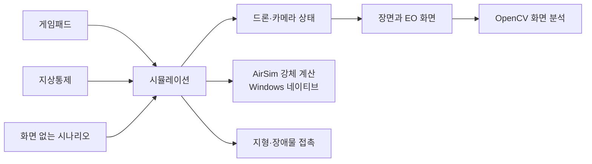

# AeroSimLab 개발 원리와 확인 결과

이 문서는 프로그램이 비행을 계산하고 화면을 만드는 흐름, 현재 모델의 한계, 실제로 측정한 결과를 설명합니다. 수치는 현재 구현을 이해하기 위한 기준입니다. 실제 드론의 성능이나 안전을 보증하지 않습니다.

## 프로그램은 어떻게 움직이나요?

시뮬레이터 화면과 화면 없는 시나리오 실행은 같은 시뮬레이션 중심 기능을 사용합니다. 지상통제 명령과 게임패드 입력도 공통 명령으로 바뀐 뒤 같은 비행 상태에 적용됩니다.



한 Tick은 1/60초입니다. 입력을 적용하고 선택한 모의 방식으로 상태를 한 번 갱신한 다음 카메라 자세를 맞춥니다. 화면이 몇 FPS로 그려지는지와 모의 시간이 얼마나 흐르는지는 별개입니다.

화면 없는 시험도 같은 시뮬레이션을 실행합니다. 따라서 버튼·통신·화면이 없어도 비행 명령과 시나리오 결과를 확인할 수 있습니다. 웹 빌드는 AirSim 없이 운동학 기준 계산을 사용합니다.

## 비행 계산은 누가 하나요?

Windows 네이티브 실행은 AirSim의 멀티로터 물리 계산을 사용합니다. 로터 힘, 모터 응답, 공기 저항, 강체의 이동·회전과 충돌 뒤 반응을 계산합니다. 별도의 Gazebo 서버가 필요하지 않습니다. 공개 X500 설정과 제조사 시험표를 참고해 질량·관성·로터 계수를 정했지만, 실제 비행 기록과 대조하지 않았습니다.

AirSim은 충돌 뒤의 반응을 계산하지만 이 프로그램의 지형이나 건물에서 접촉 위치를 찾아주지는 않습니다. 현재 장면이 드론의 충돌 상자와 지형·장애물의 겹침을 검사해 접촉 정보를 만들고 AirSim에 전달합니다. 두 엔진이 같은 운동을 따로 적분하는 구조는 아닙니다.

| 입력 또는 물리값 | 현재 기준 | 확인할 점 |
| --- | --- | --- |
| 시뮬레이션 간격 | 1/60초 | 화면 프레임 수와 무관하게 고정됩니다. |
| 기본 기체 | PX4 공개 X500 형상과 설정을 참고 | 공개 자료와 실제 조립품이 완전히 같다고 보장하지 않습니다. |
| 기체 질량 | 약 2.0643kg | 중심 기체와 네 로터를 합산한 기준값입니다. 배터리·탑재물은 다를 수 있습니다. |
| 추력·토크 계수 | 제조사 정지 시험표 15개 점에 맞춘 근사값 | X500 실기 비행의 계측값은 아닙니다. |
| 모터 응답 | 시간 상수 0.0125초 | 실제 상승·하강 응답 차이를 하나의 값으로 단순화했습니다. |
| 공기 저항 | AirSim 일반 기본값 | X500에서 직접 측정한 계수가 아닙니다. |
| 조종 제어 | 위치·속도 목표에서 로터 회전수로 변환 | 실제 PX4 Position 모드나 조종기 감도를 그대로 재현한 검증은 없습니다. |

### 조종 목표에서 로터 힘까지

위치 목표에서는 위치 차이와 현재 속도를 함께 보고 목표 가속도를 구합니다. 속도 목표에서는 목표와 현재 속도의 차이를 사용합니다. 가속도는 최대 4m/s²로 제한합니다.

```text
위치 목표: a = 3 × (목표 위치 - 현재 위치) - 2.5 × 현재 속도
속도 목표: a = 2.5 × (목표 속도 - 현재 속도)
필요한 월드 추력: F = m × (a + g),  g = (0, 0, 9.81)m/s²
자세 제어 토크: τ = I × (20e - 7ω),  |τ| ≤ 0.5N·m
로터 추력: T = k_f × ω²
로터 속도: ω = √(T / k_f)
```

`m`은 질량(kg), `I`는 관성 행렬(kg·m²), `e`는 자세 오차(rad), `ω`는 각속도(rad/s)입니다. 네 로터의 위치와 회전 방향으로 힘과 토크를 나누고, AirSim에 목표 회전 속도를 전달합니다. AirSim이 모터 지연을 적용한 뒤 강체 이동과 회전을 적분합니다. 이 조종 이득은 시뮬레이터 입력을 만들기 위한 값이며 PX4 Position 모드의 실제 조종 감도와 같다는 근거는 없습니다.

| 기체 값 | 사용값 | 자료와 단순화 |
| --- | ---: | --- |
| 총 질량 | 약 2.0643kg | 중심 기체와 네 로터의 질량을 합산했습니다. 배터리·탑재물 구성은 반영하지 않았습니다. |
| 관성 대각 성분 | 0.02385, 0.02395, 0.04400kg·m² | 공개 PX4 모델의 기체와 로터를 중심 기준으로 합산했습니다. 실제 조립품에서 재지 않았습니다. |
| 로터 위치 | 중심에서 약 0.174m, 기준면보다 0.06m 위 | 공개 X500 배치를 참고했습니다. |
| 추력 계수 `k_f` | 약 1.2295×10⁻⁵ N/(rad/s)² | 제조사 시험표 15개 점을 `T = k_f × ω²`에 맞췄습니다. |
| 토크/추력 비 | 약 0.01403m | 같은 시험표의 추력과 토크로 계산했습니다. |
| 최대 로터 속도 | 약 1032rad/s (9857rpm) | 시험표에서 가장 높은 측정 회전수입니다. 모터 정격 한계는 아닙니다. |
| 모터 응답 시간 상수 | 0.0125초 | 실제 설정의 상승·하강 차이를 하나의 값으로 단순화했습니다. |

제조사 표의 회전수는 `RPM × 2π/60`, 추력은 `질량(g) × 9.80665/1000`으로 바꿔 계수를 구합니다. 정지 시험대 데이터에 맞춘 계산이라 실제 X500의 비행 오차를 뜻하지 않습니다.

시뮬레이션 월드는 동·북·위(ENU), 기체 기준은 앞·왼쪽·위(FLU)를 씁니다. AirSim은 북·동·아래(NED), 앞·오른쪽·아래(FRD)를 사용하므로 경계에서 축과 부호를 변환합니다. 바람·로터 위치·충돌점·자세도 각 좌표 기준에 맞춰 바꿉니다. 좌표 변환이 어긋나면 북쪽 입력이 동쪽 움직임으로 보이거나 회전이 불안정해질 수 있습니다.

## 지형과 충돌은 어디까지 표현하나요?

북한산 SRTM 지형은 약 18.8 × 23.7km 범위이며 높이 간격은 약 30m입니다. 화면에서는 높낮이를 보기 쉽도록 산을 세로로 두 배 크게 그리지만, 비행과 접촉 계산은 원래 높이를 사용합니다. 그래서 작은 굴곡이나 좁은 장애물은 나타나지 않습니다.

드론은 여러 상자로 근사하고, 건물도 외곽을 감싼 상자로 충돌을 검사합니다. 지도 자료에 건물 높이가 없어 일부 건물에는 시연용 3m를 씁니다. 이 값은 실제 높이가 아닙니다. 건물 외곽선과 시설물도 일부 구역에만 준비돼 있습니다. 정밀한 메시 충돌, 실제 건물 높이, 경로 가시성 분석은 구현되지 않았습니다.

자료 출처, 좌표 기준과 높이 한계는 [지형 자료 안내](../../assets/maps/bukhansan-demo/README.md), 문제별 분석은 [문제 해결 기록](문제해결.md)에서 볼 수 있습니다.

## 화면과 EO 카메라는 어떻게 만드나요?

장면과 EO 카메라는 OpenGL로 그립니다. 화면에 보이는 카메라 영상에서 RGB 픽셀을 읽어 OpenCV가 밝기·대비·선명도를 간단히 계산합니다. 이 분석은 AI 인식이나 실제 카메라 성능 평가가 아닙니다.

현재 X500 GLB에는 재질·이미지·UV가 들어 있지 않아, 화면에서 탄소 섬유 무늬를 입히는 식으로 보완합니다. 이 무늬는 한 장의 128×128 텍스처를 삼면 투영해 모델 전체에 적용합니다. 그림자도 아직 그리지 않습니다. 그래서 실제 CAD와 같은 표면 재질이나 작은 부품 표현은 제한됩니다. 화면의 시각 품질을 높이려면 셰이더만 바꾸기보다 재질과 UV가 준비된 모델, 그림자, 주변 지형의 상세 형상이 필요합니다.

## 확인한 결과

### 자동 시험

현재 Release 빌드에서 자동 시험 20개가 통과했습니다. 이 시험은 비행 명령, 지형·충돌, 카메라 상태와 시나리오 결과를 확인합니다. 실제 Xbox 기기별 입력, 실기체 비행, 모든 화면 크기에서의 동작은 포함하지 않습니다.

### 화면 프레임

리비전 `23d537be`의 숨김 창 Release 측정은 한 번, 5초 동안 진행했습니다. 프레임 지표는 다음과 같습니다.

| 측정값 | 결과 |
| --- | ---: |
| 그린 프레임 수 | 1,773 |
| 평균 FPS | 354.55 |
| 앱 프레임 p95 / p99 | 5.707 / 5.878ms |
| 앱 프레임 최댓값 | 104.992ms |
| 렌더링·화면 교체 p95 / p99 | 5.695 / 5.865ms |
| 렌더링·화면 교체 최댓값 | 92.305ms |

한 번의 숨김 창 측정이므로 실제 화면의 조작 반응이나 장시간 안정성으로 해석할 수 없습니다. 앱 프레임과 렌더링 시간의 각 최댓값은 서로 다른 프레임일 수 있습니다.

EO 픽셀을 비동기로 읽도록 바꾼 뒤 세 번 측정한 결과, 일반 프레임의 p95는 약 5.8ms였지만 최악 프레임은 84~94ms로 남았습니다. 픽셀을 읽지 않은 프레임에서도 긴 프레임이 발생해 원인을 단정하지 못했습니다. 자세한 추적은 [EO 프레임 지연 기록](문제해결/화면-프레임-지연.md)에 있습니다.

### CPU 표본 기록

Release 데모를 31.58초 기록했고 이벤트 손실은 없었습니다. CPU 표본에는 Windows 커널, NVIDIA 드라이버, 동시성 런타임과 OpenCV 영상 처리 함수가 나타났습니다. 커널 표본의 기호를 충분히 해석하지 못했고 긴 프레임의 순간과 함수 표본을 연결하지 못했습니다. 따라서 특정 구성요소가 지연 원인이라고 결론 내릴 수 없습니다.

CPU 표본은 함수의 실제 실행 시간을 재지 않고 GPU 실행 시간도 알려 주지 않습니다. 이 기록은 병목을 좁히기 위한 자료이며, GPU와 CPU 대기를 프레임 단위로 연결한 분석은 아직 없습니다. 원본 ETL은 시스템 경로와 프로세스 정보를 포함할 수 있어 공개 문서에 두지 않았습니다.

### 여러 드론 실행

화면 없는 분리 배치에서 충돌을 포함한 강체 계산을 확인했습니다. 각 규모는 30,000 Tick씩 세 번 실행했습니다. 표의 값은 반복별 Tick p95의 중앙값입니다.

| 드론 수 | Tick p95 중앙값 |
| ---: | ---: |
| 32 | 97.1µs |
| 64 | 202.8µs |
| 128 | 418.0µs |
| 256 | 862.1µs |

이는 해당 PC와 시작 배치에서 얻은 값이며, 실제 편대의 성능이나 정확도를 보장하지 않습니다.

확장 시험에서 완료한 규모와 제한 시간에 걸린 실행도 구분해 기록했습니다.

| 실행 종류 | 확인한 규모 | 결과 |
| --- | --- | --- |
| 운동학, 분리 배치 | 1,024대 | 30,000 Tick씩 세 번 완료 |
| AirSim 강체, 분리 배치 | 512대 | 30,000 Tick씩 세 번 완료 |
| AirSim 강체, 분리 배치 | 1,024대 | 한 차례 26,000 Tick 뒤 30초 제한 도달 |
| 운동학 공동 임무 | 1,024대 | 세 번 모두 모든 목표 완료 |
| AirSim 강체 공동 임무 | 128대 | 세 번 모두 모든 목표 완료 |

확장 시험의 드론들은 시작 조건과 명령이 정해진 화면 없는 시나리오에서 실행했습니다. 시간 제한에 걸린 강체 1,024대 결과는 완료한 반복과 같은 기준으로 비교할 수 없습니다. 공동 임무 시험 결과도 실제 통신이나 경로 충돌 회피를 검증하지 않습니다.

### 최소 거리 판정 경로의 반복 작업

시나리오가 최소 드론 간 거리를 요청하면 시작 시점과 각 Tick 뒤에 모든 드론 쌍의 중심 거리를 확인합니다. 1,024대에서는 한 번 확인할 때마다 523,776쌍을 비교합니다. 기존 흐름은 이 쌍을 검사할 때마다 두 드론의 현재 상태를 이름으로 다시 찾고, 거리를 구하려고 매번 제곱근을 계산했습니다.

상태를 드론마다 한 번만 읽어 배열에 모으고, 제곱 거리로 후보를 비교한 뒤 최솟값이 바뀔 때만 실제 거리를 계산하도록 바꿨습니다. 같은 Release 빌드와 1,024대 정지 배치를 사용해 바꾸기 전후를 세 번씩 실행했습니다. 입력은 드론 사이 간격 2m, 명령 없음, 최소 거리 기준 1.9m였습니다. 한 번은 1 Tick, 다른 한 번은 60 Tick으로 실행했습니다. 시간은 프로세스 시작, JSON 처리, 시나리오 실행, 결과 출력을 포함한 전체 호출 시간입니다.

| 코드 리비전 | Tick 수 | 실행 시간 세 번 | 중앙값 |
| --- | ---: | --- | ---: |
| `29696759` 변경 전 | 1 | 81.89, 80.16, 101.82ms | 81.89ms |
| `29696759` 변경 전 | 60 | 1,057.48, 1,026.24, 1,074.42ms | 1,057.48ms |
| `4d717248` 변경 후 | 1 | 69.59, 46.51, 55.63ms | 55.63ms |
| `4d717248` 변경 후 | 60 | 70.98, 92.60, 76.09ms | 76.09ms |

이 입력에서 60 Tick 전체 호출의 중앙값은 약 1.06초에서 76ms로 줄었습니다. 다만 1 Tick 결과에서도 프로세스 시작과 JSON 처리에 수십 ms가 걸리는 등 실행 간 편차가 보였습니다. 따라서 이 변화율을 거리 계산 함수만의 성능이나 다른 시나리오의 개선율로 해석하면 안 됩니다. 결과는 1,024대 정지 배치에서 반복되는 최소 거리 계산 경로를 확인한 값이며, 강체 물리·충돌이나 실제 비행 성능을 측정하지 않았습니다. 반복별 기록은 [최소 거리 계산 측정](../../benchmarks/results/aerosimlab-separation-metric-release-2026-10-23.json)에 있습니다.

벤치마크 실행별 조건과 원본은 [현재 측정 결과](../../benchmarks/results/)에 보관합니다. 서로 다른 코드 리비전·장면·측정 조건의 숫자는 직접 비교하지 않습니다.

## 라이브러리와 사용 조건

- AirSim은 커밋 `1ca93f6f77e4e8a39b2b241c1fe2764da4d7dd41`에 고정하고 MIT 라이선스를 따릅니다. Microsoft는 기존 AirSim 저장소가 더는 업데이트되지 않는다고 안내했습니다.
- Flecs 4.1.6은 MIT 라이선스, Eigen 3.4.0은 MPL 2.0 라이선스입니다.
- 함께 배포할 때는 외부 라이브러리의 저작권과 라이선스 안내를 보존해야 합니다.

## 참고 자료

- [AirSim 물리 계산과 접촉 반응](https://github.com/microsoft/AirSim/blob/1ca93f6f77e4e8a39b2b241c1fe2764da4d7dd41/AirLib/include/physics/FastPhysicsEngine.hpp)
- [AirSim 좌표 기준](https://microsoft.github.io/AirSim/apis/)
- [AirSim 로터 모터 모델](https://github.com/microsoft/AirSim/blob/1ca93f6f77e4e8a39b2b241c1fe2764da4d7dd41/AirLib/include/vehicles/multirotor/RotorActuator.hpp)
- [PX4 X500 기체 설정](https://github.com/PX4/PX4-gazebo-models/tree/e5997f455e33ec071c7c677fc59a65781de496a4/models/x500)
- [T-Motor AIR2216II KV920과 T1045 시험표](https://store.tmotor.com/product/air-gear-450II-combo-set.html)
