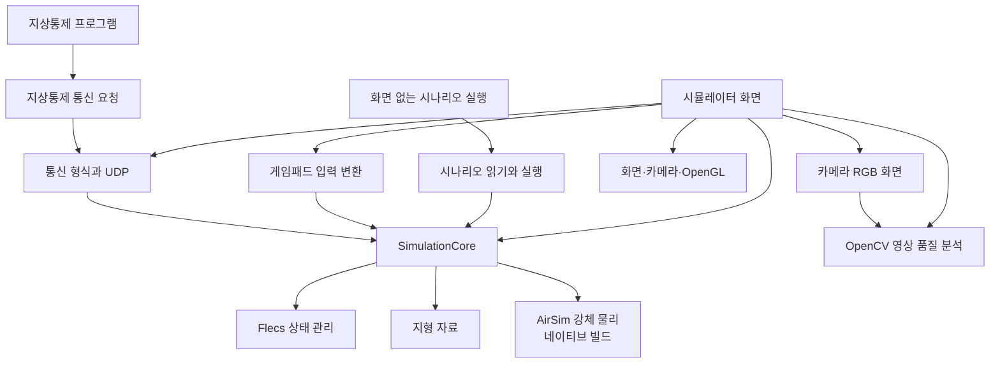

# 비행 물리와 기술 선택

## 프로그램 구조

시뮬레이터는 여러 프로그램을 따로 실행하는 구조가 아니라, 역할별 C++ 모듈을 한 응용 프로그램 안에서 연결한 구조입니다. 화면이 필요한 프로그램과 화면 없이 시나리오만 실행하는 프로그램은 같은 `SimulationCore`를 사용합니다.



- **시뮬레이션 중심 모듈**은 드론·카메라 상태와 Tick을 관리합니다. 네이티브 강체 모드에서는 Flecs가 상태와 물리 객체 번호를 보관하고, `PhysicsWorld`가 AirSim 강체를 소유합니다. 물리 월드에서 한 번 움직인 결과를 Tick 뒤 상태에 반영합니다.
- **시나리오 실행 모듈**은 입력 JSON을 먼저 검증된 실행 설정으로 바꿉니다. 실행기는 이 설정으로 시뮬레이션을 만들고 명령을 Tick 순서대로 적용한 뒤, 마지막 상태를 기대값과 비교합니다. 화면 없는 시험도 별도 비행 계산을 다시 만들지 않습니다.
- **통신과 조종 모듈**은 외부 명령이나 스틱 값을 공통 드론 명령으로 바꿉니다. 시뮬레이션 규칙 자체는 통신 창이나 게임패드 코드가 소유하지 않습니다.
- **그래픽과 영상 모듈**은 장면을 그리고 카메라 프레임을 만듭니다. RGB 프레임은 센서 모듈이 소유하고, OpenCV 분석은 화면 품질 값을 계산합니다.
- **웹 빌드**는 네이티브 AirSim·UDP 경로를 포함하지 않고 운동학 기준 모드를 사용합니다. 화면에 지형을 그려도 충돌 지형을 강체 물리 월드에 등록하지 않습니다.

GPU 자원은 OpenGL 창의 실행 환경이 살아 있을 때만 만들고 지울 수 있습니다. 시뮬레이터는 창을 먼저 만들고 그 뒤에 화면 자원을 소유하므로, 종료할 때 자원은 창보다 먼저 정리됩니다. 지상통제 창은 비동기 명령을 보내지만 OpenGL 렌더링은 같은 창 스레드에서 수행합니다. 지상통제 창이 소유한 UDP 소켓은 비동기 작업이 빌려 씁니다. 종료할 때 작업을 취소하고, 작업을 기다리는 future가 소켓보다 먼저 파괴되도록 멤버 순서를 둡니다.

빌드 대상은 실행 프로그램과 공통 기능으로 나뉩니다. `aerosimlab_simulator`는 화면·입력·통신 기능을 묶은 `aerosimlab_simulator_app`을 사용하고, `aerosimlab_headless`는 같은 `aerosimlab_simulation_core`를 화면 없이 실행합니다. Windows 지상통제 프로그램은 `aerosimlab_ground_control_client`를 거쳐 공통 통신 기능을 사용합니다.

| 대상 | 주요 연결 관계 |
| --- | --- |
| `aerosimlab_simulator_app` | 화면, 시뮬레이션 중심 모듈, 게임패드, 센서, 통신에 연결됩니다. 네이티브 빌드에서는 OpenCV 영상 분석과 ImGui 화면도 사용합니다. |
| `aerosimlab_headless` | 시뮬레이션 중심 모듈을 직접 실행합니다. 화면과 게임패드가 없어도 같은 비행·시나리오 계산을 씁니다. |
| `aerosimlab_ground_control_client` | 공통 통신 기능을 사용합니다. Windows 지상통제 창과 명령줄 프로그램이 이 연결을 공유합니다. |
| `aerosimlab_simulation_core` | Flecs로 상태를 관리하고 지형 모듈을 사용합니다. 네이티브 강체 모드에서만 AirSim과 Eigen을 연결합니다. |
| `aerosimlab_graphics` | GLFW와 OpenGL을 사용합니다. Windows와 Linux에서는 GLAD가 OpenGL 함수 연결을 돕고, 웹 빌드는 브라우저의 WebGL 경로를 사용합니다. |

웹 빌드에는 네이티브 강체 물리, UDP 통신, OpenCV 분석, ImGui 패널이 들어가지 않습니다. 화면 시뮬레이터는 유지하지만 운동학 기준 계산을 사용합니다.

## 한 물리 엔진을 사용합니다

강체 비행은 AirSim C++ 물리 라이브러리 하나로 계산합니다. AirSim이 로터 힘, 바람과 공기 저항, 강체 운동, 수치 적분, 접촉 뒤 반응을 맡습니다. 별도의 Jolt나 Gazebo 물리 계산을 함께 돌리지 않습니다. Windows에서 실행할 때 Gazebo 서버도 필요하지 않습니다.

| 후보 | 맡는 일 | 선택 판단 |
| --- | --- | --- |
| AirSim | 멀티로터, 모터 응답, 강체 계산, 바람과 충돌 후 반응을 제공 | 현재 선택. 이미 있는 비행 물리를 한 경로에서 사용합니다. 다만 Microsoft가 기존 AirSim을 보관 상태로 전환했고 더는 업데이트하지 않는다고 밝혔습니다. |
| Jolt와 직접 만든 비행 모델 | Jolt가 강체를 계산하고 앱이 모터·로터·공력 모델을 추가해야 함 | 제외. 비행 물리와 강체 계산을 각각 연결하고 검증해야 합니다. |
| Gazebo Sim | 세계·기체 모델과 물리 플러그인을 함께 실행 | 제외. 기존 화면과 별도로 Gazebo 실행 환경을 운영해야 합니다. PX4 설정과 모델 자료는 참고합니다. |

AirSim의 `FastPhysicsEngine`은 충돌 후 속도·회전 변화를 계산하지만, 주변 장면을 살펴 부딪힌 위치를 찾지는 않습니다. 전체 AirSim에서는 Unreal이 그 접촉 정보를 만듭니다. 이 프로그램은 Unreal 없이 실행하므로 현재 지형과 장애물에서 간단한 접촉 정보를 만들어 AirSim에 전달합니다. 이것은 두 물리 엔진을 섞는 구성이 아니라, AirSim 한 곳에 접촉 정보를 제공하는 방식입니다. 정확한 메시 충돌이 필요해지면 장면의 충돌 탐색을 보강해야 합니다.

## 한 번의 계산 순서

Flecs는 드론과 카메라의 상태를 보관합니다. 여기서 객체(Entity)는 드론이나 카메라 하나를 가리키고, Component는 위치·속도·제어 목표처럼 그 객체가 가진 값입니다. 강체 모드의 드론 객체에는 AirSim 강체를 가리키는 번호와 기체 제원을 함께 둡니다. 강체 자체는 물리 월드가 소유하고, 드론 객체가 사라질 때 연결된 강체도 함께 지웁니다.

강체 모드에서는 Flecs가 제어 목표를 로터 명령으로 바꾸고, 물리 월드가 지형·장애물과 닿았는지 확인해 접촉 정보를 만듭니다. AirSim은 이 정보와 로터 힘을 받아 위치·속도·자세를 한 번 계산합니다. 계산 결과를 Flecs 상태에 복사한 뒤 비행 상태와 카메라 위치를 갱신합니다. 같은 물체를 두 곳에서 적분하지 않습니다. 운동학 모드는 비교용으로 선택했을 때만 별도 계산을 합니다. 화면과 충돌에 쓰는 지형 높이 격자는 한 번 읽어 물리 월드로 옮기므로 같은 배열을 두 벌 보관하지 않습니다.

명령에서 화면까지의 흐름은 다음과 같습니다.

1. 매 화면 프레임에 게임패드와 UDP 명령을 확인합니다. UDP 명령은 형식과 순서를 검사한 뒤 처리 대기 상태에 둡니다.
2. 실제 시간은 1/60초 간격의 고정 Tick으로 바꿉니다. 한 Tick에서는 지상통제, 기록 재생, 게임패드 또는 시연 명령 중 해당 입력을 적용합니다.
3. 선택한 모의 방식으로 드론 상태를 한 번 갱신하고, 그 뒤 카메라의 위치와 방향을 맞춥니다.
4. 화면을 그린 뒤 EO 카메라 화면을 RGB 픽셀로 읽습니다. OpenCV 품질 분석은 같은 화면 프레임 안에서 끝내므로 픽셀을 복사하지 않고 잠시 빌려 씁니다.
5. 화면 없는 시나리오도 같은 고정 간격 모의 엔진을 사용하고, 마지막 상태를 기대값과 비교해 통과 여부를 돌려줍니다.

입력 기록은 명령과 적용 Tick만 메모리에 보관합니다. RGB 픽셀은 프레임이 소유하고 분석하는 동안에만 잠시 빌려줍니다. 창과 화면 자원은 앱이 소유하며, 화면 자원을 정리한 뒤 창을 닫습니다.

시뮬레이션 좌표는 미터 단위이며 X는 동쪽, Y는 북쪽, Z는 위쪽입니다. AirSim의 NED 이름은 X가 북쪽, Y가 동쪽, Z가 아래쪽을 뜻합니다. 현재 내부 어댑터는 X·Y 값을 서로 바꾸지 않고 높이축만 뒤집습니다. 따라서 AirSim 안의 X·Y를 지리 기준 북쪽·동쪽으로 읽으면 안 됩니다. 지금은 AirSim에 지리 좌표를 직접 전달하거나 AirSim 좌표를 외부 통신으로 내보내지 않습니다. 외부 NED 데이터나 방향에 따라 달라지는 환경 효과를 연결할 때는 위치뿐 아니라 속도·자세·각속도·로터 배치·접촉 방향까지 같은 기준으로 변환하고 별도 시험해야 합니다. Tick 간격은 1/60초이며 화면 프레임 수와 무관하게 고정되어 있습니다.

## 물리식과 현재 가정

### 조종 목표를 로터 속도로 바꾸는 과정

비행 모드에 따라 제어기가 목표를 다르게 해석합니다. 이륙·착륙·경유점 이동에서는 목표 위치까지의 차이와 현재 속도를 함께 써서 가속도를 정합니다. 제자리 유지나 속도 명령에서는 목표 속도와 현재 속도의 차이를 사용합니다.

```text
위치 목표: 목표 가속도 = 3 × (목표 위치 - 현재 위치) - 2.5 × 현재 속도
속도 목표: 목표 가속도 = 2.5 × (목표 속도 - 현재 속도)
```

이 값은 m/s²이며, 위치·속도 변화가 너무 커져도 가속도 크기는 최대 4m/s²로 제한합니다. 기체 질량을 `m`, 위쪽 중력 가속도를 `g = (0, 0, 9.81)m/s²`라 하면 필요한 월드 추력은 `F = m(a + g)`입니다. 이 추력 방향에 기체의 위쪽 축을 맞추고, 목표 yaw로 기체의 앞 방향을 정합니다.

자세 오차 `e`는 rad, 기체 좌표계 각속도 `ω`는 rad/s, 관성 행렬 `I`는 kg·m² 단위입니다. 회전 토크는 `τ = I(20e - 7ω)`로 구하고, 크기를 최대 0.5N·m로 제한합니다. 이어 로터 위치와 회전 방향을 반영한 연립방정식에서 네 로터의 추력을 나눠 구합니다. 음수 추력은 0으로 제한한 뒤 `회전 속도 = √(추력 ÷ 추력 계수)`로 바꾸고, 최대 모터 속도를 넘지 않게 자릅니다. AirSim은 전달받은 목표 속도에 모터 지연을 적용하고 강체의 이동·회전을 계산합니다.

위의 제어 이득과 토크 제한은 시뮬레이터의 조종을 위한 값입니다. 실제 PX4 위치 제어기의 설정이나 조종기 반응을 그대로 재현했다고 검증한 값은 아닙니다.

로터 한 개의 추력은 `T = k_f × ω²`로 계산합니다. `ω`는 로터 속도(라디안/초), `k_f`는 추력 계수(N/(라디안/초)²), `T`는 추력(N)입니다. 네 로터 추력과 중력·공기 저항을 합해 이동을 계산합니다. 각 로터 위치 `r`에서 생기는 회전력은 `r × F`이고, 프로펠러 반작용 토크도 함께 더합니다.

기체의 회전은 `I × α = τ − ω × (I × ω)` 관계를 사용합니다. `I`는 질량이 기체에 퍼진 모양을 나타내는 관성 행렬(kg·m²), `ω`는 기체 좌표 각속도(rad/s), `α`는 각가속도(rad/s²), `τ`는 합산 토크(N·m)입니다. AirSim은 이전·현재 가속도로 속도를 갱신하고, 평균 속도로 위치와 쿼터니언 자세(회전을 나타내는 네 값)를 갱신합니다. 이 구현의 적분기는 AirSim에 들어 있는 Verlet 방식입니다.

| 항목 | 현재 사용값 | 근거와 한계 |
| --- | --- | --- |
| 기체 질량 | 약 2.0643kg | PX4 X500 중심 기체와 로터 값을 합친 기준값입니다. 배터리·탑재물에 따라 달라집니다. |
| 관성 | 대각 성분 약 0.02385, 0.02395, 0.04400kg·m² | PX4 모델의 기체·로터 관성을 기체 중심으로 합산했습니다. 실제 조립품에서 측정한 값은 아닙니다. |
| 로터 위치 | 중심에서 수평 약 0.174m, 기준면보다 0.06m 위 | PX4 X500 설정을 따릅니다. |
| 추력·토크 계수 | `k_f` 약 1.2295×10⁻⁵, 토크/추력 비 약 0.01403m | T-Motor의 AIR2216II KV920·T1045·16V 시험표 15개 점을 `추력 = k_f × 회전속도²`에 맞췄습니다. X500 V2도 2216 KV920 모터와 1045 프로펠러를 사용하지만, 두 제품이 같은 모터라고 확인할 자료는 없어 참고 추정값으로 취급합니다. |
| 최대 모터 속도 | 약 1032rad/s (9857rpm) | 위 시험표에서 가장 높은 측정 회전수입니다. 모터의 정격 한계나 기체에서 측정한 값은 아닙니다. |
| 모터 응답 | 시간 상수 0.0125초 하나 | PX4 설정은 상승 0.0125초, 하강 0.025초지만 AirSim 모델은 한 값만 받습니다. 두 방향을 같은 시간 상수로 단순화했습니다. |
| 공기 저항 | AirSim의 일반 기본 계수 `linear_drag_coefficient = 1.3/4`를 사용합니다. 각방향 계수도 같은 값입니다. | 이 계수는 X500 제원이나 실측값이 아닙니다. AirSim이 동체 상자와 프로펠러 면적을 이용해 거친 저항을 계산합니다. PX4 X500의 로터 횡방향 항력·구름 모멘트는 반영하지 않았고, 전체 저항 모델도 실측 검증하지 않았습니다. |

제조사 시험표의 회전수는 `ω = RPM × 2π/60`, 추력은 `F = 질량(g) × 9.80665/1000`으로 바꿉니다. 15개 측정점에서 제곱 오차가 가장 작아지도록 계산하면 `k_f = Σ(ω²F) / Σ(ω⁴)`이고, 토크/추력 비는 `Σ(Fτ) / Σ(F²)`입니다. 이 방식으로 얻은 추력 계수는 `1.2294935×10⁻⁵`, 토크/추력 비는 `0.01403352`입니다. 추력 예측의 평균 제곱근 오차는 표의 최대 추력 대비 약 0.742%입니다. 자동 시험도 이 15개 원자료로 계수와 오차를 다시 계산합니다. 이는 제조사 정지 시험대 표를 맞춘 결과이지, X500 실제 비행과의 비교는 아닙니다.

모터의 목표 속도를 AirSim 입력으로 바꿀 때 속도 비율을 제곱합니다. AirSim 액추에이터가 그 신호에 비례해 추력과 토크를 계산하기 때문에 최종적으로 목표 속도의 제곱에 비례하는 추력이 됩니다. 이 단계에서는 배터리 전압 강하, 프로펠러 유동 간섭, ESC 제어 특성은 계산하지 않습니다.

## 충돌과 지형의 범위

- 지면은 드론 충돌 상자 여덟 개의 밑면 꼭짓점에서 높이를 확인합니다. 가장 깊게 파고든 위치와 주변 높이 변화로 접촉 방향을 정합니다.
- 건물·시설물 상자와 드론의 아홉 충돌 상자는 회전 방향까지 포함해 겹침을 계산합니다. 둥근 경계 검사는 멀리 있는 후보를 건너뛰는 데만 쓰고, 가까운 후보는 상자 사이의 분리축을 검사합니다. 드론끼리도 같은 상자 검사로 판정합니다.
- 접촉 위치·방향·겹친 깊이를 AirSim에 넘기면, AirSim이 반발·마찰과 충돌 뒤 자세 변화를 계산합니다.
- 얇은 장애물, 복잡한 형상, 경사진 면의 접촉점은 정확하지 않을 수 있습니다. 실제 기체 충돌이나 안전성 검증에 사용할 수 없습니다.

화면과 충돌에 쓰는 북한산 지형은 NASA SRTM 1초각 높이 자료이며 범위는 약 18.8 × 23.7km입니다. 약 30m 간격의 표면 높이라 작은 지형 변화와 건물을 표현하지 못합니다. 위성 영상도 같은 범위로 넓혔지만, 건물 외곽선 17개와 국립공원 시설물 49개는 중심 구역에만 있습니다. 접촉 높이는 드론 충돌 상자 여덟 개의 밑면 꼭짓점에서 확인하며, 가장 깊게 들어간 위치와 주변 높이 변화로 접촉 방향을 정합니다. 이 방식도 지형을 정밀한 표면으로 충돌 검사하지는 않습니다. OpenStreetMap 건물 높이는 자료에 없어 충돌 상자에 3m를 쓰는 시연 가정이 있습니다. 이 값은 실측 높이가 아닙니다. 국립공원 시설물 3D 형상도 위치·높이 기준 차이가 남아 있어 지형과 맞닿는지 검증되지 않았습니다. 자료 출처와 높이 기준은 [지형 자료 안내](../../assets/maps/bukhansan-demo/README.md)에 정리했습니다.

## 확인 결과

이 문서에 대표 결과를 요약했습니다. 예전 실행에서 나온 원본은 [측정 결과 보관함](../../benchmarks/results/archive/)에 모았습니다.

- Release 빌드와 CTest 20개가 통과했습니다. 같은 기능의 세부 검증은 영역별 시험에 묶여 실행됩니다. 자유 낙하, 로터 상승, 모터 지연, 질량·관성 변화, 지면·건물 접촉, 잘못된 설정, 바람, 재설정과 화면 시작 확인을 포함합니다.
- 같은 Windows 11 Pro, i5-13600KF, RTX 3060 Ti 환경에서 화면 없는 1·2·4·8대 시험을 전후 각 3회 실행했습니다. 매 실행 전 120 Tick을 진행하고 30,000 Tick을 측정했습니다.

| 드론 수 | Jolt 물리 p95(µs) | AirSim 물리 p95(µs) | Jolt 전체 Tick p95(µs) | AirSim 전체 Tick p95(µs) |
| ---: | ---: | ---: | ---: | ---: |
| 1 | 2.6 | 1.1 | 3.7 | 2.1 |
| 2 | 2.7 | 3.0 | 4.3 | 4.9 |
| 4 | 3.0 | 6.6 | 5.4 | 9.1 |
| 8 | 3.8 | 15.0 | 7.6 | 18.9 |

표의 값은 세 번 측정한 p95 중 가운데 값입니다. p95는 측정 표본 중 95%가 이 값 이하였다는 뜻입니다. 현재 AirSim 측정값은 경사 지형의 접촉 위치를 더 자세히 살펴보는 작업을 포함하며, 이전 측정보다 물리 계산 시간이 길게 나왔습니다. 드론 수가 늘면서 계산 비용도 커집니다. 이 결과만으로 정확도나 전체 성능이 더 낫다고 말할 수 없습니다. 화면 측정은 장면 구성도 달라 Jolt 이전 결과와 직접 비교하지 않습니다. 실행 조건과 표본은 [AirSim 측정 원본](../../benchmarks/results/archive/aerosimlab-airsim-release-2026-10-22.json)에 보관합니다.

### 여러 대를 함께 실행한 확장성 측정

Windows 11 Pro, Intel Core i5-13600KF(14코어·20스레드), NVIDIA GeForce RTX 3060 Ti, 메모리 32GiB에서 Release로 측정했습니다. 사용한 코드는 `43a9e90f` 기준입니다. 실행 중 문서와 측정 자료도 바뀌고 있어 원본에는 `43a9e90f-dirty`로 기록됐습니다. 드론은 2.5m 간격으로 놓고 이륙시켜 제자리에서 호버링시켰습니다. 각 실행은 120 Tick을 준비한 뒤 최대 30,000 Tick을 측정했습니다. p50은 표본의 절반이 이 시간 안에 끝났다는 뜻이고, p95와 p99는 각각 95%와 99%가 이보다 빨랐다는 뜻입니다. 표에는 반복별 p50·p95·p99의 중앙값을 적었습니다. 가장 긴 실행 시간은 측정 원본에 함께 기록했습니다.

CPU 비율은 프로세스가 사용한 누적 CPU 시간과 실제 경과 시간으로 계산합니다. 여러 스레드가 동시에 일하면 100%를 넘을 수 있으며, 컴퓨터 전체 CPU 사용률과는 다른 값입니다. 메모리는 측정 시작 전과 끝난 뒤의 작업 집합만 확인했습니다. 실행 중 평균·최대 메모리와 드론 한 대가 늘 때 추가되는 메모리는 따로 재지 않았습니다. 전체 Tick에는 Flecs 갱신, AirSim 계산, 계산 뒤 상태 동기화가 함께 들어갑니다. ECS 시스템 시간만 따로 측정하지 않았고, 강체 물리와 접촉 생성 시간만 분리해 기록했습니다.

#### 단순 운동학 계산

이 모드는 위치와 속도를 간단한 식으로 갱신합니다. AirSim 강체 물리나 접촉 계산은 실행하지 않으므로 기준선으로만 봐야 합니다.

| 드론 수 | 반복·실행당 Tick | 지연 p50 / p95 / p99 중앙값(µs) | 초당 드론 갱신 수 | 실시간 비율 |
| ---: | ---: | ---: | ---: | ---: |
| 1 | 3회 · 30,000 | 0.7 / 1.1 / 1.2 | 1,301,389 | 21,690배 |
| 8 | 3회 · 30,000 | 1.0 / 1.1 / 1.3 | 8,426,404 | 17,555배 |
| 32 | 3회 · 30,000 | 0.8 / 1.3 / 1.5 | 31,633,682 | 16,476배 |
| 64 | 3회 · 30,000 | 1.0 / 1.7 / 2.1 | 47,210,406 | 12,294배 |
| 128 | 3회 · 30,000 | 1.4 / 2.2 / 2.5 | 74,545,158 | 9,706배 |
| 256 | 3회 · 30,000 | 3.0 / 3.6 / 4.6 | 87,173,963 | 5,675배 |
| 512 | 3회 · 30,000 | 4.7 / 5.7 / 7.4 | 105,357,020 | 3,430배 |
| 1,024 | 3회 · 30,000 | 6.9 / 10.1 / 20.2 | 124,659,034 | 2,029배 |

모든 실행에서 16.67ms를 넘긴 Tick은 없었습니다. 가장 큰 단일 Tick은 267.2µs였습니다. CPU 사용률은 약 98.3~101.0%, 작업 집합은 184.0~190.5MiB였습니다. 이 값은 프로세스 전체를 측정한 것이며, 드론 한 대의 메모리 사용량으로 나눠 해석할 수 없습니다. 이 결과는 단순 계산량만 보여주며, 강체 물리 모드가 이 규모를 처리한다는 뜻은 아닙니다.

#### AirSim 강체 계산

AirSim이 로터 힘과 강체 운동을 계산하는 모드입니다. 물리 계산 지연은 전체 Tick 시간과 따로 기록했습니다.

| 드론 수 | 반복·실행당 Tick | 지연 p50 / p95 / p99 중앙값(µs) | 물리 지연 p95 중앙값(µs) | 초당 드론 갱신 수 | 실시간 비율 |
| ---: | ---: | ---: | ---: | ---: | ---: |
| 1 | 3회 · 30,000 | 2.1 / 3.3 / 3.8 | 1.7 | 382,493 | 6,375배 |
| 8 | 3회 · 30,000 | 14.3 / 21.8 / 42.9 | 17.1 | 466,825 | 973배 |
| 32 | 3회 · 30,000 | 95.0 / 159.7 / 241.8 | 142.1 | 285,149 | 149배 |
| 64 | 3회 · 30,000 | 331.6 / 493.9 / 609.8 | 462.3 | 178,288 | 46배 |
| 128 | 1회 · 25,000 | 1,107.1 / 1,617.2 / 1,823.6 | 1,559.5 | 106,428 | 14배 |

초당 드론 갱신 수는 `드론 수 × 측정 Tick ÷ 실제 측정 시간`으로 계산했습니다. 실시간 비율은 진행한 모의 시간을 실제 경과 시간으로 나눈 값입니다. 1배면 모의가 실제 시간과 같은 속도로 진행되고, 1배보다 크면 더 빨리 진행된다는 뜻입니다.

128대 시험은 한 번 실행하다 30초 제한에 걸렸습니다. 이 결과는 세 번 반복한 값과 같은 신뢰도로 볼 수 없습니다. 그 구간까지 16.67ms를 넘긴 Tick은 없었고, 가장 큰 Tick은 4.54ms였습니다. 256대 이상은 아직 확인하지 않았습니다. CPU 사용률은 약 99.2~100.0%, 작업 집합은 183.8~184.7MiB였습니다. 두 값은 프로세스 전체를 측정한 것이며, 드론 한 대가 늘 때 필요한 메모리로 해석할 수 없습니다.

#### 멀리 있는 드론의 충돌 검사를 줄인 뒤

기준선에서는 각 드론이 나머지 모든 드론과 부딪히는지 확인했습니다. 바꾼 뒤에는 먼저 드론을 X축 위치 순서로 정렬하고, 충돌 모양이 닿을 수 있는 범위에 있는 드론만 기존 상자 검사로 넘깁니다. 이 간격 측정은 후보를 거르는 단계이며, 실제 충돌 판정 방식은 그대로 둡니다. 드론이 한곳에 모여 있으면 검사 후보가 많아져 이득이 줄 수 있습니다.

| 드론 수 | 기준 Tick p95 (µs) | 변경 후 Tick p95 (µs) | 감소율 | 기준 물리 p95 (µs) | 변경 후 물리 p95 (µs) |
| ---: | ---: | ---: | ---: | ---: | ---: |
| 1 | 3.3 | 3.3 | 0% | 1.7 | 1.6 |
| 8 | 21.8 | 17.0 | 22.0% | 17.1 | 12.6 |
| 32 | 159.7 | 69.1 | 56.7% | 142.1 | 54.0 |
| 64 | 493.9 | 137.7 | 72.1% | 462.3 | 109.5 |
| 128 | 1,617.2 | 282.9 | 82.5% | 1,559.5 | 229.8 |

1·8·32·64대는 각 방식에서 30,000 Tick씩 세 번 측정했습니다. 128대 기준선은 25,000 Tick 한 번뿐이지만, 변경 후에는 30,000 Tick씩 세 번을 마쳤습니다. 따라서 128대 감소율은 참고값으로 봐야 합니다. 변경 후에는 256대와 512대도 각각 30,000 Tick씩 세 번 측정했고, 1,024대는 15,000 Tick 한 번을 실행한 뒤 30초 제한에 도달했습니다. 이 측정에서 16.67ms를 넘긴 Tick은 없었습니다. 변경 후 원본에는 모든 실행의 p50·p95·p99와 최댓값이 기록돼 있습니다. [기준 원본](../../benchmarks/results/archive/aerosimlab-scaling-release-2026-10-23.json)과 [변경 후 원본](../../benchmarks/results/aerosimlab-scaling-after-broadphase-release-2026-10-23.json)을 함께 확인할 수 있습니다.

#### 최신 확장성 측정 요약

Release 빌드의 최신 측정은 코드 리비전 `8faf19f5`에서 진행했습니다. 드론은 서로 간격을 두거나 가까이 모아 호버링 상태로 두었고, 120 Tick을 준비한 뒤 각 실행에서 최대 30,000 Tick을 측정했습니다. 대부분 규모는 세 차례 반복했고, 예외는 표에 표시했습니다. 아래 지연과 실시간 비율은 반복별 측정값의 중앙값입니다.

| 모의 방식·배치 | 드론 수 | 반복·실행당 Tick | p50 / p95 / p99 (µs) | 실시간 비율 |
| --- | ---: | ---: | ---: | ---: |
| 운동학·분산 | 128 | 3회 · 30,000 | 1.3 / 1.5 / 2.2 | 11,759배 |
| 운동학·분산 | 256 | 3회 · 30,000 | 2.1 / 2.3 / 3.1 | 7,344배 |
| 운동학·분산 | 512 | 3회 · 30,000 | 3.4 / 4.0 / 4.4 | 4,634배 |
| 운동학·분산 | 1,024 | 3회 · 30,000 | 6.1 / 6.8 / 10.5 | 2,621배 |
| AirSim 강체·분산 | 128 | 3회 · 30,000 | 124.3 / 155.3 / 222.8 | 128.7배 |
| AirSim 강체·분산 | 256 | 3회 · 30,000 | 250.1 / 313.4 / 387.6 | 64.1배 |
| AirSim 강체·분산 | 512 | 3회 · 30,000 | 521.2 / 658.1 / 743.5 | 30.6배 |
| AirSim 강체·분산 | 1,024 | 1회 · 27,000 | 1,088.4 / 1,327.8 / 1,420.2 | 14.8배 |
| AirSim 강체·밀집 | 128 | 3회 · 30,000 | 565.1 / 681.8 / 746.3 | 28.6배 |
| AirSim 강체·밀집 | 256 | 1회 · 25,000 | 1,191.6 / 1,374.8 / 1,471.6 | 13.7배 |

운동학 분산 배치는 1,024대까지 세 차례 측정했습니다. AirSim 강체 분산 배치는 512대, 밀집 배치는 128대까지 세 차례 측정했습니다. 1,024대 분산 배치와 256대 밀집 배치는 한 번 실행에서 30초 제한에 걸렸으므로 참고값으로 봐야 합니다. 이 시험은 호버링 조건에서 진행했으며, 통신·영상 분석·화면 그리기는 포함하지 않습니다. 밀집 충돌을 포함한 실제 협동 임무에서의 처리 규모도 보증하지 않습니다. 원본에는 그래픽 장치와 실행별 수치가 기록돼 있습니다. [측정 원본](../../benchmarks/results/aerosimlab-full-benchmark-release-2026-10-23-8faf19f5.json)에서 확인할 수 있습니다.

앞서 비교한 기준선과 변경 후 시험은 드론을 서로 떨어뜨려 단순 호버링만 시켰습니다. 밀집 충돌, 임무 수행, 통신과 영상 분석은 포함하지 않아 실제 다중 드론 운용 성능을 보증하지 않습니다.

#### 가까이 겹쳐 출발하는 경우

같은 Release 실행 파일에서 각 드론을 0.55m 간격의 격자에 놓고 이륙시켰습니다. 드론의 충돌 모양이 서로 겹친 상태로 시작하므로, 이 측정은 접촉이 생길 수 있는 상황에서 물리 계산이 얼마나 늘어나는지 살펴봅니다. 이륙 뒤에는 충돌 반응으로 드론 사이 간격이 달라집니다. 좁은 편대가 계속 유지되는 상황을 재현한 시험은 아닙니다. 표에는 세 번 측정한 Tick p95와 물리 계산 p95의 중앙값을 적었습니다.

| 배치 | 드론 수 | Tick p95 (µs) | 물리 계산 p95 (µs) | 측정한 실행 |
| --- | ---: | ---: | ---: | --- |
| 서로 떨어짐 | 8 | 17.3 | 12.6 | 3회 · 30,000 Tick |
| 가까이 겹침 | 8 | 208.9 | 202.7 | 3회 · 30,000 Tick |
| 서로 떨어짐 | 32 | 67.6 | 52.9 | 3회 · 30,000 Tick |
| 가까이 겹침 | 32 | 1,314.1 | 1,292.1 | 3회 · 30,000 Tick |
| 서로 떨어짐 | 64 | 132.5 | 105.7 | 3회 · 30,000 Tick |
| 가까이 겹침 | 64 | 2,852.9 | 2,814.9 | 1회 · 16,000 Tick, 30초 제한 |

64대 밀집 측정은 한 번만 끝까지 실행하지 못했으므로 반복 측정 결과와 직접 비교하기 어렵습니다. 이 시험에서는 16.67ms를 넘긴 Tick이 없었지만, 측정한 p95는 2.85ms였습니다. 충돌 후보를 줄이는 정렬 방식은 서로 멀리 있는 드론이 많을 때 효과가 크며, 가까운 드론이 한꺼번에 닿으면 좁혀지는 후보 수가 줄어 이점이 작아집니다. 실제로 운용 가능한 밀집 비행 규모를 보증하는 결과는 아닙니다. [밀집 배치 측정 원본](../../benchmarks/results/archive/aerosimlab-scaling-compact-release-2026-10-23.json)에서 전체 실행과 최댓값을 확인할 수 있습니다.

#### 접촉 정보를 만드는 데 든 시간

물리 단계 안에서 접촉 정보를 찾는 부분과 AirSim 계산을 따로 살펴봤습니다. 접촉 생성 시간에는 드론 위치 정렬, 각 드론의 환경 갱신, 지형·장애물·다른 드론과의 접촉 확인이 포함됩니다. 표의 비율은 각 Tick에서 `접촉 생성 시간 ÷ 물리 단계 전체 시간`을 계산한 뒤, 그 비율의 p95를 반복 측정끼리 비교한 값입니다.

| 배치 | 드론 수 | 물리 p95 (µs) | 접촉 생성 p95 (µs) | Tick별 비율 p95 | 측정한 실행 |
| --- | ---: | ---: | ---: | ---: | --- |
| 서로 떨어짐 | 32 | 51.6 | 38.1 | 79.9% | 3회 · 30,000 Tick |
| 서로 떨어짐 | 256 | 528.1 | 386.4 | 79.3% | 3회 · 30,000 Tick |
| 가까이 겹침 | 8 | 239.1 | 234.3 | 98.7% | 3회 · 30,000 Tick |
| 가까이 겹침 | 32 | 1,322.6 | 1,299.6 | 99.0% | 3회 · 30,000 Tick |
| 가까이 겹침 | 64 | 2,923.8 | 2,869.3 | 99.0% | 1회 · 15,000 Tick, 30초 제한 |

이 결과에서는 가까이 겹친 드론이 많을 때 접촉 정보를 만드는 일이 물리 시간 대부분을 차지했습니다. 그래서 각 드론의 충돌 상자를 Tick마다 한 번 월드 좌표로 바꾸고, 가까운 드론 쌍과의 검사에서 재사용하도록 바꿨습니다. 같은 32대 밀집 배치의 세 번 측정에서 Tick p95 중앙값은 1,344.3µs에서 665.1µs로 50.5%, 물리 단계는 1,322.6µs에서 649.0µs로 50.9%, 접촉 생성은 1,299.6µs에서 632.7µs로 51.3% 줄었습니다. 매 실행은 120 Tick을 준비한 뒤 30,000 Tick을 측정했습니다. 접촉 생성 비율은 여전히 물리 단계의 약 98%이며, 추가 개선 여지가 남아 있습니다. 실행 파일에 포함된 리비전 표기는 CMake 구성 시점의 값이어서, 결과에는 실제 소스 커밋과 포함된 표기를 구분해 기록했습니다. 이 비교는 같은 Windows Release PC와 배치의 세 번 측정에 한정되며 다른 기기나 밀집 상태를 보증하지 않습니다. [접촉 시간 기준 측정](../../benchmarks/results/archive/aerosimlab-physics-breakdown-release-2026-10-23.json)과 [상자 재사용 후 측정](../../benchmarks/results/aerosimlab-collision-box-cache-after-release-2026-10-23.json)을 함께 볼 수 있습니다.

#### 가까운 드론 쌍의 접촉 검사 후속 측정

한 쌍의 드론이 겹쳐 있을 때 충돌 검사를 양쪽 기체에서 각각 반복하지 않도록 바꿨습니다. 한 번 찾은 접촉 정보를 두 기체에 반대 방향으로 전달합니다. PX4 X500 모양을 사용한 밀집 배치 시험 결과는 다음과 같습니다. 각 규모에서 30,000 Tick씩 세 차례 측정한 p95의 중앙값입니다.

| 드론 수 | Tick p95 (µs) | 물리 p95 (µs) | 접촉 생성 p95 (µs) |
| ---: | ---: | ---: | ---: |
| 32 | 97.1 | 82.7 | 72.2 |
| 64 | 202.8 | 178.4 | 158.1 |
| 128 | 418.0 | 370.4 | 330.8 |
| 256 | 862.1 | 772.2 | 701.9 |

이전 전체 측정의 밀집 배치에서 32·64·128대 Tick p95 중앙값은 151.1µs, 325.1µs, 681.8µs였습니다. 서로 떨어뜨린 128대 측정은 155.3µs에서 155.0µs로 비슷했습니다. 두 측정은 같은 Windows PC와 Release 설정, GPU, 드론 배치를 사용했지만 소스 리비전이 다릅니다. 따라서 차이 전체를 이번 접촉 검사 변경의 효과라고 단정할 수는 없습니다. 256대는 이전에 25,000 Tick 한 번만 측정했으므로 전후 수치를 직접 비교하지 않습니다. [이전 전체 측정](../../benchmarks/results/aerosimlab-full-benchmark-release-2026-10-23-8faf19f5.json)과 [후속 측정](../../benchmarks/results/aerosimlab-dense-contact-pair-check-release-2026-10-23.json)에서 실행별 값을 확인할 수 있습니다.

#### 평평한 바닥 접촉 검사 줄이기

이전 확장성 측정에서 드론이 서로 떨어져 있을 때 물리 Tick의 약 80%가 접촉 검사에 쓰였습니다. 지형 높이 격자가 없는 경우에는 바닥이 `z=0` 평면이므로 충돌 상자 여덟 꼭짓점 중 가장 낮은 점만 확인하면 됩니다. 이 점검을 적용했고, 실제 지형 격자가 있는 경우에는 기존처럼 여덟 꼭짓점을 모두 살펴봅니다.

Windows Release에서 같은 확장성 시험을 최적화 전후 각 세 번 반복했습니다. 드론을 2.5m 간격으로 둔 강체 물리 시험에서 다음과 같이 줄었습니다.

| 드론 수 | Tick p95 중앙값 전→후 (µs) | 접촉 검사 p50 중앙값 전→후 (µs) | Tick p95 변화 | 반복 수 |
| ---: | ---: | ---: | ---: | ---: |
| 128 | 195.2 → 137.4 | 111.7 → 65.6 | 29.6% 감소 | 3회씩 |
| 512 | 799.2 → 602.3 | 451.1 → 270.2 | 24.6% 감소 | 3회씩 |
| 1,024 | 1,586.2 → 1,204.3 | 914.0 → 551.7 | 24.1% 감소 | 1회씩 |

1,024대 시험은 각각 30초 제한에 걸려 21,000 Tick까지만 진행했습니다. 0.55m 간격으로 가까이 배치한 시험에서 64대 Tick p95는 약 2% 줄어 효과가 작았습니다. 가까운 드론끼리 실제로 부딪히는 계산이 비용 대부분을 차지했기 때문입니다. 이 최적화는 지형 격자를 사용하는 화면 시뮬레이션의 충돌 경로나 그래픽 성능을 개선했다고 볼 수 없습니다. 반복별 결과와 측정 환경은 [전후 측정 요약](../../benchmarks/results/aerosimlab-flat-ground-contact-before-after-2026-10-23.json)에 정리했습니다.

#### ECS와 메모리 표본을 포함한 후속 측정

같은 Windows PC에서 59개 Release 성능 실행을 마쳤습니다. 측정에 사용한 소스는 `ccf304cc`입니다. 실행 파일에는 이전 CMake 설정의 리비전 `4ec16596`이 들어 있어 원본 결과에 두 값을 구분해 기록했습니다. Flecs 전체 진행 시간과 드론 갱신·힘 적용·카메라 갱신 시스템의 실행 구간을 각각 쟀습니다. 아래 지연값은 반복별 p95의 중앙값입니다.

| 모의 방식 | 배치·드론 수 | 실행량 | Tick p95 (µs) | Flecs 전체 p95 (µs) | 드론 시스템 p95 (µs) | 카메라 시스템 p95 (µs) | 물리 p95 (µs) |
| --- | --- | --- | ---: | ---: | ---: | ---: | ---: |
| 운동학 | 1,024대 | 3회 · 30,000 Tick | 7.3 | 7.2 | 6.6 | 0.1 | — |
| AirSim 강체 | 분리 · 128대 | 3회 · 30,000 Tick | 199.5 | 21.2 | 19.5 | 0.1 | 163.3 |
| AirSim 강체 | 분리 · 512대 | 3회 · 30,000 Tick | 801.9 | 83.8 | 81.7 | 0.1 | 663.6 |
| AirSim 강체 | 분리 · 1,024대 | 1회 · 21,000 Tick | 1,600.6 | 160.7 | 157.3 | 0.2 | 1,325.2 |
| AirSim 강체 | 밀집 · 128대 | 1회 · 17,000 Tick | 1,965.6 | 30.0 | 25.7 | 0.2 | 1,925.4 |

같은 실행에서 얻은 작업 집합 표본의 평균과 최댓값은 다음과 같습니다. 메모리는 5,000 Tick마다 확인했으며, 반복 실행 값의 중앙값을 적었습니다.

| 모의 방식 | 배치·드론 수 | 실행량 | 평균 메모리 표본 (MiB) | 최대 메모리 표본 (MiB) |
| --- | --- | --- | ---: | ---: |
| 운동학 | 1,024대 | 3회 · 30,000 Tick | 185.6 | 185.9 |
| AirSim 강체 | 분리 · 128대 | 3회 · 30,000 Tick | 187.1 | 187.7 |
| AirSim 강체 | 분리 · 512대 | 3회 · 30,000 Tick | 190.6 | 191.1 |
| AirSim 강체 | 분리 · 1,024대 | 1회 · 21,000 Tick | 194.8 | 195.2 |
| AirSim 강체 | 밀집 · 128대 | 1회 · 17,000 Tick | 187.4 | 187.8 |

추가 드론을 만들고 지울 때 걸린 시간도 따로 쟀습니다. 운동학 모드에서는 ECS 엔티티와 상태 준비·정리를, 강체 모드에서는 여기에 AirSim 물리 객체 생성·삭제도 포함합니다. 최초의 주 드론은 제외하고 추가한 드론만 측정했습니다. 각 실행에서 드론 한 대를 만들거나 지우는 데 든 시간의 p50·p95를 구한 뒤, 반복별 결과의 중앙값을 표에 적었습니다.

| 모의 방식·배치 | 드론 수 | 실행량 | 생성 p50 / p95 (µs) | 삭제 p50 / p95 (µs) |
| --- | ---: | --- | ---: | ---: |
| 운동학 | 128 | 3회 · 회당 127대 | 0.30 / 1.10 | 0.10 / 0.20 |
| 운동학 | 512 | 3회 · 회당 511대 | 0.30 / 0.80 | 0.10 / 0.10 |
| 운동학 | 1,024 | 3회 · 회당 1,023대 | 0.30 / 0.50 | 0.10 / 0.20 |
| AirSim 강체 · 분리 | 128 | 3회 · 회당 127대 | 3.20 / 15.10 | 0.40 / 0.90 |
| AirSim 강체 · 분리 | 512 | 3회 · 회당 511대 | 3.20 / 14.80 | 0.40 / 0.70 |
| AirSim 강체 · 분리 | 1,024 | 1회 · 1,023대 | 3.60 / 13.90 | 0.40 / 0.70 |
| AirSim 강체 · 밀집 | 128 | 1회 · 127대 | 3.20 / 14.20 | 0.40 / 0.70 |

기록한 모든 실행에서 16.67ms를 넘긴 Tick은 없었습니다. 1,024대 강체 분리 배치와 128대 밀집 배치는 30초 제한에 걸려 한 번만 측정했으므로 반복 결과와 같은 신뢰도로 볼 수 없습니다. 메모리는 5,000 Tick마다 표본을 얻어 순간 최대를 보증하지 않으며, 드론 수에 따라 일정하게 늘지 않아 드론 한 대당 증가량은 계산하지 않았습니다. Flecs 전체 시간에는 시스템 실행 외에 질의 순회와 진행 비용도 포함되므로 개별 시스템 수치와 단순히 더하거나 빼서 나머지 비용으로 해석할 수 없습니다. 이번 측정은 이전 기록과 계측 방식이 달라 성능 향상을 증명하는 전후 비교가 아닙니다. [반복별 측정 원본](../../benchmarks/results/aerosimlab-entity-lifecycle-profile-release-2026-10-23.json)에서 전체 결과를 확인할 수 있습니다.

강체를 계속 추가하고 지운 뒤에도 물리 Tick이 느려지는지 따로 비교했습니다. 활성 강체 한 대를 남기고 임시 강체를 1,000회 만들고 지운 다음, 120회 준비 실행과 30,000회 측정을 세 번 반복했습니다. Release 빌드에서 Tick당 전체 경과 시간의 중앙값은 이전 구현 2.255µs, 변경 구현 1.072µs였습니다. 이 조건에서는 약 52.5% 줄었습니다. 이전 구현은 삭제된 자리도 매 Tick 훑었고, 변경 구현은 살아 있는 강체만 훑습니다. 이번 결과는 이 반복 추가·삭제 조건만 보여 줍니다. Tick별 p95나 다른 드론 수·장면에서의 성능을 뜻하지는 않습니다. [측정 조건과 실행별 결과](../../benchmarks/results/aerosimlab-body-churn-before-after-release-2026-10-23.json)

현재 성능 비교는 Windows 11 Pro, Core i5-13600KF, GeForce RTX 3060 Ti, 메모리 32GiB 환경에서 같은 Release 설정과 장면으로 진행했습니다. 화면은 1280×720 숨김 창입니다. 충돌 박스의 바깥 경계가 떨어져 있으면 15축 검사 전에 제외하도록 바꾼 뒤, 드론을 0.55m 간격으로 둔 밀집 시험에서 다음과 같이 측정됐습니다. 값은 각 실행의 Tick p95를 구한 뒤 반복 중앙값을 계산한 결과입니다.

| 드론 수 | 실행량 | Tick p95 전 → 후 | 접촉 생성 p95 전 → 후 | Tick p95 감소 |
| ---: | --- | ---: | ---: | ---: |
| 32 | 각 3회 · 30,000 Tick | 481.8 → 151.1µs | 455.2 → 126.4µs | 68.6% |
| 64 | 각 3회 · 30,000 Tick | 999.0 → 325.1µs | 950.6 → 279.3µs | 67.5% |

분리 배치 512대는 652.7µs에서 658.1µs로 거의 같았습니다. 128대 밀집 배치는 변경 전 1회 실행이 17,000 Tick에서 30초 제한에 걸렸지만, 변경 뒤에는 30,000 Tick을 3회 모두 마쳤고 반복 중앙값 p95는 681.8µs였습니다. 변경 전후 실행량이 달라 128대 값은 직접적인 개선률로 계산하지 않습니다. 밀집 시험은 드론이 처음 충돌한 뒤 흩어지므로, 일정한 밀도를 유지하는 시험은 아닙니다.

측정 후 화면 평균은 353.38FPS, 앱 프레임 p95는 5.697ms였습니다. 앞선 실행은 355.68FPS와 5.624ms였지만 각각 한 번뿐이라 이 차이로 화면 성능이 나빠졌다고 판단할 수 없습니다. 전체 실행은 4분 15초 걸렸습니다. 모든 시험에서 16.67ms를 넘긴 Tick은 없었습니다. 운동학은 1,024대까지 3회, 강체 분리 512대와 밀집 128대까지 3회씩 완료했습니다. 분리 강체 1,024대는 27,000 Tick, 밀집 256대는 25,000 Tick을 한 번 측정한 뒤 각각 30초 제한에 걸려 더 큰 실행을 멈췄습니다. [변경 전 전체 측정](../../benchmarks/results/aerosimlab-full-benchmark-release-2026-10-23-e13116a9.json)과 [변경 후 전체 측정](../../benchmarks/results/aerosimlab-full-benchmark-release-2026-10-23-8faf19f5.json)에 반복별 값과 OpenGL 정보가 있습니다. 결과의 `elapsed_seconds`는 전체 실행 시간이 아니라 화면 측정 구간만 나타냅니다.

화면과 EO 영상 경로를 Release로 세 번 측정했습니다. Windows 11 Pro, Intel Core i5-13600KF, NVIDIA GeForce RTX 3060 Ti, 메모리 31.8GiB 환경에서 창을 숨기고 1280×720 장면, X500 한 대, 같은 지형·건물·시설물을 사용했습니다. 실행마다 5초를 측정했고 OpenGL은 NVIDIA 581.42의 3.3.0입니다.

비동기 읽기 전 기준 측정의 세 번 중앙값은 평균 286.0FPS, 프레임 p50·p95·p99 2.41·7.52·8.42ms, EO 픽셀 읽기 p95 3.70ms, 영상 분석 p95 4.96ms였습니다. 프레임 최댓값은 104.91~113.48ms로 길게 멈춘 구간이 매번 있었습니다. 이후 세 슬롯 PBO와 fence를 사용해 읽기를 비동기로 바꿔 다시 세 번 쟀습니다. 이 측정의 중앙값은 361.2FPS, 프레임 p50·p95·p99 2.39·5.80·5.92ms였고, 픽셀 읽기 요청을 넣는 시간 p95는 2.36ms, 준비된 결과를 확인하는 시간 p95는 2.35ms, 영상 분석 p95는 3.18ms였습니다. 가장 긴 프레임은 여전히 84.30~94.19ms였습니다.

새 측정에서는 프레임 p95와 p99가 낮아졌지만 긴 멈춤은 남았습니다. 이전과 새 측정은 같은 PC·장면·해상도를 썼지만 코드 리비전이 달라 PBO만의 효과를 분리한 엄밀한 A/B 시험은 아닙니다. 창을 숨긴 측정이므로 실제 화면 표시, 입력부터 화면 반영까지의 지연, 장시간 안정성도 확인하지 않았습니다. 실행별 표본과 조건은 [세 번 반복한 화면·EO 결과](../../benchmarks/results/aerosimlab-graphics-repeats-release-2026-10-23.json)에 보관합니다. 이전 동기식 픽셀 읽기 측정은 [초기 기록](../../benchmarks/results/archive/aerosimlab-graphics-readback-release-2026-10-23.json)과 [읽기 여부를 나눈 기록](../../benchmarks/results/aerosimlab-eo-readback-correlation-release-2026-10-23.json)에서 볼 수 있습니다.

`render_frame_duration_us`는 입력 확인과 시뮬레이션 갱신을 포함하지 않고, 그리기와 화면 교체에 걸린 시간만 잽니다. 이 범위를 분명히 하려고 앱 프레임 전체 시간도 따로 기록합니다. 화면 측정 구간은 이벤트·입력 확인부터 고정 간격 시뮬레이션, 그리기, 화면 교체까지 포함합니다. 현재 Release 측정은 리비전 `8faf19f5`에서 숨김 창으로 한 번 진행했습니다. 5초 동안 1,767프레임을 그렸고 평균은 353.38FPS였습니다. 앱 프레임 p50·p95·p99는 2.401·5.697·5.951ms, 최댓값은 105.986ms였습니다. 그리기와 화면 교체만 잰 값은 p50·p95·p99 2.386·5.684·5.922ms, 최댓값 95.770ms였습니다. 최댓값은 서로 다른 프레임에서 나왔을 수 있습니다. 단일 측정이며 화면 성능이 개선되거나 나빠졌다고 판단할 수 없습니다. 조건과 반복별 확장성 결과는 [이번 Release 전체 측정](../../benchmarks/results/aerosimlab-full-benchmark-release-2026-10-23-8faf19f5.json)에 있습니다.

#### CPU·GPU 병목을 확인하는 도구

Visual Studio의 **CPU Usage**는 실행 중 CPU 표본과 함수 호출 경로를 기록합니다. Release 빌드에서는 코드에 타이머를 넣지 않아도 CPU가 오래 머무는 위치를 찾을 수 있습니다. `--demo` 실행을 두 번 기록하고 함수 이름을 확인했습니다. 첫 기록에서 영상 행을 뒤집을 때 쓰는 바이트 교환이 실행 파일 함수 표본 가중치의 40.7%를 차지했습니다. 변경 후 기록에는 그 함수가 나타나지 않았습니다. 표본 가중치는 실제 실행 시간과 다르고 버전별 기록도 한 번씩뿐이므로, 이 결과만으로 속도 향상을 단정하지 않습니다. 실행 조건과 표본은 [측정 요약](../../benchmarks/results/archive/aerosimlab-eo-row-order-profile-release-2026-10-23.json)에서 확인할 수 있습니다. [CPU Usage 안내](https://learn.microsoft.com/en-us/visualstudio/profiling/cpu-usage?view=visualstudio)

#### Visual Studio에서 병목 찾기

1. 상단 구성에서 **Release**를 고릅니다. CMake 프로젝트에서는 시작 항목을 실행 가능한 대상인 **시뮬레이터**로 선택합니다.
2. **디버그 > 성능 프로파일러**를 열고 **CPU Usage**를 선택한 뒤 **시작**을 누릅니다.
3. 프로그램에서 병목을 찾고 싶은 동작을 재현한 뒤 수집을 멈춥니다.
4. 보고서의 **Functions**에서 `Total CPU`가 큰 항목을 살펴봅니다. 이 값은 함수 자신과 그 함수가 부른 작업을 합한 시간입니다. **Call Tree**나 **Flame Graph**를 열면 시간이 많이 드는 호출 경로를 따라갈 수 있습니다.

CPU Usage는 CPU가 실행한 코드의 표본을 보여 줍니다. 함수의 정확한 경과 시간이나 GPU가 실제로 일한 시간은 알려 주지 않습니다. 결과를 비교할 때는 같은 Release 실행과 같은 동작을 사용하고, 개선 여부는 벤치마크로 다시 확인합니다. [보고서와 호출 경로 보는 법](https://learn.microsoft.com/en-us/visualstudio/profiling/cpu-usage?view=visualstudio)

함수마다 호출 시간과 횟수를 더 자세히 재려면 Visual Studio의 **Instrumentation** 측정도 있습니다. 실행 파일에 측정 코드를 넣어 기록하므로 표본 방식보다 실행에 부담을 줄 수 있습니다. 먼저 CPU Usage로 느린 위치를 좁힌 뒤 필요한 경우에만 사용합니다. [측정 방식 비교](https://learn.microsoft.com/en-us/visualstudio/profiling/understanding-performance-collection-methods-perf-profiler?view=visualstudio)

프로젝트 벤치마크는 공통 시간 측정 도구로 Tick·물리·화면·EO 처리 시간을 잽니다. 시계 계산은 한곳에서 처리하지만, 어떤 구간을 잴지는 코드에 표시합니다. C++에는 모든 함수에 측정을 자동으로 붙이는 AOP 기능이 기본으로 없으므로, 전체 함수에 타이머를 넣는 대신 프로파일러로 병목을 찾습니다.

CPU와 GPU 흐름을 함께 기록하는 도구로 **Tracy**를 검토할 수 있습니다. 함수 표본을 자동으로 모으고, 필요한 구간에는 표시를 추가해 CPU·GPU 시간을 나란히 볼 수 있습니다. OpenGL GPU 측정은 그래픽 드라이버가 타이머 질의를 지원해야 합니다. 아직 이 프로젝트에 연결하거나 측정해 보지는 않았습니다. [Tracy 공식 안내](https://github.com/wolfpld/tracy)

GPU 실행 시간은 아직 측정하지 않았습니다. CPU가 GPU를 기다린 시간과 GPU가 실제로 작업한 시간은 다르므로, CPU 프로파일만으로 GPU 시간을 추정하지 않습니다.

이 PC에는 **NVIDIA Nsight Systems 2019.3.7.5**가 설치돼 있습니다. 현재판은 OpenGL 호출과 GPU 작업을 시간축에서 함께 보여 주며, 여러 그리기 작업이 묶인 GPU 처리 시간도 잴 수 있습니다. 다만 이 PC에 설치된 구버전으로 AeroSimLab을 추적하지 않아, Windows 11과 현재 드라이버에서 제대로 작동하는지는 확인하지 못했습니다. 우선 설치된 버전으로 짧게 시험하고, 추적이 되지 않을 때 새 버전을 검토합니다. [OpenGL 추적 설명](https://docs.nvidia.com/nsight-systems/UserGuide/), [최신판 다운로드와 지원 조건](https://developer.nvidia.com/nsight-systems/get-started)

**Nsight Graphics**도 OpenGL 프레임 분석 도구입니다. 현재 PC에는 설치되어 있지 않습니다. NVIDIA가 안내하는 OpenGL 지원 범위는 4.2~4.5인데 AeroSimLab은 OpenGL 3.3을 쓰므로, 설치해도 호환된다고 단정할 수 없습니다. [Nsight Graphics의 OpenGL 지원 조건](https://developer.nvidia.com/nsight-graphics-requirements)

Windows 기본 성능 도구인 **WPR UI**, **WPA**, **GPUView**도 설치돼 있습니다. WPR에서 **More Options > GPU activity**를 선택해 짧은 장면을 기록한 뒤, 저장된 ETL을 GPUView에서 열면 CPU 명령 제출과 GPU 작업 흐름을 살펴볼 수 있습니다. 이 기록은 시스템 전체 GPU 활동을 보여 주며, 앱 프레임마다 GPU 실행 시간 하나를 바로 제공하지는 않습니다. 관리자 권한이 필요할 수 있고 ETL이 수백 MB까지 커질 수 있습니다. 도구와 GPU 기록 항목은 확인했지만 AeroSimLab으로 추적하지는 않아, OpenGL 작업이 이 PC에서 어떻게 잡히는지는 아직 검증되지 않았습니다. [WPR의 GPU 기록 항목](https://learn.microsoft.com/en-us/windows-hardware/test/wpt/built-in-recording-profiles), [GPUView와 ETL 안내](https://learn.microsoft.com/en-us/windows-hardware/drivers/display/using-gpuview)

프로파일러는 느린 위치를 찾는 데 씁니다. 개선 전후 수치는 같은 Release 빌드·장면·입력·측정 시간으로 실행한 벤치마크끼리 비교합니다.

#### 공동 임무 실행 시간

화면 없는 실제 시나리오 실행기에 각 드론별 조사 목표를 넣고, 이륙부터 목표 도달과 임무 완료 판정까지 측정했습니다. 드론은 5m 간격으로 두고, 각자 시작점에서 0.5m 떨어진 목표를 받습니다. 규모마다 준비 실행 1회 뒤 본 측정 3회를 진행했습니다. 아래 값은 시나리오 한 번을 끝내는 데 든 시간의 중앙값이며, 성능이 개선됐는지를 비교한 전후 측정은 아닙니다.

| 모의 방식 | 드론 수 | 시나리오 Tick | 완료한 목표 | 실행 시간 중앙값 |
| --- | ---: | ---: | ---: | ---: |
| 단순 운동학 | 2 | 300 | 2/2 | 1.85ms |
| 단순 운동학 | 32 | 300 | 32/32 | 2.04ms |
| 단순 운동학 | 128 | 300 | 128/128 | 3.17ms |
| 단순 운동학 | 512 | 300 | 512/512 | 7.39ms |
| 단순 운동학 | 1,024 | 300 | 1,024/1,024 | 13.29ms |
| AirSim 강체 물리 | 2 | 480 | 2/2 | 3.23ms |
| AirSim 강체 물리 | 32 | 480 | 32/32 | 22.45ms |
| AirSim 강체 물리 | 64 | 480 | 64/64 | 43.07ms |
| AirSim 강체 물리 | 128 | 480 | 128/128 | 84.40ms |

모든 측정 실행에서 시나리오와 임무 판정이 통과했습니다. 단순 운동학은 1,024대까지, 강체 물리는 128대까지 확인했습니다. 두 모의 방식은 Tick 수와 물리 계산이 달라 실행 시간을 서로 같은 조건의 비교로 보면 안 됩니다. 통신, 영상 분석, 화면 그리기, 밀집 편대와 충돌 회피는 포함하지 않았습니다. [공동 임무 측정 원본](../../benchmarks/results/aerosimlab-cooperative-mission-scaling-release-2026-10-23.json)에 반복별 결과가 있습니다.

#### 시나리오에서 드론 간 최소 거리 계산

Windows 11 Pro, Core i5-13600KF, 메모리 32GiB PC에서 Release x64로 측정했습니다. 128대가 지상에 5m 간격으로 놓인 운동학 시나리오를 600 Tick 실행하고, 매 Tick마다 드론 사이 최소 거리를 확인했습니다. 명령은 없고, 시험이 거리 1m 이상을 확인하도록 설정했습니다. 준비 실행 1회 뒤 세 번 재었습니다. 화면을 그리지 않는 시험이므로 GPU 작업 시간은 포함하지 않습니다.

| 소스 리비전 | 실행 시간 세 번 | 중앙값 |
| --- | ---: | ---: |
| `c32acc1f` 변경 전 | 261.13 · 258.81 · 252.77ms | 258.81ms |
| `b3fb82e5` 변경 후 | 170.91 · 198.35 · 156.99ms | 170.91ms |

중앙값은 약 34% 낮아졌습니다. 변경은 각 드론 쌍을 확인할 때 첫 드론 상태를 반복해서 읽지 않도록 한 것입니다. 드론 쌍의 거리 계산 횟수는 그대로입니다. 이 수치는 입력 읽기와 시나리오 실행, 결과 출력을 모두 포함한 전체 실행 시간이라 해당 계산만의 속도를 뜻하지 않습니다. 변경 후 세 번의 차이도 커서 개선 폭은 참고값으로 봐야 합니다. 더 많은 반복과 다른 드론 수의 측정이 필요합니다.

제조사 표의 최대 회전수에서 계산한 추력은 1335.8g이며 표의 1332g와 약 0.29% 차이 납니다. 전체 15개 점에서 단일 제곱식이 만드는 평균 제곱근 오차는 최대 추력의 약 0.74%입니다. 이 비교는 정지 시험대 자료에 대한 계수 맞춤 결과일 뿐, 실제 X500 비행 기록과 대조한 검증은 아닙니다. 두 자료의 조건도 다를 수 있으므로 기체 전체가 실제와 일치한다고 볼 수 없습니다. 이 모델은 교육·시나리오 시험용 근사 모델로 봐야 합니다.

## 버전과 이용 조건

- AirSim은 소스 커밋 `1ca93f6f`에 고정하며 [MIT 라이선스](https://github.com/microsoft/AirSim/blob/1ca93f6f77e4e8a39b2b241c1fe2764da4d7dd41/LICENSE)를 따릅니다.
- Flecs 4.1.6은 [MIT 라이선스](https://github.com/SanderMertens/flecs/blob/v4.1.6/LICENSE), Eigen 3.4.0은 [MPL 2.0 라이선스](https://gitlab.com/libeigen/eigen/-/blob/3.4.0/COPYING.MPL2)입니다. Eigen은 AirSim 물리 코드의 행렬 자료형에 필요합니다.
- 외부 라이브러리의 저작권과 라이선스 안내는 함께 배포할 때 보존해야 합니다.
- [Microsoft의 AirSim 종료 안내](https://github.com/microsoft/AirSim/blob/main/project_airsim.md)는 기존 저장소에 추가 업데이트가 없다고 설명합니다. 따라서 고정 커밋으로 현재 빌드를 재현할 수는 있어도, 새 Windows·컴파일러 문제나 보안 수정이 upstream에서 해결된다고 기대할 수 없습니다.

## 참고 자료

- [AirSim 물리 계산과 충돌 후 반응](https://github.com/microsoft/AirSim/blob/1ca93f6f77e4e8a39b2b241c1fe2764da4d7dd41/AirLib/include/physics/FastPhysicsEngine.hpp)
- [AirSim API의 NED 좌표 기준](https://microsoft.github.io/AirSim/apis/)
- [AirSim의 로터 모터 모델](https://github.com/microsoft/AirSim/blob/1ca93f6f77e4e8a39b2b241c1fe2764da4d7dd41/AirLib/include/vehicles/multirotor/RotorActuator.hpp)
- [AirSim 전체 환경에서 충돌 탐색을 맡는 Unreal 연동](https://github.com/microsoft/AirSim/blob/1ca93f6f77e4e8a39b2b241c1fe2764da4d7dd41/docs/paper/main.tex)
- [PX4 X500 모터·프로펠러 설정](https://github.com/PX4/PX4-gazebo-models/blob/e5997f455e33ec071c7c677fc59a65781de496a4/models/x500/model.sdf)
- [PX4 X500 기체 질량·관성·배치 설정](https://github.com/PX4/PX4-gazebo-models/blob/e5997f455e33ec071c7c677fc59a65781de496a4/models/x500_base/model.sdf)
- [Holybro X500 V2 구성과 모터 제원](https://holybro.com/products/px4-development-kit-x500-v2)
- [T-Motor AIR2216II KV920과 T1045 프로펠러의 제조사 시험표](https://store.tmotor.com/product/air-gear-450II-combo-set.html)
