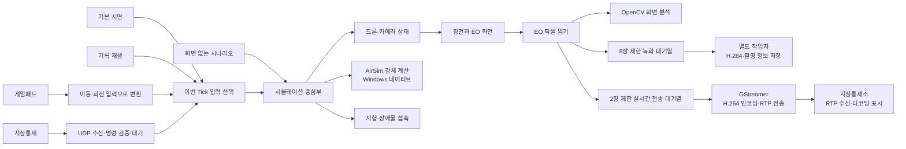
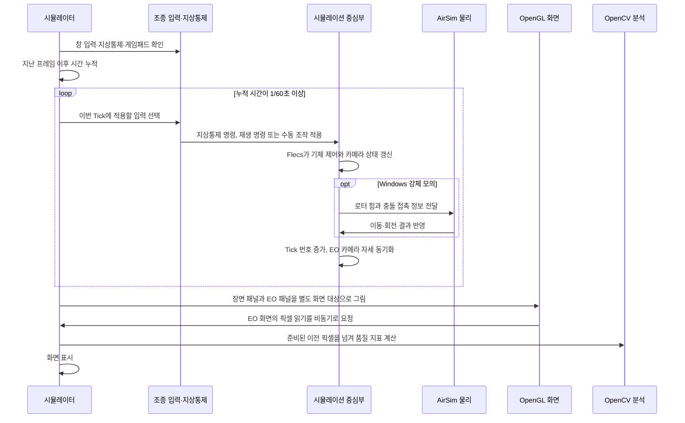
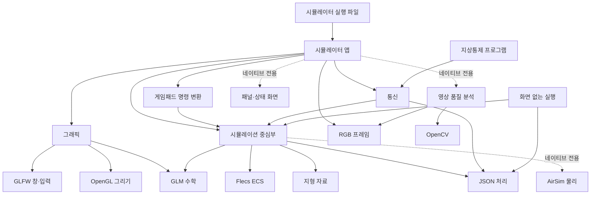

# AeroSimLab 개발 원리와 확인 결과

이 문서는 비행 계산과 화면 표시가 진행되는 순서, 기술을 고른 이유, 현재 모델의 적용 범위를 설명합니다. 실제 성능은 비행 기록이나 실기체 측정값과 대조해 확인해야 합니다.

## 처음 읽을 때는 여기부터 보세요

아래 순서대로 읽으면 조작 입력이 비행 계산과 화면 표시로 이어지는 흐름을 파악할 수 있습니다.

1. **입력**: 게임패드나 지상통제 창에서 명령을 받습니다. 두 입력은 내부에서 같은 비행 명령으로 바뀝니다.
2. **시뮬레이션 한 걸음**: 프로그램은 1/60초 간격으로 상태를 갱신합니다. 이 한 번의 갱신을 `Tick`이라고 부릅니다.
3. **비행 계산**: 기본 네이티브 실행에서는 AirSim이 모터 지연, 로터 힘, 기체의 이동·회전과 접촉 뒤 반응을 계산합니다.
4. **화면과 카메라**: 계산된 기체 상태로 3D 장면과 기체 카메라 영상을 각각 그립니다.
5. **영상 분석**: 필요하면 카메라 화면의 픽셀을 CPU로 가져와 밝기·대비·선명도를 계산합니다. 분석 항목은 화면 품질 지표이며 물체 인식은 다루지 않습니다.

| 낯선 말 | 여기서 뜻하는 것 |
| --- | --- |
| Tick | 시뮬레이션 시간을 1/60초 진행하며 드론 상태를 갱신하는 한 단계 |
| ECS | 드론 상태 데이터와 그 데이터를 갱신하는 작업을 나눠 관리하는 구조 |
| 강체 계산 | 힘과 토크를 적용해 기체의 속도·위치·회전을 계산하는 방식 |
| 운동학 계산 | 실제 힘 대신 정해 둔 간단한 규칙으로 위치와 자세를 갱신하는 기준 방식 |
| EO 카메라 | 드론에 달린 카메라 화면을 가리키는 프로젝트 용어 |
| 프레임 | 모니터나 카메라 화면에 한 장을 그리는 작업. 시뮬레이션 Tick과 속도가 같을 필요는 없음 |

이 문서의 **현재 동작**은 코드와 시험으로 확인한 내용입니다. **적용 범위**에는 아직 구현하지 않았거나 확인하지 못한 부분을 적었습니다.

## 프로그램은 어떻게 움직이나요?

시뮬레이터 화면과 화면 없는 시나리오 실행은 같은 시뮬레이션 중심 기능을 사용합니다. 지상통제 명령과 게임패드 입력도 공통 명령으로 바뀐 뒤 같은 비행 상태에 적용됩니다.



한 Tick은 1/60초입니다. 입력을 적용하고 선택한 모의 방식으로 상태를 한 번 갱신한 다음 카메라 자세를 맞춥니다. 화면이 몇 FPS로 그려지는지와 모의 시간이 얼마나 흐르는지는 별개입니다.

입력마다 시뮬레이션에 들어오는 길이 다릅니다. 게임패드 축과 버튼은 이동·회전·이륙·착륙 명령으로 바뀝니다. 지상통제는 UDP 메시지의 형식과 순서를 확인합니다. 상태 조회는 현재 상태로 바로 응답하고, 비행·카메라 변경 명령은 다음 Tick에 적용한 뒤 상태를 응답합니다. 지상통제 변경 명령이 있으면 같은 Tick의 재생·게임패드 입력은 건너뜁니다. 지상통제 명령이 없으면 기록 재생이 게임패드보다 우선하며, 기본 시연은 외부 조종이 없을 때만 입력 선택 전에 적용됩니다.

한 UDP 패킷에는 비행·카메라·기록·편대 명령 중 하나를 담습니다. C++의 `std::variant`가 명령 종류를 구분하므로 한 패킷에 서로 다른 명령이 섞이지 않습니다. 수신 뒤에는 명령 종류에 맞는 처리 경로로 전달합니다.

화면 없는 시나리오는 통신·게임패드 경로를 거치지 않고 시뮬레이션 중심부에 명령을 전달합니다. 지연·손실도 시나리오 안에서 재현합니다. 실제 UDP 송수신과 지상통제 창은 별도로 확인해야 합니다. 웹 빌드는 AirSim 대신 운동학 계산을 사용합니다.

### 한 화면 프레임은 어떤 순서로 진행되나요?

화면 프레임은 모니터에 한 장을 그리는 과정이고, Tick은 비행 상태를 1/60초만큼 갱신하는 과정입니다. 화면 프레임 사이에 여러 Tick이 진행될 수 있습니다.



지상통제 명령이 그 Tick에 적용되면 게임패드와 재생 입력은 같은 Tick에 추가 적용하지 않습니다. 지상통제 명령이 없을 때는 재생 중인 기록을 먼저 적용하고, 재생 중이 아니면 게임패드 입력을 반영합니다. Demo 명령은 외부 조종이 꺼진 경우 이 선택 과정 앞에서 만들어집니다.

| 구성 | 맡은 일 | 다른 구성과 만나는 지점 |
| --- | --- | --- |
| 시뮬레이터 화면 | 입력을 모으고 고정 Tick을 진행하며 장면·카메라 패널과 상태 표시를 갱신합니다. | 공통 시뮬레이션 명령과 상태를 사용합니다. |
| 시뮬레이션 중심부 | 드론·카메라 상태와 명령을 관리하고 매 Tick의 ECS 시스템을 실행합니다. | 선택한 운동학 또는 강체 계산을 호출합니다. |
| AirSim 물리 연결 | 로터 입력, 강체 이동·회전, 충돌 후 반응을 계산합니다. | 장면의 충돌 접촉 정보를 받아 시뮬레이션 상태를 돌려줍니다. |
| 통신·수동 조종 | UDP 지상통제 메시지와 게임패드 값을 공통 명령으로 바꿉니다. | 명령을 시뮬레이션 중심부에 전달하고 상태 응답을 만듭니다. |
| 그래픽 | 창, 카메라, 메시, 재질, 화면 대상과 셰이더로 장면을 그립니다. | 시뮬레이션 상태를 읽어 두 패널을 각각 렌더링합니다. |
| 센서·영상 분석 | RGB 프레임 정보를 다루고 화면의 밝기·대비·선명도를 계산합니다. | EO 렌더링 결과의 픽셀을 읽어 분석기에 전달합니다. |
| 미디어 전송 | GStreamer로 RGB 프레임을 H.264로 인코딩하고 RTP/RTCP 네트워크 경로를 처리합니다. | 시뮬레이터는 송신하고 지상통제 프로그램은 최신 디코딩 프레임을 화면에 표시합니다. MP4 녹화와는 별도 경로입니다. |
| 점검 자료 전달 | 저장된 영상·촬영 정보·목록을 TCP 5603으로 GCS에 보내고 CRC-32를 확인합니다. 확인 응답 뒤 시뮬레이터의 목록 상태를 `DELIVERED`로 바꿉니다. | 연결을 확인할 때마다 저장된 미전달 자료를 다시 시도합니다. 수신 파일 검증은 자동 시험으로 확인했으며, 다른 PC·방화벽을 거치는 실제 운용은 아직 확인하지 않았습니다. |

EO 화면은 패널 크기에 맞춰 축소 렌더링하지 않고, 드론에 설정된 카메라 해상도로 따로 그립니다. GPU에 픽셀 읽기를 요청한 뒤 완료된 프레임을 다음 처리 시점에 가져오므로 화면 표시와 영상 분석이 서로 다른 프레임을 처리할 수 있습니다. 프레임 번호를 함께 기록해 두 화면의 시점을 구분합니다.

시나리오에는 모든 드론에 적용할 `camera_model`을 지정할 수 있고, 드론 항목에 같은 설정을 넣으면 해당 기체만 덮어씁니다. 해상도와 세로 시야각은 화면 크기뿐 아니라 점검면이 몇 픽셀로 보이는지 계산할 때도 사용합니다. 따라서 저해상도 카메라로는 같은 점검면이 최소 픽셀 기준에 못 미칠 수 있습니다. 해상도 한 변은 8192픽셀까지 허용합니다. 이 설정은 가상 카메라 제원이며 실제 X500 탑재 카메라 사양을 확인했다는 뜻은 아닙니다.

```json
"camera_model": {
  "image_width_pixels": 1920,
  "image_height_pixels": 1080,
  "vertical_field_of_view_degrees": 60
}
```

OpenCV에는 앱 배열에 기록된 픽셀을 복사하지 않고 전달합니다. `cv::Mat`은 원본 배열을 가리키며, 분석이 끝날 때까지 배열을 유지합니다. 현재는 한 스레드에서 순서대로 처리하므로 추가 복사나 이동이 없습니다. 분석을 다른 스레드로 넘기려면 배열을 다시 쓰기 전에 소유권을 넘기거나 별도 메모리로 복사해야 합니다.

### 실행 프로그램은 어떤 구성에 의존하나요?

아래 그림은 현재 CMake 빌드에 등록된 주요 의존 관계입니다. 화살표는 앞에 있는 실행 파일이나 모듈이 뒤의 기능을 사용한다는 뜻입니다. `네이티브 전용`은 Windows 같은 일반 운영체제 빌드에만 포함되고, WebAssembly 빌드에는 들어가지 않는 경로입니다.



화면 없는 실행은 그래픽 모듈을 거치지 않고 같은 시뮬레이션 중심부를 호출합니다. 따라서 화면 표시 없이도 비행 명령, 공동 임무, 통신 장애와 결과 판정을 실행할 수 있습니다. 지상통제 명령은 통신 형식을 거쳐 공통 비행 명령으로 바뀌며, 게임패드 입력도 별도 변환 단계를 거쳐 같은 명령 체계에 들어옵니다.

시나리오는 JSON을 읽고 검증한 뒤 실행용 드론과 물리 방식을 준비합니다. 매 Tick마다 예약 명령, 사람이 지정한 임무 목표, 편대 위치 공유, 카메라 이벤트를 반영하고 시뮬레이션을 진행합니다. Tick 뒤에는 최소 드론 간 거리, 미리 지정한 작업과 경유점의 수행률, 임무 시작 Tick과 완료 시간을 기록하며, 마지막 상태를 기대 위치·상태·카메라 결과와 비교합니다. 여기서 수행률은 사전에 입력한 경로와 작업을 얼마나 실행했는지를 뜻하며 시설물 표면의 촬영 범위나 점검 완료율이 아닙니다. 배터리 모형을 켠 경우에는 드론별 사용량과 잔량도 기록합니다. 이 과정은 실제 UDP 패킷을 전송하지 않고 시나리오 안에서 지연·손실·연결 중단을 재현합니다.

카메라 이벤트에 드론 이름을 넣으면 해당 기체의 카메라만 켜거나 끄고, 고장·복구를 따로 시험할 수 있습니다. 이름을 생략하면 기본 드론에 적용합니다. 실행 결과에는 드론별 카메라 상태와 모의 프레임 수가 기록됩니다. 이 프레임 수는 센서 상태를 모의한 값이며, 영상 파일을 촬영하거나 저장했다는 뜻은 아닙니다.

현재 시험 시나리오는 작업마다 사람이 지정한 시험 표면과 `facility_id`, `inspection_zone_id`를 받습니다. 카메라 프레임이 만들어질 때 시험 표면이 카메라 앞에 있는지, 설정한 거리·방향·화면 크기를 만족하는지, 가림 상자에 가려지는지를 계산합니다. 이 계산은 지정한 목표가 카메라 화면에 들어오는지 확인하는 기하 시험입니다. 카메라가 시설물 상태를 판독하거나 촬영하지 않은 장소를 찾아내지 않습니다. 식별값과 판정 결과를 저장하는 이유도 시험 결과를 재현하기 위해서입니다. 실제 시설물 파손 여부, 점검 필요성, 추가로 촬영할 곳은 사람이 영상과 사진을 보고 정합니다. 현재 시나리오의 기하 판정은 실제 영상 파일 저장·전달을 보장하지 않으며, 영상 수집 임무는 별도의 녹화·전송 경로로 시험합니다.

### 통신이 끊기면 임무는 어떻게 다시 나누나요?

공동 임무는 중앙 조정기가 사람이 미리 지정한 정찰 목표를 여러 드론에 배정합니다. 점 하나를 지정하거나 사람이 입력한 직사각형 경로 범위를 자동으로 나눌 수 있습니다. 범위는 드론 입력 순서대로 X 방향 폭을 균등하게 나누고 각 담당 경로에 왕복 띠를 만듭니다. 이는 정찰 경로 분할이며, 시설물의 파손이나 더 살펴야 할 위치를 찾아내는 작업은 아닙니다. 현재 분할은 지형·장애물·배터리 상태를 고려하지 않습니다.

통신이 끊기면 마지막으로 받은 위치와 상태를 보관합니다. 정해진 하트비트 시간이 지나기 전에는 상태를 오래된 정보로 표시하고, 시간이 지나면 위치를 알 수 없는 상태로 바꿉니다. 위치를 알 수 없는 드론의 임무는 성공이나 실패로 단정하지 않고 대기열로 되돌립니다. 중앙 조정기는 연결되어 있고 비행 중인 드론 가운데 목표에 가까운 기체를 골라 다시 맡깁니다. 이미 다른 목표를 수행 중이면 그 목표를 대기열에 돌려놓고 새 목표부터 처리한 뒤 다시 배정합니다.

사람이 미리 정한 네 정찰 경로를 네 대의 드론에 맡기고, 두 번째 기체의 하트비트가 끊기는 예제를 넣었습니다. 이 예제에서는 두 번째 기체가 맡은 경로 작업을 세 번째 기체가 이어받고, 밀려난 작업은 기존 목표가 끝난 네 번째 기체가 처리합니다. 결과에는 마지막으로 상태를 받은 Tick, 통신 상태, 작업의 최초·현재 담당 기체, 재배정 횟수와 배정 이력이 남습니다. 이는 미리 배정한 비행 작업의 재분배 시험이며, 촬영하지 않은 시설물 위치를 찾아내는 기능이 아닙니다. 이 경로는 화면 없는 실행과 같은 시나리오 시험에서 확인합니다.

이 장애는 정해진 Tick에 관측 정보가 끊기는 상황을 시나리오 안에서 재현합니다. 실제 UDP 장애와 무선 지연 분포, 비행제어기의 링크 상실 대응은 별도 검증 대상입니다. `on_timeout`의 기본값은 `continue_last_command`입니다. `hold_position`을 고르면 위치 명령을 받을 수 있는 비행 상태가 될 때까지 기다린 뒤, 마지막으로 확인한 현재 위치를 목표로 지정합니다.

### 드론끼리 부딪힐 위험은 어떻게 찾나요?

시나리오에서 예측 회피를 켜면, 연결된 임무 기체는 현재 위치와 속도가 일정 시간 그대로 유지된다고 보고 가장 가까워질 시점을 계산합니다. 통신이 끊긴 기체는 오래된 속도를 현재까지 외삽하지 않고 마지막으로 확인한 위치에 정지한 장애물로 둡니다. 상대 위치를 `r`, 상대 속도를 `v`라고 할 때 가장 가까워질 때까지의 시간은 `-r·v / (v·v)`를 0초와 예측 시간 사이로 제한한 값입니다. 그 시간 뒤의 예상 거리가 안전거리보다 짧으면 정해진 드론이 회피가 시작된 위치에서 옆으로 빠지는 목표를 받습니다. 이 목표는 예상 거리가 안전거리의 1.5배를 넘을 때까지 유지합니다. 위험 구간을 벗어나면 원래 임무 경로가 다시 적용됩니다.

결과에는 실제 최소 중심 간 거리, 예측 최소 거리, 회피 경로 시작 횟수가 따로 표시됩니다. 예측은 현재 속도를 일정하게 이어 계산하며, 가속·회전·기체 크기·바람·지형은 다루지 않습니다. 충돌 회피는 공동 임무 경로를 수행하는 드론에 적용하며, 실제 충돌 안전성은 별도 검증이 필요합니다.

강체 모드에서 서로 마주 오는 두 드론의 임무도 시험했습니다. 모터를 안정화한 뒤 안전거리 8m, 예측 시간 6초, 옆 이동 10m를 설정했고, 임무 중 최소 중심 간 거리는 3.179m였습니다. 통과 기준은 3m 이상입니다. 이 결과는 해당 경로에서만 얻었으며, 다른 속도·기체·환경의 충돌 간격은 별도 시험이 필요합니다.

### 배터리가 예비량에 도달하면 어떻게 하나요?

선택 기능인 에너지 모델은 시나리오에 정한 배터리 용량과 소비 전력으로 남은 에너지를 계산합니다. 지상에서는 소비하지 않고, 정지 비행에는 정지 전력, 이륙·이동·착륙에는 비행 전력을 적용합니다. 한 Tick의 사용량은 `전력(W) × 시간(s) ÷ 3600`으로 Wh 단위로 더합니다.

배터리가 예비 비율에 도달하면 해당 드론이 맡은 미수행 정찰 작업을 대기열로 돌리고, 처음 출발한 지점으로 이동한 뒤 착륙시킵니다. 귀환 중인 드론은 새 임무 후보에서 제외하고, 중앙 조정기는 남은 드론에 사전에 정한 작업을 다시 맡깁니다. 결과에는 드론별 용량·사용 Wh·남은 Wh·남은 비율·조정기에 마지막으로 보고된 비율·예비량 때문에 귀환했는지가 표시됩니다.

네 대 시나리오에서 저전력 착륙과 다른 기체의 통신 단절을 함께 재현했습니다. 저전력 기체가 맡은 정찰 작업은 예비 기체가 이어받았고, 통신이 끊긴 기체의 담당 작업은 마지막 수신 위치를 기준으로 다시 배정했습니다. 세 작업은 새 담당 기체가 모두 완료했지만, 연결이 끊긴 기체의 상태는 끝까지 `unknown`으로 남았습니다. 임무 기록은 사전에 지정한 비행 작업의 수행 여부를 보여 줄 뿐, 시설물 점검이나 촬영 범위의 완전성을 나타내지 않습니다. 배터리 소비와 통신 단절은 시나리오 규칙으로 모의했으며 실제 배터리나 UDP 장애를 재현한 시험은 아닙니다.

배터리 예비 기준과 통신 단절 시점을 바꿔 조건마다 세 번씩 다시 실행했습니다. 표의 Tick은 1/60초이며, 완료 시점은 세 구역을 모두 마친 Tick입니다.

| 배터리 예비 기준 | 통신 단절 시작 | 하트비트 시간 제한 | 저전력 착륙 시작 | 전체 구역 완료 | 반복 결과 |
| ---: | ---: | ---: | ---: | ---: | --- |
| 40% | 95 Tick | 3 Tick | 217 Tick | 322 Tick | 3회 모두 같은 결과 |
| 30% | 95 Tick | 3 Tick | 271 Tick | 376 Tick | 3회 모두 같은 결과 |
| 40% | 115 Tick | 8 Tick | 217 Tick | 217 Tick | 3회 모두 같은 결과 |
| 50% | 95 Tick | 8 Tick | 163 Tick | 171 Tick | 3회 모두 같은 결과 |

네 조건을 각각 세 번씩, 총 12회 실행해 모두 세 구역을 완료했습니다. 통신이 끊긴 기체는 계속 `unknown`으로 남았습니다. 난수 없는 재현 시나리오이므로 반복 결과는 성공 확률 추정에 쓰지 않습니다. 이 시험은 예비 비율과 통신 시간을 바꾼 운동학 시험이며, 강체 물리·충돌 회피·무작위 통신 손실은 별도 검증 범위입니다.

같은 장애 조합을 AirSim 강체 모드에서도 세 번 실행했습니다. 저전력 기체는 0.3Wh 용량과 80% 시작 잔량을 사용했고, 전체 기준은 50% 예비량이었습니다. 통신 단절은 180번째 Tick에 시작하고 하트비트 제한은 6 Tick으로 두었습니다. 네 대 모두 물리 모드에서 이륙한 뒤 임무를 진행했습니다.

| 확인 항목 | 세 번의 실행에서 확인한 결과 |
| --- | --- |
| 임무 시작 | 세 실행 모두 121번째 Tick에 시작 |
| 저전력 구역 | 처음 담당한 기체가 163번째 Tick에 착륙을 시작하고, 예비 기체가 이어받아 완료 |
| 미확정 구역 | 마지막 하트비트는 179번째 Tick, 185번째 Tick부터 `unknown`; 다른 기체에 재배정되어 완료 |
| 전체 임무 | 세 구역 모두 완료, 337번째 Tick에 종료. 세 실행 결과가 같음 |

이 표의 결과는 출발 지점 귀환을 넣기 전 실행한 기록입니다. 당시 저전력 기체는 잔량이 50%에 도달한 자리에서 착륙을 시작했고, 착륙 중에도 비행 전력을 사용해 최종 잔량은 약 24.9%였습니다. 현재 시나리오는 예비량에 도달한 기체를 출발 지점으로 돌려보낸 뒤 착륙시킵니다. 다만 잔량이 귀환에 충분한지 계산하지 않으며, 예비 기준 아래로 떨어져도 계속 이동합니다. 최신 귀환 동작의 위치 검증은 저전력 재배정 시나리오에서 확인했지만, 여러 거리와 배터리 조건에서 귀환 가능성을 보장하는 검증은 아직 없습니다. 배터리에는 상태별 고정 전력을 쓰고 통신 단절은 지정한 Tick에 재현하므로, 실제 전지·무선 통신이나 충돌 안전성은 검증하지 않습니다.

배터리 예산은 모터 회전수나 추력에서 전력을 계산하지 않습니다. 비행 상태마다 고정 전력을 적용하므로 X500의 실제 비행 시간이나 거리를 예측하지 않습니다. 시나리오별로 드론의 용량과 시작 잔량을 지정할 수 있습니다.

예비 비율과 시작 잔량은 기본 착륙에 필요한 에너지보다 크게 설정해야 합니다. 입력 검사는 운동학 모델에서 1.5m를 초당 1m로 하강한다고 보고, 예상 시간과 비행 전력으로 최소 에너지를 계산합니다. AirSim 강체 모드의 실제 착륙 시간과 전력 소모는 이 계산에 반영하지 않습니다.

### Flecs에는 어떤 데이터를 두나요?

Flecs는 드론별 상태와 제어 목표를 컴포넌트로 저장하고, 선택한 모의 방식에 맞는 시스템을 Tick마다 실행합니다. 컴포넌트는 데이터 묶음이고, 시스템은 그 데이터를 읽거나 갱신하는 작업입니다.

| 컴포넌트 | 보관하는 내용 | 사용처 |
| --- | --- | --- |
| `DroneState` | 위치·속도·자세·각속도·비행 상태·로터 속도 | 시뮬레이터, 지상통제 응답, 시나리오 판정 |
| `DroneControlState` | 경유점·목표 속도·목표 방향·지면 높이 | 비행 규칙과 강체 제어기 |
| `InitialPose` | 처음 위치·방향·지면 높이 | 초기화 및 재시작 |
| `PhysicsBody` | AirSim 강체를 찾는 핸들 | 네이티브 강체 모드에만 사용 |
| `CameraState` | 카메라 상태·해상도·프레임 번호·드론 기준 자세 | 카메라 시스템, EO 렌더링, 결과 판정 |

모의 방식에 따라 실행되는 시스템이 달라집니다. 운동학 모드의 `AdvanceKinematicDrone`은 간단한 비행 규칙으로 위치와 방향을 갱신합니다. 강체 모드의 `ApplyRigidBodyForces`는 현재 상태와 목표에서 로터 회전 목표를 계산합니다. 모든 강체 드론은 현재 같은 X500 설정을 사용하므로, 이 설정은 드론마다 복사하지 않고 시뮬레이션 중심부가 한 벌만 보관합니다. `AdvanceCamera`는 두 모드에서 카메라 상태와 프레임 번호를 갱신합니다. Flecs 진행이 끝나면 강체 모드에서 AirSim을 한 번 진행하고, 반환된 상태를 드론에 반영한 뒤 카메라 위치와 방향을 맞춥니다.

### 객체와 자원은 누가 정리하나요?

| 자원 | 소유자와 정리 시점 | 수명상 주의점 |
| --- | --- | --- |
| 창·렌더러·메시·텍스처·셰이더·화면 대상 | 시뮬레이터 앱이 소유하고 앱 종료 때 정리합니다. | OpenGL 자원은 유효한 그래픽 문맥에서 해제돼야 하므로 창과 그래픽 객체의 생성·정리 순서를 지켜야 합니다. |
| Flecs 실행 공간과 드론 엔티티 | 시뮬레이션 중심부의 내부 저장소가 소유합니다. | 엔티티의 물리 정보는 AirSim 강체 자체가 아니라 그 강체를 찾는 식별 핸들입니다. |
| X500 기체 설정 | 시뮬레이션 중심부가 한 벌을 보관하고, 새 강체 생성과 로터 목표 계산에 함께 사용합니다. | 현재 강체 모드는 모든 드론에 같은 X500 제원을 적용합니다. 드론별 기종 설정은 아직 지원하지 않습니다. |
| AirSim 물리 월드와 강체 | 시뮬레이션 내부 물리 월드가 소유합니다. 드론을 지우면 연결된 강체도 함께 등록 해제하고 정리합니다. | Flecs 시스템 콜백이 물리 월드를 참조하므로, 콜백을 가진 Flecs 실행 공간을 먼저 닫고 물리 월드를 나중에 정리합니다. |
| UDP 소켓과 영상 분석기 | 시뮬레이터 앱이 소유하고 종료 때 정리합니다. | 통신·분석 자원은 시뮬레이터 앱의 실행 기간 안에서만 사용합니다. |
| RTP 영상 파이프라인 | 시뮬레이터와 지상통제 앱이 각각 송신기·수신기를 소유하고 창 종료 때 멈춥니다. | 송신 입력은 최대 두 프레임만 기다립니다. 새 프레임이 더 오면 오래된 프레임을 버려 실시간 표시가 밀리지 않게 합니다. |
| EO RGB 픽셀 버퍼 | 앱이 소유합니다. 영상 분석기는 처리 중 이 버퍼를 복사하지 않고 빌려 봅니다. | 분석이 끝나기 전에 GPU 읽기 결과로 버퍼를 덮어쓰지 않습니다. |

모듈 내부의 대부분 자원은 소유 객체가 직접 정리하지만, OpenGL 문맥이나 Flecs 콜백처럼 생성 순서에 영향을 받는 자원은 단순히 포인터가 사라지는 것만으로 수명이 안전해지지 않습니다. 그래서 창·그래픽 자원과 Flecs·물리 월드의 생성 및 해제 순서도 구조의 일부로 다룹니다.

## 비행 계산은 누가 하나요?

Windows 네이티브 실행은 AirSim의 멀티로터 물리 계산을 사용합니다. AirSim이 로터 힘, 모터 응답, 공기 저항, 강체의 이동·회전과 충돌 반응을 계산하므로 별도 Gazebo 서버는 필요하지 않습니다. 질량·관성·로터 계수는 공개 X500 설정과 제조사 시험표를 참고해 정했습니다. 공개 비행 기록의 추정값과 비교했지만, 실기체에서 측정한 위치·추력과 대조하지 않아 물리 정확도는 확인하지 못했습니다.

실비행 자료는 PX4 Flight Review의 공개 로그 목록에서 찾을 수 있습니다. 2026년 10월 24일 조회 당시 공개 기록 481,162건 가운데 기체 이름이 `Holybro X500 V2`인 항목은 8,252건이었습니다. 이 숫자는 로그 건수이지 서로 다른 기체나 독립 비행 횟수는 아닙니다. 같은 기체가 여러 기록을 올릴 수 있으므로, 모델 검증에 쓸 기록은 기체 정보·비행 모드·포함된 센서 주제·데이터 품질을 확인한 뒤 골라야 합니다. 공개 로그는 PX4가 안내한 CC-BY PX4 조건을 따릅니다. [공개 로그 안내](https://docs.px4.io/main/en/dev_log/flight_log_analysis_statistical)와 [공식 로그 검색·내려받기 도구](https://github.com/PX4/flight_review/blob/main/app/download_logs.py)를 참고하세요.

### 시험 후보: X500 V2의 Position 비행 기록

공개 목록에서 Position 모드로 약 30초간 기록했고 오류·경고 표시가 없는 X500 V2 로그 하나를 내려받아 구조와 품질을 확인했습니다. PX4 로그를 읽는 공식 도구인 [pyulog](https://github.com/PX4/pyulog)를 사용했습니다. 기록 식별자는 `9d886d7b-90cd-4621-a412-9924c157bae7`이며 [Flight Review에서 열기](https://logs.px4.io/plot_app?log=9d886d7b-90cd-4621-a412-9924c157bae7)에서 확인할 수 있습니다.

| 신호 | 표본 수 | 중앙 표본 간격 | 이 기록에서 확인한 점 |
| --- | ---: | ---: | --- |
| 위치·속도 추정 | 302 | 101.3ms | 위치와 속도 유효 표시가 모든 표본에서 켜져 있음 |
| 자세 | 603 | 50.6ms | 쿼터니언 자세 기록이 있음 |
| 각속도 | 1,505 | 20.3ms | 기체 좌표계 각속도 기록이 있음 |
| 위치 목표 | 152 | 202.6ms | Position 제어기가 사용한 목표 기록이 있음 |
| 모터 추력 명령 | 302 | 101.3ms | 정규화된 명령 기록이 있음. 실제 모터 회전수는 아님 |
| 몸체 토크 목표 | 1,505 | 20.3ms | 비행제어기가 요구한 몸체 X·Y·Z 토크. 정규화된 값이며 실제 토크 측정값은 아님 |
| 액추에이터 출력 | 302 | 101.3ms | 출력 장치에 보낸 신호. 선택한 4초 구간에서는 약 1,449~1,653이며 모터 회전수는 아님 |

기록 길이는 30.121초입니다. 선택한 신호의 시간이 거꾸로 가는 표본은 없었고 ULog에 기록된 데이터 누락은 0건, 손상 바이트도 0이었습니다. PX4의 위치 신호는 EKF 시작점을 기준으로 한 NED 좌표이며 단위는 m, m/s입니다. 프로젝트 월드가 ENU이므로 수평 위치와 속도는 `(동, 북) = (y, x)`로 바꾸고, 수직 위치와 속도는 부호를 뒤집습니다. 다만 이 좌표의 수직 원점이 시뮬레이터 지면과 같다는 보장은 없습니다. 기록 초기에 착륙한 상태가 있으면 그 구간의 수직 위치 중앙값을 지면으로 보고 시작 높이를 맞춥니다. 사용한 표본 수와 지면 높이도 변환 결과에 남깁니다. 착륙 기준을 찾지 못하면 NED 원점과 시뮬레이터 지면이 같다고 가정하며, 그 가정은 변환 결과에 표시합니다. 이 차이 때문에 실제 비행처럼 보이는 결과가 수백 미터 위치 오차로 계산된 사례와 수정 근거는 [PX4 로그 높이 기준 문제](문제해결/PX4-높이-기준.md)에 정리했습니다. PX4 각속도는 FRD 기체 좌표계 rad/s이고 프로젝트 기체 좌표는 FLU이므로 `(앞, 왼쪽, 위) = (x, -y, -z)`로 바꿔야 합니다. 쿼터니언은 축 기준 변환을 행렬로 적용한 뒤 비교해야 합니다. [PX4 위치 신호 정의](https://docs.px4.io/main/en/msg_docs/VehicleLocalPosition), [PX4 각속도 신호 정의](https://docs.px4.io/main/en/msg_docs/VehicleAngularVelocity)를 근거로 삼았습니다.

이 기록에는 모션 캡처 위치·자세와 ESC 회전수가 없습니다. 위치·자세는 PX4 추정값이고, 모터 추력 명령은 정규화된 목표입니다. 액추에이터 출력은 장치 단위의 신호로, 선택한 4초 구간에서는 약 1,449~1,653입니다. 몸체 토크 목표도 비행제어기가 요구한 정규화 값입니다. 이 자료는 ULog 읽기, 시간축 정렬, NED·FRD에서 ENU·FLU로의 좌표 변환을 확인하는 데 사용했습니다. 모터 신호는 약 10Hz라 현재 모델의 12.5ms 상승 시간 상수를 맞추기에 표본이 성기며, 50Hz 토크 목표 역시 실측 토크가 아닙니다. 신호 정의는 PX4 공식 [모터 추력 명령](https://docs.px4.io/main/en/msg_docs/ActuatorMotors), [몸체 토크 목표](https://docs.px4.io/main/en/msg_docs/VehicleTorqueSetpoint), [액추에이터 출력](https://docs.px4.io/main/en/msg_docs/ActuatorOutputs)을 따릅니다.

### 추가 시험 자료: 공중 구간이 확인된 X500 V2 기록

30초 기록은 변환 절차를 확인하는 데는 쓸 수 있지만 비교 구간이 짧고 모터 자료도 약 10Hz였습니다. 더 긴 기록을 찾을 때는 Flight Review에 표시된 기체 이름과 오류 수만 믿지 않고, ULog 안의 기체 설정과 착륙 상태도 확인했습니다. 180초로 표시된 다른 후보는 `landed` 값이 계속 켜져 있어 비행 비교 자료에서 제외했습니다. PX4는 이 값을 기체가 지면에 착륙했다고 판단했는지 나타내는 신호로 정의합니다. [PX4 착륙 감지 신호 설명](https://docs.px4.io/main/en/msg_docs/VehicleLandDetected)

새 후보는 [PX4 Flight Review 공개 기록](https://logs.px4.io/plot_app?log=d71cd659-1c9c-49e7-859a-79664657c857)에서 확인할 수 있습니다. 목록에는 `Holybro X500 V2`, Position 모드, 오류·경고 0건으로 표시되어 있습니다. 원본 ULog에는 `PX4_FMU_V6X`, NuttX 운영체제, `SYS_HITL=0`, `SYS_AUTOSTART=4019`가 기록되어 있습니다. 실제 ESC 네 대가 DShot으로 연결돼 회전수를 보고했고, PX4 SITL이 만든 기록에서 쓰는 합성 회전수 값은 아닙니다. 4019는 PX4의 Holybro X500 V2 기체 설정입니다. [PX4 기체 설정표](https://docs.px4.io/main/en/airframes/airframe_reference)

다른 공개 자료도 확인했습니다. [DroneLog](https://azamatjon11.github.io/DroneLog/)에는 X500 V2의 PX4 ULog가 있지만, 항법 비교값은 GPS와 PX4 EKF 추정값입니다. 모션 캡처처럼 독립 측정한 위치·자세가 없어 X500 모델의 실제 궤적 오차를 판정할 기준으로는 부족합니다. 대신 ULog 형식과 분석 절차를 시험하는 데 쓸 수 있습니다. [VID 데이터셋](https://github.com/ZJU-FAST-Lab/VID-Dataset)은 다른 650mm급 기체의 로터 회전수·전류와 일부 실내 비행의 모션 캡처 위치·외력을 담고 있습니다. 기체가 다르므로 X500 검증 결과와 섞지 않고, 데이터 처리 절차를 확인하는 자료로만 검토합니다. 사용 전에 이용 조건과 파일 접근을 확인해야 합니다.

| 확인 항목 | 기록에서 확인한 값 | 해석 |
| --- | ---: | --- |
| 전체 기록 길이 | 168.394초 | 비행 시작과 착륙 구간이 함께 들어 있습니다. |
| 착륙 감지 상태 | 약 15.28~162.38초 동안 `landed=false` | ULog 안에서 공중 구간을 확인했습니다. |
| 위치·속도 | 중앙 간격 100ms | 비교할 수 있지만 빠른 자세 변화보다 시간 해상도가 낮습니다. |
| 자세 | 중앙 간격 5ms | 방향 변화를 더 촘촘히 비교할 수 있습니다. |
| 각속도·모터 추력 명령 | 중앙 간격 1.25ms | 모터 명령이 앞 기록보다 자주 저장되어 있습니다. |
| ESC 회전수 | 중앙 간격 5ms | 네 모터가 DShot으로 응답했고, 양방향 DShot 설정과 모터별 회전수 기록이 확인됩니다. |
| 전체 기록의 누락 표시 | 229건 | 기록 전체에 표시가 있어, 누락이 적은 구간을 따로 골랐습니다. |

처음에는 79~83초 구간을 비교했지만, 시작 시각 보간에 필요한 경계 표본 사이에 큰 공백이 있었습니다. 위치 표본 간격은 약 700ms, 자세·각속도·모터 명령은 약 558~560ms였습니다. 구간 내부 간격만 확인해 이 경계 공백을 놓쳤고, 79초 구간은 비교에서 제외했습니다.

ULog 변환은 기본적으로 주제별 허용 간격을 적용하고, 실제 보간에 쓰인 최대 간격도 결과에 기록합니다. 위치·속도 표본은 최대 250ms, 자세·각속도·모터 명령과 ESC 회전수는 최대 20ms까지만 보간합니다. 이 기준으로 100~104초 구간을 다시 만들었습니다. 변환 결과에서 확인한 최대 간격은 위치·속도 100.223ms, 자세 5.486ms, 각속도 5.332ms, 모터 명령 5.345ms, ESC 회전수 9.876ms였습니다. 반대로 79초 구간은 위치 표본 공백 700.05ms 때문에 변환 단계에서 거부됩니다.

저장 주기가 느린 로그를 탐색 목적으로 변환해야 할 때는 `--maximum-sample-gap-ms`에 허용 간격을 직접 지정할 수 있습니다. 이 값은 위치·자세·각속도·모터 명령에 동일하게 적용되며, 변환 결과에는 지정값과 실제 표본 간격이 기록됩니다. 허용 간격을 늘리면 변환할 수 있는 로그는 늘지만, 빠른 움직임을 놓칠 수 있습니다. 특히 10Hz 모터 명령으로는 현재 모델의 12.5ms 모터 응답을 확인할 수 없습니다. 이 옵션을 쓴 재생은 입력 형식과 장기 궤적을 살펴보는 용도로 한정합니다.

| 100~104초 입력 방식 | 위치 RMSE | 속도 RMSE | 자세 RMSE | 각속도 RMSE | 회전수 RMSE |
| --- | ---: | ---: | ---: | ---: | ---: |
| PX4 추력 명령에서 회전수를 환산 | 1.126m | 0.873m/s | 61.46° | 0.822rad/s | 217.16rad/s |
| ESC 측정 회전수 사용 | 0.714m | 0.618m/s | 29.17° | 0.411rad/s | 3.12rad/s |

두 실행은 공개 로그의 100~104초 구간을 60Hz, 241개 표본으로 비교했습니다. 시작 상태, 물리 설정, 모터 응답은 같게 두고 모터 입력만 바꿨습니다. 시작 높이는 앞선 착륙 표본 61개의 중앙값에 맞춘 0.976m입니다. 첫 방식은 PX4 추력 명령 `u`를 `√u × 최대 회전수`로 바꿉니다. 둘째 방식은 각 시각의 ESC RPM을 회전수 입력으로 사용합니다. ESC 회전수를 입력으로 바꾸자 위치·자세 차이와 로터 회전수 오차가 줄었지만, 시뮬레이션은 약 0.236m까지 내려가 지면에 닿았습니다. 따라서 이 비교는 회전수 입력 경로를 고친 결과이며, 비행 정확도를 입증하지 않습니다.

로그의 고속 모터 명령과 ESC 회전수로 1차 응답식도 맞춰 보았습니다. 목표 회전수는 `최대 회전수 × √(정규화 추력)`으로 두고, PX4 명령은 1.25ms 간격, ESC 측정값은 약 5ms 간격으로 계산했습니다. 시간 상수 탐색 범위는 상승·하강 각각 1~200ms였습니다.

| 비교 구간 | 이 입력에 맞춘 회전수 크기 | 상승 시간 상수 | 하강 시간 상수 | 회전수 RMSE |
| --- | ---: | ---: | ---: | ---: |
| 현재 설정 | 9,549RPM | 12.5ms | 25ms | 2,086RPM |
| 100~104초 전체 | 6,828RPM | 146ms | 1ms | 144RPM |
| 100~101초 | 6,820RPM | 58ms | 1ms | 94RPM |
| 101~102초 | 6,848RPM | 200ms | 1ms | 195RPM |
| 102~103초 | 6,755RPM | 200ms | 200ms | 118RPM |
| 103~104초 | 6,849RPM | 200ms | 1ms | 107RPM |

현재 모델은 최대 회전수 9,549RPM, 상승·하강 시간 상수 12.5ms·25ms를 씁니다. 위 맞춤에서는 회전수 크기가 약 6,800RPM으로 모이지만, 시간 상수는 구간마다 달라지고 탐색 범위의 끝에 붙습니다. 이 결과는 이 로그의 명령과 회전수 사이를 단일 1차 식으로 설명하기 어렵다는 뜻입니다. 맞춤값을 새 기체 설정으로 쓰지 않았습니다. 여기서 추정한 회전수 크기도 모터의 정격 최대 RPM 측정값이 아닙니다.

이 기록에는 모터 네 개의 ESC 회전수도 있습니다. `esc_status`의 연결 종류는 DShot이고 네 모터가 모두 온라인이며, 양방향 DShot이 켜져 있습니다. 펌웨어는 ESC가 돌려준 전기적 회전수(eRPM)를 모터 극수로 나눠 기계 회전수로 환산합니다. 이 기록의 극수 설정은 14입니다. 따라서 여기의 RPM은 모터 추력 명령에서 계산한 값이 아니라 ESC 텔레메트리입니다. 다만 추력 자체를 잰 자료는 아닙니다. [해당 PX4 펌웨어의 DShot 회전수 변환](https://github.com/PX4/PX4-Autopilot/blob/d6f12ad1c4f70ad3230afd7d86e971421e02fef4/src/drivers/dshot/DShot.cpp), [PX4 양방향 DShot 안내](https://docs.px4.io/main/en/peripherals/dshot)

이 RPM으로 추력 계수를 대략 가늠해 보았습니다. 각 시각의 위치 추정 가속도에서 중력 가속도를 빼고, 그 값을 기체의 위쪽 추력 방향으로 투영해 추력으로 환산했습니다. 계산식은 `k_f ≈ m × ((a_NED − g_NED) · d_up) / Σω_i²`입니다. 여기서 `a_NED`는 PX4 위치 추정기의 가속도, `g_NED`는 NED 좌표계의 중력 가속도, `d_up`은 자세에서 구한 기체의 위쪽 추력 방향입니다. `ω_i`는 각 ESC RPM에 `2π/60`을 곱해 rad/s로 바꾼 값이고, `m`은 현재 모델의 질량인 2.0643kg이라고 가정했습니다. ESC 회전수와 위치 가속도는 저장 주기가 다르므로, 각각의 타임스탬프에 맞춰 표본을 대응시켰습니다.

| 계산에 쓴 값 | 결과 |
| --- | ---: |
| ESC 회전수 표본 | 모터별 약 200Hz, 4초 동안 797개 |
| 위치 추정 가속도 표본 | 약 10Hz, 4초 동안 40개 |
| 추정한 유효 추력 계수의 중앙값 | `1.94×10⁻⁵ N/(rad/s)²` |
| 표본의 10~90 백분위 범위 | `1.75~2.42×10⁻⁵ N/(rad/s)²` |
| PX4 공개 X500 계수 | `8.55×10⁻⁶ N/(rad/s)²` |
| 제조사 모터표에서 계산한 계수 | `1.23×10⁻⁵ N/(rad/s)²` |

로그에서 얻은 유효 계수 중앙값은 PX4 공개 설정의 약 2.3배, 제조사 표에서 계산한 값의 약 1.6배입니다. 이는 현재 사용 중인 추력 계수가 실제 기록과 맞지 않을 가능성을 보여주는 근거입니다. 다만 정확한 기체 질량을 재지 않았고 위치 가속도는 비행제어기의 추정값이며, ESC RPM에도 모터 극수 설정이 적용됩니다. 이 계산만으로 새 계수를 확정하거나 현재 오차의 단일 원인이라고 단정하지 않습니다. 독립적인 추력 시험이나 같은 기체의 질량·모터 사양 확인이 필요합니다.

79초 구간은 시작 시각 주변의 표본 간격이 커 재생 자료에서 제외했습니다. 이 공백만으로 큰 자세 오차를 설명할 수는 없습니다. 100~104초 구간에서는 ESC 회전수를 입력으로 사용한 뒤 자세 RMSE가 61.46°에서 29.17°로, 회전수 RMSE가 217.16rad/s에서 3.12rad/s로 줄었습니다. 시뮬레이션은 여전히 지면에 닿았으므로 비행 재현은 끝나지 않았습니다. 두 비교는 시험 조건이 다르므로 한 결과처럼 섞어 해석하지 않습니다.

이 비교는 PX4 제어기가 오차를 보정하지 않는 개루프 재생입니다. 변환 자료에는 모터별 ESC 회전수가 들어 있으며, 로그에 해당 값이 있으면 시작 상태와 매 Tick의 입력에 사용합니다. ESC 자료가 없는 로그는 `ActuatorMotors.control`에서 회전수를 환산합니다. 회전수 RMSE는 시뮬레이션과 로그의 ESC 값이 얼마나 다른지 보여 줍니다. 이 비교에는 외부 측량 위치와 추력 측정값이 없어 실기체 비행 정확도를 판정할 수 없습니다. 자동 시험의 위치 허용 오차는 1,000m로 넓게 설정돼 있어 실행 여부만 판별하며, 물리 오차는 표의 RMSE로 봐야 합니다.

기록의 Flight Review 표기, PX4 기체 설정, HIL 상태와 비행 상태는 서로 맞지만, 업로더나 비행 장소를 독립적으로 확인할 자료는 없습니다. 그러므로 이 자료는 공개 X500 V2 비행 기록 후보로 다루며, 실기체 성능 검증을 완료했다고 쓰지 않습니다. ESC가 보고한 회전수는 있지만 실제 추력 측정값은 없습니다. 추력 계수·관성·모터 응답도 이 한 구간에 맞춰 보정하지 않았습니다.

### 다음 검증에 쓸 비행 자료 후보

현재 X500 기록에는 ESC가 보고한 회전수가 있지만, 외부 측량 위치와 실제 추력 측정값은 없습니다. 아래 자료는 서로 다른 빈틈을 채우므로 결과를 한데 섞어 X500 검증이라고 부르면 안 됩니다.

| 자료 | 들어 있는 내용 | 이 프로젝트에서 쓸 곳 | 확인할 수 없는 것 |
| --- | --- | --- | --- |
| [DroneLog X500 V2](https://doi.org/10.5281/zenodo.20279005) | X500 V2와 X650의 PX4 비행 기록 50회와 여러 탑재량 사례를 안내합니다. 기록 채널에는 IMU·GPS·자세·위치 추정·배터리·액추에이터 출력이 포함됩니다. 라이선스 메타데이터는 CC BY 4.0입니다. | 접근 승인을 받으면 X500 ULog 변환을 여러 비행과 탑재량에서 반복하고, 추정 상태와 조종 출력의 변화를 비교합니다. | Zenodo 페이지는 기록 설명은 공개하지만 파일은 제한한다고 표시합니다. 로그인해야 파일 접근 권한을 확인할 수 있고, 권한이 없으면 자료 제공자 승인이 필요합니다. 공개 API에도 파일 목록이 나오지 않습니다. CC BY 4.0 표시는 파일을 바로 내려받을 수 있다는 뜻이 아닙니다. 기록된 채널에는 외부 모션 캡처 위치와 실제 로터 RPM도 없습니다. |
| [QUT S500 비행 로그](https://doi.org/10.25912/RDF_1619673939763) | QUT의 공개 자료 설명은 Holybro S500과 Pixhawk 4로 2020년에 실제 비행을 기록했다고 밝힙니다. [저장소 안내](https://data.researchdatafinder.qut.edu.au/dataset/flight-logs-of2)와 [직접 다운로드](https://data.researchdatafinder.qut.edu.au/dataset/ed92ba31-dfbc-480c-aa99-7140c9408081/resource/16ac1c16-b836-4bf5-87a3-ecc91241ae21/download/flightlogs.zip)에서 107,427,912바이트 ZIP을 공개로 받을 수 있습니다. 이용 조건은 CC BY 4.0이며 압축에는 PX4 ULog 43개가 들어 있습니다. | 다른 기체의 실제 PX4 기록 구조를 확인하고, 낮은 표본률과 구형 주제 이름을 다루는 방법을 검토합니다. | X500 데이터가 아니므로 X500 물리 정확도나 파라미터를 검증하지 못합니다. 외부 지상 진실 위치, 실제 로터 회전수, 추력 측정값은 확인되지 않았습니다. 현재 변환기로는 바로 재생 입력을 만들 수 없습니다. |
| [TU Delft 비행 자료](https://doi.org/10.4121/8244B196-373E-4211-9E05-994E37656490) | DOI 정보에는 PX4 ULog, 제어 명령, 모션 캡처 CSV와 영상이 포함된다고 적혀 있습니다. 이용 조건은 CC BY-NC 4.0입니다. | X500이 아닌 다른 기체 자료로 시간축 정렬, 좌표 변환, ULog와 기준 궤적의 오차 계산 과정을 확인합니다. | X500의 질량·관성·추력 계수나 실제 비행 정확도를 검증하지 못합니다. 비상업적 이용 조건을 지켜야 하며, 내려받기 가능 여부와 ULog·모션 캡처 표본 사이의 시계 오프셋은 받은 자료에서 확인해야 합니다. |
| [VID 멀티로터 자료](https://github.com/ZJU-FAST-Lab/VID-Dataset) | 맞춤형 650mm 기체의 ROS 자료입니다. 로터 목표·측정 회전수와 전류, 실내 모션 캡처, 일부 외력 센서 시험을 안내합니다. | 다른 기체의 실제 RPM·전류·자세 자료를 읽고, 동역학 비교 절차를 시험합니다. | X500 자료가 아니며 ROS 시간 동기화 절차가 필요합니다. 저장소의 자료 내려받기 주소가 열리지 않는다는 [접근 문제 보고](https://github.com/ZJU-FAST-Lab/VID-Dataset/issues/10)가 있어, 실제로 받을 수 있는지 확인하기 전에는 시험 자료로 확정하지 않습니다. |

자료를 받을 때는 원본 ULog·CSV·ROS 기록의 출처, 이용 조건, 단위, 시간 기준을 함께 보존합니다. X500 ULog는 X500 모델 비교에, 다른 기체의 모션 캡처·RPM 자료는 분석 절차 확인에만 사용합니다.

QUT의 43개 로그를 직접 읽어 보니 모두 `vehicle_local_position`, `vehicle_attitude`, `sensor_combined`, `actuator_controls_0`, `actuator_outputs`를 기록했습니다. 반면 현재 변환기가 요구하는 `vehicle_angular_velocity`와 `actuator_motors`는 한 로그에도 없습니다. 따라서 이 자료를 X500용 변환기에 넣어 재생 시나리오를 만드는 경로는 성립하지 않습니다. 특히 `actuator_controls_0`는 구형 제어 묶음이고 `actuator_outputs`는 출력 신호이므로, 이름이나 숫자만 보고 로터별 추력으로 바꾸면 안 됩니다.

표본 간격도 60Hz 재생에 맞지 않습니다. 43개 로그에서 로그별 중앙 간격의 중앙값은 위치 약 104ms, 자세 32ms, 원시 IMU 4ms였습니다. 위치·자세의 최대 공백은 각각 약 609ms와 505ms였습니다. 이 값은 각 자료가 가진 표본 간격을 설명하며 시뮬레이터 성능 측정값은 아닙니다. 짧고 촘촘한 구간이 있는지는 로그마다 따로 골라야 합니다. 현재 확인으로는 ULog 읽기와 주제 탐색까지 검증했으며, 이 자료를 이용한 상태 변환·시간 정렬·재생·오차 계산은 아직 검증하지 않았습니다.

시나리오에서 월드 위치·속도, 자세 쿼터니언, 기체 각속도를 시작 상태로 지정하고 로터별 추력 명령을 시간표에 따라 재생할 수 있습니다. 자세 쿼터니언은 `[w, x, y, z]`, 위치·속도는 동·북·위(ENU) 월드 좌표, 각속도는 앞·왼쪽·위(FLU) 기체 좌표를 사용합니다. 추력 명령 네 값은 현재 X500 설정의 로터 순서이며 각각 0부터 1까지의 비율입니다. 명령은 다음 명령이 들어올 때까지 유지됩니다.

```json
{
  "version": 1,
  "dynamics": "rigid_body",
  "ticks": 2,
  "drones": [{
    "name": "x500",
    "initial_position_meters": [0, 0, 2],
    "initial_velocity_meters_per_second": [0, 0, 0],
    "initial_orientation_quaternion_wxyz": [1, 0, 0, 0],
    "initial_angular_velocity_radians_per_second": [0, 0, 0],
    "initial_motor_speeds_radians_per_second": [0, 0, 0, 0],
    "initial_mode": "flying"
  }],
  "commands": [{
    "tick": 0,
    "type": "set_rotor_thrusts",
    "normalized_thrust": [0.4, 0.4, 0.4, 0.4]
  }],
  "expected": {"drones": [{"name": "x500", "mode": "flying",
    "position_meters": [0, 0, 2], "tolerance_meters": 1000}]}
}
```

시나리오 시간은 초당 60 Tick입니다. PX4 ULog는 `pyulog` 기반 변환 도구로 읽어 위치·속도·자세·각속도를 ENU·FLU 기준으로 맞추고, 모터 추력 명령을 60Hz로 보간한 재생 자료를 만들 수 있습니다. 이 도구는 X500의 4개 로터와 0~1 추력 명령을 전제로 합니다. 원본 ULog를 시뮬레이터가 직접 읽는 것은 아니며, 변환 뒤 만들어진 JSON을 ScenarioRunner가 실행합니다.

참조 표본이 든 시나리오와 화면 없는 실행 결과를 비교 도구에 함께 넣으면 위치·속도·자세·각속도 RMSE를 계산합니다. 운동학 모드가 아닌 강체 물리 실행만 비교하며, 두 궤적의 표본 수와 시각이 맞지 않으면 멈춥니다. 위치는 두 궤적의 시작점을 맞춘 뒤 비교하고, 자세는 쿼터니언 부호가 반대여도 같은 회전으로 계산합니다. 출력에는 참조 자료와 로그 구간, 재표본 간격, 실제·허용 표본 공백, 사용한 질량·관성·추력·토크·모터 응답 설정도 표시됩니다.

화면 없는 실행 결과의 `passed`는 시나리오에 적힌 완료 조건을 만족했다는 뜻입니다. 참조 궤적과의 오차가 작다는 뜻은 아닙니다. 물리 차이는 비교 도구가 출력한 네 가지 RMSE와 측정 조건을 기준으로 살펴봅니다.

## PX4 X500 로그와 4초 재생 비교

PX4 공개 로그의 12.05초부터 16.05초까지를 60Hz로 다시 맞춰 강체 시뮬레이션에 넣었습니다. 위치·속도·자세·각속도는 같은 시각으로 보간했고, 위치는 시작점을 원점으로 옮겼습니다. PX4의 NED·FRD 좌표는 프로젝트의 ENU·FLU 좌표로 변환했습니다. 네 모터 명령도 각 Tick 시각으로 선형 보간해 넣었습니다.

재생 입력과 241개의 변환 상태 표본은 GPS 좌표를 뺀 시험 자료로 저장했습니다. 시험은 같은 입력과 기체 설정에서 초기 로터 속도만 바꿔 두 번 실행합니다. 첫 번째 조건은 네 로터 속도를 모두 0으로 놓고, 두 번째 조건은 첫 모터 명령 `u`에서 `√u × 최대 회전수`로 추정합니다. 두 번째 값은 실제 RPM 측정치가 아니라 비교를 위한 가정입니다.

| 오차 RMSE | 초기 속도 0 | 명령값에서 추정한 초기 속도 | 추력 계수 10% 증가 |
| --- | ---: | ---: | ---: |
| 위치 이동량 | 0.653m | 0.752m | 1.649m |
| 속도 | 0.581m/s | 0.802m/s | 2.645m/s |
| 자세 | 71.81도 | 89.98도 | 108.95도 |
| 각속도 | 1.220rad/s | 1.299rad/s | 2.916rad/s |

이 한 구간에서는 명령으로 추정한 시작 회전수를 넣었을 때 네 오차가 모두 더 컸습니다. 그렇다고 실제 모터가 멈춰 있었다는 뜻은 아닙니다. PX4 `actuator_motors.control`은 정규화된 **추력 명령**이지 회전수 측정값이 아닙니다. 초기 회전수는 비교를 위한 추정값이며, 실측 RPM을 복구한 결과가 아닙니다.

같은 초기 상태와 로터 입력에서 추력 계수만 10% 높이면 위치·자세 오차가 더 커졌습니다. 이 구간이 추력 계수 가정에 민감하다는 점은 보여주지만, 어느 계수가 실제 X500에 맞는지 판정하지는 않습니다. 입력은 기록된 제어 명령을 다시 넣는 개루프 조건이므로, 모델 차이가 누적되며 PX4 비행제어기의 보정 반응은 포함하지 않습니다.

이 결과는 PX4 제어기 없이 기록된 명령을 다시 넣은 개루프 비교입니다. PX4 위치·자세는 추정값입니다. 시뮬레이션에는 해당 비행 장소의 지형 높이 격자를 적용하지 않았지만, z=0인 평면 바닥과의 접촉은 계산합니다. 따라서 결과는 이 입력·모델·구간에서의 재생 차이를 보여줄 뿐 X500의 현실 정확도나 두 초기 조건 중 어느 쪽이 실제와 가까운지 증명하지 않습니다. ULog 변환은 별도 도구가 담당하고, 자동 시험은 저장된 변환 자료를 재생해 오차를 계산합니다. 시간·좌표 변환과 오차 판단 과정은 [PX4 기록 재생 문제](문제해결/PX4-기록-재생-자세-차이.md)에 정리했습니다.

### 한 비행 기록의 공중 구간 22개 비교

[같은 공개 X500 기록](https://logs.px4.io/plot_app?log=d71cd659-1c9c-49e7-859a-79664657c857)에서 표본 간격 조건을 통과한 4초 구간 25개를 골랐습니다. 시작 시각은 1, 8, 15, 21, 28, 34, 41, 48, 54, 60, 67, 73, 80, 87, 93, 100, 106, 113, 119, 126, 132, 139, 145, 152, 158초입니다. 1초와 8초 구간은 지상 상태였고, 15초 구간은 이륙 판정과 겹쳐 공중 비교에서 뺐습니다. 나머지 22개 구간은 60Hz, 구간당 241개 표본으로 재생했습니다.

두 설정 모두 같은 ESC 측정 회전수를 입력했습니다. 최대 회전수가 다른 만큼 추력 명령을 다시 계산해 설정별로 같은 회전수가 들어가게 맞췄습니다. 질량·관성·모터 시간 상수는 유지하고 추력 계수·토크/추력 비·최대 회전수만 바꿨습니다.

| 오차 항목 | PX4 설정: 중앙값 (범위) | 제조사 시험표 추정: 중앙값 (범위) |
| --- | ---: | ---: |
| 위치 | 0.651m (0.237~1.751m) | 0.601m (0.233~1.702m) |
| 속도 | 0.537m/s (0.147~0.914m/s) | 0.460m/s (0.147~0.887m/s) |
| 자세 | 18.74° (1.41~72.28°) | 22.13° (1.57~68.31°) |
| 각속도 | 0.259rad/s (0.103~0.771rad/s) | 0.366rad/s (0.116~0.840rad/s) |
| 로터 회전수 | 5.24rad/s (2.41~16.71rad/s) | 5.24rad/s (2.41~16.71rad/s) |

모든 구간에서 시뮬레이션이 최저 0.30m 이하까지 내려가 지면에 닿았습니다. 접촉이 하강을 막아 RMSE를 작게 보이게 할 수 있으므로 표의 중앙값은 비행 정확도를 나타내지 않습니다. 오차는 항목별로 엇갈립니다. PX4 설정은 자세·각속도 중앙값이 낮고, 제조사 시험표 추정값은 위치·속도 중앙값이 낮습니다. 22개 구간은 모두 한 번의 비행에서 골랐으며, 위치·자세 비교에는 PX4 추정값을 사용했습니다.

같은 100~104초 입력을 Release 실행 파일로 수정 전 12번 반복했을 때, 전체 결과는 두 가지로 나뉘었습니다. 기체는 약 1.05초에 평면 바닥에 닿았고, 1.0667초 표본부터 충돌 반응이 보였습니다. 55 Tick(0.9167초)까지는 접촉 반응이 나타나지 않았습니다. 이 짧은 구간은 12회 모두 비슷한 결과를 냈지만, 속도·자세 오차가 이미 작지 않아 전체 비행의 정확도를 대신할 수는 없습니다.

수정 전 결과가 갈라지는 지점을 찾기 위해 기록된 위치·자세와 X500 충돌 상자 크기로 지면과의 간격을 다시 계산했습니다. 바닥에 가장 가까운 가드 면의 간격은 실행에 따라 약 2.6나노미터 겹치거나 2.2나노미터 떨어져 있었습니다. 기존 코드는 겹침이 0보다 클 때만 접촉으로 처리했기 때문에, `float` 반올림 수준의 차이로 AirSim에 전달되는 접촉 정보가 빠지기도 했습니다.

접촉 판정에 AirSim `float` 좌표의 정밀도를 반영한 허용 오차를 두고, 그 범위 안의 작은 틈도 접촉으로 처리하도록 고쳤습니다. 허용 오차는 `2 × float epsilon × max(1m, |지면 높이|, |충돌점 높이|)`로 계산합니다. 실제 겹친 깊이는 0보다 작게 전달하지 않습니다. 수정 후 같은 시나리오를 새 프로세스로 12회 실행했을 때 늦은 시점의 속도 분기가 다시 나타나지 않았습니다. 위치·속도·각속도·자세·모터 속도 성분을 비교한 실행 간 최대 차이는 항목별 원래 단위 기준으로 2.6×10⁻⁶ 이내였습니다.

| 실행 조건 | 반복 수 | 위치 RMSE | 속도 RMSE | 자세 RMSE | 각속도 RMSE |
| --- | ---: | ---: | ---: | ---: | ---: |
| 수정 전, 접촉 반응 전 55 Tick | 12회 | 약 0.320615m | 약 1.051932m/s | 약 21.5853도 | 약 1.075518rad/s |
| 수정 전, 전체 4초: 바닥에 머문 결과 | 9회 | 1.040614m | 0.801930m/s | 58.964477도 | 0.796509rad/s |
| 수정 전, 전체 4초: 접촉 뒤 속도가 다시 생긴 결과 | 3회 | 1.040813m | 0.802739m/s | 58.965441도 | 0.796636rad/s |
| 수정 후, 전체 4초 | 12회 | 약 1.040614m | 약 0.801930m/s | 약 58.964477도 | 약 0.796509rad/s |

수정 후 반복 결과는 안정됐지만, 물리 정확도가 좋아졌다는 뜻은 아닙니다. 시뮬레이션은 약 1초 만에 평면 바닥에 닿은 반면 참조 기체는 계속 비행했습니다. 전체 4초 오차에는 자유 비행 중 차이와 바닥 접촉 반응이 함께 들어 있으므로, X500의 현실 정확도를 입증하지 못합니다. 이 비교는 현재 파라미터의 재생 오차와 접촉 처리 한계를 보여주는 자료로만 사용합니다.

바닥 접촉이 오차를 전부 만든 것인지 가리기 위해 같은 초기 상태와 로터 입력에서 시작 높이만 100m 올린 진단 재생도 했습니다. 오차 계산은 재생 시작 위치를 빼고 참조 이동량과 비교하므로, 높이 이동 자체는 위치 오차에 포함되지 않습니다. 이 재생에서 기체 중심의 최저 높이는 58.83m여서 4초 동안 평지에 닿지 않았습니다. 높이 이동은 실제 비행 조건을 재현하려는 설정이 아니라 바닥 접촉을 분리하기 위한 시험 조작입니다.

| 재생 조건 | 반복 수 | 위치 RMSE | 속도 RMSE | 자세 RMSE | 각속도 RMSE |
| --- | ---: | ---: | ---: | ---: | ---: |
| 기존 시작 높이, 평지 접촉 포함 | 12회 | 1.041m | 0.802m/s | 58.96° | 0.797rad/s |
| 시작 높이만 100m 올려 접촉 제외 | 3회 | 20.641m | 14.943m/s | 106.55° | 2.918rad/s |

접촉을 제외한 재생의 네 오차는 기존보다 커졌습니다. 평지 접촉이 시뮬레이션의 하강을 멈춰 위치·속도 오차를 작게 보이게 했던 것입니다. 따라서 접촉을 포함한 4초 RMSE를 자유 비행 성능으로 읽을 수 없습니다. 세 번의 접촉 제외 실행 결과도 거의 같았지만, 반복 가능하다는 사실은 모델이 참조 궤적을 잘 따른다는 뜻이 아닙니다. 현재 모델은 평지 충돌 여부와 무관하게 이 구간의 전체 비행을 재현하지 못합니다.

두 설정의 공중 구간 22회 실행은 모두 시나리오를 마쳤습니다. `passed` 판정의 위치 허용 오차는 1,000m로 넓게 잡혀 있어 실행 경로 확인에만 쓰입니다. 모델 오차는 RMSE와 지면 접촉 시점을 기준으로 봐야 합니다.

PX4 설정 모델은 추력 계수 `8.54858×10⁻⁶`, 토크/추력 비 `0.016`, 최대 회전수 `1000rad/s`를 썼습니다. 비교 설정은 제조사 시험표 추정값인 `1.2294935×10⁻⁵`, `0.01403352`, `1032.2226rad/s`를 사용합니다. 제조사 값은 X500과 같은 부품으로 확인된 값이 아니며 시험표를 옮긴 추정치입니다.

PX4의 `ActuatorMotors.control`은 로터 회전수가 아니라 정규화된 추력 명령입니다. ESC 회전수가 없는 로그를 재생할 때 프로젝트는 명령 `u`를 목표 회전수 `√u × 최대 회전수`로 환산합니다. 모터 응답을 계산한 뒤 회전수 비율의 제곱을 AirSim에 전달하고, AirSim은 이 값에 로터 최대 추력을 곱합니다. 모터가 목표 회전수에 도달하면 `추력 = u × 추력 계수 × 최대 회전수²`가 됩니다. [PX4 모터 명령 정의](https://docs.px4.io/main/en/msg_docs/ActuatorMotors), [AirSim 로터 계산](https://github.com/microsoft/AirSim/blob/1ca93f6f77e4e8a39b2b241c1fe2764da4d7dd41/AirLib/include/vehicles/multirotor/RotorActuator.hpp)

| 설정 | 로터 한 개의 계산상 최대 추력 |
| --- | ---: |
| PX4 X500 설정 | 8.55N |
| 제조사 시험표 추정 설정 | 13.10N |

PX4 기본 설정의 로터 한 개당 최대 추력은 약 8.55N, 제조사 시험표 추정 설정은 약 13.10N입니다. 같은 회전수를 입력하면 추력과 토크도 달라집니다. 이 값은 계수와 회전수로 계산했으며 실기체에서 잰 추력이 아닙니다. 두 설정을 비교해 파라미터 선택이 재생 결과에 미치는 영향을 살펴봅니다.

참조 위치·자세는 PX4의 추정값이며 외부 측량값은 없습니다. 12.05~16.05초 기록에는 ESC 회전수가 없어 정규화 추력 명령으로 모터 입력을 만들었습니다. PX4 제어기가 재생 중 오차를 보정하지 않는 개루프 시험이라 이 결과만으로 오차 원인이나 새 파라미터를 확정할 수 없습니다. 100~104초 기록의 ESC 회전수 비교는 별도 표와 설명에 정리했습니다.

AirSim은 충돌 뒤의 반응을 계산하지만 이 프로그램의 지형이나 건물에서 접촉 위치를 찾아주지는 않습니다. 현재 장면이 드론의 충돌 상자와 지형·장애물의 겹침을 검사해 접촉 정보를 만들고 AirSim에 전달합니다. 두 엔진이 같은 운동을 따로 적분하는 구조는 아닙니다.

상자 충돌은 AirSim 호출과 분리된 기하 계산에서 처리합니다. 강체 기준 상자를 월드 좌표로 옮기고, 외접구와 축 정렬 상자로 멀리 떨어진 쌍을 먼저 거른 뒤, 15개 분리축으로 겹침과 접촉 방향·깊이를 구합니다. 이 결과를 AirSim이 받는 접촉 정보로 바꾸어 전달합니다.

| 입력 또는 물리값 | 현재 기준 | 확인할 점 |
| --- | --- | --- |
| 시뮬레이션 간격 | 1/60초 | 화면 프레임 수와 무관하게 고정됩니다. |
| 기본 기체 | PX4 공개 X500 형상과 설정을 참고 | 공개 자료와 실제 조립품이 완전히 같다고 보장하지 않습니다. |
| 기체 질량 | 약 2.0643kg | 중심 기체와 네 로터를 합산한 기준값입니다. 배터리·탑재물은 다를 수 있습니다. |
| 추력·토크 계수 | 기본값은 PX4 설정, 제조사 시험표 추정값은 비교용 | 둘 다 실제 X500에서 추력을 측정해 정한 값은 아닙니다. |
| 모터 응답 | 상승 0.0125초, 하강 0.025초 | PX4 공개 X500 값을 로터 회전 속도 응답에 적용합니다. 결과는 1/60초 Tick 간격으로 갱신됩니다. |
| 공기 저항 | AirSim의 동체 면 저항 | 공개 PX4 모델에 있는 로터 항력과 회전 저항 계수는 현재 강체 모델에 전달하지 않습니다. |
| 바람 | 시나리오에서 ENU 속도 벡터 지정 | 균일하고 일정한 바람만 적용합니다. 항력 계수는 AirSim 기본값이며 X500 실측값으로 보정하지 않았습니다. 실제 입력은 결과에도 기록합니다. |
| 조종 제어 | 위치·속도 목표에서 로터 회전수로 변환 | 실제 PX4 Position 모드나 조종기 감도를 그대로 재현한 검증은 없습니다. |

### PX4 X500 설정을 어디까지 반영했나요?

기본 강체 모델의 숫자는 PX4가 공개한 Gazebo X500 설정을 바탕으로 옮겼습니다. 중심 기체의 질량·관성과 네 로터의 질량·관성을 합쳐 프로젝트가 다루는 단일 강체 값으로 만들고, 로터 위치·회전 방향과 모터의 추력 계수·회전 응답 시간도 가져왔습니다. 질량과 관성은 로터 질량을 중심 기체 기준으로 옮길 때 평행축 정리를 적용해 계산합니다. 원본 값은 [X500 모터 설정](https://github.com/PX4/PX4-gazebo-models/blob/e5997f455e33ec071c7c677fc59a65781de496a4/models/x500/model.sdf)과 [중심 기체·로터 구성](https://github.com/PX4/PX4-gazebo-models/blob/e5997f455e33ec071c7c677fc59a65781de496a4/models/x500_base/model.sdf)에서 확인할 수 있습니다.

| 확인 항목 | PX4 공개 설정과 프로젝트의 연결 | 시험으로 확인하는 내용 |
| --- | --- | --- |
| 질량·관성 | 중심 기체 2kg과 로터 네 개의 질량·관성을 합산합니다. 프로젝트에는 대각 관성 성분만 전달합니다. | 같은 로터 명령에서 질량을 25% 높이면 추력은 유지되고 수직 가속도가 1m/s²보다 더 낮아지는지 확인합니다. 호버 힘 균형과 관성 변화에 따른 회전 응답도 시험합니다. 실제 기체를 저울이나 진자 시험으로 잰 값은 아닙니다. |
| 로터 배치·회전 방향 | PX4 설정의 로터 위치, 회전 방향과 0.174m 팔 길이를 사용합니다. | 비대칭 로터 입력이 기울기·요 회전을 만드는지 확인합니다. |
| 모터·추력 | 최대 회전수 1000rad/s, 추력 계수 `8.54858×10⁻⁶`, 모멘트 비율 `0.016`, 상승·하강 시간 상수 `0.0125/0.025초`를 사용합니다. 모터 응답은 프로젝트에서 1차 지연식으로 계산하고, AirSim의 별도 입력 필터는 겹치지 않도록 매우 짧게 둡니다. | 목표 회전수까지 올라가거나 내려가는 속도, 추력 변화, 계수와 관성이 바뀔 때 응답이 달라지는지 확인합니다. |
| 공기 저항 | 동체 저항은 AirSim 기본값을 사용합니다. PX4 설정의 로터 항력 `8.06428×10⁻⁵`과 회전 저항 `1×10⁻⁶`은 현재 모델에 전달하지 않습니다. | 바람이 있을 때 경로가 변하는지만 확인합니다. 실제 X500의 항력 계수를 검증한 것은 아닙니다. |
| 적분·접촉 | AirSim이 힘과 토크에 따른 이동·회전을 적분합니다. 프로젝트는 지형·건물·드론 사이의 접촉을 찾아 AirSim에 전달합니다. | 자유 낙하, 수직 추력, 착지와 장애물 접촉의 기본 동작을 확인합니다. Gazebo와 같은 적분·접촉 결과를 낸다는 뜻은 아닙니다. |

자동 시험은 설정한 시간 상수에 따른 모터 응답과 호버 추력·중력의 균형 등 계산 경로를 확인합니다. 실제 기체 정확도는 별도 자료와 비교해야 합니다. 100~104초 PX4 기록 재생에서는 ESC 회전수를 입력했을 때 자세 RMSE가 29.17°였고 시뮬레이션은 지면에 닿았습니다. 로그에는 ESC 회전수와 PX4 추정 위치가 있지만, 독립 측량 위치와 추력 측정값은 없습니다. 현재 자료만으로 실기체 재현을 확인할 수 없습니다.

따라서 현재 확인된 결론은 **PX4 X500 설정 일부를 옮긴 AirSim 기반 강체 모델이 기본 물리 시험을 통과한다**는 것입니다. **AirSim 모델이 Gazebo X500 또는 실제 X500과 같은 비행을 한다는 검증은 아직 끝나지 않았습니다.** 로터 항력·회전 저항 반영, 실제 추력·회전수 자료 확보, PX4 제어기를 포함한 재생은 추가 검증 항목입니다.

### 조종 목표에서 로터 힘까지

위치 목표에서는 위치 차이와 현재 속도를 함께 보고 목표 가속도를 구합니다. 속도 목표에서는 목표와 현재 속도의 차이를 사용합니다. 가속도는 최대 4m/s²로 제한합니다. 시나리오에서 제어기 이득을 바꿀 수 있고, 따로 지정하지 않으면 아래 기본값을 씁니다.

```text
위치 목표: a = Kp × (목표 위치 - 현재 위치) - Kv × 현재 속도
속도 목표: a = Kv × (목표 속도 - 현재 속도)
필요한 월드 추력: F = m × (a + g),  g = (0, 0, 9.81)m/s²
자세 제어 토크: τ = I × (Katt × e - Kω × ω),  |τ| ≤ 0.5N·m
로터 추력: T = k_f × ω²
로터 속도: ω = √(T / k_f)
```

기본 이득은 `Kp=3`, `Kv=2.5`, `Katt=20`, `Kω=7`입니다. 위치·자세 이득 단위는 1/s², 속도·각속도 이득 단위는 1/s입니다. `m`은 질량(kg), `I`는 관성 행렬(kg·m²), `e`는 자세 오차(rad), `ω`는 각속도(rad/s)입니다. 네 로터의 위치와 회전 방향으로 힘과 토크를 나누고, AirSim에 목표 회전 속도를 전달합니다. AirSim이 모터 지연을 적용한 뒤 강체 이동과 회전을 적분합니다. 이 조종 이득은 시뮬레이터 입력을 만들기 위한 값이며 PX4 Position 모드의 실제 조종 감도와 같다는 근거는 없습니다. 실행 결과에는 사용된 이득이 `controller_gains`에 기록됩니다.

바람 입력은 AirSim의 상대풍속 `기체 속도 - 바람 속도`를 이용한 동체 면 항력에 반영됩니다. 현재 프로젝트는 AirSim이 제공하는 기본 선형 항력 계수(1.3/4)를 그대로 사용합니다. 이 수치는 PX4 X500 시험으로 정한 값이 아니며, 바람 변화 시험은 같은 구현 안에서 경로가 달라지는지 확인할 뿐 실제 바람 속 정확도를 검증하지 않습니다. 시나리오에 입력한 ENU 바람 속도는 `wind_velocity_meters_per_second` 결과에 보존합니다.

| 기체 값 | 사용값 | 자료와 단순화 |
| --- | ---: | --- |
| 총 질량 | 약 2.0643kg | 중심 기체와 네 로터의 질량을 합산했습니다. 배터리·탑재물 구성은 반영하지 않았습니다. |
| 관성 대각 성분 | 0.02385, 0.02395, 0.04400kg·m² | 공개 PX4 모델의 기체와 로터를 중심 기준으로 합산했습니다. 실제 조립품에서 재지 않았습니다. |
| 로터 위치 | 중심에서 약 0.174m, 기준면보다 0.06m 위 | 공개 X500 배치를 참고했습니다. |
| 추력 계수 `k_f` | 약 1.2295×10⁻⁵ N/(rad/s)² | 제조사 시험표 15개 점을 `T = k_f × ω²`에 맞췄습니다. |
| 토크/추력 비 | 약 0.01403m | 같은 시험표의 추력과 토크로 계산했습니다. |
| 최대 로터 속도 | 약 1032rad/s (9857rpm) | 시험표에서 가장 높은 측정 회전수입니다. 모터 정격 한계는 아닙니다. |
| 모터 응답 시간 상수 | 상승 0.0125초, 하강 0.025초 | PX4 공개 설정값입니다. 모터 응답은 1/60초 Tick 단위로 계산합니다. |

제조사 표의 회전수는 `RPM × 2π/60`, 추력은 `질량(g) × 9.80665/1000`으로 바꿔 계수를 구합니다. 정지 시험대 데이터에 맞춘 계산이라 실제 X500의 비행 오차를 뜻하지 않습니다.

### X500 값은 어디서 왔고 무엇을 아직 확인하지 않았나요?

기체의 중심부 질량·관성과 네 로터의 질량·배치는 [PX4 X500 기체 설정](https://github.com/PX4/PX4-gazebo-models/blob/e5997f455e33ec071c7c677fc59a65781de496a4/models/x500_base/model.sdf)에 맞췄습니다. 중심부는 2.0kg이며, 로터 한 개는 약 0.01608kg입니다. 네 로터를 더한 질량은 약 2.0643kg입니다. 관성은 각 부품의 자체 관성에 중심에서 떨어진 거리에 따른 값을 더해 합쳤습니다. 이 계산은 별도 링크 네 개를 하나의 강체로 다루기 위한 것이며, 로터 회전 관성이나 실물 기체를 직접 잰 결과는 아닙니다.

[PX4 X500 모터 설정](https://github.com/PX4/PX4-gazebo-models/blob/e5997f455e33ec071c7c677fc59a65781de496a4/models/x500/model.sdf)에는 추력 계수 `8.54858×10⁻⁶`, 토크 비 `0.016`, 최대 회전수 `1000rad/s`, 상승·하강 시간 상수 `0.0125초`·`0.025초`가 들어 있습니다. 기본 실행은 PX4의 추력 계수·토크 비·최대 회전수를 사용합니다. 제조사 시험표에서 계산한 추력 계수 `1.2295×10⁻⁵`, 토크 비 `0.01403`, 최대 회전수 `1032rad/s`는 비교용 설정으로 따로 제공합니다. 두 설정 모두 질량·관성·로터 배치와 모터 시간 상수는 PX4 X500 자료를 참고합니다.

AirSim의 [로터 작동기 계산](https://github.com/microsoft/AirSim/blob/1ca93f6f77e4e8a39b2b241c1fe2764da4d7dd41/AirLib/include/vehicles/multirotor/RotorActuator.hpp)은 0~1 입력 신호를 필터링해 회전수와 추력을 계산합니다. PX4 X500 설정은 목표 회전 속도에 상승·하강 시간 상수를 적용합니다. 시뮬레이터도 먼저 이 시간 상수에 따라 로터 회전 속도를 갱신한 뒤, 정규화한 속도의 제곱을 AirSim에 전달합니다. AirSim 내부 신호 필터는 응답이 중복으로 늦어지지 않도록 1마이크로초로 설정했습니다. 물리 계산은 1/60초 Tick으로 진행하므로 시간 상수는 연속 시간의 모터 응답을 Tick 간격으로 근사합니다.

모터 응답 시험은 고정 속도 목표를 주고 상승·하강 구간을 따로 측정합니다. 각 구간에서 첫 Tick 뒤의 회전 속도를 일차 응답식과 비교합니다. 다른 기준 시험은 물리 엔진에 궤적을 강제로 입력하지 않고, 실제 실행 경로와 같은 위치 제어기가 정지 경유점을 유지하는지와 비대칭 로터 입력이 자세 회전을 만드는지를 확인합니다.

| 시험 | 입력과 시간 | 통과 기준 |
| --- | --- | --- |
| 중력·상승·하강 반응 | 10m 높이에서 모터 정지, 호버 회전수의 80%, 120%를 각각 0.5초 적용 | 무추력 높이 변화가 자유 낙하 계산의 ±0.3m 이내이고, 80% 입력은 하강·120% 입력은 상승 |
| 호버 추력과 중력 균형 | 10m 높이에서 네 로터에 계산한 호버 회전수를 주고 2초 진행 | 모터가 안정된 뒤 로터별 추력·월드 힘·중력·수직 가속도가 서로 맞음 |
| 정지 경유점 유지 | 10m 높이에서 같은 위치를 경유점으로 두고 1/60초 Tick을 600번 진행 | 마지막 높이 오차 0.10m 이내, 수직 속도 0.05m/s 이내 |
| 비대칭 로터 자세 반응 | 네 로터를 760rad/s로 두고 두 로터를 900rad/s로 올려 1초 진행 | 기체의 Y축 각속도 절댓값이 0.1rad/s 초과, 자세 쿼터니언 Y 성분 절댓값이 0.01 초과 |
| 관성 민감도 | 760rad/s로 2초 안정화한 뒤 앞쪽 두 로터를 900rad/s로 1초 구동하고 Y축 관성만 2배로 변경 | 1초 뒤 Y축 각속도가 기준의 절반에서 0.2 이내 |
| 토크/추력 비 민감도 | 760rad/s로 2초 안정화한 뒤 같은 회전 방향의 두 로터를 900rad/s로 0.5초 구동하고 비율만 2배로 변경 | 0.5초 뒤 Yaw 각속도가 기준의 2배에서 0.2 이내 |
| 질량 민감도 | 호버링 상태에서 질량만 기준값의 1.25배로 변경 | 목표 회전수가 `sqrt(1.25)`배가 되는 호버 계산식과 일치 |
| 추력 계수 민감도 | 호버링 상태에서 추력 계수만 기준값의 1.5배로 변경 | 목표 회전수가 `1/sqrt(1.5)`배가 되는 호버 계산식과 일치 |
| 바람 민감도 | 같은 이륙·정지 경유점 시나리오를 600 Tick 실행하고, 동쪽 바람 2m/s만 적용한 결과와 비교 | 두 결과 모두 통과하고 최종 동쪽 위치 차이가 0.01m 초과. 이번 실행에서는 바람이 있을 때 약 0.050m 이동 |

질량·추력 계수 시험은 호버에 필요한 회전수 계산을 확인합니다. 질량이 커지면 같은 추력을 내기 위해 회전수가 올라가고, 추력 계수가 커지면 같은 추력을 더 낮은 회전수로 냅니다. 시험은 제어기 출력과 계산식이 맞는지 확인하며 실제 기체의 가속도나 비행 정확도는 다루지 않습니다.

관성 시험은 로터 토크를 유지한 채 Y축 관성만 두 배로 바꿨을 때 1초 뒤 회전 속도가 절반 가까이 줄어드는지 확인합니다. `각가속도 = 토크 / 관성` 관계가 AirSim 경로에 반영되는지를 보는 시험이며, 기준 관성 값이 실제 X500과 맞는지는 별도 실측이 필요합니다.

토크/추력 비 시험은 로터 속도를 유지하고 비율만 두 배로 바꿔, 같은 방향의 두 로터가 만드는 Yaw 토크와 각속도가 함께 증가하는지 확인합니다. 설정값과 실제 X500 토크의 일치 여부는 별도 실측이 필요합니다.

호버 추력 시험은 모터가 멈춘 상태에서 시작합니다. 회전수가 목표에 도달하기 전에는 추력이 무게보다 작아 기체가 잠시 내려갑니다. 2초 실행에서 높이는 10m에서 9.162m로 낮아졌고, 마지막 하강 속도는 0.420m/s였습니다. 수직 가속도는 약 0.006m/s²로 거의 0에 가까웠지만 시작 때 생긴 하강 속도는 위치 제어기가 없어 계속 남았습니다. 따라서 이 시험은 모터가 안정된 뒤의 힘 균형을 확인합니다. 고도 유지 여부는 위치 제어기를 사용하는 별도 시험에서 확인합니다. 이 값은 해당 시험 조건의 결과이며 실제 X500 하강량을 나타내지는 않습니다.

현재 Release 물리 시험 묶음은 위 시험과 모터 지연·좌표 변환·접촉 시나리오를 통과했습니다. 자유 낙하와 호버 추력의 일부·초과 입력은 중력과 합산 추력이 수직 운동에 반영되는지 확인합니다. 바람 시험은 AirSim 항력 계산이 입력에 반응하는지 확인합니다. X500의 실제 바람 응답은 검증하지 않았습니다. 시험은 정해진 시작 자세와 입력을 사용하므로 다양한 명령·바람·질량 조건에서의 안정성을 나타내지는 않습니다.

재현 실험을 위해 시나리오에서 질량, 주축 관성, 추력 계수, 토크/추력 비, 모터 상승·하강 시간 상수와 최대 회전수를 바꿀 수 있습니다. 지정하지 않은 항목은 현재 X500 기준값을 씁니다. 실제 실행에 들어간 값은 결과의 `physical_model`에 남습니다. 바꾸는 항목은 모두 같은 기체 파라미터 묶음으로 물리 월드와 위치 제어기에 전달됩니다. 로터 항력과 관성 텐서의 비대각 항은 아직 조정 대상이 아닙니다.

이 시험은 구현한 방정식과 제어 경로가 맞물리는지 확인합니다. 제조사 사양이나 실기체 로그와 정확도를 대조하지 않았습니다. 실제 모터 응답, PX4·Gazebo 결과, 로터 항력과 비교하지 않아 적용한 시간 상수도 검증되지 않았습니다. PX4 Position 모드와의 조종감은 비교할 비행 기록이나 공개 기준 궤적을 확보한 뒤 확인해야 합니다.

### AirSim은 로터 입력을 이동과 회전으로 어떻게 바꾸나요?

프로젝트 제어기는 목표 회전 속도를 AirSim 입력으로 바꿉니다. 최대 회전 속도로 나눈 뒤 제곱하는 이유는 AirSim의 로터 입력이 속도가 아니라 0부터 1 사이의 추력 신호이기 때문입니다.

```text
ω_next = ω_now + (ω_target - ω_now) × (1 - exp(-Δt/τ_up/down))
u = clamp((ω_next / 최대 회전 속도)², 0, 1)
T = u × T_max
Q = u × Q_max × 회전 방향
```

`ω`는 로터 회전 속도(rad/s), `τ_up/down`은 모터 응답 시간 상수(초), `T`는 추력(N), `Q`는 로터 축 토크(N·m)입니다. 목표 속도가 커지면 상승 시간, 작아지면 하강 시간을 골라 적용합니다. 계산한 속도를 정규화하고 제곱해 AirSim에 전달하는 까닭은 로터 추력이 회전 속도의 제곱에 비례하기 때문입니다.

AirSim은 네 로터의 힘과 중심에서 떨어진 위치가 만드는 토크를 합칩니다. 여기에 공기 저항과 중력을 더해 선형 가속도를 계산하고, 관성 행렬로 각가속도를 구합니다.

```text
a_world = F_world / m + g_world
α_body = I⁻¹ × (τ_body - ω_body × (I × ω_body))
v_next = v_now + (a_now + a_next) × Δt / 2
p_next = p_now + (v_now + a_now × Δt / 2) × Δt
ω_next = ω_now + (α_now + α_next) × Δt / 2
```

`F`는 합력(N), `m`은 질량(kg), `g`는 중력 가속도(m/s²), `I`는 관성 행렬(kg·m²), `τ`는 합토크(N·m), `ω`는 기체 기준 각속도(rad/s), `α`는 각가속도(rad/s²)입니다. 위치 갱신에 쓰는 `v_now + a_now × Δt/2`는 Tick 중간 속도 추정값입니다. AirSim은 현재 가속도로 이 값을 먼저 추정해 공기 저항을 구하고, 다음 가속도를 계산한 뒤 속도를 갱신합니다. 이 계산은 프로젝트의 `AdvanceOneTick`이 아니라 AirSim 물리 단계에서 이루어집니다.

회전은 단위 쿼터니언으로 보관합니다. 쿼터니언은 세 축 회전이 겹칠 때 오일러 각에서 생길 수 있는 특정 자세의 특이점을 피하고, 방향을 부드럽게 합성하는 네 수 성분 값입니다. AirSim은 기체 기준 평균 각속도로 한 Tick의 회전량을 만들고 현재 자세에 곱한 뒤 길이를 1로 다시 맞춥니다.

```text
Δq = (cos(|ω_avg| × Δt / 2),  ω̂_avg × sin(|ω_avg| × Δt / 2))
q_next = normalize(q_now × Δq)
```

여기서 `ω̂_avg`는 평균 각속도 방향을 나타내며, 각속도가 0이면 회전량도 0입니다. 월드 좌표와 기체 좌표의 기준이 다르므로 이 식의 각속도와 자세 갱신은 AirSim 좌표 변환 경계 안에서 다뤄야 합니다. 쿼터니언의 순서를 바꾸면 회전 기준이 달라질 수 있습니다.

시뮬레이션 월드는 동·북·위(ENU), 기체 기준은 앞·왼쪽·위(FLU)를 씁니다. AirSim은 북·동·아래(NED), 앞·오른쪽·아래(FRD)를 사용하므로 경계에서 축과 부호를 변환합니다. 바람·로터 위치·충돌점·자세도 각 좌표 기준에 맞춰 바꿉니다. 좌표 변환이 어긋나면 북쪽 입력이 동쪽 움직임으로 보이거나 회전이 불안정해질 수 있습니다.

## 탄천 지형과 충돌은 어디까지 표현하나요?

현재 화면은 탄천교 주변의 30m SRTM 높이 격자를 그립니다. 이 간격은 넓은 지형을 표현하기 위한 것으로, 교량 상판·연석과 같은 작은 구조를 재현하지 못합니다. OpenStreetMap에서 확보한 건물·도로·교량 형상은 아직 장면과 충돌에 연결하지 않았습니다. 따라서 현재 화면은 시설물 점검용 실지형 장면이 아닙니다.

네이티브 강체 물리는 이 격자를 지면 높이로 사용합니다. 웹 운동학 모의는 화면에 지형을 표시하지만 충돌에는 반영하지 않습니다. 충돌 연결부는 강체마다 Tick당 접촉 한 건만 AirSim에 전달합니다. 지면 접촉이 있으면 지면을 우선하고, 없으면 장애물·다른 드론 접촉 중 겹친 깊이가 가장 큰 한 건을 전달합니다. 건물이나 여러 장애물에 동시에 닿는 상황은 실제 탄천 형상으로 검증하지 않았습니다.

협동 비행에서는 임무가 없는 연결 드론도 실제 위치와 속도를 기준으로 장애물처럼 봅니다. 한쪽만 미완료 임무를 수행 중이면 그 드론이 비켜가고, 둘 다 임무 중이면 목록에서 뒤에 있는 드론이 양보합니다. 통신이 끊긴 드론은 마지막으로 확인한 위치에서 멈춘 것으로 계산하고, 연결된 임무 드론이 회피합니다. 두 드론 모두 움직일 임무가 없으면 회피 명령을 보내지 않습니다.

자동 시험에서는 임무 없이 호버 중인 드론을 가로지르는 경로에서 회피가 발생하고, 임무 중인 드론이 목표까지 도착하는지 확인합니다. 강체 비행의 교차 경로도 다시 확인했습니다. 정지 드론을 장애물로 보면서 안전거리 안팎에서 회피를 계속 반복하지 않도록, 둘 다 임무 중일 때만 여유 거리를 두고 회피를 풉니다. 한쪽이 정지 장애물일 때는 설정된 안전거리까지 벌어지면 회피를 풉니다.

강체 교차 시험에서 설정한 안전거리 8m가 실제로 지켜지는지도 확인했습니다. 두 드론의 시작 간격은 정확히 8m였고, 당시에는 예측 간격이 기준과 같으면 회피를 시작하지 않았습니다. 같은 Release 환경과 경로에서 경계 조건을 고치기 전후 각각 한 번 실행했습니다. 안전거리 8m, 예측 시간 6초, 옆 이동 목표 10m를 사용했습니다.

| 확인 항목 | 경계 제외 | 경계 포함 |
| --- | ---: | ---: |
| 실제 최소 중심 간격 | 5.084m | 5.652m |
| 예측 최소 간격 | 3.373m | 3.639m |
| 회피 시작 횟수 | 1회 | 2회 |
| 임무 결과 | 두 드론 모두 도착 | 두 드론 모두 도착 |

기준과 같을 때도 회피하도록 바꾸자 실제 최소 간격은 0.568m 늘었습니다. 자동 시험의 최소 간격 기준을 3m에서 5.5m로 올렸고 같은 Release 시험을 통과했습니다. 관측한 5.652m는 설정값 8m보다 작습니다. 현재 예측은 위치와 속도가 일정하다고 보고 가장 가까운 간격을 계산하며, 강체의 기울기·가속·제동 지연은 반영하지 않습니다. 이번 변경은 경계에서 회피를 늦게 시작하던 문제를 고쳤지만, 8m 간격을 보장하지는 않습니다.

이 확인은 단일 경로와 단순한 예측 조건에 한정됩니다. 현재 회피는 드론의 위치와 속도를 일정하게 이어서 가장 가까워질 시점을 계산하고, 옆으로 이동할 목표를 하나 정합니다. 지형·건물과 함께 여러 드론이 동시에 얽히는 상황, 조종 명령으로 움직이는 임무 밖 드론, 실제 기체에서의 안전성은 보장하거나 검증하지 않았습니다.

AirSim은 접촉점에서 들어오는 속도와 반발 계수로 충격량을 구하고, 접촉면을 따라가는 속도에는 마찰 충격량을 적용합니다. 기본 반발 계수는 0.55, 마찰 계수는 0.5입니다. 수직 방향으로 내려앉는 지면 접촉이라고 판정되면 반발 계수를 0, 마찰 계수를 1로 바꾸고, 접지 잠금에서 기울기와 움직임을 정리합니다. 표면마다 다른 재질값은 없으며, 벽·건물과 지면의 재질 차이를 실제 측정값으로 반영하지 않았습니다. 비스듬한 충돌이나 회전 중 접촉의 결과도 기준 장비와 대조하지 않았습니다.

지면 높이와 충돌 좌표를 맞추며 확인한 한계는 [문제 해결 기록](문제해결/지형-높이와-충돌.md)에서 확인할 수 있습니다.

## 화면과 EO 카메라는 어떻게 만드나요?

장면과 EO 카메라는 OpenGL로 그립니다. OpenCV는 화면에 표시된 RGB 픽셀에서 밝기·대비·선명도를 계산합니다. 이 지표는 실제 카메라 성능을 평가한 결과가 아닙니다.

현재 X500 GLB에는 재질·이미지·UV가 들어 있지 않아, 화면에서 탄소 섬유 무늬를 입히는 식으로 보완합니다. 이 무늬는 한 장의 128×128 텍스처를 삼면 투영해 모델 전체에 적용합니다. 그림자도 아직 그리지 않습니다. 그래서 실제 CAD와 같은 표면 재질이나 작은 부품 표현은 제한됩니다. 화면의 시각 품질을 높이려면 셰이더만 바꾸기보다 재질과 UV가 준비된 모델, 그림자, 주변 지형의 상세 형상이 필요합니다.

## 현재 검증 상태

### 현재 코드에서 확인한 범위

2026년 10월 24일 리비전 `26c7fce1`에서 Release 시험 실행 파일을 다시 빌드하고 CTest 20개를 실행했습니다. 20개 모두 통과했으며, 통신 장애와 충돌 회피를 함께 다루는 협동 임무, Viewer 스모크 시험도 포함됩니다. 이 결과는 자동 시험의 통과를 뜻하며, 실기체 응답이나 아직 시험하지 않은 충돌 상황을 검증하지는 않습니다.

지형 높이 회귀 시험은 42m 지면에서 운동학 모드로 이륙해 43.5m에 도달하고 다시 42m로 착륙하는 동작을 확인합니다. 수정 전에는 이륙 뒤 1.5m, 착륙 뒤 0m가 나왔고, 수정 뒤에는 기대 높이를 통과했습니다. 자세한 원인과 계산 기준은 [지형 높이와 충돌 기록](문제해결/지형-높이와-충돌.md)에 있습니다.

2026년 10월 24일 리비전 `06c6c7b1`의 GitHub Actions에서 WebAssembly 설정, 컴파일, 결과물 검사가 통과했습니다. GitHub Pages 배포는 환경 보호 규칙이 `main` 브랜치를 허용하지 않아 거부됐습니다. 따라서 웹 빌드는 확인됐지만 사이트 배포는 되지 않았습니다. 브라우저에서 실제 실행하는 시험도 아직 하지 않았습니다. 로컬 Emscripten SDK는 사용자가 삭제를 요청해 다시 설치하지 않았습니다. 네이티브 빌드·정적 분석·시험과 Linux 품질 검사의 마지막 확인 리비전은 `e03c9641`이며, 이후 코드 변경이 포함된 현재 리비전의 결과로 간주하지 않습니다.

### 자동 시험과 확인하지 못한 환경

위 CTest는 비행 명령, 지형·충돌, 카메라 상태와 시나리오 결과를 검사합니다. 실제 Xbox 기기별 입력, 실기체 비행, 브라우저에서의 WebAssembly 실행은 검사하지 않았습니다. Linux Sanitizer 통합 시험에서는 과거 UDP 기록·재생 요청이 시간 초과된 적이 있으며, 당시 원인 후보와 확인 범위는 [UDP 통합 시험 문제 기록](문제해결/통합시험-UDP-시작-시간초과.md)에 적었습니다. 원격 Linux CI는 `e03c9641`에서 통과했지만, 그 결과가 현재 로컬 커밋의 Linux 시험이나 과거 UDP 재현을 증명하지는 않습니다.

강체 물리 핵심 시험은 PX4 Gazebo 설정과 현재 기본 설정을 각각 사용해 호버 추력과 중력의 균형, 자유 낙하, 호버보다 낮거나 높은 입력에서의 하강·상승 방향을 확인합니다. 두 설정에서 관성을 두 배로 했을 때 피치 응답이 줄고, 토크/추력 비를 두 배로 했을 때 요 응답이 커지는지도 확인합니다. 이 시험은 AirSim 연결과 코드에 적힌 물리 관계가 예상대로 동작하는지 검사합니다. 실제 X500의 측정 응답과 맞는지 판정하는 시험은 아닙니다.

## C++20을 선택한 이유와 실제 사용 기능

프로젝트는 CMake에서 C++20을 사용합니다. 현재 코드에서는 지상통제 요청 취소, 재생 명령 구간 전달, 지형 파일 읽기와 높이 보간에 C++20 기능을 활용합니다. 표준 라이브러리 기능으로 이런 처리를 맡겨 직접 작성하고 관리할 보조 코드를 줄입니다.

| C++20 기능 | 프로젝트에서 하는 일 | 이 기능을 쓰는 이유와 주의점 |
| --- | --- | --- |
| `std::stop_source`, `std::stop_token` | 지상통제 창이 진행 중인 요청에 취소를 알리고, UDP 요청 처리가 취소 여부를 확인합니다. | 취소 상태를 전역 변수나 자체 원자 변수로 만들지 않아도 됩니다. 취소는 협력 방식이므로, 요청 처리 코드가 토큰을 확인하는 지점에서 반영됩니다. |
| `std::jthread` | UDP 클라이언트 시험과 시뮬레이터 통합 시험의 작업 스레드를 관리합니다. | 범위를 벗어날 때 스레드 종료를 기다리는 RAII 동작을 제공합니다. 앱의 비동기 요청은 `std::async`와 취소 토큰을 사용합니다. |
| `std::span` | 재생할 명령 구간과 충돌 상자 목록을 함수에 전달합니다. | 연속된 데이터를 복사하지 않고 읽기 범위를 전달합니다. 원본을 소유하지 않으므로 `span`은 원본 벡터보다 오래 보관할 수 없습니다. |
| `std::endian`, `std::bit_cast` | `std::endian`으로 컴퓨터의 바이트 순서를 확인해 지형 파일의 리틀엔디안 값을 읽고, `std::bit_cast`로 16비트 높이의 비트 표현을 부호 있는 정수로 해석합니다. | 포인터를 다른 형식으로 재해석하지 않고 비트 표현을 변환합니다. 파일 크기·헤더·높이 표시는 별도로 검사해야 합니다. |
| `std::lerp` | 높이 격자에서 동서 방향을 먼저 보간하고 남북 방향으로 다시 보간해 위치의 지면 높이를 구합니다. | 보간 계산을 표준 함수로 표현합니다. 격자 간격과 범위 검사는 별도로 합니다. |
| `std::numbers::pi` | 위도·경도 변환과 모터 회전수 단위 변환에 원주율을 사용합니다. | 소스마다 근삿값을 다시 적지 않아도 됩니다. 변환식의 단위와 좌표 기준은 별도로 맞춰야 합니다. |
| C++20 지정 초기화 | 실행 옵션과 시험 입력에 필드 이름을 함께 적습니다. | 여러 값이 있는 설정에서도 각 값의 의미를 바로 알 수 있습니다. 필드는 선언된 순서를 따라야 하며, 생략한 값은 형식의 기본 초기화 규칙을 따릅니다. |

현재 `concepts`, `ranges`, 코루틴, 모듈은 사용하지 않습니다. C++17에서도 필요한 기능을 직접 구현할 수 있지만, 취소 토큰·비소유 범위 전달·비트 변환을 표준 기능으로 사용하려고 C++20을 선택했습니다. 빌드 도구도 C++20을 지원해야 합니다.

이 프로젝트에서 C++20은 속도 향상보다 직접 관리할 코드와 의존성을 줄이기 위한 선택입니다.

## 라이브러리와 사용 조건

| 기술 | 현재 맡은 일과 사용 이유 | 같은 문제를 푸는 대안 | 현재 구조에서 감수하는 점 |
| --- | --- | --- | --- |
| Flecs | 드론과 카메라 상태를 컴포넌트로 보관하고 Tick마다 등록한 시스템을 실행합니다. | 드론 상태 배열을 직접 순회하는 구조 | 시스템과 상태가 분리돼 확장하기 쉽지만, 실행 순서와 객체 수명을 여러 지점에서 살펴야 합니다. 현재 시스템 수가 적어 ECS의 관리 비용이 기능 이득보다 커질 수 있습니다. |
| AirSim | 네이티브 강체 모의에서 로터·모터·강체 운동과 접촉 반응을 계산합니다. 자체 적분기 대신 외부 비행 물리를 사용합니다. | 직접 물리 계산 구현, 다른 물리 엔진 | 충돌 접촉 연결 코드를 유지하고 입력을 AirSim의 `float` 범위에 맞춰야 합니다. 고정한 저장소는 더 이상 업데이트되지 않습니다. |
| GLM | 위치·방향·행렬 계산에 그래픽 코드와 같은 벡터·쿼터니언 형식을 씁니다. | Eigen 또는 직접 만든 수학 타입 | 현재 고정 크기 벡터·회전 계산에 사용합니다. 동적 행렬 연산은 직접 구현하지 않았고, 좌표계가 다른 경계는 변환해야 합니다. |
| GLFW와 OpenGL | 창·입력·그래픽 문맥을 준비하고 장면과 카메라 화면을 직접 그립니다. | SDL 또는 게임 엔진의 렌더링·창 기능 | 화면 흐름을 프로젝트가 통제할 수 있지만 메시·재질·셰이더·GPU 자원 수명을 직접 관리해야 하고 드라이버 차이도 영향을 줍니다. |
| Dear ImGui | 시뮬레이터 안에 상태 표시와 장면·카메라 패널을 배치합니다. | 운영체제 기본 GUI 또는 별도 GUI 프레임워크 | 현재는 네이티브 창에서 사용하며 WebAssembly 화면에는 포함하지 않습니다. |
| OpenCV | CPU로 전달된 RGB 프레임에서 밝기·대비·선명도를 계산합니다. | 필요한 통계만 직접 계산 | 검증된 영상 연산을 쓸 수 있지만 픽셀 읽기와 CPU 분석 비용이 있고, 현재 기능만 보면 의존성이 무거울 수 있습니다. |
| nlohmann JSON | 시나리오와 지상통제 메시지를 JSON으로 읽고 씁니다. | 다른 JSON 라이브러리 또는 자체 형식 | 입력 검증과 메시지 형식 호환성은 프로젝트가 관리해야 합니다. |
| Eigen | AirSim이 사용하는 선형대수 형식을 제공하는 빌드 의존성입니다. 프로젝트 자체의 운동학·충돌 코드는 Eigen 행렬을 사용하지 않습니다. | 프로젝트 코드에서 직접 쓰지 않는다면 의존성에서 제외할 수 있습니다. | 현재는 AirSim의 간접 의존성입니다. 프로젝트에 DLS 역기구학이나 Eigen 기반 행렬 계산은 구현돼 있지 않습니다. |
| GoogleTest | C++ 모듈과 통신·시뮬레이터 동작을 자동 시험합니다. | 자체 시험 프레임워크 작성 | 테스트 실행 환경과 의존성을 추가로 관리해야 하지만, 기대 결과와 실패 위치를 일관된 형식으로 확인할 수 있습니다. |

### 빌드와 실행 환경

| 기술 | 맡은 일과 선택 이유 | 감수하는 점 |
| --- | --- | --- |
| CMake | 모듈별 빌드 대상을 정의하고 Windows 네이티브와 WebAssembly에서 필요한 의존성을 나눕니다. 같은 시뮬레이션 중심부를 여러 실행 대상에서 재사용할 수 있습니다. | CMake 설정과 각 도구 체인의 사용법을 함께 관리해야 합니다. 대상별 조건이 늘면 실제 지원 범위와 설정이 어긋나지 않는지 확인해야 합니다. |
| CMake FetchContent | GLM, Flecs, AirSim, JSON, GLFW, ImGui, GoogleTest 등 저장소가 고정한 외부 소스를 빌드에 가져옵니다. | 처음 구성할 때 네트워크가 필요하고, 버전 변경은 빌드 결과와 호환성에 영향을 줍니다. OpenCV처럼 시스템 패키지로 찾는 의존성과 가져오는 방식이 다릅니다. |
| vcpkg | vcpkg를 사용하는 네이티브 빌드에서 OpenCV 패키지를 준비합니다. CMake는 `core`, `imgproc` 구성요소를 찾으며, vcpkg를 쓰지 않는 환경도 같은 패키지를 제공하면 구성할 수 있습니다. | vcpkg 기준 버전과 설치된 패키지가 빌드 환경에 맞아야 합니다. 다른 사람의 컴퓨터에서 같은 구성을 만들려면 도구 체인 설정도 맞춰야 합니다. |
| GLAD | 데스크톱 OpenGL 빌드에서 현재 그래픽 문맥의 OpenGL 함수 주소를 불러옵니다. WebAssembly에서는 Emscripten이 제공하는 그래픽 경로를 사용합니다. | 그래픽 함수 로딩과 GPU 자원 수명은 프로젝트가 직접 관리해야 합니다. |
| Win32·소켓 API | 별도 지상통제 창은 Win32로 만들고, UDP 통신은 Windows에서 Winsock을 사용합니다. Linux 쪽 소켓 코드는 POSIX 소켓을 사용합니다. | 지상통제 창은 Windows 전용입니다. 소켓 API 차이는 통신 모듈 안에서 운영체제별로 관리해야 합니다. |
| Emscripten | 브라우저에서 실행할 WebAssembly 빌드를 만듭니다. 화면과 시나리오 경로를 공유하고, AirSim 대신 운동학 모의를 사용합니다. | 웹판은 네이티브 강체 물리와 다른 계산을 사용하므로 두 실행 결과의 성능·기능을 직접 비교할 수 없습니다. |

이 표는 각 기술이 현재 맡은 역할과 의존 관계를 설명합니다. 도입 당시 후보를 비교한 기록은 없습니다. 기술 교체를 검토할 때는 지원 플랫폼, 물리·그래픽 기능, 자원 수명, 기존 시나리오 호환성과 유지보수 가능성을 같은 조건에서 비교해야 합니다.

- AirSim은 커밋 `1ca93f6f77e4e8a39b2b241c1fe2764da4d7dd41`에 고정하고 MIT 라이선스를 따릅니다. Microsoft는 기존 AirSim 저장소가 더는 업데이트되지 않는다고 안내했습니다.
- Flecs 4.1.6은 MIT 라이선스, Eigen 3.4.0은 MPL 2.0 라이선스입니다.
- 함께 배포할 때는 외부 라이브러리의 저작권과 라이선스 안내를 보존해야 합니다.

## 참고 자료

- [AirSim 물리 계산과 접촉 반응](https://github.com/microsoft/AirSim/blob/1ca93f6f77e4e8a39b2b241c1fe2764da4d7dd41/AirLib/include/physics/FastPhysicsEngine.hpp)
- [AirSim 강체 이동·회전 적분과 쿼터니언 갱신](https://github.com/microsoft/AirSim/blob/1ca93f6f77e4e8a39b2b241c1fe2764da4d7dd41/AirLib/include/physics/FastPhysicsEngine.hpp)
- [AirSim 좌표 기준](https://microsoft.github.io/AirSim/apis/)
- [AirSim 로터 모터 모델](https://github.com/microsoft/AirSim/blob/1ca93f6f77e4e8a39b2b241c1fe2764da4d7dd41/AirLib/include/vehicles/multirotor/RotorActuator.hpp)
- [AirSim 모터 입력 필터](https://github.com/microsoft/AirSim/blob/1ca93f6f77e4e8a39b2b241c1fe2764da4d7dd41/AirLib/include/common/FirstOrderFilter.hpp)
- [PX4 X500 기체 설정](https://github.com/PX4/PX4-gazebo-models/tree/e5997f455e33ec071c7c677fc59a65781de496a4/models/x500)
- [T-Motor AIR2216II KV920과 T1045 시험표](https://store.tmotor.com/product/air-gear-450II-combo-set.html)
