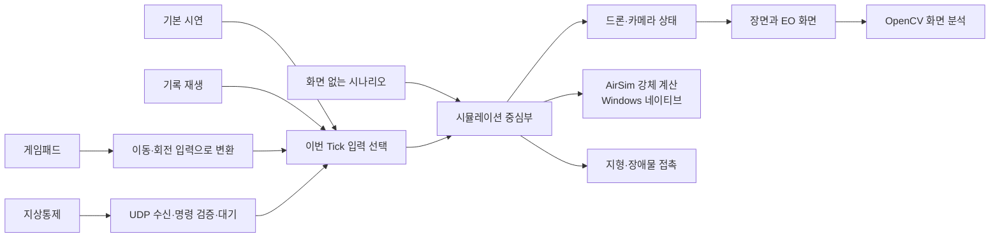
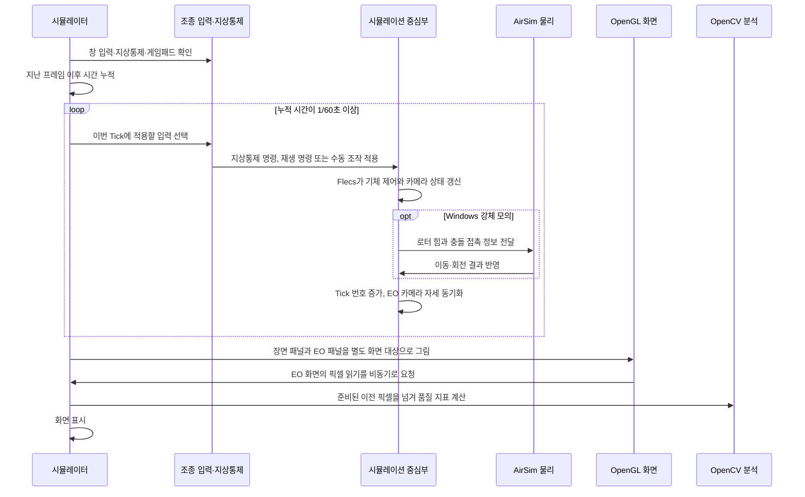
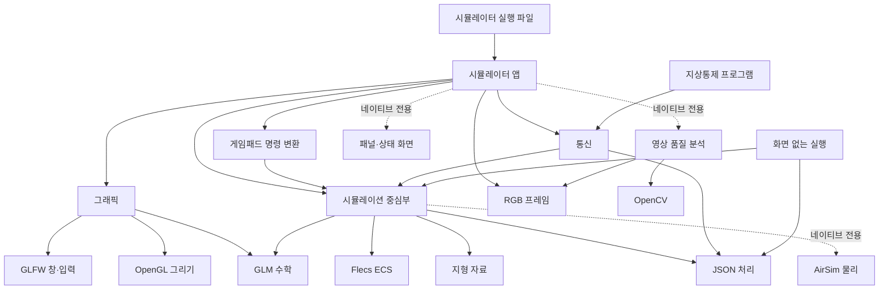

# AeroSimLab 개발 원리와 확인 결과

이 문서는 프로그램이 비행을 계산하고 화면을 만드는 흐름, 기술을 고른 이유와 현재 모델의 한계를 설명합니다. 시뮬레이션 결과는 실제 드론의 성능이나 안전을 보증하지 않습니다.

## 처음 읽을 때는 여기부터 보세요

처음부터 모든 내용을 외울 필요는 없습니다. 먼저 아래 순서로 보면 한 번의 조작이 화면까지 어떻게 이어지는지 잡을 수 있습니다.

1. **입력**: 게임패드나 지상통제 창에서 명령을 받습니다. 두 입력은 내부에서 같은 비행 명령으로 바뀝니다.
2. **시뮬레이션 한 걸음**: 프로그램은 1/60초 간격으로 상태를 갱신합니다. 이 한 번의 갱신을 `Tick`이라고 부릅니다.
3. **비행 계산**: 기본 네이티브 실행에서는 AirSim이 모터 지연, 로터 힘, 기체의 이동·회전과 접촉 뒤 반응을 계산합니다.
4. **화면과 카메라**: 계산된 기체 상태로 3D 장면과 기체 카메라 영상을 각각 그립니다.
5. **영상 분석**: 필요하면 카메라 화면의 픽셀을 CPU로 가져와 밝기·대비·선명도를 계산합니다. 이 기능은 물체를 알아보는 인공지능이 아닙니다.

| 낯선 말 | 여기서 뜻하는 것 |
| --- | --- |
| Tick | 시뮬레이션 시간을 1/60초 진행하며 드론 상태를 갱신하는 한 단계 |
| ECS | 드론 상태 데이터와 그 데이터를 갱신하는 작업을 나눠 관리하는 구조 |
| 강체 계산 | 힘과 토크를 적용해 기체의 속도·위치·회전을 계산하는 방식 |
| 운동학 계산 | 실제 힘 대신 정해 둔 간단한 규칙으로 위치와 자세를 갱신하는 기준 방식 |
| EO 카메라 | 드론에 달린 카메라 화면을 가리키는 프로젝트 용어 |
| 프레임 | 모니터나 카메라 화면에 한 장을 그리는 작업. 시뮬레이션 Tick과 속도가 같을 필요는 없음 |

이 문서에서 **현재 동작**은 코드와 시험으로 확인한 내용을 말합니다. **한계**는 구현이 없거나 확인하지 못한 부분입니다.

## 프로그램은 어떻게 움직이나요?

시뮬레이터 화면과 화면 없는 시나리오 실행은 같은 시뮬레이션 중심 기능을 사용합니다. 지상통제 명령과 게임패드 입력도 공통 명령으로 바뀐 뒤 같은 비행 상태에 적용됩니다.



한 Tick은 1/60초입니다. 입력을 적용하고 선택한 모의 방식으로 상태를 한 번 갱신한 다음 카메라 자세를 맞춥니다. 화면이 몇 FPS로 그려지는지와 모의 시간이 얼마나 흐르는지는 별개입니다.

입력마다 시뮬레이션에 들어오는 길이 다릅니다. 게임패드 축과 버튼은 이동·회전·이륙·착륙 명령으로 바뀝니다. 지상통제는 UDP 메시지의 형식과 순서를 확인합니다. 상태 조회는 현재 상태로 바로 응답하고, 비행·카메라 변경 명령은 다음 Tick에 적용한 뒤 상태를 응답합니다. 지상통제 변경 명령이 있으면 같은 Tick의 재생·게임패드 입력은 건너뜁니다. 지상통제 명령이 없으면 기록 재생이 게임패드보다 우선하며, 기본 시연은 외부 조종이 없을 때만 입력 선택 전에 적용됩니다.

한 UDP 패킷에는 비행·카메라·기록·편대 명령 중 하나만 담습니다. C++의 `std::variant`로 명령 종류를 표현해 한 패킷에 서로 다른 명령이 동시에 들어가는 상태를 만들지 않습니다. 명령을 받은 뒤에는 종류에 맞는 처리 경로로 보내므로, 명령을 해석하는 쪽에서 여러 선택 필드를 서로 대조할 필요도 없습니다.

화면 없는 시나리오는 통신·게임패드 경로를 거치지 않고 시뮬레이션 중심부에 명령을 넣습니다. 시나리오에서 지연·손실을 설정하면 시나리오 실행 안에서 그 상황을 재현하지만, 실제 UDP 송수신이나 지상통제 창은 시험하지 않습니다. 이 구분 때문에 화면 없는 시험에서 성공해도 입력 장치, 통신 연결, 그래픽 표시까지 동작한다고 볼 수는 없습니다. 웹 빌드는 AirSim 없이 운동학 기준 계산을 사용합니다.

### 한 화면 프레임은 어떤 순서로 진행되나요?

화면 프레임은 모니터에 한 번 그리는 과정이고, Tick은 비행 상태를 1/60초만큼 계산하는 과정입니다. 한 화면 프레임 사이에 시간이 많이 흘렀다면 여러 Tick을 먼저 처리한 뒤 화면을 그릴 수 있습니다.



지상통제 명령이 그 Tick에 적용되면 게임패드와 재생 입력은 같은 Tick에 추가 적용하지 않습니다. 지상통제 명령이 없을 때는 재생 중인 기록을 먼저 적용하고, 재생 중이 아니면 게임패드 입력을 반영합니다. Demo 명령은 외부 조종이 꺼진 경우 이 선택 과정 앞에서 만들어집니다.

| 구성 | 맡은 일 | 다른 구성과 만나는 지점 |
| --- | --- | --- |
| 시뮬레이터 화면 | 입력을 모으고 고정 Tick을 진행하며 장면·카메라 패널과 상태 표시를 갱신합니다. | 공통 시뮬레이션 명령과 상태를 사용합니다. |
| 시뮬레이션 중심부 | 드론·카메라 상태와 명령을 관리하고 매 Tick의 ECS 시스템을 실행합니다. | 선택한 운동학 또는 강체 계산을 호출합니다. |
| AirSim 물리 연결 | 로터 입력, 강체 이동·회전, 충돌 후 반응을 계산합니다. | 장면의 충돌 접촉 정보를 받아 시뮬레이션 상태를 돌려줍니다. |
| 통신·수동 조종 | UDP 지상통제 메시지와 게임패드 값을 공통 명령으로 바꿉니다. | 명령을 시뮬레이션 중심부에 전달하고 상태 응답을 만듭니다. |
| 그래픽 | 창, 카메라, 메시, 재질, 화면 대상과 셰이더로 장면을 그립니다. | 시뮬레이션 상태를 읽어 두 패널을 각각 렌더링합니다. |
| 센서·영상 분석 | RGB 프레임 정보를 다루고 화면의 밝기·대비·선명도를 계산합니다. | EO 렌더링 결과의 픽셀을 읽어 분석기에 전달합니다. |

EO 화면은 패널에 보이는 크기로 다시 축소해 그리지 않고, 드론에 설정된 카메라 해상도로 별도 렌더링합니다. GPU에 픽셀 읽기를 요청하고 완료된 프레임을 다음 처리 시점에 가져오므로, 화면 표시와 영상 분석은 서로 다른 프레임을 볼 수 있습니다. 이 때문에 프레임 번호를 함께 기록합니다.

픽셀을 OpenCV에 전달할 때는 이미 앱 배열에 기록된 영상을 다시 복사하지 않습니다. `cv::Mat`은 그 배열을 가리키는 임시 창으로 만들고, 분석 함수가 반환될 때까지 원본 배열을 유지합니다. 따라서 현재처럼 한 스레드에서 차례로 분석할 때는 OpenCV용 추가 복사나 이동이 필요하지 않습니다. 분석을 다른 스레드로 넘기는 구조로 바뀌면 배열을 재사용하기 전에 소유권을 넘기거나 별도 메모리로 복사해야 합니다.

### 실행 프로그램은 어떤 구성에 의존하나요?

아래 그림은 현재 CMake 빌드에 등록된 주요 의존 관계입니다. 화살표는 앞에 있는 실행 파일이나 모듈이 뒤의 기능을 사용한다는 뜻입니다. `네이티브 전용`은 Windows 같은 일반 운영체제 빌드에만 포함되고, WebAssembly 빌드에는 들어가지 않는 경로입니다.



화면 없는 실행은 그래픽 모듈을 거치지 않고 같은 시뮬레이션 중심부를 호출합니다. 따라서 화면 표시 없이도 비행 명령, 공동 임무, 통신 장애와 결과 판정을 실행할 수 있습니다. 지상통제 명령은 통신 형식을 거쳐 공통 비행 명령으로 바뀌며, 게임패드 입력도 별도 변환 단계를 거쳐 같은 명령 체계에 들어옵니다.

시나리오는 JSON을 읽고 검증한 뒤 실행용 드론과 물리 방식을 준비합니다. 매 Tick마다 예약 명령, 임무 목표, 편대 위치 공유, 카메라 이벤트를 반영하고 시뮬레이션을 진행합니다. Tick 뒤에는 최소 드론 간 거리, 완료한 임무 비율, 경유점 기준 진행률, 임무 시작 Tick과 완료 시간을 기록하며, 마지막 상태를 만든 다음 기대 위치·상태·카메라 결과와 비교합니다. 배터리 모형을 켠 경우에는 드론별 사용량과 잔량도 기록합니다. 이 과정은 실제 UDP 패킷을 전송하지 않고 시나리오 안에서 지연·손실·연결 중단을 재현합니다.

### 통신이 끊기면 임무는 어떻게 다시 나누나요?

공동 임무는 여러 드론에 미리 맡긴 구역별 목표를 중앙 조정기가 실행하는 방식입니다. 점 하나를 지정하는 임무와 직사각형 조사 구역을 자동 분할하는 임무를 지원합니다. 조사 구역은 드론 입력 순서대로 X 방향 폭을 균등하게 나눈 뒤, 각 구역에 왕복 띠 경로를 만듭니다. 지형·장애물·배터리 상태에 따라 구역을 다르게 나누거나 경로를 최적화하지는 않습니다.

통신이 끊기면 마지막으로 받은 위치와 상태를 보관합니다. 정해진 하트비트 시간이 지나기 전에는 상태를 오래된 정보로 표시하고, 시간이 지나면 위치를 알 수 없는 상태로 바꿉니다. 위치를 알 수 없는 드론의 임무는 성공이나 실패로 단정하지 않고 대기열로 되돌립니다. 중앙 조정기는 연결되어 있고 비행 중인 드론 가운데 목표에 가까운 기체를 골라 다시 맡깁니다. 이미 다른 목표를 수행 중이면 그 목표를 대기열에 돌려놓고 새 목표부터 처리한 뒤 다시 배정합니다.

네 대의 드론이 네 구역을 조사하다 두 번째 기체의 하트비트가 끊기는 예제를 넣었습니다. 이 예제에서는 두 번째 구역을 세 번째 기체가 이어받고, 밀려난 세 번째 구역은 기존 목표가 끝난 네 번째 기체가 처리합니다. 결과에는 마지막으로 상태를 받은 Tick, 통신 상태, 임무의 최초·현재 담당 기체, 재배정 횟수와 배정 이력이 남습니다. 이 경로는 화면 없는 실행과 같은 시나리오 시험에서 확인합니다.

이 장애는 시뮬레이터 안에서 정해진 Tick에 관측 정보만 끊는 재현입니다. 실제 UDP 장애와 무선 지연 분포는 검증하지 않습니다. 시나리오의 `on_timeout`은 기본적으로 `continue_last_command`이며, `hold_position`을 고르면 위치 명령을 받을 수 있는 비행 상태가 될 때까지 기다렸다가 마지막으로 확인한 현재 위치를 목표로 지정합니다. 이 동작은 시나리오 안의 모의 규칙이며 실제 비행제어기의 링크 상실 안전 기능을 검증한 것은 아닙니다. 구역 분할은 직사각형을 같은 폭으로 나누는 단순 방식이며, 지형·장애물·배터리에 따른 최적 분할은 아직 없습니다.

### 드론끼리 부딪힐 위험은 어떻게 찾나요?

시나리오에서 예측 회피를 켜면, 연결된 임무 기체는 현재 위치와 속도가 일정 시간 그대로 유지된다고 보고 가장 가까워질 시점을 계산합니다. 통신이 끊긴 기체는 오래된 속도를 현재까지 외삽하지 않고 마지막으로 확인한 위치에 정지한 장애물로 둡니다. 상대 위치를 `r`, 상대 속도를 `v`라고 할 때 가장 가까워질 때까지의 시간은 `-r·v / (v·v)`를 0초와 예측 시간 사이로 제한한 값입니다. 그 시간 뒤의 예상 거리가 안전거리보다 짧으면 정해진 드론이 회피가 시작된 위치에서 옆으로 빠지는 목표를 받습니다. 이 목표는 예상 거리가 안전거리의 1.5배를 넘을 때까지 유지합니다. 위험 구간을 벗어나면 원래 임무 경로가 다시 적용됩니다.

결과에는 실제로 지나간 최소 중심 간 거리, 예측한 최소 거리, 회피 경로가 시작된 횟수가 따로 표시됩니다. 연결된 기체의 예측은 현재 속도를 일정하게 연장하는 단순 계산입니다. 가속·회전·기체 크기·바람·지형은 예측식에 넣지 않으며, 실제 물리 충돌을 완전히 막는 안전 인증 기능도 아닙니다. 충돌 회피는 공동 임무 경로를 수행하는 드론에 적용됩니다.

강체 모드에서도 서로 마주 오는 두 드론의 임무를 시험했습니다. 모터를 안정화한 뒤 안전거리 8m, 예측 시간 6초, 옆 이동 10m를 설정해 임무를 끝냈고, 기록된 최소 중심 간 거리는 3.179m였습니다. 이 시험의 통과 기준은 3m 이상입니다. 예측 거리 기준 8m를 실제 최소 간격으로 보장하지는 않으며, 이 한 사례만으로 다른 속도·기체·환경에서도 충돌을 막는다고 볼 수 없습니다.

### 배터리가 예비량에 도달하면 어떻게 하나요?

선택 기능인 에너지 모델은 시나리오에 정한 배터리 용량과 소비 전력으로 남은 에너지를 계산합니다. 지상에서는 소비하지 않고, 정지 비행에는 정지 전력, 이륙·이동·착륙에는 비행 전력을 적용합니다. 한 Tick의 사용량은 `전력(W) × 시간(s) ÷ 3600`으로 Wh 단위로 더합니다.

배터리가 예비 비율에 도달하면 해당 드론의 미완료 구역을 대기열로 돌리고 착륙시킵니다. 중앙 조정기는 착륙 중인 드론을 새 임무 후보에서 제외하고, 남은 드론에 구역을 다시 맡깁니다. 결과에는 드론별 용량·사용 Wh·남은 Wh·남은 비율·조정기에 마지막으로 보고된 비율·예비량 때문에 착륙했는지가 표시됩니다.

네 대 시나리오에서 저전력 착륙과 다른 기체의 통신 단절을 함께 일으켜 확인했습니다. 저전력 기체의 구역은 예비 기체가 이어받았고, 연결이 끊긴 기체의 미확정 구역은 마지막 수신 위치를 기준으로 다른 기체에 다시 배정했습니다. 세 구역은 새 담당 기체가 모두 완료해 임무 결과는 성공이지만, 연결이 끊긴 기체의 상태는 끝까지 `unknown`으로 남았습니다. 즉, 임무를 다른 기체가 마쳤다는 사실과 통신이 끊긴 기체의 현재 상태를 따로 기록합니다. 배터리 소비와 통신 단절은 시나리오 규칙으로 모의했으며 실제 배터리나 UDP 장애를 시험한 것은 아닙니다.

배터리 예비 기준과 통신 단절 시점을 바꿔 조건마다 세 번씩 다시 실행했습니다. 표의 Tick은 1/60초이며, 완료 시점은 세 구역을 모두 마친 Tick입니다.

| 배터리 예비 기준 | 통신 단절 시작 | 하트비트 시간 제한 | 저전력 착륙 시작 | 전체 구역 완료 | 반복 결과 |
| ---: | ---: | ---: | ---: | ---: | --- |
| 40% | 95 Tick | 3 Tick | 217 Tick | 322 Tick | 3회 모두 같은 결과 |
| 30% | 95 Tick | 3 Tick | 271 Tick | 376 Tick | 3회 모두 같은 결과 |
| 40% | 115 Tick | 8 Tick | 217 Tick | 217 Tick | 3회 모두 같은 결과 |
| 50% | 95 Tick | 8 Tick | 163 Tick | 171 Tick | 3회 모두 같은 결과 |

네 조건에서 각각 세 번, 총 12회 모두 세 구역을 완료했고, 통신이 끊긴 기체는 계속 `unknown`으로 남았습니다. 같은 조건을 반복했을 때 결과가 재현되는 것은 확인했지만, 시나리오에는 난수 요소가 없으므로 이를 임무 성공 확률로 해석할 수는 없습니다. 또한 예비 비율과 통신 시간만 바꾼 운동학 시험입니다. 강체 물리·충돌 회피·다양한 난수 통신 손실을 함께 시험한 결과는 아닙니다.

같은 장애 조합을 AirSim 강체 모드에서도 세 번 실행했습니다. 저전력 기체는 0.3Wh 용량과 80% 시작 잔량을 사용했고, 전체 기준은 50% 예비량이었습니다. 통신 단절은 180번째 Tick에 시작하고 하트비트 제한은 6 Tick으로 두었습니다. 네 대 모두 물리 모드에서 이륙한 뒤 임무를 진행했습니다.

| 확인 항목 | 세 번의 실행에서 확인한 결과 |
| --- | --- |
| 임무 시작 | 세 실행 모두 121번째 Tick에 시작 |
| 저전력 구역 | 처음 담당한 기체가 163번째 Tick에 착륙을 시작하고, 예비 기체가 이어받아 완료 |
| 미확정 구역 | 마지막 하트비트는 179번째 Tick, 185번째 Tick부터 `unknown`; 다른 기체에 재배정되어 완료 |
| 전체 임무 | 세 구역 모두 완료, 337번째 Tick에 종료. 세 실행 결과가 같음 |

이 시험에서는 저전력 기체가 50% 예비 기준에 도달했을 때 착륙을 시작했지만, 착륙 중에도 비행 전력을 계속 사용해 최종 잔량은 약 24.9%였습니다. 이 모델에서 예비 기준은 착륙을 시작하는 값이지, 착륙 뒤에도 남는 최소 잔량을 보장하는 값은 아닙니다. 이 시험은 AirSim 강체 계산과 중앙 임무 재배정이 함께 이어지는지 확인합니다. 배터리 소모는 상태별 고정 전력이고 통신 단절은 지정한 Tick에 일어나는 모의이므로, 실제 전지·무선 통신의 동작이나 충돌 안전성을 검증하지는 않습니다.

이 계산은 모터 회전수나 추력에서 전력을 구하지 않습니다. 각 상태에 고정 전력을 적용하는 시나리오 예산 모델이므로, X500의 실제 배터리 시간이나 비행 가능 거리를 예측하지 않습니다. 시나리오에서 개별 드론의 용량과 시작 잔량은 따로 지정할 수 있습니다.

예비 비율과 시작 잔량은 기본 착륙에 필요한 에너지보다 크게 설정해야 합니다. 입력 검사는 운동학 모델에서 1.5m를 초당 1m로 하강하는 시간과 설정한 비행 전력으로 이 최소값을 확인합니다. AirSim 강체 모드의 실제 착륙 시간과 전력 소모를 보장하는 계산은 아닙니다.

### Flecs에는 어떤 데이터를 두나요?

Flecs는 드론별 상태와 제어 목표를 컴포넌트로 저장하고, 선택한 모의 방식에 맞는 시스템을 Tick마다 실행합니다. 컴포넌트는 데이터 묶음이고, 시스템은 그 데이터를 읽거나 갱신하는 작업입니다.

| 컴포넌트 | 보관하는 내용 | 사용처 |
| --- | --- | --- |
| `DroneState` | 위치·속도·자세·각속도·비행 상태·로터 속도 | 시뮬레이터, 지상통제 응답, 시나리오 판정 |
| `DroneControlState` | 경유점·목표 속도·목표 방향·지면 높이 | 비행 규칙과 강체 제어기 |
| `InitialPose` | 처음 위치·방향·지면 높이 | 초기화 및 재시작 |
| `PhysicsBody` | AirSim 강체를 찾는 핸들 | 네이티브 강체 모드에만 사용 |
| `CameraState` | 카메라 상태·해상도·프레임 번호·드론 기준 자세 | 카메라 시스템, EO 렌더링, 결과 판정 |

모의 방식에 따라 실행되는 시스템이 달라집니다. 운동학 모드의 `AdvanceKinematicDrone`은 간단한 비행 규칙으로 위치와 방향을 갱신합니다. 강체 모드의 `ApplyRigidBodyForces`는 현재 상태와 목표에서 로터 회전 목표를 계산합니다. 모든 강체 드론은 현재 같은 X500 설정을 사용하므로, 이 설정은 드론마다 복사하지 않고 시뮬레이션 중심부가 한 벌만 보관합니다. `AdvanceCamera`는 두 모드에서 카메라 상태와 프레임 번호를 갱신합니다. Flecs 진행이 끝나면 강체 모드에서 AirSim을 한 번 진행하고, 반환된 상태를 드론에 반영한 뒤 카메라 위치와 방향을 맞춥니다.

### 객체와 자원은 누가 정리하나요?

| 자원 | 소유자와 정리 시점 | 수명상 주의점 |
| --- | --- | --- |
| 창·렌더러·메시·텍스처·셰이더·화면 대상 | 시뮬레이터 앱이 소유하고 앱 종료 때 정리합니다. | OpenGL 자원은 유효한 그래픽 문맥에서 해제돼야 하므로 창과 그래픽 객체의 생성·정리 순서를 지켜야 합니다. |
| Flecs 실행 공간과 드론 엔티티 | 시뮬레이션 중심부의 내부 저장소가 소유합니다. | 엔티티의 물리 정보는 AirSim 강체 자체가 아니라 그 강체를 찾는 식별 핸들입니다. |
| X500 기체 설정 | 시뮬레이션 중심부가 한 벌을 보관하고, 새 강체 생성과 로터 목표 계산에 함께 사용합니다. | 현재 강체 모드는 모든 드론에 같은 X500 제원을 적용합니다. 드론별 기종 설정은 아직 지원하지 않습니다. |
| AirSim 물리 월드와 강체 | 시뮬레이션 내부 물리 월드가 소유합니다. 드론을 지우면 연결된 강체도 함께 등록 해제하고 정리합니다. | Flecs 시스템 콜백이 물리 월드를 참조하므로, 콜백을 가진 Flecs 실행 공간을 먼저 닫고 물리 월드를 나중에 정리합니다. |
| UDP 소켓과 영상 분석기 | 시뮬레이터 앱이 소유하고 종료 때 정리합니다. | 통신·분석 자원은 시뮬레이터 앱의 실행 기간 안에서만 사용합니다. |
| EO RGB 픽셀 버퍼 | 앱이 소유합니다. 영상 분석기는 처리 중 이 버퍼를 복사하지 않고 빌려 봅니다. | 분석이 끝나기 전에 GPU 읽기 결과로 버퍼를 덮어쓰지 않습니다. |

모듈 내부의 대부분 자원은 소유 객체가 직접 정리하지만, OpenGL 문맥이나 Flecs 콜백처럼 생성 순서에 영향을 받는 자원은 단순히 포인터가 사라지는 것만으로 수명이 안전해지지 않습니다. 그래서 창·그래픽 자원과 Flecs·물리 월드의 생성 및 해제 순서도 구조의 일부로 다룹니다.

## 비행 계산은 누가 하나요?

Windows 네이티브 실행은 AirSim의 멀티로터 물리 계산을 사용합니다. 로터 힘, 모터 응답, 공기 저항, 강체의 이동·회전과 충돌 뒤 반응을 계산합니다. 별도의 Gazebo 서버가 필요하지 않습니다. 공개 X500 설정과 제조사 시험표를 참고해 질량·관성·로터 계수를 정했지만, 실제 비행 기록과 대조하지 않았습니다.

실비행 자료는 PX4 Flight Review의 공개 로그 목록에서 찾을 수 있습니다. 2026년 10월 24일 조회 당시 공개 기록 481,162건 가운데 기체 이름이 `Holybro X500 V2`인 항목은 8,252건이었습니다. 이 숫자는 로그 건수이지 서로 다른 기체나 독립 비행 횟수는 아닙니다. 같은 기체가 여러 기록을 올릴 수 있으므로, 모델 검증에 쓸 기록은 기체 정보·비행 모드·포함된 센서 주제·데이터 품질을 확인한 뒤 골라야 합니다. 공개 로그는 PX4가 안내한 CC-BY PX4 조건을 따릅니다. [공개 로그 안내](https://docs.px4.io/main/en/dev_log/flight_log_analysis_statistical)와 [공식 로그 검색·내려받기 도구](https://github.com/PX4/flight_review/blob/main/app/download_logs.py)를 참고하세요.

### 시험 후보: X500 V2의 Position 비행 기록

공개 목록에서 Position 모드로 약 30초간 기록했고 오류·경고 표시가 없는 X500 V2 로그 하나를 내려받아 구조와 품질을 확인했습니다. PX4 로그를 읽는 공식 도구인 [pyulog](https://github.com/PX4/pyulog)를 사용했습니다. 기록 식별자는 `9d886d7b-90cd-4621-a412-9924c157bae7`이며 [Flight Review에서 열기](https://logs.px4.io/plot_app?log=9d886d7b-90cd-4621-a412-9924c157bae7)에서 확인할 수 있습니다.

| 신호 | 표본 수 | 중앙 표본 간격 | 이 기록에서 확인한 점 |
| --- | ---: | ---: | --- |
| 위치·속도 추정 | 302 | 101.3ms | 위치와 속도 유효 표시가 모든 표본에서 켜져 있음 |
| 자세 | 603 | 50.6ms | 쿼터니언 자세 기록이 있음 |
| 각속도 | 1,505 | 20.3ms | 기체 좌표계 각속도 기록이 있음 |
| 위치 목표 | 152 | 202.6ms | Position 제어기가 사용한 목표 기록이 있음 |
| 모터 추력 명령 | 302 | 101.3ms | 정규화된 명령 기록이 있음. 실제 모터 회전수는 아님 |
| 몸체 토크 목표 | 1,505 | 20.3ms | 비행제어기가 요구한 몸체 X·Y·Z 토크. 정규화된 값이며 실제 토크 측정값은 아님 |
| 액추에이터 출력 | 302 | 101.3ms | 출력 장치에 보낸 신호. 선택한 4초 구간에서는 약 1,449~1,653이며 모터 회전수는 아님 |

기록 길이는 30.121초입니다. 선택한 신호의 시간이 거꾸로 가는 표본은 없었고 ULog에 기록된 데이터 누락은 0건, 손상 바이트도 0이었습니다. PX4의 위치 신호는 원점이 EKF 시작 위치인 NED 좌표이며 단위는 m, m/s입니다. 프로젝트 월드가 ENU이므로 위치와 속도는 `(동, 북, 위) = (y, x, -z)`로 바꿔야 합니다. PX4 각속도는 FRD 기체 좌표계 rad/s이고 프로젝트 기체 좌표는 FLU이므로 `(앞, 왼쪽, 위) = (x, -y, -z)`로 바꿔야 합니다. 쿼터니언은 축 기준 변환을 행렬로 적용한 뒤 비교해야 합니다. [PX4 위치 신호 정의](https://docs.px4.io/main/en/msg_docs/VehicleLocalPosition), [PX4 각속도 신호 정의](https://docs.px4.io/main/en/msg_docs/VehicleAngularVelocity)를 근거로 삼았습니다.

이 자료에는 모션 캡처 같은 지상 진실 위치·자세와 ESC가 측정한 실제 회전수가 없습니다. 위치·자세는 비행제어기의 추정값이고, 모터 추력 명령과 액추에이터 출력은 실제 회전수를 측정한 값이 아닙니다. 액추에이터 출력은 장치가 사용하는 단위의 신호이며, 선택한 4초 구간에서는 약 1,449~1,653 범위입니다. 출력 채널과 모터의 연결, 신호를 회전 속도로 바꾸는 설정을 함께 알아야 물리 입력으로 해석할 수 있습니다. 몸체 토크 목표도 비행제어기가 요구한 정규화 값이지 실제 기체에 걸린 토크가 아닙니다. 각 신호의 의미는 PX4 공식 [모터 추력 명령](https://docs.px4.io/main/en/msg_docs/ActuatorMotors), [몸체 토크 목표](https://docs.px4.io/main/en/msg_docs/VehicleTorqueSetpoint), [액추에이터 출력](https://docs.px4.io/main/en/msg_docs/ActuatorOutputs) 정의를 기준으로 구분했습니다. 따라서 이 기록은 ULog 읽기, 시간축 정렬, NED·FRD에서 ENU·FLU로 바꾸는 절차를 시험하는 데 쓸 수 있지만, 실제 위치 오차나 모터 시간 상수를 확정하는 기준값은 아닙니다. 모터 관련 값은 약 10Hz로 저장되어 현재 모델의 12.5ms 상승 시간 상수를 검증하기에는 표본 간격이 너무 깁니다. 토크 목표는 약 50Hz로 기록되어 명령 시점 해석에 참고할 수 있지만, 이것만으로 실제 로터 힘이나 토크를 알 수는 없습니다.

### 추가 시험 자료: 공중 구간이 확인된 X500 V2 기록

30초 기록은 변환 절차를 확인하는 데는 쓸 수 있지만 비교 구간이 짧고 모터 자료도 약 10Hz였습니다. 더 긴 기록을 찾을 때는 Flight Review에 표시된 기체 이름과 오류 수만 믿지 않고, ULog 안의 기체 설정과 착륙 상태도 확인했습니다. 180초로 표시된 다른 후보는 `landed` 값이 계속 켜져 있어 비행 비교 자료에서 제외했습니다. PX4는 이 값을 기체가 지면에 착륙했다고 판단했는지 나타내는 신호로 정의합니다. [PX4 착륙 감지 신호 설명](https://docs.px4.io/main/en/msg_docs/VehicleLandDetected)

새 후보는 [PX4 Flight Review 공개 기록](https://logs.px4.io/plot_app?log=d71cd659-1c9c-49e7-859a-79664657c857)에서 확인할 수 있습니다. 목록에는 `Holybro X500 V2`, Position 모드, 오류·경고 0건으로 표시되어 있습니다. 원본 ULog에도 `SYS_AUTOSTART=4019`, `PX4_FMU_V6X`, HIL(비행제어기 하드웨어 연동 시뮬레이션) 비활성 상태가 기록되어 있습니다. PX4의 공식 기체 표에서 4019는 Holybro X500 V2 설정입니다. [PX4 기체 설정표](https://docs.px4.io/main/en/airframes/airframe_reference)

| 확인 항목 | 기록에서 확인한 값 | 해석 |
| --- | ---: | --- |
| 전체 기록 길이 | 168.394초 | 비행 시작과 착륙 구간이 함께 들어 있습니다. |
| 착륙 감지 상태 | 약 15.28~162.38초 동안 `landed=false` | ULog 안에서 공중 구간을 확인했습니다. |
| 위치·속도 | 중앙 간격 100ms | 비교할 수 있지만 빠른 자세 변화보다 시간 해상도가 낮습니다. |
| 자세 | 중앙 간격 5ms | 방향 변화를 더 촘촘히 비교할 수 있습니다. |
| 각속도·모터 추력 명령 | 중앙 간격 1.25ms | 모터 명령이 앞 기록보다 자주 저장되어 있습니다. |
| 전체 기록의 누락 표시 | 229건 | 기록 전체에 표시가 있어, 누락이 적은 구간을 따로 골랐습니다. |

처음에는 79~83초 구간을 비교에 썼지만, 시작 시각을 보간할 때 필요한 경계 표본 사이에 큰 공백이 있다는 사실을 뒤늦게 확인했습니다. 위치 표본 간격은 약 700ms였고 자세·각속도·모터 명령도 약 558~560ms였습니다. 구간 안쪽 표본 간격만 살피면 이 공백을 놓칩니다. 따라서 79초 구간은 비교에서 제외했습니다.

ULog 변환 도구에는 주제별 허용 간격을 두고, 실제 보간에 쓰인 최대 간격도 변환 결과에 기록하도록 보완했습니다. 위치·속도 표본은 최대 250ms, 자세·각속도·모터 명령은 최대 20ms까지만 보간합니다. 이 기준으로 100~104초 구간을 다시 만들었습니다. 변환 결과에서 확인한 최대 간격은 위치·속도 100.223ms, 자세 5.486ms, 각속도 5.332ms, 모터 명령 5.345ms였습니다. 반대로 79초 구간은 위치 표본 공백 700.05ms 때문에 변환 단계에서 거부됩니다.

| 100~104초 구간의 시작 상태·기체 설정 | 위치 RMSE | 속도 RMSE | 자세 RMSE | 각속도 RMSE |
| --- | ---: | ---: | ---: | ---: |
| PX4/Gazebo 설정, 첫 명령에서 시작 RPM 추정 | 1.041m | 0.802m/s | 58.96° | 0.797rad/s |
| PX4/Gazebo 설정, 시작 RPM 0 | 0.895m | 0.649m/s | 51.14° | 0.719rad/s |
| 추력 계수 10% 증가 | 2.127m | 1.511m/s | 82.98° | 1.070rad/s |
| 제조사 모터표 추정 설정, RPM도 다시 추정 | 5.454m | 3.881m/s | 138.29° | 1.804rad/s |
| PX4 설정의 로터 위치 적용 | 1.242m | 0.949m/s | 76.30° | 1.021rad/s |

세 번째 조건은 시작 상태와 명령은 그대로 두고 추력 계수만 10% 높였습니다. 네 번째 조건은 질량·관성·로터 배치는 그대로 두고 추력 계수, 토크 비율, 최대 회전수를 제조사 모터표 추정값으로 바꿨습니다. 최대 회전수가 달라져 첫 명령으로 계산하는 시작 RPM도 다시 계산했습니다. 마지막 조건에서는 기록의 PX4 로터 배치만 적용했습니다. 설정에 기록된 로터는 중심에서 X·Y 방향으로 각각 0.24m 떨어져 있고, 현재 기본 모델은 각각 0.174m입니다. PX4의 FRD 좌표를 프로젝트의 FLU 좌표로 바꿔 비교했습니다.

경계 표본 공백은 79초 재생 자료의 품질 문제였지만, 큰 자세 오차의 원인 전부를 설명하지는 않습니다. 유효한 100초 구간에서도 기본 설정의 자세 RMSE는 약 59°이며, 설정을 바꾼 시험도 모든 오차 항목을 함께 줄이지 못했습니다. 특히 0 RPM 시작은 위치 오차를 낮췄지만, 이 결과만으로 실제 초기 회전수가 0이었다고 판단할 수는 없습니다. 로터 배치 차이 역시 확인된 설정 차이일 뿐, 오차 원인이라고 단정할 근거는 없습니다. 기록에 실제 RPM과 추력이 없고 PX4 제어기를 다시 실행하지 않는 개루프 비교이므로, 실제 모터 회전수·추력 자료나 PX4 제어기를 연결한 폐루프 재생이 있어야 원인을 더 좁힐 수 있습니다.

이 비교는 기록된 로터 추력 명령을 다시 넣은 개루프 재생입니다. 위치·자세는 PX4의 추정값이며 지상 진실값이 아닙니다. 명령으로 계산한 시작 RPM도 실제 측정치가 아닙니다. 따라서 위 수치는 이 구간과 현재 파라미터에서 생긴 차이를 재현하는 기준일 뿐, X500의 현실 정확도를 판정하지 않습니다. 자세 오차가 크게 남아 있어 현재 모델이 맞다고 결론내릴 수도 없습니다. 자동 시험 자료의 최종 위치 허용 범위는 1,000m로 넓게 잡혀 있습니다. 그러므로 시나리오가 통과해도 오차가 작다는 뜻은 아니며, 위 RMSE 값들이 실제 비교 결과입니다.

기록의 Flight Review 표기, PX4 기체 설정, HIL 상태와 비행 상태는 서로 맞지만, 업로더나 비행 장소를 독립적으로 확인할 자료는 없습니다. 그러므로 이 자료는 공개 X500 V2 비행 기록 후보로 다루며, 실기체 성능 검증을 완료했다고 쓰지 않습니다. 특히 추력 계수·관성·모터 응답을 이 한 구간에 맞춰 보정하지 않았고, 실제 모터 회전수와 추력도 확보하지 못했습니다.

시나리오에서 월드 위치·속도, 자세 쿼터니언, 기체 각속도를 시작 상태로 지정하고 로터별 추력 명령을 시간표에 따라 재생할 수 있습니다. 자세 쿼터니언은 `[w, x, y, z]`, 위치·속도는 동·북·위(ENU) 월드 좌표, 각속도는 앞·왼쪽·위(FLU) 기체 좌표를 사용합니다. 추력 명령 네 값은 현재 X500 설정의 로터 순서이며 각각 0부터 1까지의 비율입니다. 명령은 다음 명령이 들어올 때까지 유지됩니다.

```json
{
  "version": 1,
  "dynamics": "rigid_body",
  "ticks": 2,
  "drones": [{
    "name": "x500",
    "initial_position_meters": [0, 0, 2],
    "initial_velocity_meters_per_second": [0, 0, 0],
    "initial_orientation_quaternion_wxyz": [1, 0, 0, 0],
    "initial_angular_velocity_radians_per_second": [0, 0, 0],
    "initial_motor_speeds_radians_per_second": [0, 0, 0, 0],
    "initial_mode": "flying"
  }],
  "commands": [{
    "tick": 0,
    "type": "set_rotor_thrusts",
    "normalized_thrust": [0.4, 0.4, 0.4, 0.4]
  }],
  "expected": {"drones": [{"name": "x500", "mode": "flying",
    "position_meters": [0, 0, 2], "tolerance_meters": 1000}]}
}
```

시나리오 시간은 초당 60 Tick입니다. PX4 ULog는 `pyulog` 기반 변환 도구로 읽어 위치·속도·자세·각속도를 ENU·FLU 기준으로 맞추고, 모터 추력 명령을 60Hz로 보간한 재생 자료를 만들 수 있습니다. 이 도구는 X500의 4개 로터와 0~1 추력 명령을 전제로 합니다. 원본 ULog를 시뮬레이터가 직접 읽는 것은 아니며, 변환 뒤 만들어진 JSON을 ScenarioRunner가 실행합니다.

## PX4 X500 로그와 4초 재생 비교

PX4 공개 로그의 12.05초부터 16.05초까지를 60Hz로 다시 맞춰 강체 시뮬레이션에 넣었습니다. 위치·속도·자세·각속도는 같은 시각으로 보간했고, 위치는 시작점을 원점으로 옮겼습니다. PX4의 NED·FRD 좌표는 프로젝트의 ENU·FLU 좌표로 변환했습니다. 네 모터 명령도 각 Tick 시각으로 선형 보간해 넣었습니다.

재생 입력과 241개의 변환 상태 표본은 GPS 좌표를 뺀 시험 자료로 저장했습니다. 시험은 같은 입력과 기체 설정에서 초기 로터 속도만 바꿔 두 번 실행합니다. 첫 번째 조건은 네 로터 속도를 모두 0으로 놓고, 두 번째 조건은 첫 모터 명령 `u`에서 `√u × 최대 회전수`로 추정합니다. 두 번째 값은 실제 RPM 측정치가 아니라 비교를 위한 가정입니다.

| 오차 RMSE | 초기 속도 0 | 명령값에서 추정한 초기 속도 | 추력 계수 10% 증가 |
| --- | ---: | ---: | ---: |
| 위치 이동량 | 0.411m | 0.478m | 0.973m |
| 속도 | 0.267m/s | 0.371m/s | 0.969m/s |
| 자세 | 27.70도 | 52.29도 | 99.85도 |
| 각속도 | 0.557rad/s | 0.880rad/s | 1.421rad/s |

이 한 구간에서는 명령으로 추정한 시작 회전수를 넣었을 때 네 항목의 오차가 모두 더 컸습니다. 그렇다고 실제 모터가 멈춰 있었다는 뜻은 아닙니다. PX4 `actuator_motors.control`은 정규화된 **추력 명령**이지 회전수 측정값이 아닙니다. 명령에서 RPM을 계산하는 가정과 AirSim의 로터 응답을 함께 검증해야 합니다. AirSim 로터 필터는 첫 Tick에 0에서 출발하므로 추정 속도를 줘도 첫 출력은 바로 일치하지 않습니다.

같은 초기 상태와 로터 입력을 유지한 채 추력 계수만 기준값보다 10% 높인 비교에서는 위치 RMSE가 0.478m에서 0.973m로, 자세 RMSE가 52.29도에서 99.85도로 커졌습니다. 이 구간은 추력 계수 가정에 민감하다는 점을 보여주지만, 어느 계수가 실제 X500에 맞는지 판정하지는 않습니다. 입력은 기록된 제어 명령을 다시 넣는 개루프 조건이므로, 모델 차이가 누적되며 실제 비행제어기의 보정 반응도 포함하지 않습니다.

이 결과는 PX4 제어기 없이 기록된 명령을 다시 넣은 개루프 비교입니다. PX4 위치·자세는 추정값이고, 시뮬레이션에는 실제 지형 접촉을 넣지 않았습니다. 따라서 결과는 이 입력·모델·구간에서의 재생 차이를 보여줄 뿐 X500의 현실 정확도나 두 초기 조건 중 어느 쪽이 실제와 가까운지 증명하지 않습니다. ULog 변환은 별도 도구가 담당하고, 자동 시험은 저장된 변환 자료를 재생해 오차를 계산합니다. 시간·좌표 변환과 오차 판단 과정은 [PX4 기록 재생 문제](문제해결/PX4-기록-재생-자세-차이.md)에 정리했습니다.

AirSim은 충돌 뒤의 반응을 계산하지만 이 프로그램의 지형이나 건물에서 접촉 위치를 찾아주지는 않습니다. 현재 장면이 드론의 충돌 상자와 지형·장애물의 겹침을 검사해 접촉 정보를 만들고 AirSim에 전달합니다. 두 엔진이 같은 운동을 따로 적분하는 구조는 아닙니다.

상자 충돌은 AirSim 호출과 분리된 기하 계산에서 처리합니다. 강체 기준 상자를 월드 좌표로 옮기고, 외접구와 축 정렬 상자로 멀리 떨어진 쌍을 먼저 거른 뒤, 15개 분리축으로 겹침과 접촉 방향·깊이를 구합니다. 이 결과를 AirSim이 받는 접촉 정보로 바꾸어 전달합니다.

| 입력 또는 물리값 | 현재 기준 | 확인할 점 |
| --- | --- | --- |
| 시뮬레이션 간격 | 1/60초 | 화면 프레임 수와 무관하게 고정됩니다. |
| 기본 기체 | PX4 공개 X500 형상과 설정을 참고 | 공개 자료와 실제 조립품이 완전히 같다고 보장하지 않습니다. |
| 기체 질량 | 약 2.0643kg | 중심 기체와 네 로터를 합산한 기준값입니다. 배터리·탑재물은 다를 수 있습니다. |
| 추력·토크 계수 | 제조사 정지 시험표에 맞춘 근사값 | 공개 PX4 설정의 계수와 다르며, X500 실기 비행에서 측정한 값은 아닙니다. |
| 모터 응답 | 상승 0.0125초, 하강 0.025초 | PX4 공개 X500 값을 로터 회전 속도 응답에 적용합니다. 결과는 1/60초 Tick 간격으로 갱신됩니다. |
| 공기 저항 | AirSim의 동체 면 저항 | 공개 PX4 모델에 있는 로터 항력과 회전 저항 계수는 현재 강체 모델에 전달하지 않습니다. |
| 바람 | 시나리오에서 ENU 속도 벡터 지정 | 균일하고 일정한 바람만 적용합니다. 항력 계수는 AirSim 기본값이며 X500 실측값으로 보정하지 않았습니다. 실제 입력은 결과에도 기록합니다. |
| 조종 제어 | 위치·속도 목표에서 로터 회전수로 변환 | 실제 PX4 Position 모드나 조종기 감도를 그대로 재현한 검증은 없습니다. |

### PX4 X500 설정을 어디까지 반영했나요?

기본 강체 모델의 숫자는 PX4가 공개한 Gazebo X500 설정을 바탕으로 옮겼습니다. 중심 기체의 질량·관성과 네 로터의 질량·관성을 합쳐 프로젝트가 다루는 단일 강체 값으로 만들고, 로터 위치·회전 방향과 모터의 추력 계수·회전 응답 시간도 가져왔습니다. 질량과 관성은 로터 질량을 중심 기체 기준으로 옮길 때 평행축 정리를 적용해 계산합니다. 원본 값은 [X500 모터 설정](https://github.com/PX4/PX4-gazebo-models/blob/e5997f455e33ec071c7c677fc59a65781de496a4/models/x500/model.sdf)과 [중심 기체·로터 구성](https://github.com/PX4/PX4-gazebo-models/blob/e5997f455e33ec071c7c677fc59a65781de496a4/models/x500_base/model.sdf)에서 확인할 수 있습니다.

| 확인 항목 | PX4 공개 설정과 프로젝트의 연결 | 시험으로 확인하는 내용 |
| --- | --- | --- |
| 질량·관성 | 중심 기체 2kg과 로터 네 개의 질량·관성을 합산합니다. 프로젝트에는 대각 관성 성분만 전달합니다. | 호버 힘의 균형과 관성이 바뀔 때 각속도 응답이 달라지는지 확인합니다. 실제 기체를 저울이나 진자 시험으로 잰 값은 아닙니다. |
| 로터 배치·회전 방향 | PX4 설정의 로터 위치, 회전 방향과 0.174m 팔 길이를 사용합니다. | 비대칭 로터 입력이 기울기·요 회전을 만드는지 확인합니다. |
| 모터·추력 | 최대 회전수 1000rad/s, 추력 계수 `8.54858×10⁻⁶`, 모멘트 비율 `0.016`, 상승·하강 시간 상수 `0.0125/0.025초`를 사용합니다. 모터 응답은 프로젝트에서 1차 지연식으로 계산하고, AirSim의 별도 입력 필터는 겹치지 않도록 매우 짧게 둡니다. | 목표 회전수까지 올라가거나 내려가는 속도, 추력 변화, 계수와 관성이 바뀔 때 응답이 달라지는지 확인합니다. |
| 공기 저항 | 동체 저항은 AirSim 기본값을 사용합니다. PX4 설정의 로터 항력 `8.06428×10⁻⁵`과 회전 저항 `1×10⁻⁶`은 현재 모델에 전달하지 않습니다. | 바람이 있을 때 경로가 변하는지만 확인합니다. 실제 X500의 항력 계수를 검증한 것은 아닙니다. |
| 적분·접촉 | AirSim이 힘과 토크에 따른 이동·회전을 적분합니다. 프로젝트는 지형·건물·드론 사이의 접촉을 찾아 AirSim에 전달합니다. | 자유 낙하, 수직 추력, 착지와 장애물 접촉의 기본 동작을 확인합니다. Gazebo와 같은 적분·접촉 결과를 낸다는 뜻은 아닙니다. |

자동 시험은 계산 경로가 의도한 방향으로 반응하는지 확인합니다. 예를 들어 모터 응답 시험은 설정한 시간 상수에 맞춰 회전수가 변하는지, 호버 시험은 계산된 추력과 중력이 균형을 이루는지 확인합니다. 이 값들은 코드에 넣은 물리식과 AirSim 연결이 일관적인지 보는 기준이며, 실제 기체의 정확도와 별개입니다. PX4 비행 기록 재생은 외부 자료와 비교하는 더 강한 확인이지만, 현재 선택한 100~104초 구간에서도 자세 오차가 약 59도 남았습니다. 해당 기록에는 실제 로터 회전수·추력과 지상 진실 위치가 없어, 실기체 재현이 맞다고 판정할 수 없습니다.

따라서 현재 확인된 결론은 **PX4 X500 설정 일부를 옮긴 AirSim 기반 강체 모델이 기본 물리 시험을 통과한다**는 것입니다. **AirSim 모델이 Gazebo X500 또는 실제 X500과 같은 비행을 한다는 검증은 아직 끝나지 않았습니다.** 로터 항력·회전 저항 반영, 실제 추력·회전수 자료 확보, PX4 제어기를 포함한 재생은 추가 검증 항목입니다.

### 조종 목표에서 로터 힘까지

위치 목표에서는 위치 차이와 현재 속도를 함께 보고 목표 가속도를 구합니다. 속도 목표에서는 목표와 현재 속도의 차이를 사용합니다. 가속도는 최대 4m/s²로 제한합니다. 시나리오에서 제어기 이득을 바꿀 수 있고, 따로 지정하지 않으면 아래 기본값을 씁니다.

```text
위치 목표: a = Kp × (목표 위치 - 현재 위치) - Kv × 현재 속도
속도 목표: a = Kv × (목표 속도 - 현재 속도)
필요한 월드 추력: F = m × (a + g),  g = (0, 0, 9.81)m/s²
자세 제어 토크: τ = I × (Katt × e - Kω × ω),  |τ| ≤ 0.5N·m
로터 추력: T = k_f × ω²
로터 속도: ω = √(T / k_f)
```

기본 이득은 `Kp=3`, `Kv=2.5`, `Katt=20`, `Kω=7`입니다. 위치·자세 이득 단위는 1/s², 속도·각속도 이득 단위는 1/s입니다. `m`은 질량(kg), `I`는 관성 행렬(kg·m²), `e`는 자세 오차(rad), `ω`는 각속도(rad/s)입니다. 네 로터의 위치와 회전 방향으로 힘과 토크를 나누고, AirSim에 목표 회전 속도를 전달합니다. AirSim이 모터 지연을 적용한 뒤 강체 이동과 회전을 적분합니다. 이 조종 이득은 시뮬레이터 입력을 만들기 위한 값이며 PX4 Position 모드의 실제 조종 감도와 같다는 근거는 없습니다. 실행 결과에는 사용된 이득이 `controller_gains`에 기록됩니다.

바람 입력은 AirSim의 상대풍속 `기체 속도 - 바람 속도`를 이용한 동체 면 항력에 반영됩니다. 현재 프로젝트는 AirSim이 제공하는 기본 선형 항력 계수(1.3/4)를 그대로 사용합니다. 이 수치는 PX4 X500 시험으로 정한 값이 아니며, 바람 변화 시험은 같은 구현 안에서 경로가 달라지는지 확인할 뿐 실제 바람 속 정확도를 검증하지 않습니다. 시나리오에 입력한 ENU 바람 속도는 `wind_velocity_meters_per_second` 결과에 보존합니다.

| 기체 값 | 사용값 | 자료와 단순화 |
| --- | ---: | --- |
| 총 질량 | 약 2.0643kg | 중심 기체와 네 로터의 질량을 합산했습니다. 배터리·탑재물 구성은 반영하지 않았습니다. |
| 관성 대각 성분 | 0.02385, 0.02395, 0.04400kg·m² | 공개 PX4 모델의 기체와 로터를 중심 기준으로 합산했습니다. 실제 조립품에서 재지 않았습니다. |
| 로터 위치 | 중심에서 약 0.174m, 기준면보다 0.06m 위 | 공개 X500 배치를 참고했습니다. |
| 추력 계수 `k_f` | 약 1.2295×10⁻⁵ N/(rad/s)² | 제조사 시험표 15개 점을 `T = k_f × ω²`에 맞췄습니다. |
| 토크/추력 비 | 약 0.01403m | 같은 시험표의 추력과 토크로 계산했습니다. |
| 최대 로터 속도 | 약 1032rad/s (9857rpm) | 시험표에서 가장 높은 측정 회전수입니다. 모터 정격 한계는 아닙니다. |
| 모터 응답 시간 상수 | 상승 0.0125초, 하강 0.025초 | PX4 공개 설정값입니다. 모터 응답은 1/60초 Tick 단위로 계산합니다. |

제조사 표의 회전수는 `RPM × 2π/60`, 추력은 `질량(g) × 9.80665/1000`으로 바꿔 계수를 구합니다. 정지 시험대 데이터에 맞춘 계산이라 실제 X500의 비행 오차를 뜻하지 않습니다.

### X500 값은 어디서 왔고 무엇을 아직 확인하지 않았나요?

기체의 중심부 질량·관성과 네 로터의 질량·배치는 [PX4가 공개한 X500 기체 설정](https://github.com/PX4/PX4-gazebo-models/blob/main/models/x500_base/model.sdf)에 맞췄습니다. 중심부는 2.0kg이며, 로터 한 개는 약 0.01608kg입니다. 네 로터를 더한 질량은 약 2.0643kg입니다. 관성은 각 부품의 자체 관성에 중심에서 떨어진 거리에 따른 값을 더해 합쳤습니다. 이 계산은 별도 링크 네 개를 하나의 강체로 다루기 위한 것이며, 로터 회전 관성이나 실물 기체를 직접 잰 결과는 아닙니다.

[PX4의 X500 모터 설정](https://github.com/PX4/PX4-gazebo-models/blob/main/models/x500/model.sdf)은 추력 계수 `8.54858×10⁻⁶`, 토크 비 `0.016`, 최대 회전수 `1000rad/s`, 상승·하강 시간 상수 `0.0125초`·`0.025초`를 제공합니다. 하지만 현재 시뮬레이터는 이 설정의 추력·토크 계수를 그대로 쓰지 않습니다. 제조사 시험표를 `T = k_f × ω²`에 맞춘 `k_f = 1.2295×10⁻⁵`, 토크 비 `0.01403`, 시험표에서 관측된 최대값 약 `1032rad/s`를 사용합니다. 질량·관성·로터 배치와 상승·하강 시간 상수는 PX4 설정을 참고합니다. 따라서 현재 기체는 PX4 X500의 완전한 복제 모델이 아니라, PX4 형상에 다른 자료에서 추정한 모터 값을 결합한 모델입니다.

AirSim의 [로터 작동기 계산](https://github.com/microsoft/AirSim/blob/main/AirLib/include/vehicles/multirotor/RotorActuator.hpp)은 0~1 입력 신호를 필터링하고, 그 신호에서 회전수와 추력을 구합니다. PX4 X500 설정은 목표 회전 속도에 상승·하강별 시간 상수를 적용합니다. 이를 맞추기 위해 시뮬레이터가 먼저 로터 회전 속도를 두 시간 상수 중 하나로 갱신한 다음, 정규화한 속도의 제곱을 AirSim에 전달합니다. AirSim 내부 신호 필터는 이 응답을 다시 늦추지 않도록 1마이크로초로 설정합니다. 물리 계산은 고정 1/60초 Tick으로 표본화하므로 설정한 시간 상수와 완전히 연속적인 모터 응답이 같다는 뜻은 아닙니다.

모터 응답 시험은 고정 속도 목표를 준 뒤 상승 구간과 하강 구간을 따로 측정합니다. 각 구간에서 첫 시간 간격 뒤의 회전 속도를 일차 응답식과 비교합니다. 나머지 기준 시험은 물리 엔진에 계산된 궤적을 강제로 넣지 않습니다. 대신 실제 실행 경로와 같은 위치 제어기가 정지 경유점을 유지하는지, 비대칭 로터 입력이 자세 회전을 만드는지 확인합니다.

| 시험 | 입력과 시간 | 통과 기준 |
| --- | --- | --- |
| 중력·상승·하강 반응 | 10m 높이에서 모터 정지, 호버 회전수의 80%, 120%를 각각 0.5초 적용 | 무추력 높이 변화가 자유 낙하 계산의 ±0.3m 이내이고, 80% 입력은 하강·120% 입력은 상승 |
| 호버 추력과 중력 균형 | 10m 높이에서 네 로터에 계산한 호버 회전수를 주고 2초 진행 | 모터가 안정된 뒤 로터별 추력·월드 힘·중력·수직 가속도가 서로 맞음 |
| 정지 경유점 유지 | 10m 높이에서 같은 위치를 경유점으로 두고 1/60초 Tick을 600번 진행 | 마지막 높이 오차 0.10m 이내, 수직 속도 0.05m/s 이내 |
| 비대칭 로터 자세 반응 | 네 로터를 760rad/s로 두고 두 로터를 900rad/s로 올려 1초 진행 | 기체의 Y축 각속도 절댓값이 0.1rad/s 초과, 자세 쿼터니언 Y 성분 절댓값이 0.01 초과 |
| 관성 민감도 | 760rad/s로 2초 안정화한 뒤 앞쪽 두 로터를 900rad/s로 1초 구동하고 Y축 관성만 2배로 변경 | 1초 뒤 Y축 각속도가 기준의 절반에서 0.2 이내 |
| 토크/추력 비 민감도 | 760rad/s로 2초 안정화한 뒤 같은 회전 방향의 두 로터를 900rad/s로 0.5초 구동하고 비율만 2배로 변경 | 0.5초 뒤 Yaw 각속도가 기준의 2배에서 0.2 이내 |
| 질량 민감도 | 호버링 상태에서 질량만 기준값의 1.25배로 변경 | 목표 회전수가 `sqrt(1.25)`배가 되는 호버 계산식과 일치 |
| 추력 계수 민감도 | 호버링 상태에서 추력 계수만 기준값의 1.5배로 변경 | 목표 회전수가 `1/sqrt(1.5)`배가 되는 호버 계산식과 일치 |
| 바람 민감도 | 같은 이륙·정지 경유점 시나리오를 600 Tick 실행하고, 동쪽 바람 2m/s만 적용한 결과와 비교 | 두 결과 모두 통과하고 최종 동쪽 위치 차이가 0.01m 초과. 이번 실행에서는 바람이 있을 때 약 0.050m 이동 |

질량·추력 계수 시험은 호버에 필요한 목표 회전수 계산을 확인합니다. 질량이 커지면 같은 추력을 내기 위해 회전수가 올라가고, 추력 계수가 커지면 같은 추력을 더 낮은 회전수로 냅니다. 이 시험은 제어기 출력과 계산식의 일치 여부를 확인하는 것이며, 실제 기체의 가속도나 비행 정확도를 검증하지는 않습니다.

관성 시험은 로터가 만드는 같은 회전 토크에서 Y축 관성만 두 배로 바꿨을 때 1초 뒤 회전 속도가 절반 가까이 줄어드는지 확인합니다. 이는 `각가속도 = 토크 / 관성` 관계가 AirSim 실행 경로에 반영되는지 보는 시험입니다. 기준 관성 값이 실제 X500과 일치하는지는 별도의 실측 비교가 필요합니다.

토크/추력 비 시험은 로터 속도 입력을 같게 유지하고 비율만 두 배로 바꿉니다. 같은 방향의 두 로터가 만드는 Yaw 토크와 각속도가 함께 증가하는지 확인합니다. 이 시험도 설정값이 실제 X500의 토크와 일치하는지는 판단하지 않습니다.

호버 추력 시험은 모터가 멈춘 상태에서 시작합니다. 회전수가 목표에 도달하기 전에는 추력이 무게보다 작아 기체가 잠시 내려갑니다. 이번 2초 실행에서는 높이가 10m에서 9.162m로 낮아졌고, 마지막 하강 속도는 0.420m/s였습니다. 반면 마지막 수직 가속도는 약 0.006m/s²로 거의 0에 가까웠습니다. 시작 때 생긴 하강 속도는 위치 제어기가 없어 계속 남은 것입니다. 그래서 이 시험은 모터가 안정된 뒤의 힘 균형만 확인합니다. 기체가 제자리에서 고도를 유지하는지는 위치 제어기를 쓰는 별도 시험으로 확인합니다. 이 결과는 코드의 시험 조건에서 얻은 값이며 실제 X500의 하강량을 예측하지 않습니다.

현재 Release 물리 시험 묶음에서 위 조건과 모터 지연·좌표 변환·접촉 시나리오가 통과했습니다. 자유 낙하와 호버 추력의 일부·초과 입력은 중력과 집합 추력이 기체의 수직 운동으로 이어지는지 확인합니다. 바람 시험은 AirSim 항력 계산이 입력에 반응하는지 확인하며, X500의 실제 바람 응답을 검증하지는 않습니다. 이 시험들은 한 가지 시작 자세와 입력만 확인하므로, 다양한 명령·바람·질량 조건에서의 안정성까지 뜻하지는 않습니다.

재현 실험을 위해 시나리오에서 질량, 주축 관성, 추력 계수, 토크/추력 비, 모터 상승·하강 시간 상수와 최대 회전수를 바꿀 수 있습니다. 지정하지 않은 항목은 현재 X500 기준값을 씁니다. 실제 실행에 들어간 값은 결과의 `physical_model`에 남습니다. 바꾸는 항목은 모두 같은 기체 파라미터 묶음으로 물리 월드와 위치 제어기에 전달됩니다. 로터 항력과 관성 텐서의 비대각 항은 아직 조정 대상이 아닙니다.

이 시험은 구현한 방정식과 제어 경로가 서로 맞물리는지 확인합니다. 제조사나 실기체 로그에 대한 정확도 검증은 아닙니다. 실제 모터 응답과 PX4·Gazebo 결과를 직접 비교하지 않았으므로, 적용한 시간 상수가 비행 기록과 맞는지는 아직 확인하지 않았습니다. 로터 항력도 기준 모델과 맞춰 보지 않았습니다. PX4 Position 모드와의 조종감 차이 역시 비행 기록이나 공개 기준 궤적을 확보한 뒤 비교해야 합니다.

### AirSim은 로터 입력을 이동과 회전으로 어떻게 바꾸나요?

프로젝트 제어기는 목표 회전 속도를 AirSim 입력으로 바꿉니다. 최대 회전 속도로 나눈 뒤 제곱하는 이유는 AirSim의 로터 입력이 속도가 아니라 0부터 1 사이의 추력 신호이기 때문입니다.

```text
ω_next = ω_now + (ω_target - ω_now) × (1 - exp(-Δt/τ_up/down))
u = clamp((ω_next / 최대 회전 속도)², 0, 1)
T = u × T_max
Q = u × Q_max × 회전 방향
```

`ω`는 로터 회전 속도(rad/s), `τ_up/down`은 모터 응답 시간 상수(초), `T`는 추력(N), `Q`는 로터 축 토크(N·m)입니다. 목표 속도가 커지면 상승 시간, 작아지면 하강 시간을 골라 적용합니다. 계산한 속도를 정규화하고 제곱해 AirSim에 전달하는 까닭은 로터 추력이 회전 속도의 제곱에 비례하기 때문입니다.

AirSim은 네 로터의 힘과 중심에서 떨어진 위치가 만드는 토크를 합칩니다. 여기에 공기 저항과 중력을 더해 선형 가속도를 계산하고, 관성 행렬로 각가속도를 구합니다.

```text
a_world = F_world / m + g_world
α_body = I⁻¹ × (τ_body - ω_body × (I × ω_body))
v_next = v_now + (a_now + a_next) × Δt / 2
p_next = p_now + (v_now + a_now × Δt / 2) × Δt
ω_next = ω_now + (α_now + α_next) × Δt / 2
```

`F`는 합력(N), `m`은 질량(kg), `g`는 중력 가속도(m/s²), `I`는 관성 행렬(kg·m²), `τ`는 합토크(N·m), `ω`는 기체 기준 각속도(rad/s), `α`는 각가속도(rad/s²)입니다. 위치 갱신에 쓰는 `v_now + a_now × Δt/2`는 Tick 중간 속도 추정값입니다. AirSim은 현재 가속도로 이 값을 먼저 추정해 공기 저항을 구하고, 다음 가속도를 계산한 뒤 속도를 갱신합니다. 이 계산은 프로젝트의 `AdvanceOneTick`이 아니라 AirSim 물리 단계에서 이루어집니다.

회전은 단위 쿼터니언으로 보관합니다. 쿼터니언은 세 축 회전이 겹칠 때 오일러 각에서 생길 수 있는 특정 자세의 특이점을 피하고, 방향을 부드럽게 합성하는 네 수 성분 값입니다. AirSim은 기체 기준 평균 각속도로 한 Tick의 회전량을 만들고 현재 자세에 곱한 뒤 길이를 1로 다시 맞춥니다.

```text
Δq = (cos(|ω_avg| × Δt / 2),  ω̂_avg × sin(|ω_avg| × Δt / 2))
q_next = normalize(q_now × Δq)
```

여기서 `ω̂_avg`는 평균 각속도 방향을 나타내며, 각속도가 0이면 회전량도 0입니다. 월드 좌표와 기체 좌표의 기준이 다르므로 이 식의 각속도와 자세 갱신은 AirSim 좌표 변환 경계 안에서 다뤄야 합니다. 쿼터니언의 순서를 바꾸면 회전 기준이 달라질 수 있습니다.

시뮬레이션 월드는 동·북·위(ENU), 기체 기준은 앞·왼쪽·위(FLU)를 씁니다. AirSim은 북·동·아래(NED), 앞·오른쪽·아래(FRD)를 사용하므로 경계에서 축과 부호를 변환합니다. 바람·로터 위치·충돌점·자세도 각 좌표 기준에 맞춰 바꿉니다. 좌표 변환이 어긋나면 북쪽 입력이 동쪽 움직임으로 보이거나 회전이 불안정해질 수 있습니다.

## 지형과 충돌은 어디까지 표현하나요?

북한산 SRTM 지형은 약 18.8 × 23.7km 범위이며 높이 간격은 약 30m입니다. 화면에서는 높낮이를 보기 쉽도록 산을 세로로 두 배 크게 그리지만, 비행과 접촉 계산은 원래 높이를 사용합니다. 그래서 작은 굴곡이나 좁은 장애물은 나타나지 않습니다.

드론은 여러 상자로 근사하고, 건물도 외곽을 감싼 상자로 충돌을 검사합니다. 지도 자료에 건물 높이가 없어 일부 건물에는 시연용 3m를 씁니다. 이 값은 실제 높이가 아닙니다. 건물 외곽선과 시설물도 일부 구역에만 준비돼 있습니다. 정밀한 메시 충돌, 실제 건물 높이, 경로 가시성 분석은 구현되지 않았습니다.

충돌 반응에도 제한이 있습니다. 현재 연결부는 강체 하나에 Tick마다 접촉 한 건만 AirSim에 전달합니다. 지면 접촉이 있으면 지면을 우선하고, 지면 접촉이 없을 때는 장애물·다른 드론 접촉 중 겹친 깊이가 가장 큰 한 건을 전달합니다. 따라서 기체가 바닥과 벽을 동시에 누르거나 여러 드론·장애물에 동시에 끼인 상황에서는 모든 접촉을 합쳐 푸는 물리 엔진처럼 반응하지 않습니다. 접촉 형상은 검사하지만 복수 접촉의 힘과 회전을 정확히 재현하지는 않습니다.

AirSim은 접촉점에서 들어오는 속도와 반발 계수로 충격량을 구하고, 접촉면을 따라가는 속도에는 마찰 충격량을 적용합니다. 기본 반발 계수는 0.55, 마찰 계수는 0.5입니다. 수직 방향으로 내려앉는 지면 접촉이라고 판정되면 반발 계수를 0, 마찰 계수를 1로 바꾸고, 접지 잠금에서 기울기와 움직임을 정리합니다. 표면마다 다른 재질값은 없으며, 벽·건물과 지면의 재질 차이를 실제 측정값으로 반영하지 않았습니다. 비스듬한 충돌이나 회전 중 접촉의 결과도 기준 장비와 대조하지 않았습니다.

자료 출처, 좌표 기준과 높이 한계는 [지형 자료 안내](../../assets/maps/bukhansan-demo/README.md), 문제별 분석은 [문제 해결 기록](문제해결.md)에서 볼 수 있습니다.

## 화면과 EO 카메라는 어떻게 만드나요?

장면과 EO 카메라는 OpenGL로 그립니다. 화면에 보이는 카메라 영상에서 RGB 픽셀을 읽어 OpenCV가 밝기·대비·선명도를 간단히 계산합니다. 이 분석은 AI 인식이나 실제 카메라 성능 평가가 아닙니다.

현재 X500 GLB에는 재질·이미지·UV가 들어 있지 않아, 화면에서 탄소 섬유 무늬를 입히는 식으로 보완합니다. 이 무늬는 한 장의 128×128 텍스처를 삼면 투영해 모델 전체에 적용합니다. 그림자도 아직 그리지 않습니다. 그래서 실제 CAD와 같은 표면 재질이나 작은 부품 표현은 제한됩니다. 화면의 시각 품질을 높이려면 셰이더만 바꾸기보다 재질과 UV가 준비된 모델, 그림자, 주변 지형의 상세 형상이 필요합니다.

## 현재 검증 상태

### 현재 코드에서 확인한 범위

2026년 10월 24일 검증 당시 체크아웃은 `fc752cdb`였습니다. 그 상태에서 Release CTest 20개가 모두 통과했습니다. 이번 확인에서는 CTest를 실행했으며, 전체 빌드는 다시 실행하지 않았습니다. 최근 기능 변경은 `080e2e55`까지이며, 이후 커밋은 문서 변경입니다.

지형 높이 회귀 시험은 42m 지면에서 운동학 모드로 이륙해 43.5m에 도달하고 다시 42m로 착륙하는 동작을 확인합니다. 수정 전에는 이륙 뒤 1.5m, 착륙 뒤 0m가 나왔고, 수정 뒤에는 기대 높이를 통과했습니다. 자세한 원인과 계산 기준은 [지형 높이와 충돌 기록](문제해결/지형-높이와-충돌.md)에 있습니다.

GitHub Actions의 마지막 원격 검증 리비전은 `e03c9641`입니다. 이 리비전에서는 네이티브 빌드·정적 분석·시험과 품질 검사가 통과했고, WebAssembly 컴파일과 결과물 검사도 통과했습니다. 그 뒤의 로컬 변경은 아직 원격 CI에서 확인하지 않았습니다. 웹 워크플로의 배포 단계는 저장소 환경 규칙이 `main` 브랜치를 허용하지 않아 실패했습니다. 이는 빌드 실패와 별개입니다. 브라우저에서 실제 실행하는 시험도 아직 하지 않았습니다. 로컬 Emscripten SDK는 사용자가 삭제를 요청해 다시 설치하지 않았습니다.

### 자동 시험과 확인하지 못한 환경

위 CTest는 비행 명령, 지형·충돌, 카메라 상태와 시나리오 결과를 검사합니다. 실제 Xbox 기기별 입력, 실기체 비행, 브라우저에서의 WebAssembly 실행은 검사하지 않았습니다. Linux Sanitizer 통합 시험에서는 과거 UDP 기록·재생 요청이 시간 초과된 적이 있으며, 당시 원인 후보와 확인 범위는 [UDP 통합 시험 문제 기록](문제해결/통합시험-UDP-시작-시간초과.md)에 적었습니다. 원격 Linux CI는 `e03c9641`에서 통과했지만, 그 결과가 현재 로컬 커밋의 Linux 시험이나 과거 UDP 재현을 증명하지는 않습니다.

## C++20을 선택한 이유와 실제 사용 기능

프로젝트는 CMake에서 C++ 표준을 20으로 고정합니다. 최초 도입 당시 어떤 표준과 비교했는지는 기록에서 확인되지 않았습니다. 현재 코드에서 확인되는 사용 근거는 새 문법의 수가 아니라, 필요한 동시성·데이터 보기·수치 처리 기능을 표준 라이브러리로 사용해 직접 만든 보조 코드를 줄이는 점입니다. 지상통제 요청 취소, 재생 명령 구간 전달, 지형 파일 읽기와 높이 보간에서 C++20 기능을 실제로 사용합니다.

| C++20 기능 | 프로젝트에서 하는 일 | 이 기능을 쓰는 이유와 주의점 |
| --- | --- | --- |
| `std::stop_source`, `std::stop_token` | 지상통제 창이 진행 중인 요청에 취소를 알리고, UDP 요청 처리가 취소 여부를 확인합니다. | 취소 상태를 전역 변수나 자체 원자 변수로 만들지 않아도 됩니다. 취소는 협력 방식이므로, 요청 처리 코드가 토큰을 확인하는 지점에서 반영됩니다. |
| `std::jthread` | UDP 클라이언트 시험과 시뮬레이터 통합 시험의 작업 스레드를 관리합니다. | 범위를 벗어날 때 스레드 종료를 기다리는 RAII 동작을 제공합니다. 실제 앱의 비동기 요청은 `std::async`와 취소 토큰을 사용하므로, `jthread`가 앱의 모든 스레드를 관리한다고 보면 안 됩니다. |
| `std::span` | 재생할 명령 구간과 충돌 상자 목록을 함수에 전달합니다. | 연속된 데이터를 복사하거나 소유권을 넘기지 않고 읽기 범위를 표현합니다. `span`은 원본 데이터를 소유하지 않으므로, 원본 벡터보다 오래 보관하면 안 됩니다. |
| `std::endian`, `std::bit_cast` | `std::endian`으로 컴퓨터의 바이트 순서를 확인해 지형 파일의 리틀엔디안 값을 읽고, `std::bit_cast`로 16비트 높이의 비트 표현을 부호 있는 정수로 해석합니다. | 형식 변환을 포인터 재해석이나 가정에 맡기지 않습니다. 파일 크기, 헤더, 지원하지 않는 높이 표시는 별도로 검사해야 합니다. |
| `std::lerp` | 높이 격자에서 동서 방향을 먼저 보간하고 남북 방향으로 다시 보간해 위치의 지면 높이를 구합니다. | 보간 의도를 드러내고 같은 계산을 직접 반복하지 않습니다. 격자 간격과 범위를 검증하는 코드를 대신하지는 않습니다. |
| `std::numbers::pi` | 위도·경도 변환과 모터 회전수 단위 변환에 원주율을 사용합니다. | 소스마다 근삿값을 다시 적지 않아도 됩니다. 변환식의 단위와 좌표 기준은 별도로 맞춰야 합니다. |
| C++20 지정 초기화 | 실행 옵션과 시험 입력의 필드 이름을 함께 적습니다. | 여러 필드가 있는 설정에서 각 값의 의미를 읽기 쉽게 합니다. C++ 지정 초기화는 선언된 멤버 순서를 따라야 하며, 생략된 값은 해당 형식의 기본 초기화 규칙을 따릅니다. |

반면 `concepts`, `ranges`, 코루틴, 모듈은 현재 코드에서 사용하지 않습니다. C++20을 선택했다고 언어의 모든 새 기능을 도입한 것은 아닙니다. C++17로도 직접 구현할 수 있는 기능은 있지만, 취소 토큰과 비소유 범위, 안전한 비트 변환 같은 기능을 표준 구현으로 사용하려고 C++20을 빌드 기준으로 삼았습니다. 이 기준은 오래된 컴파일러와 도구 체인의 선택 폭을 줄이므로, 빌드 환경도 C++20 지원이 필요합니다.

C++20을 사용한다는 사실만으로 실행 속도가 빨라지는 것은 아닙니다. 이 프로젝트에서는 표준 기능을 사용해 직접 관리할 코드와 의존성을 줄이는 쪽이 선택 근거입니다.

## 라이브러리와 사용 조건

| 기술 | 현재 맡은 일과 사용 이유 | 같은 문제를 푸는 대안 | 현재 구조에서 감수하는 점 |
| --- | --- | --- | --- |
| Flecs | 드론과 카메라 상태를 컴포넌트로 보관하고 Tick마다 등록한 시스템을 실행합니다. | 드론 상태 배열을 직접 순회하는 구조 | 시스템과 상태가 분리돼 확장하기 쉽지만, 실행 순서와 객체 수명을 여러 지점에서 살펴야 합니다. 현재 시스템 수가 적어 ECS의 관리 비용이 기능 이득보다 커질 수 있습니다. |
| AirSim | 네이티브 강체 모의에서 로터·모터·강체 운동과 접촉 뒤 반응을 계산합니다. 프로젝트가 자체 적분기를 유지하지 않고 외부 비행 물리를 사용합니다. | 직접 물리 계산 구현, 다른 물리 엔진 | 충돌 접촉 연결 코드를 유지해야 하고 입력은 AirSim의 `float` 범위에 맞춰야 합니다. 고정한 저장소는 더 이상 업데이트되지 않습니다. |
| GLM | 위치·방향·행렬 계산에 그래픽 코드와 같은 벡터·쿼터니언 형식을 씁니다. | Eigen 또는 직접 만든 수학 타입 | 현재 고정 크기 벡터·회전 계산에는 충분하지만, 일반적인 동적 행렬 계산 기능은 사용하지 않습니다. 좌표계가 다른 경계는 직접 변환해야 합니다. |
| GLFW와 OpenGL | 창·입력·그래픽 문맥을 준비하고 장면과 카메라 화면을 직접 그립니다. | SDL 또는 게임 엔진의 렌더링·창 기능 | 화면 흐름을 프로젝트가 통제할 수 있지만 메시·재질·셰이더·GPU 자원 수명을 직접 관리해야 하고 드라이버 차이도 영향을 줍니다. |
| Dear ImGui | 시뮬레이터 안에 상태 표시와 장면·카메라 패널을 배치합니다. | 운영체제 기본 GUI 또는 별도 GUI 프레임워크 | 기존 렌더링 화면에 바로 붙일 수 있지만 네이티브 창 전용이며 WebAssembly 화면 구성에는 포함되지 않습니다. |
| OpenCV | CPU로 전달된 RGB 프레임에서 밝기·대비·선명도를 계산합니다. | 필요한 통계만 직접 계산 | 검증된 영상 연산을 쓸 수 있지만 픽셀 읽기와 CPU 분석 비용이 있고, 현재 기능만 보면 의존성이 무거울 수 있습니다. |
| nlohmann JSON | 시나리오와 지상통제 메시지를 JSON으로 읽고 씁니다. | 다른 JSON 라이브러리 또는 자체 형식 | 입력 검증과 메시지 형식 호환성은 프로젝트가 관리해야 합니다. |
| Eigen | AirSim이 사용하는 선형대수 형식을 제공하는 빌드 의존성입니다. 프로젝트의 운동학·충돌 계산이 Eigen 행렬을 직접 사용하는 것은 아닙니다. | 직접 사용하지 않는다면 별도 도입하지 않는 선택 | 현재는 AirSim에 필요한 간접 의존성입니다. 자체 DLS 역기구학이나 다른 행렬 계산 기능이 이미 구현돼 있다고 오해하면 안 됩니다. |
| GoogleTest | C++ 모듈과 통신·시뮬레이터 동작을 자동 시험합니다. | 자체 시험 프레임워크 작성 | 테스트 실행 환경과 의존성을 추가로 관리해야 하지만, 기대 결과와 실패 위치를 일관된 형식으로 확인할 수 있습니다. |

### 빌드와 실행 환경

| 기술 | 맡은 일과 선택 이유 | 감수하는 점 |
| --- | --- | --- |
| CMake | 모듈별 빌드 대상을 정의하고 Windows 네이티브와 WebAssembly에서 필요한 의존성을 나눕니다. 같은 시뮬레이션 중심부를 여러 실행 대상에서 재사용할 수 있습니다. | CMake 설정과 각 도구 체인의 사용법을 함께 관리해야 합니다. 대상별 조건이 늘면 실제 지원 범위와 설정이 어긋나지 않는지 확인해야 합니다. |
| CMake FetchContent | GLM, Flecs, AirSim, JSON, GLFW, ImGui, GoogleTest 등 저장소가 고정한 외부 소스를 빌드에 가져옵니다. | 처음 구성할 때 네트워크가 필요하고, 버전 변경은 빌드 결과와 호환성에 영향을 줍니다. OpenCV처럼 시스템 패키지로 찾는 의존성과 가져오는 방식이 다릅니다. |
| vcpkg | vcpkg를 사용하는 네이티브 빌드에서 OpenCV 패키지를 준비합니다. CMake는 `core`, `imgproc` 구성요소를 찾으며, vcpkg를 쓰지 않는 환경도 같은 패키지를 제공하면 구성할 수 있습니다. | vcpkg 기준 버전과 설치된 패키지가 빌드 환경에 맞아야 합니다. 다른 사람의 컴퓨터에서 같은 구성을 만들려면 도구 체인 설정도 맞춰야 합니다. |
| GLAD | 데스크톱 OpenGL 빌드에서 현재 그래픽 문맥의 OpenGL 함수 주소를 불러옵니다. WebAssembly에서는 Emscripten이 제공하는 그래픽 경로를 사용합니다. | 그래픽 함수 로딩과 GPU 자원 수명은 프로젝트가 직접 관리해야 합니다. |
| Win32·소켓 API | 별도 지상통제 창은 Win32로 만들고, UDP 통신은 Windows에서 Winsock을 사용합니다. Linux 쪽 소켓 코드는 POSIX 소켓을 사용합니다. | 지상통제 창은 Windows 전용입니다. 소켓 API 차이는 통신 모듈 안에서 운영체제별로 관리해야 합니다. |
| Emscripten | 브라우저에서 실행할 WebAssembly 빌드를 만듭니다. 화면과 시나리오 실행 경로를 공유하되 AirSim 대신 운동학 모의를 사용합니다. | 웹판은 네이티브 강체 물리와 같은 결과를 내는 실행 형태가 아닙니다. 성능과 기능을 네이티브 물리 결과와 직접 비교하면 안 됩니다. |

여기 적은 이유는 현재 코드에서 맡은 역할과 의존 구조를 설명합니다. 과거 도입 당시 어떤 후보를 비교했는지 기록은 확인되지 않아, 특정 라이브러리가 다른 대안보다 우월하다고 주장하지 않습니다. 다른 기술로 바꿀 때는 지원 플랫폼, 물리·그래픽 기능, 자원 수명, 기존 시나리오 호환성, 유지보수 가능성을 같은 입력으로 비교해야 합니다.

- AirSim은 커밋 `1ca93f6f77e4e8a39b2b241c1fe2764da4d7dd41`에 고정하고 MIT 라이선스를 따릅니다. Microsoft는 기존 AirSim 저장소가 더는 업데이트되지 않는다고 안내했습니다.
- Flecs 4.1.6은 MIT 라이선스, Eigen 3.4.0은 MPL 2.0 라이선스입니다.
- 함께 배포할 때는 외부 라이브러리의 저작권과 라이선스 안내를 보존해야 합니다.

## 참고 자료

- [AirSim 물리 계산과 접촉 반응](https://github.com/microsoft/AirSim/blob/1ca93f6f77e4e8a39b2b241c1fe2764da4d7dd41/AirLib/include/physics/FastPhysicsEngine.hpp)
- [AirSim 강체 이동·회전 적분과 쿼터니언 갱신](https://github.com/microsoft/AirSim/blob/1ca93f6f77e4e8a39b2b241c1fe2764da4d7dd41/AirLib/include/physics/FastPhysicsEngine.hpp)
- [AirSim 좌표 기준](https://microsoft.github.io/AirSim/apis/)
- [AirSim 로터 모터 모델](https://github.com/microsoft/AirSim/blob/1ca93f6f77e4e8a39b2b241c1fe2764da4d7dd41/AirLib/include/vehicles/multirotor/RotorActuator.hpp)
- [AirSim 모터 입력 필터](https://github.com/microsoft/AirSim/blob/1ca93f6f77e4e8a39b2b241c1fe2764da4d7dd41/AirLib/include/common/FirstOrderFilter.hpp)
- [PX4 X500 기체 설정](https://github.com/PX4/PX4-gazebo-models/tree/e5997f455e33ec071c7c677fc59a65781de496a4/models/x500)
- [T-Motor AIR2216II KV920과 T1045 시험표](https://store.tmotor.com/product/air-gear-450II-combo-set.html)
