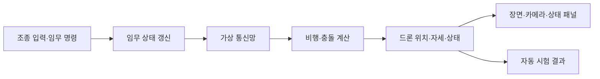

# 현재 기술 구조

이 글은 지금 코드가 한 Tick을 계산하고 화면에 보여 주는 흐름을 설명합니다. 앞으로 만들 기능은 [개발 목표](../../GOAL.md), 구현 여부와 시험 근거는 [현재 구현과 시험 상태](../../SPEC.md)에서 확인하세요.

## 한 번의 시뮬레이션 단계

시뮬레이션은 초당 60번 진행합니다. 각 계산을 `Tick`이라고 부릅니다. 화면 갱신은 고정 주기 계산과 따로 이뤄집니다.

화면 없는 시험은 렌더링을 건너뛰고 계산만 진행합니다. Viewer 시작 시험도 창이 열리는지만 확인하므로, 실제 화면 배치와 임무 전체 흐름은 따로 확인해야 합니다.

## 한 프로그램 안에서 돌아가는 구성

`DroneSim.exe` 한 프로세스가 시뮬레이션과 통합 화면을 실행합니다. 드론 여러 대와 가상 통신망도 이 프로세스 안에서 갱신합니다. 별도 GCS 프로그램을 실행하지 않아도 기본 장면과 조작 패널을 볼 수 있습니다.

현재 구현의 주요 책임은 다음과 같습니다.

| 영역 | 하는 일 |
| --- | --- |
| 시뮬레이터 앱 | 실행 창, 임무·장애 조작, 상태 패널을 구성합니다. |
| 시뮬레이션 코어 | 드론 상태, 임무 진행, 비행 제어와 물리 갱신을 맡습니다. |
| 가상 통신망 | 이웃 탐색, 라우팅, 메시지 전달·폐기, 양방향·방향별 링크 장애를 계산합니다. |
| 그래픽 | 3D 장면, 카메라 화면과 패널을 그립니다. |
| 미디어 | 네이티브 영상 녹화와 파일 전달 기능을 맡습니다. |

드론은 각각 임무 상태와 통신 상태를 갖지만 별도 프로세스나 실제 무선 기기로 실행되지는 않습니다. 통신 단절 시험은 가상망의 메시지 전달 여부를 바꾸는 방식입니다.

## 임무와 통신 메시지

전체 임무는 편대 이동(M01), 지점 정찰(M02), 재집결과 복귀(M03) 순서로 구성합니다. 리더가 경로와 목표를 조정하고, 다른 기체는 전달받은 경로를 수행합니다. 사람은 정찰 지점을 정하고, 드론은 그곳에서 영상과 위치 정보를 모읍니다. 이 구조는 한 프로그램 안에서 동작하는 논리적 군집 모의이며, 각 기체가 별도 컴퓨터에서 실행되는 분산 시스템은 아닙니다.

추종 기체는 6 Tick마다 위치·비행·임무 상태를 보고합니다. 리더는 30 Tick이 지난 보고를 오래된 정보로 봅니다. 편대 이동 중 상태 보고가 끊기면 리더는 통신 가능한 기체를 확인해 대체 리더를 정합니다. 후보가 없으면 임무를 중단하고 비행 중인 기체에 안전 착륙 명령을 보냅니다. 이 흐름과 전체 임무의 현재 시험 결과는 [현재 구현과 시험 상태](../../SPEC.md)에 기록합니다.

경로 확인 응답이 없으면 60 Tick마다 다시 보내며 최대 10회 시도합니다. 같은 경로가 다시 와도 진행 중인 목표를 처음부터 재시작하지 않습니다.

## 경로와 편대 전환

경로 탐색은 훈련장을 5m 간격 격자로 나누고 A*로 수행합니다. 편대 크기와 안전 여유를 고려해 건물 주변 격자를 막습니다. 요청한 대형으로 경로가 나오지 않으면 일렬 대형으로 다시 찾습니다.

통로에 들어가기 전 편대 간격을 줄이고, 통과한 뒤 공간이 충분하면 원래 대형으로 돌아옵니다. 드론별 목표 위치는 경로 진행에 따라 보간해 한 번에 급격히 바뀌지 않게 합니다. 이 계산이 모든 조건에서 충돌을 막는다고 보장하지 않으며, 안전거리 확인 결과는 [현재 구현과 시험 상태](../../SPEC.md)에 적었습니다.

## 리더 장애와 상태 보고

앱의 임무 관리 기능은 리더의 생존 메시지가 45 Tick 동안 오지 않으면 다른 기체에 확인 요청을 보내고, 응답한 기체를 새 리더로 정합니다. 리더가 지상통제소에 직접 닿지 않더라도 추종 기체가 최근 상태를 보고하고 있으면 리더 교체를 시작하지 않습니다. 새 리더는 보고받은 상태를 모아 경로를 다시 계산합니다.

시뮬레이터는 모든 기체의 실제 위치를 알지만, 임무 판단에는 전달받은 상태 보고를 사용합니다. 통신이 끊긴 기체의 현재 위치를 통제 화면이 계속 알고 있는 것처럼 다루지 않기 위한 구분입니다. 이 구조는 한 프로세스의 가상 시험이며, 분산 컴퓨터에서 독립적으로 실행되는 군집 시스템은 아닙니다.

## 가상 통신망

통신 방식은 임무를 시작하기 전에 고릅니다. 현재 네 방식은 같은 가상 링크와 메시지 전달 기능을 사용하지만, 중계 경로를 정하고 장애에 반응하는 규칙이 다릅니다.

| 방식 | 메시지 경로 | 링크가 끊겼을 때 |
| --- | --- | --- |
| 직접 통신 | 송신 드론에서 목적 드론으로 바로 전달합니다. | 두 기체가 직접 연결되지 않으면 전달하지 않습니다. |
| 리더 경유 | 송신·수신 드론 사이 메시지를 현재 리더를 통해 보냅니다. | 리더를 거치는 데 필요한 연결이 없으면 전달하지 않습니다. 리더가 바뀌면 새 리더를 기준으로 경로를 찾습니다. |
| 고정 다중 홉 | 처음 발견한 여러 기체 경로를 사용합니다. | 선택한 다음 연결이 끊기면 다른 길을 자동으로 찾지 않습니다. 모든 통신 장애를 복구하면 경로를 다시 사용할 수 있습니다. |
| 장애 적응 다중 홉 | 발견한 경로를 사용하고, 필요하면 다른 기체를 거칩니다. | 경로가 끊기거나 만료되면 새 경로를 탐색합니다. |

이웃은 거리와 건물 가림을 바탕으로 정합니다. 기본 시험 설정은 링크 거리 90m, 이웃 갱신 15 Tick, 이웃 만료 90 Tick, 경로 유효 기간 300 Tick, 최대 5홉입니다. 메시지에는 기본 지연을 적용하고, 설정한 최대 지터 안에서 난수 시드에 따라 추가 지연을 더할 수 있습니다. 시드가 같으면 같은 순서의 메시지에 같은 지연이 생깁니다. 화면에서 방식을 바꾸는 기능은 모든 드론이 지상에 있을 때만 사용할 수 있습니다.

이 값은 가상 훈련용 설정입니다. 화면에서 패킷 손실률과 기본 지연에 더할 최대 무작위 지연을 바꿀 수 있습니다. 지연 흔들림은 0부터 설정한 상한까지의 Tick 수로 적용하며, 60Hz 기준 1 Tick은 약 16.7ms입니다. 손실률과 지연은 통신망 전체에 적용하며 링크별 대역폭과 전송 대기열은 아직 모의하지 않습니다. 실제 주파수, 안테나 방향, 전파 간섭이나 무선 장비의 성능도 계산하지 않습니다. UI에는 라우팅 표와 최근 전달 패킷이 표시되지만, 완전한 네트워크 시간표·링크별 통계 화면은 아직 제공하지 않습니다.

장애 시험에서는 두 기체 사이 링크 전체를 끊거나 한 방향만 차단할 수 있습니다. 예를 들어 `A → B`만 막으면 `B → A` 전달은 계속될 수 있습니다. 선택한 기체의 라디오 전체를 끄는 시험, 패킷 손실률과 지연 흔들림 조정도 지원합니다. GUI에서 실행한 장애 조작은 모의 Tick과 함께 저장해 같은 임무 종류와 드론 구성에서 다시 적용할 수 있습니다. 임무 경로와 초기 상태까지 포함한 전체 재현은 아직 지원하지 않습니다.

## 비행과 좌표 기준

네이티브 제어기는 목표 위치와 현재 속도로 필요한 가속도를 구하고, 자세 오차와 각속도로 요구 토크를 계산합니다. 명령은 네 로터에 배분되어 AirSim으로 전달됩니다. AirSim이 추력·토크, 중력, 공기 저항, 이동과 접촉을 계산합니다.

웹 빌드에는 AirSim이 포함되지 않습니다. 웹은 단순화한 운동학 계산을 사용하므로 네이티브 결과와 같은 물리 모델로 비교할 수 없습니다.

시뮬레이터 월드는 동·북·위(ENU), 기체는 앞·왼쪽·위(FLU) 기준을 사용합니다. AirSim에 전달할 때는 북·동·아래(NED), 앞·오른쪽·아래(FRD) 기준에 맞게 축과 부호를 변환합니다. 위치뿐 아니라 자세, 로터 배치, 충돌 정보에도 같은 변환 기준을 적용해야 합니다.

## 장면·카메라·영상

OpenGL은 훈련장과 드론 카메라 화면을 그립니다. 카메라는 각 드론의 위치와 자세를 따라갑니다. 보이는 GLB와 물리 충돌 형상은 별도 데이터이므로 외형과 충돌 경계가 완전히 일치한다고 볼 수 없습니다.

실행 장면은 약 500m × 400m의 가상 산업·자연 복합 훈련장과 고정 배치한 장애물로 구성합니다. 탄천 자료는 기본 실행 장면에서 제외하고 자동 시험용으로만 둡니다. 따라서 이 장면은 실제 장소의 위치·높이나 시설물 배치를 나타내지 않습니다. 장면과 충돌 형상은 별도 자료이므로 둘이 정확히 겹치는지도 따로 확인해야 합니다.

네이티브 영상은 화면 표시와 별도로 녹화할 수 있습니다. 저장 영상은 MP4이고 촬영 시각·카메라 정보는 JSONL에, 프레임 수와 파일 확인값은 목록 파일에 기록합니다. 영상 파일을 지상통제소 화면에서 수신해 열람하는 기능은 아직 연결되지 않았습니다. OpenCV는 기본 영상 품질 지표를 계산하며, 사람이나 파손을 자동 탐지하지 않습니다.

## 기술을 선택한 이유

| 기술 | 맡은 일 | 선택 이유 |
| --- | --- | --- |
| C++20 | 시뮬레이션과 네이티브 앱 | 고정 주기 계산과 그래픽·물리 라이브러리를 한 코드베이스에서 연결합니다. |
| Flecs | 드론 상태 갱신 | 드론별 상태를 구성요소로 나누고 필요한 시스템에서 처리합니다. |
| AirSim | 네이티브 멀티로터 물리 | 로터 입력부터 강체 이동과 접촉 계산까지 맡깁니다. 웹에서는 사용하지 않습니다. |
| OpenGL·GLFW | 장면·카메라·창 | 네이티브와 WebGL 화면을 그리는 기반입니다. |
| Dear ImGui | 시뮬레이터 조작 화면 | 상태와 조작을 하나의 실행 창 안에 표시합니다. |
| GLM | 벡터·행렬·쿼터니언 | 공간·자세 계산에 공통 자료형을 사용합니다. |
| OpenCV | 영상 품질 지표 | 프레임의 밝기·대비·선명도 등을 계산합니다. |
| GStreamer | 영상 처리·저장·전송 | 코덱과 영상 파이프라인을 직접 구현하지 않고 검증된 미디어 요소를 연결합니다. |
| UDP | 통신 연동 시험 | 별도 지상통제 클라이언트와 메시지 규약을 시험하는 데 남아 있습니다. 기본 화면 조작은 시뮬레이터 안에서 합니다. |
| CMake | 빌드 구성 | 네이티브와 웹 빌드 설정을 관리합니다. |

## C++20 기능을 사용하는 곳

| 기능 | 코드에서 하는 일 |
| --- | --- |
| `std::jthread`, `std::stop_token` | 영상 처리·전달 작업 스레드의 종료를 요청하고 수명을 관리합니다. |
| `std::span` | 벡터·프레임 같은 연속 자료를 복사 없이 함수에 전달합니다. |
| `std::bit_cast`, `std::endian` | 지형 파일의 높이 자료와 바이트 순서를 해석합니다. |
| `std::numbers` | 각도 계산에 필요한 원주율을 사용합니다. |
| `std::lerp` | 높이와 경로 목표 사이 값을 보간합니다. |
| `std::erase_if` | 조건에 맞는 만료 이웃·경로·메시지를 지웁니다. |

코루틴과 C++ 모듈은 현재 코드에서 쓰지 않습니다. 각 기능의 확인 상태는 [현재 구현과 시험 상태](../../SPEC.md)에서 확인하세요.
