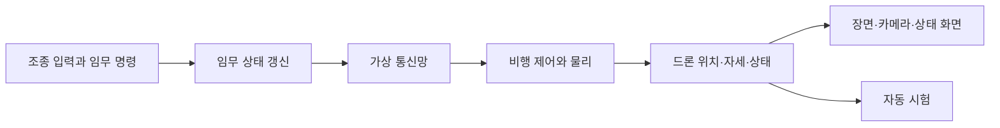

# 기술 구조

이 문서는 입력부터 드론 상태와 화면까지 계산이 이어지는 흐름을 설명합니다. 현재 되는 기능과 시험 범위는 [구현 현황](../../SPEC.md), 프로젝트가 만들려는 결과는 [개발 목표](../../GOAL.md)에서 확인하세요.

## 한 번의 시뮬레이션 단계

시뮬레이션은 초당 60번 고정된 간격으로 진행합니다. 이 한 번의 계산을 `Tick`이라고 부릅니다. 화면 갱신은 이 주기와 따로 진행합니다.

화면 없는 시험은 그래픽 처리를 건너뜁니다. 따라서 화면을 띄우는 시험과 비행·통신 계산만 하는 시험은 결과가 답하는 질문이 다릅니다.

## 프로그램 구성

시뮬레이터, 드론 여러 대, 임무 처리와 가상 통신망은 한 프로그램 안에서 동작합니다. 드론마다 별도 운영체제 프로세스나 실제 무선 장비를 실행하지 않습니다.

| 영역 | 책임 |
| --- | --- |
| 시뮬레이터 앱 | 창과 조작 화면을 만들고 임무·장애 명령을 전달합니다. |
| 시뮬레이션 코어 | 드론 상태, 임무 진행, 비행 제어와 물리 계산을 갱신합니다. |
| 가상 통신망 | 기체 사이 링크와 경로를 계산하고 메시지 전달·폐기를 처리합니다. |
| 그래픽 | 3D 장면, 드론 카메라와 화면 패널을 그립니다. |
| 미디어 | 네이티브 카메라 영상을 저장하고 촬영 정보를 기록합니다. |

이 경계 덕분에 화면 없는 시험은 시뮬레이션 코어를 실행하면서 그래픽 처리를 생략할 수 있습니다. 가상 통신망의 결과는 실제 무선 환경의 성능 측정값이 아닙니다.

## 임무와 메시지 흐름

전체 임무는 M01 편대 이동, M02 지점 정찰, M03 재집결·복귀 순서입니다. 리더는 경로와 정찰 목표를 나누고, 각 드론은 전달받은 목표를 수행합니다. 사람은 정찰 지점을 정하며 자동 영상 분석은 하지 않습니다.

중요 경로 명령은 수신 드론까지 도착했는지 확인하고, 응답을 받지 못하면 다시 보냅니다. 통신망의 응답은 앱이 명령을 적용했다는 뜻과 다르므로, 수신 앱의 적용 결과를 별도로 확인합니다. 일반 상태 메시지는 재전송 없이 전달을 시도합니다.

리더의 상태 보고가 끊기면 앱은 연결 후보를 확인합니다. 후보가 있으면 새 리더가 경로와 미완료 목표를 이어받습니다. 후보가 없으면 임무를 중단하고 비행 중인 드론에 착륙을 요청합니다. 리더 교체 시험의 연결 조건은 [구현 현황](../../SPEC.md)에 적힌 범위에 한정됩니다.

## 가상 통신 방식

네 방식은 같은 가상 링크와 메시지 전달을 사용하고, 경로를 고르는 방법만 다릅니다.

| 방식 | 경로 선택 | 연결이 끊겼을 때 |
| --- | --- | --- |
| 직접 통신 | 송신기와 수신기 사이 한 구간 | 직접 연결이 없으면 전달하지 않습니다. |
| 리더 경유 | 현재 리더를 거치는 경로 | 리더를 잇는 링크가 없으면 전달하지 않습니다. |
| 고정 다중 홉 | 처음 찾은 여러 기체 경로 | 선택한 경로가 끊겨도 다른 길을 찾지 않습니다. |
| 장애 적응 다중 홉 | 필요할 때 여러 기체를 거치는 경로 | 경로가 끊기거나 만료되면 다시 찾습니다. |

이웃 연결은 거리와 건물 가림으로 정합니다. 패킷 손실과 지연 흔들림은 시험 설정으로 적용합니다. 대기열 크기에는 상한이 있지만 송신 속도를 늦추는 혼잡 제어는 없습니다. 실제 주파수·안테나·전파 간섭·링크별 대역폭도 계산하지 않습니다.

## 비행 물리와 좌표

Windows 네이티브에서는 제어기가 목표 위치와 현재 속도로 필요한 가속도를 계산하고, 자세 오차와 각속도로 로터 명령을 만듭니다. AirSim이 로터 추력·토크, 중력, 공기 저항, 위치·자세 변화와 접촉을 계산합니다. 웹에서는 AirSim을 사용할 수 없어 단순화한 운동학 계산을 씁니다.

월드 좌표는 동·북·위(ENU), 기체 좌표는 앞·왼쪽·위(FLU)를 기준으로 합니다. AirSim에 값을 전달할 때는 북·동·아래(NED), 앞·오른쪽·아래(FRD) 기준으로 축과 부호를 바꿉니다. 위치, 자세, 로터 배치와 충돌 정보에 같은 변환 기준을 적용합니다.

네이티브와 웹은 서로 다른 비행 계산을 사용하므로 동일한 입력을 줘도 결과가 같다고 볼 수 없습니다. PX4 실제 비행과의 정확도 역시 별도로 검증해야 합니다.

## 장면·카메라·영상

OpenGL이 장면과 카메라 화면을 그립니다. 카메라는 선택한 드론의 위치와 자세를 따라갑니다. 화면에 쓰는 모델과 물리 충돌 모양은 별도로 구성할 수 있어 둘의 외곽이 일치하는지는 확인이 필요합니다.

현재 기본 장면은 절차 생성한 약 500m × 400m 가상 훈련장입니다. 실제 탄천을 나타내지 않습니다. 시험용 탄천 자료가 기본 장면에 연결되어 있지 않으며, 지도 정확도는 자동 시험으로 평가하지 않았습니다.

네이티브 EO 영상은 MP4로 저장하고 프레임 시각과 카메라 정보를 기록합니다. GCS로 영상을 전송해 재생하는 흐름은 연결되지 않았습니다. OpenCV는 밝기·대비·선명도 같은 영상 품질 값을 계산하며 사람이나 시설물 파손을 자동으로 찾지 않습니다.

## 사용 기술과 선택 이유

| 기술 | 맡은 일 | 선택한 이유 |
| --- | --- | --- |
| C++20 | 시뮬레이션과 네이티브 앱 | 고정 주기 계산과 물리·그래픽 라이브러리를 한 코드베이스에서 연결합니다. |
| Flecs | 드론 상태와 시스템 갱신 | 기체별 상태를 구성요소로 나누고 필요한 갱신 로직에서 조회합니다. |
| AirSim | 네이티브 멀티로터 강체 물리 | 로터 입력과 강체 이동·접촉 계산을 맡깁니다. 웹에서는 사용하지 않습니다. |
| OpenGL·GLFW | 3D 화면과 창 | 장면과 카메라를 그리는 기반입니다. |
| Dear ImGui | 비행·임무 조작 화면 | 시뮬레이터 창 안에 상태와 조작 패널을 만듭니다. |
| GLM | 벡터·행렬·쿼터니언 | 위치와 자세 계산에 공통 수학 자료형을 씁니다. |
| OpenCV | EO 영상 품질 값 | 기본 영상 지표를 계산합니다. 대상 자동 인식에는 쓰지 않습니다. |
| GStreamer | 영상 처리와 저장 | 영상 요소를 조합해 녹화 파이프라인을 구성합니다. |
| UDP | 통신 연동 시험 | 별도 지상통제 클라이언트와 메시지 규약을 시험할 때 사용합니다. |
| CMake | 빌드 구성 | 네이티브와 웹 구성을 관리합니다. |

## 사용하는 C++20 기능

| 기능 | 쓰임 |
| --- | --- |
| `std::jthread`, `std::stop_token` | 영상 작업 스레드의 종료 요청과 수명을 관리합니다. |
| `std::span` | 연속된 벡터·프레임 자료를 복사하지 않고 전달합니다. |
| `std::bit_cast`, `std::endian` | 지형 높이 파일의 값과 바이트 순서를 읽습니다. |
| `std::numbers` | 각도 계산에 쓸 원주율을 제공합니다. |
| `std::lerp` | 높이와 경로 목표 사이를 보간합니다. |
| `std::erase_if` | 조건에 맞는 만료 이웃·경로·메시지를 지웁니다. |

현재 코드는 코루틴과 C++ 모듈을 사용하지 않습니다. 기능의 시험 여부는 [구현 현황](../../SPEC.md)에서 확인하세요.
