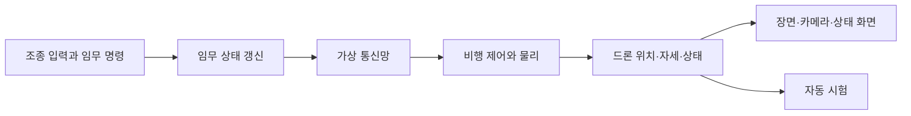

# 기술 구조

이 문서는 입력부터 드론 상태와 화면까지 계산이 이어지는 흐름을 설명합니다. 현재 되는 기능과 시험 범위는 [구현 현황](../../SPEC.md), 프로젝트가 만들려는 결과는 [개발 목표](../../GOAL.md)에서 확인하세요.

## 한 번의 시뮬레이션 단계

시뮬레이션은 초당 60번 고정된 간격으로 진행합니다. 이 한 번의 계산을 `Tick`이라고 부릅니다. 화면 갱신은 이 주기와 따로 진행합니다.

화면 없는 시험은 그래픽 처리를 건너뜁니다. 따라서 화면을 띄우는 시험과 비행·통신 계산만 하는 시험은 결과가 답하는 질문이 다릅니다.

## 프로그램 구성

시뮬레이터, 드론 여러 대, 임무 처리와 가상 통신망은 한 프로그램 안에서 동작합니다. 드론마다 별도 운영체제 프로세스나 실제 무선 장비를 실행하지 않습니다.

| 영역 | 책임 |
| --- | --- |
| 시뮬레이터 앱 | 창과 조작 화면을 만들고 임무·장애 명령을 전달합니다. |
| 시뮬레이션 코어 | 드론 상태, 임무 진행, 비행 제어와 물리 계산을 갱신합니다. |
| 가상 통신망 | 드론별 가상 포트로 거리·건물 가림·라디오 차단을 반영해 직접 메시지를 전달합니다. 운영체제 UDP 소켓은 사용하지 않습니다. |
| 그래픽 | 3D 장면, 드론 카메라와 화면 패널을 그립니다. |
| 카메라 화면 | 시뮬레이터가 그린 EO 화면을 같은 창의 카메라 패널에 보여 줍니다. 영상 전송은 하지 않습니다. |

이 경계 덕분에 화면 없는 시험은 시뮬레이션 코어를 실행하면서 그래픽 처리를 생략할 수 있습니다. 가상 통신망의 결과는 실제 무선 환경의 성능 측정값이 아닙니다.

## 임무와 메시지 흐름

전체 임무는 M01 편대 이동, M02 지점 정찰, M03 재집결·복귀 순서입니다. 리더는 경로와 정찰 목표를 나누고, 각 드론은 전달받은 목표를 수행합니다. 임무 판정과 드론 사이 상태 전달은 이름이 정해진 상태값을 씁니다. 화면에 보여 줄 때만 한국어 문구로 바꿉니다. 사람은 정찰 지점을 정하며 자동 영상 분석은 하지 않습니다.

정찰 경로 명령은 임무 코드가 일정 간격으로 다시 보냅니다. 수신 드론의 확인 메시지를 받으면 재전송을 멈춥니다. 통신망 자체에는 확인 응답이나 재전송 기능이 없습니다. 드론 상태 보고도 드론끼리 직접 연결된 경우에만 전달됩니다.

## 가상 통신 방식

가상 통신은 송신기와 수신기 사이에 직접 연결이 있을 때만 메시지를 전달합니다. 연결 가능 여부는 두 기체 사이 거리, 전원·라디오 상태, 링크 장애, 건물 가림으로 정합니다. 전송 지연은 설정된 Tick만큼 적용합니다. 연결이 없으면 새 메시지는 바로 실패하고, 전송 중 연결이 끊기면 도착할 때 버립니다.

중간 드론을 통한 전달, 경로 탐색, 무작위 패킷 손실, 지연 흔들림, 통신망 자체의 확인 응답·재전송은 지원하지 않습니다. 실제 무선 주파수·안테나·간섭·대역폭도 계산하지 않습니다. 직접 전달, 건물 가림, 링크·라디오 차단과 복구, 중계 없는 동작을 단위 시험에서 확인했고, 네 대 임무 통합 시험도 통과했습니다. 상세 범위는 [구현 현황](../../SPEC.md)에 적었습니다.

## 비행 물리와 좌표

네이티브와 웹 모두 제어기가 목표 위치와 현재 속도로 필요한 가속도를 계산하고, 자세 오차와 각속도로 로터 명령을 만듭니다. Jolt가 로터 추력·토크, 중력, 공기 저항, 위치·자세 변화와 접촉을 계산합니다. 운영체제와 컴파일러가 달라 계산 결과가 완전히 같다고 보장하지는 않습니다. 네이티브 Release는 확인했지만 웹 빌드는 아직 검증하지 않았습니다.

시뮬레이션 좌표는 동·북·위(ENU), 기체 좌표는 앞·왼쪽·위(FLU)를 기준으로 합니다. Jolt에 넘길 때는 엔진이 쓰는 축 방향에 맞춰 위치·자세·힘을 변환하고, 결과를 다시 시뮬레이션 좌표로 돌립니다. 로터 배치와 충돌 형상에도 같은 기준을 적용합니다.

네이티브와 웹은 서로 다른 비행 계산을 사용하므로 동일한 입력을 줘도 결과가 같다고 볼 수 없습니다. PX4 실제 비행과의 정확도 역시 별도로 검증해야 합니다.

## 장면·카메라·영상

OpenGL이 장면과 카메라 화면을 그립니다. 카메라는 선택한 드론의 위치와 자세를 따라갑니다. 화면에 쓰는 모델과 물리 충돌 모양은 별도로 구성할 수 있어 둘의 외곽이 일치하는지는 확인이 필요합니다.

현재 장면은 Sketchfab의 `Ruined city FREE (5)` 모형을 사용합니다. 제작자는 dasy444이며, 모델 원본은 [Sketchfab 페이지](https://sketchfab.com/3d-models/ruined-city-free-5-4b0b0021d91442079a91b075576efe4e)에서 확인할 수 있습니다. 사용자가 제공한 로컬 GLB는 크기를 10배 키운 상태이며 바닥판은 약 166m × 498m입니다. 시뮬레이터는 추가 확대 없이 이 크기로 표시하고 물리 지면과 충돌 범위도 맞춥니다. 원본 파일은 저장소에 들어 있지 않아 실행 환경에서 별도로 준비해야 합니다. Sketchfab 표준 사용 조건은 원본 3D 파일을 독립 파일로 재배포하는 일을 제한하므로, 저장소에는 지도 파일을 넣지 않습니다. 건물 충돌은 모형 조각의 범위를 상자로 근사합니다. 바닥은 GLB 원본 UV로 재질을 입힙니다. 원본 재질은 타일용이 아니라 교차로 그림 한 장이므로 임의로 반복하면 지면과 무늬가 어긋납니다. 현재는 반복하지 않아 무늬 배치는 보존하지만, 큰 지도에 늘어난 만큼 흐릿할 수 있습니다. 이 장면을 실제 장소의 정확한 복원으로 보아서는 안 됩니다.

EO 화면은 시뮬레이터가 장면을 카메라 시점으로 GPU에 다시 그려 같은 프로그램 안에 표시합니다. 웹 화면도 카메라 장면을 같은 페이지의 패널에 보여 줍니다. 다른 프로그램이나 네트워크로 영상을 보내지 않으며, 영상·사진 파일도 저장하지 않습니다. 사람이나 시설물 파손을 자동으로 찾는 영상 분석 기능은 두지 않았습니다.

## 사용 기술과 선택 이유

| 기술 | 맡은 일 | 선택한 이유 |
| --- | --- | --- |
| C++20 | 시뮬레이션과 네이티브 앱 | 고정 주기 계산과 물리·그래픽 라이브러리를 한 코드베이스에서 연결합니다. |
| Flecs | 드론 상태와 시스템 갱신 | 기체별 상태를 구성요소로 나누고 필요한 갱신 로직에서 조회합니다. |
| Jolt Physics | 네이티브·웹 강체 물리 | 로터 입력을 받은 기체의 이동·회전과 지면·장애물 접촉을 계산합니다. |
| OpenGL·GLFW | 3D 화면과 창 | 장면과 카메라를 그리는 기반입니다. |
| Dear ImGui | 비행·임무 조작 화면 | 시뮬레이터 창 안에 상태와 조작 패널을 만듭니다. |
| GLM | 벡터·행렬·쿼터니언 | 위치와 자세 계산에 공통 수학 자료형을 씁니다. |
| 가상 포트 | 드론 간 메시지 주소 | 운영체제 소켓 없이 모의 통신에서 드론 송수신 대상을 구분합니다. |
| CMake | 빌드 구성 | 네이티브와 웹 구성을 관리합니다. |

## 사용하는 C++20 기능

| 기능 | 쓰임 |
| --- | --- |
| `std::span` | 연속된 벡터·프레임 자료를 복사하지 않고 전달합니다. |
| `std::bit_cast`, `std::endian` | 지형 높이 파일의 값과 바이트 순서를 읽습니다. |
| `std::numbers` | 각도 계산에 쓸 원주율을 제공합니다. |
| `std::lerp` | 높이와 경로 목표 사이를 보간합니다. |
| `std::erase_if` | 사라진 드론의 라디오 차단 상태를 정리합니다. |

현재 코드는 코루틴과 C++ 모듈을 사용하지 않습니다. 기능의 시험 여부는 [구현 현황](../../SPEC.md)에서 확인하세요.
