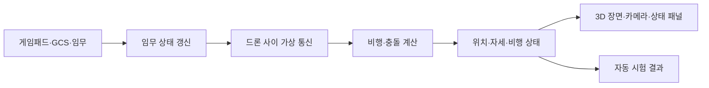

# 기술 구조와 계산 흐름

이 문서는 입력이 비행 계산과 통신을 거쳐 화면에 나타나는 과정을 설명합니다. 현재 구현과 시험 상태는 [기능 현황](../../SPEC.md), 실행 순서는 [실행 안내](시작하기.md)에서 확인하세요.

## 한 번의 시뮬레이션 단계

시뮬레이션은 초당 60번 진행합니다. 한 번의 계산을 `Tick`이라고 부릅니다. 화면 갱신은 이 고정 주기와 별도로 이뤄집니다.

화면 없는 시험은 렌더링을 생략하고 시뮬레이션을 진행합니다. Viewer 시작 시험은 창이 열리는지만 확인합니다. 임무 조작과 화면 품질은 별도로 살펴봐야 합니다.

## 임무와 메시지

전체 임무는 편대 이동(M01), 지점 분담 정찰(M02), 재집결과 복귀(M03)로 구성됩니다.

- M01에서 리더는 편대의 크기와 대형을 고려해 경로를 찾고, 추종 드론의 목표 위치를 계산해 전달합니다.
- M02와 M03에서는 리더가 각 드론의 경로를 정해 `fleet_route` 메시지로 보냅니다.
- 추종 드론은 경로 메시지를 받은 뒤 이동하고, 목적지에 도착하면 확인 응답을 보냅니다.
- 추종 드론은 6 Tick마다 위치와 비행·임무 상태를 보고합니다. 리더는 더 최신인 보고를 사용하고, 30 Tick이 지난 보고는 오래된 것으로 취급합니다.

경로 확인 응답이 없으면 60 Tick마다 다시 보내며 최대 10회 시도합니다. 같은 경로가 다시 와도 진행 중인 비행 목표를 처음부터 시작하지 않습니다. 현재는 한 프로세스가 시뮬레이션, 임무 상태, 가상 통신망을 함께 관리합니다. 각 드론이 별도 프로세스에서 메시지만 주고받는 구조는 아닙니다.

## 편대 경로와 좁은 통로

경로 탐색은 훈련장을 5m 간격의 격자로 나누고 A*로 시작점부터 목적지까지 찾습니다. 건물 외곽에서 편대 반경과 안전 여유만큼 떨어진 격자는 경로에서 제외합니다. 같은 길이라도 넓은 대형은 지나가지 못하고 좁은 대형은 통과할 수 있습니다.

요청한 대형으로 경로를 찾지 못하면 리더는 4m 간격의 일렬 대형으로 경로를 다시 찾습니다. 이 간격이 기체 반지름과 안전 여유로 정한 최소 간격보다 작으면 해당 경로를 쓰지 않습니다. 일렬 대형 경로를 찾으면 편대 중심을 따라 1m 간격으로 살펴, 요청한 대형이 안전하게 지나갈 수 있는 구간과 좁은 구간을 나눕니다. 넓은 구간에서는 요청한 대형을 유지하고 좁은 구간에 들어가기 전 10m 이상에 걸쳐 일렬 대형으로 줄입니다. 통로를 지난 뒤 여유 공간이 충분하면 다시 요청한 대형으로 펼칩니다.

추종 드론에는 전환 중인 위치를 통신 목표로 보냅니다. 대형이 한 번에 바뀌지 않도록 경로 진행 거리에 따라 목표 위치를 보간합니다. 리더가 바뀌면 원래 요청한 대형과 간격으로 경로를 다시 짭니다.

시험용 훈련장에서 열린 구간은 V자 대형, 좁은 통로는 4m 일렬 대형, 통과 뒤에는 V자 대형으로 돌아오는 경로를 확인했습니다. Viewer 스모크 시험은 창이 열리는지만 확인합니다. 실제 비행 중 드론 네 대가 안정적으로 대형을 바꾸는지는 아직 확인하지 않았습니다.

## 리더 응답이 끊겼을 때

지상통제소는 리더의 생존 메시지가 45 Tick 동안 도착하지 않으면 가상 통신망으로 다른 드론에 확인 요청을 보냅니다. 확인 응답이 돌아온 드론 가운데 먼저 응답한 기체를 새 리더로 지정합니다. 새 리더를 중심으로 드론 상태를 다시 모은 뒤, 기존 편대 경로를 다시 계산합니다. 정찰 중이던 리더가 맡은 지점은 다른 드론에 배정합니다.

기존 리더는 편대에서 빼고 시뮬레이터가 안전 착륙을 명령합니다. 후보 확인이나 상태 수집에 실패하면 남은 드론도 착륙시킵니다. 이 동작은 현재 한 프로세스 안에서 모의합니다. 기체마다 별도 비행 제어기가 독립적으로 안전 착륙을 수행하는 것은 아닙니다.

통신망 시험은 지상통제소와 드론 사이의 다중 홉 확인 요청·응답을 검증합니다. 앱 통합 시험은 네 대를 띄운 상태에서 리더 송수신을 끊고 새 리더 지정, 상태 수집과 정찰 지점 재배정까지 확인합니다. 응답할 드론이 없는 경우에는 비행 중인 드론을 착륙 상태로 전환하는 명령도 확인합니다. GUI 버튼 조작과 실제 착륙 완료까지 포함한 전체 임무 시연은 아직 확인하지 않았습니다.

## 실제 상태와 보고된 상태

시뮬레이션은 모든 드론의 실제 위치와 비행 상태를 계산합니다. 물리 계산과 통신 연결 여부를 판단할 때 이 값을 사용합니다. 반면 자동 임무의 리더는 추종 드론이 보낸 상태 보고로 편대 도착과 정찰 완료를 판단합니다. 보고가 없거나 오래되면 다음 단계로 넘어가지 않고 기다립니다.

이 구분으로 통신이 끊겼을 때 임무 판단에 필요한 정보가 사라지는 상황을 시험할 수 있습니다. 다만 전체 시스템이 분산 실행되는 것은 아니며, 장애를 넣은 앱 전체 임무의 복구는 아직 확인하지 않았습니다.

## 가상 통신망

통신망은 드론 사이 거리와 건물 가림을 보고 직접 연결할 수 있는 이웃을 찾습니다. 목적지까지 직접 닿지 않으면 다른 드론을 거쳐 메시지를 보냅니다. 연결이 끊긴 경로는 만료시키거나 다시 찾습니다.

경로 탐색은 AODV의 요청·응답 흐름을 참고합니다. 현재 시험값은 링크 거리 90m, 이웃 갱신 15 Tick, 이웃 만료 90 Tick, 경로 유효 기간 300 Tick, 최대 5홉입니다. 이 값은 가상 시험을 위한 설정입니다. 주파수, 안테나 방향, 전파 간섭, 실제 무선 장비의 성능은 계산하지 않습니다.

화면에서는 링크를 끊거나 드론의 송수신을 막고, 패킷 손실률을 조절할 수 있습니다. 이 조작은 전달 가능한 메시지를 바꾸지만, 실제 무선 통신의 품질을 보장하지는 않습니다.

## 비행 계산과 좌표

Windows 네이티브에서는 제어기가 목표 위치와 현재 속도로 필요한 가속도를 구하고, 자세 오차와 각속도로 요구 토크를 계산합니다. 계산한 명령을 네 로터에 배분해 AirSim에 전달합니다. AirSim은 로터 입력을 바탕으로 추력·토크, 중력, 공기 저항, 기체 이동과 접촉을 계산합니다.

웹에는 AirSim이 포함되지 않습니다. 웹에서는 더 단순한 운동학 계산을 사용하므로 웹과 네이티브의 비행 결과는 같은 물리 모델의 결과가 아닙니다.

시뮬레이터의 월드 좌표는 동·북·위(ENU), 기체 좌표는 앞·왼쪽·위(FLU)입니다. AirSim에 전달할 때는 북·동·아래(NED), 앞·오른쪽·아래(FRD) 기준으로 축과 부호를 바꿉니다. 위치뿐 아니라 자세, 로터 배치와 충돌 정보도 같은 기준에 맞춰야 합니다.

## 장면과 카메라

OpenGL은 훈련장과 EO 카메라 화면을 그립니다. GLB 모델은 화면에 보이는 모양을 제공하고, 충돌은 별도로 준비한 형상으로 계산합니다. 따라서 시각 모델과 충돌 경계가 완전히 같다고 볼 수 없습니다.

각 드론의 카메라는 해당 드론의 위치와 자세를 따라갑니다. OpenCV는 밝기·대비·선명도 같은 영상 지표를 계산합니다. 사람이나 시설물 파손을 자동으로 찾아내지는 않습니다. 카메라 영상은 화면에 표시되지만, 모든 드론의 영상과 위치 정보를 임무별 자료로 저장하고 지상통제소에 전달하는 흐름은 아직 연결되지 않았습니다.

현재 훈련장은 500m × 400m 범위의 수식 지형과 고정 배치한 시설물·자연물 GLB로 구성합니다. 실제 탄천의 DEM, 건물 외곽선, 높이 자료를 읽는 장면은 아닙니다. 따라서 이 장면으로 실제 도시에서의 위치 정확도를 검증할 수 없습니다.

## 주요 기술을 고른 이유

| 기술 | 맡은 일 | 선택한 이유 |
| --- | --- | --- |
| C++20 | 시뮬레이션·비행·통신·화면 | 고정 주기 계산과 네이티브 자원 관리를 한 코드베이스에서 처리합니다. |
| Flecs | 드론 상태와 반복 갱신 | 드론 상태를 기능별 데이터로 나누고 Tick마다 필요한 항목을 처리합니다. |
| AirSim | 네이티브 멀티로터 강체 계산 | 로터 입력부터 기체의 이동과 접촉까지 물리 계산을 맡깁니다. 웹에는 들어가지 않습니다. |
| OpenGL·GLFW | 3D 화면·창·입력 | 장면과 카메라를 그리고 창 입력을 받습니다. |
| Dear ImGui | 비행 상태와 조작 패널 | 별도 창을 늘리지 않고 시뮬레이터 안에 상태와 조작 UI를 둡니다. |
| GLM | 벡터·행렬·쿼터니언 | 좌표와 자세 계산에 공통 수학 자료형을 사용합니다. |
| OpenCV | 영상 품질 지표 | 카메라 프레임의 기본 화질 수치를 계산합니다. 객체 탐지에는 쓰지 않습니다. |
| GStreamer | 네이티브 영상 처리 | 영상 인코딩과 전송 경로에 사용합니다. |
| UDP | 별도 지상통제소 연결 | 시뮬레이터와 지상통제 프로그램 사이에서 명령과 상태를 주고받습니다. 드론 간 가상망과는 별도입니다. |
| CMake | 빌드 구성 | 네이티브와 웹 실행에 필요한 구성을 정리합니다. |

## C++20에서 사용하는 기능

| 기능 | 코드에서 맡는 일 |
| --- | --- |
| `std::jthread`, `std::stop_token` | 작업 스레드의 수명과 종료 요청을 관리합니다. |
| `std::span` | 연속된 데이터를 복사하거나 소유권을 넘기지 않고 함수에 전달합니다. |
| `std::bit_cast`, `std::endian` | 지형 자료의 비트 표현과 바이트 순서를 다룹니다. |
| `std::numbers` | 각도 계산에 필요한 원주율을 사용합니다. |
| `std::lerp` | 지형 높이와 경로 고도를 보간합니다. |
| `std::erase_if` | 조건을 만족하는 만료 항목을 컨테이너에서 제거합니다. |

코루틴과 C++ 모듈은 현재 주요 코드에서 사용하지 않습니다. 기술 선택과 현재 기능의 전체 범위는 [기능 현황](../../SPEC.md)을 함께 보세요.
