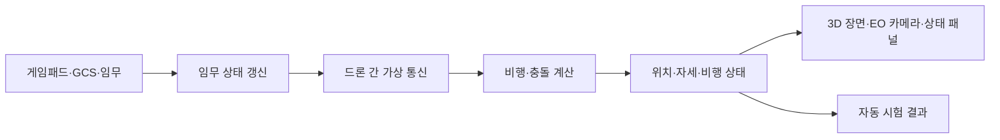

# 기술 구조와 기술을 고른 이유

이 문서는 한 번의 시뮬레이션 단계에서 입력, 비행 계산, 통신, 화면이 어떻게 이어지는지 설명합니다. 지금 되는 기능과 확인 범위는 [기능 현황](../../SPEC.md), 실행 방법은 [시작 안내](시작하기.md)에 있습니다.

## 한 번의 시뮬레이션 단계

시뮬레이션은 1초에 60번 진행합니다. 각 단계를 `Tick`이라고 부릅니다. 화면은 Tick과 별도 속도로 갱신합니다.

화면 없는 자동 시험은 렌더링을 제외한 시뮬레이션을 실행합니다. Viewer 스모크 시험은 창이 열리는지만 확인하므로 화면 배치나 임무 조작까지 검증하지 않습니다.

## 편대 임무와 경로 메시지

기준 규모는 X500 네 대입니다. 전체 임무는 편대 이동(M01), 지점 분담 정찰(M02), 재집결과 복귀(M03) 순서입니다.

- **M01:** 리더가 경로를 따라 이동합니다. 추종 드론은 리더가 보낸 편대 목표 메시지를 받아 목표 위치를 갱신합니다.
- **M02:** 리더가 미리 정한 정찰 지점을 나누고 각 추종 드론의 경로를 `fleet_route` 메시지로 보냅니다.
- **M03:** 재집결과 복귀 경로도 같은 메시지 전달 경로로 보냅니다.

메시지에는 임무 단계, 목표 번호, 경유점 좌표와 순서 번호가 들어갑니다. 추종 드론은 경로 메시지를 받은 뒤에 이동합니다. 현재는 경로를 한 번 전송하고 600 Tick 안에 도착하지 않으면 오류로 처리합니다. 임무 수준의 전달 확인 응답과 재전송은 아직 없습니다.

현재 프로그램은 한 프로세스 안에서 시뮬레이션, 임무 상태, 가상 통신망을 관리합니다. 리더가 경로를 계산할 때 다른 드론의 시뮬레이션 상태를 읽는 코드가 남아 있습니다. 따라서 메시지 전달이 이동에 영향을 주도록 연결했지만, 각 드론의 상태와 메시지 수신함이 완전히 독립된 분산 구조는 아닙니다.

## 가상 통신망

가상 통신망은 드론 사이 거리와 건물 가림을 바탕으로 직접 연결 가능한 이웃을 찾습니다. 이웃이 바뀌면 경로를 찾고, 메시지를 중계해 목적지까지 전달합니다. 연결이 끊긴 경로는 만료되거나 다시 탐색됩니다.

경로 탐색은 AODV의 요청·응답 흐름을 참고합니다. 현재 설정은 링크 거리 90m, 이웃 갱신 15 Tick, 이웃 만료 90 Tick, 경로 유효 기간 300 Tick, 최대 5홉입니다. 이는 가상 시험값이며 실제 통신 장비의 성능을 뜻하지 않습니다. 무선 주파수, 안테나 패턴, 간섭, 실제 패킷 전송은 계산하지 않습니다.

임무 중에는 통신 장애 패널의 **패킷 손실률**을 조절할 수 있습니다. 설정한 확률로 HELLO, 경로 탐색, 임무 메시지를 포함한 가상 패킷을 버립니다. 메시지 도착과 폐기 건수는 패널의 통신 사건에 반영됩니다. 임무 메시지에 대한 확인 응답과 재전송은 아직 구현하지 않았으므로, 높은 손실률에서 임무가 자동 복구된다고 볼 수 없습니다.

## 비행 계산과 좌표

Windows 네이티브는 AirSim에 로터 명령을 전달해 추력·토크, 중력, 공기 저항, 기체 이동과 접촉을 계산합니다. 자체 제어기는 목표 위치·속도와 현재 상태를 바탕으로 필요한 가속도와 자세를 계산하고, 이를 네 로터 입력으로 나눕니다.

웹 실행에는 AirSim이 들어가지 않습니다. 웹은 단순화한 운동학 계산을 사용하므로 웹과 네이티브 결과를 같은 물리 모델의 결과로 비교할 수 없습니다.

월드 좌표는 동·북·위(ENU), 기체 좌표는 앞·왼쪽·위(FLU)를 사용합니다. AirSim에 값을 전달할 때는 북·동·아래(NED), 앞·오른쪽·아래(FRD) 기준으로 축과 부호를 바꿉니다. 위치·자세뿐 아니라 로터 배치와 충돌 정보도 같은 기준으로 변환해야 합니다.

## 장면, 충돌, 카메라

훈련장은 산업시설과 자연물 에셋을 배치한 가상 공간입니다. 실제 탄천이나 특정 도시를 정확히 옮긴 지형·건물 데이터가 아닙니다.

GLB는 화면에 보이는 모델을 읽습니다. 충돌은 별도 형상으로 계산하므로 화면 메시와 충돌 면이 정확히 같지 않을 수 있습니다. 모든 표면을 정밀 메시 충돌체로 사용하지 않습니다.

OpenGL이 3D 장면과 EO 영상을 그립니다. EO 카메라는 주 드론의 위치와 탑재 방향을 따릅니다. OpenCV는 밝기·대비·선명도 같은 영상 품질 지표를 계산하지만, 사람이나 파손을 자동으로 찾지는 않습니다. GStreamer는 네이티브 영상 인코딩·전송 경로에서 사용합니다. 임무별 촬영 자료를 저장하고 지상통제소에 전달하는 전체 흐름은 아직 연결되지 않았습니다.

## 주요 기술을 고른 이유

| 기술 | 맡은 일 | 사용 이유와 범위 |
| --- | --- | --- |
| C++20 | 시뮬레이션·비행·통신·화면 | 고정 주기 계산과 네이티브 자원 관리를 한 언어로 구현합니다. 실제 사용하는 표준 기능은 아래에 적었습니다. |
| Flecs | 드론 상태와 Tick 작업 | 드론 상태 데이터를 컴포넌트로 나누고 반복 갱신합니다. |
| AirSim | 네이티브 멀티로터 강체 계산 | 로터 입력부터 기체 운동까지의 계산을 활용합니다. 웹에는 포함되지 않습니다. |
| OpenGL·GLFW | 3D 화면·창·입력 | 장면과 카메라를 렌더링하고 창 입력을 받습니다. |
| Dear ImGui | 상태 패널과 조작 UI | 시뮬레이터 화면 안에 상태와 조작 패널을 구성합니다. |
| GLM | 벡터·행렬·쿼터니언 | 렌더링과 비행 계산에서 같은 수학 자료형을 씁니다. |
| OpenCV | 영상 품질 지표 | 픽셀 영상의 기본 통계 계산을 맡깁니다. 객체 탐지에는 쓰지 않습니다. |
| GStreamer | 네이티브 영상 처리 | 영상 인코딩과 전송 파이프라인을 구성합니다. |
| UDP | 별도 지상통제소 통신 | 시뮬레이터와 지상통제 프로그램 사이에서 명령·상태 메시지를 주고받습니다. 드론 간 가상망과는 별도입니다. |
| CMake | 빌드 구성 | 네이티브와 웹 빌드에서 사용할 구성 요소를 나눕니다. |

### C++20 기능

| 기능 | 쓰임 |
| --- | --- |
| `std::jthread`, `std::stop_token` | 작업 스레드 수명과 종료 요청을 관리합니다. |
| `std::span` | 소유권을 넘기지 않고 연속된 데이터를 함수에 전달합니다. |
| `std::bit_cast`, `std::endian` | 지형 자료의 비트 해석과 바이트 순서를 다룹니다. |
| `std::numbers` | 각도 계산에서 원주율 상수를 사용합니다. |
| `std::lerp` | 지형 높이와 경로 고도를 보간합니다. |
| `std::erase_if` | 조건에 맞는 만료 항목을 컨테이너에서 지웁니다. |

코루틴이나 C++ 모듈은 현재 주요 코드에서 사용하지 않습니다. 이 표는 구현이 바뀌면 코드와 대조해 갱신해야 합니다.

## 적용 범위

현재 시험장은 가상 훈련 환경이며 실제 도시 지도나 실기체 운용 결과를 대신하지 않습니다. 자동 시험과 미검증 범위는 [기능 현황](../../SPEC.md), 과거 성능 측정과 원자료는 [성능 검증 기록](성능검증.md)에서 확인할 수 있습니다.
