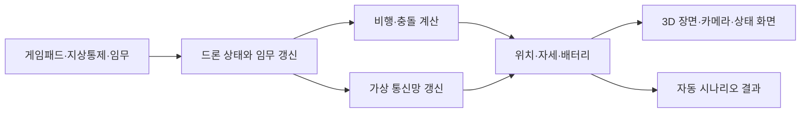

# 기술 구조와 선택 이유

이 문서는 시뮬레이션이 한 Tick 동안 어떻게 움직이는지, 주요 기술이 어디에 쓰이는지 설명합니다. 사용법은 [실행하고 조작하기](시작하기.md), 구현 여부는 [기능 현황](../../SPEC.md), 과거 시험값은 [성능 검증](성능검증.md)에서 확인하세요.

## 한 번의 시뮬레이션 흐름

시뮬레이션은 초당 60번 고정된 간격으로 진행합니다. 이 한 단계를 `Tick`이라고 부릅니다. 화면은 모니터와 컴퓨터 성능에 따라 다른 속도로 그릴 수 있습니다.

화면 없는 자동 시험도 같은 시뮬레이션 중심부를 실행합니다. 다만 자동 시험 통과만으로 실제 창의 배치나 조작이 확인되는 것은 아닙니다.

현재 기준 규모는 X500 네 대입니다. 별도 조작으로 편대 이동·분산 정찰·복귀를 각각 시작할 수 있고, 한 번에 잇는 전체 임무 시작 동작도 코드에 추가되어 있습니다. 이 동작은 M01 편대 이동 뒤 M02 정찰과 착륙을 진행하고, 공통 지점에서 재집결한 다음 출발 위치로 돌아가도록 연결합니다. 전체 흐름은 현재 작업본에서 창을 열어 끝까지 확인하지 않았으므로 완성된 기능으로 간주하지 않습니다.

## 비행과 좌표 기준

Windows 네이티브 실행은 AirSim에 네 로터의 입력을 전달해 모터 반응, 추력·토크, 중력, 공기 저항, 이동과 접촉을 계산합니다. 제어기는 목표 위치·속도와 현재 상태의 차이로 필요한 가속도를 구하고, 자세 오차와 각속도를 이용해 기체 회전 목표를 계산합니다. 계산한 힘과 토크는 네 로터에 나눠 전달합니다.

기체 제원과 모터 자료를 참고해 모델을 구성했습니다. 공개 PX4 비행 기록 한 건으로 입력 변환과 상태 차이를 확인했지만, 실제 비행을 정확히 재현했다고 볼 자료는 아닙니다. 입력 문제와 시험 한계는 [PX4 기록 재생 문제](문제해결/PX4-기록-재생-자세-차이.md)에 정리했습니다.

웹 실행에는 AirSim이 포함되지 않습니다. 웹은 단순화한 운동학 계산을 사용하므로, 웹과 네이티브 결과를 같은 물리 모델의 결과로 비교할 수 없습니다.

좌표 기준은 월드의 동·북·위(ENU), 기체의 앞·왼쪽·위(FLU)입니다. AirSim에 값을 넘길 때 북·동·아래(NED), 앞·오른쪽·아래(FRD) 기준으로 축과 부호를 변환합니다. 위치와 자세뿐 아니라 로터 배치와 충돌 정보에도 변환이 필요합니다.

## 드론 간 가상 통신

가상 통신망은 드론 사이 거리와 건물 가림을 이용해 직접 연결 가능한 이웃을 정합니다. 이웃 정보와 경로 요청·응답을 주고받아 여러 드론을 거치는 경로를 만듭니다. 연결이 끊기면 기존 경로를 무효화하고 다른 경로를 찾습니다.

경로 탐색은 AODV의 요청·응답 원리를 참고했습니다. 실제 주파수, 전파 간섭, 안테나, 무선 장비는 계산하지 않습니다. 거리와 가림을 바탕으로 만든 시험 모델이므로 실제 무선망의 성능을 뜻하지 않습니다.

화면에서 최근 네트워크 사건을 볼 수 있습니다. 사건 목록은 최근 64개를 메모리에 보관하며 파일로 저장하지 않습니다. 현재 가상망은 편대 이동과 전체 임무 진행 중 갱신되며 링크 장애를 주입할 수 있습니다. 다만 정찰 배정과 단계 전환은 앱의 임무 코드가 직접 처리합니다. 따라서 다중 홉 메시지가 정찰 배정이나 장애 뒤 재할당을 실제로 바꾼다는 점은 아직 입증되지 않았습니다.

## 장면, 충돌, 영상

훈련장은 산업시설과 자연물 에셋을 배치한 가상 공간입니다. 실제 탄천이나 특정 도시의 지형·건물 위치를 그대로 옮긴 장면은 아닙니다.

GLB는 화면에 보이는 모델을 읽는 데 사용합니다. 충돌은 별도로 준비한 단순 형상으로 계산하므로 보이는 모델과 부딪히는 면이 다를 수 있습니다. 화면 모델의 모든 표면을 정밀 충돌 메시로 사용하지 않습니다.

OpenGL이 장면과 EO 카메라를 그립니다. 카메라 영상은 드론의 위치와 탑재 방향을 따릅니다. OpenCV는 전달된 영상의 밝기·대비·선명도 같은 기본 지표를 계산합니다. 이 지표는 사람이나 시설물 파손을 찾아내는 AI 판정이 아닙니다.

네이티브에는 GStreamer를 사용하는 영상 인코딩·전송 경로가 있습니다. 모든 드론의 임무별 영상 수집·저장·GCS 전달을 전체 정찰 흐름에서 확인한 것은 아닙니다. 구현 범위는 [기능 현황](../../SPEC.md)을 기준으로 합니다.

## 주요 기술과 선택 이유

| 기술 | 맡은 일 | 선택한 이유와 현재 범위 |
| --- | --- | --- |
| C++20 | 시뮬레이션·비행·통신·화면 모듈 | 고정 주기의 계산과 네이티브 자원 관리를 한 언어에서 다룹니다. 사용하는 표준 기능은 아래에 정리했습니다. |
| Flecs | 드론 상태와 Tick 작업 관리 | 상태 데이터와 갱신 작업을 엔티티·컴포넌트·시스템으로 나눕니다. 현재 시험 기체는 네 대입니다. |
| AirSim | 네이티브 멀티로터 강체 계산 | 로터부터 기체 운동까지의 물리 계산을 직접 새로 구현하지 않고 사용합니다. 웹 실행에는 포함되지 않습니다. |
| OpenGL·GLFW | 3D 렌더링, 창과 입력 | 네이티브 화면·카메라·입력 연결을 처리합니다. |
| Dear ImGui | 상태 표시와 조작 패널 | 별도 GUI 프레임워크를 만들지 않고 시뮬레이터 창에 상태와 조작 요소를 배치합니다. |
| GLM | 벡터·행렬·쿼터니언 | 렌더링과 비행 계산에서 같은 수학 자료형을 사용합니다. |
| GStreamer | 네이티브 영상 인코딩·전송 | 영상 코덱과 전송 파이프라인을 직접 구현하지 않도록 합니다. |
| OpenCV | 영상 품질 지표 계산 | 픽셀 처리와 기본 영상 통계 계산을 라이브러리에 맡깁니다. 객체 탐지에는 사용하지 않습니다. |
| UDP | 지상통제 명령과 상태 전달 | 시뮬레이터와 별도 지상통제 프로그램 사이의 메시지 교환에 사용합니다. |
| CMake | 빌드와 의존성 구성 | Windows 네이티브와 웹에서 포함할 구성 요소를 나눕니다. |

### C++20에서 실제 사용하는 기능

C++20은 문법을 새로 보이게 하려는 선택이 아닙니다. 스레드 종료와 배열 범위를 표준 도구로 표현해 수명과 데이터 전달을 분명히 하려는 목적입니다.

| 기능 | 코드에서 하는 일 |
| --- | --- |
| `std::jthread`, `std::stop_token` | 영상·통신 작업의 스레드 수명과 종료 요청을 관리합니다. |
| `std::span` | 벡터 등의 데이터를 복사하지 않고 읽기 전용 범위로 전달합니다. 호출받은 쪽은 해당 메모리를 소유하지 않습니다. |
| `std::bit_cast` | 지형 파일의 정수 비트를 부호 있는 높이값으로 해석합니다. |
| `std::numbers` | 각도 계산에 필요한 원주율 상수를 사용합니다. |
| `std::endian` | 지형 자료의 바이트 순서를 확인합니다. |
| `std::lerp` | 지형 높이와 경로 고도를 두 값 사이에서 보간합니다. |
| `std::erase_if` | 조건에 맞는 만료 이웃·경로·요청 항목을 컨테이너에서 지웁니다. |

코루틴, 모듈, 템플릿 메타프로그래밍은 현재 주요 기능에 사용하지 않습니다. 확인한 표준 기능만 기록하며 새로운 기능 사용 여부는 코드가 바뀌면 갱신합니다.

## 검증 범위

자동 시험 결과와 미검증 항목은 [기능 현황](../../SPEC.md)에 모읍니다. 성능 수치는 조건이 맞는지 확인할 수 있도록 [성능 검증](성능검증.md)에 보관합니다. 주요 문제는 각각의 [문제 해결 기록](문제해결.md)에서 증상·확인 과정·수정·검증 범위를 설명합니다.
